# Windows AD Remote Administration Control Center — Enterprise Administration Suite
## Complete Operator Reference Manual & Architecture Guide (v3.0.0)
**Created & Developed by Askarali Mattummal**

> **📖 Two guides in one window**: this is the **🖥️ Main Application** tab of the User Guide. The **Network Monitor** (network device monitoring, the Network Coordinator service and WhatsApp alerting) has its own detailed guide in the **📡 Network Monitor** tab. This guide covers **Windows AD Remote Administration Control Center v3.0.0** along with **ADRC_IdleAgent v1.2.0**, **ADRC_MonitorCoordinator v1.0.0**, and **ADRC_DiskScanner v1.0.0**.

---

### 📑 Table of Contents
1. [Overview & Architecture](#1-overview--architecture)
2. [Launching & Portability](#2-launching--portability)
3. [User Interface, Navigation & Visual Indicators](#3-user-interface-navigation--visual-indicators)
4. [Complete Right-Click Smart Context Menu Reference Guide](#4-complete-right-click-smart-context-menu-reference-guide)
   - [A. Single Computer Context Menu (Full Directory)](#a-single-computer-context-menu-full-directory)
   - [B. Bulk Computers Context Menu (Multi-Device Operations)](#b-bulk-computers-context-menu-multi-device-operations)
5. [Remote Desktop Access & Session Management](#5-remote-desktop-access--session-management)
   - [A. Remote Shadow Session (Screen Mirroring)](#a-remote-shadow-session-screen-mirroring)
   - [B. Pre-Shadow Toast Alert Notification](#b-pre-shadow-toast-alert-notification)
   - [C. Standard Remote Desktop (RDP) & Console Session](#c-standard-remote-desktop-rdp--console-session)
   - [D. Quick Assist Remote Assistance](#d-quick-assist-remote-assistance)
   - [E. UAC Shadow Session Compatibility & Black Screen Remediation](#e-uac-shadow-session-compatibility--black-screen-remediation)
   - [F. Comparison Table of Connection Modes](#f-comparison-table-of-connection-modes)
   - [G. Remote Display Power & Screen Standby (Turn Off Monitor)](#g-remote-display-power--screen-standby-turn-off-monitor)
   - [H. Session-Safe Physical Mouse & Keyboard Input Lock](#h-session-safe-physical-mouse--keyboard-input-lock)
   - [I. Live Remote Desktop Status Probing & Dynamic Visual Indicator](#i-live-remote-desktop-status-probing--dynamic-visual-indicator)
   - [J. Live & Historical Remote Desktop (RDP) Sessions Monitor](#j-live--historical-remote-desktop-rdp-sessions-monitor)
6. [Interactive Remote Terminal Console (CMD & PowerShell)](#6-interactive-remote-terminal-console-cmd--powershell)
7. [Hardware Specs & Real-Time Performance Diagnostics Monitor](#7-hardware-specs--real-time-performance-diagnostics-monitor)
   - [A. Centralized IT Hardware & Workstation Inventory Report (Offline + Online)](#a-centralized-it-hardware--workstation-inventory-report-offline--online)
8. [Systems Administration & Controllers](#8-systems-administration--controllers)
   - [A. Remote Task Manager (Process Controller)](#a-remote-task-manager-process-controller)
   - [B. Remote Windows Services Controller & Print Spooler Fix](#b-remote-windows-services-controller--print-spooler-fix)
   - [C. Remote Startup Applications (Autorun Manager)](#c-remote-startup-applications-autorun-manager)
   - [D. Remote System Restore Point Manager](#d-remote-system-restore-point-manager)
   - [E. Remote Computer Management & Task Scheduler MMC Snap-ins](#e-remote-computer-management--task-scheduler-mmc-snap-ins)
   - [F. Enable Windows Server Task Manager Disk Performance Counters](#f-enable-windows-server-task-manager-disk-performance-counters)
   - [G. Rename Remote Computer](#g-rename-remote-computer)
   - [H. Edit / Set Computer Description in Active Directory](#h-edit--set-computer-description-in-active-directory)
9. [Installed Software Inventory & Silent Uninstaller](#9-installed-software-inventory--silent-uninstaller)
10. [Remote Windows Event Log Viewer & Security Audit Hub](#10-remote-windows-event-log-viewer--security-audit-hub)
11. [Remote Printers, Print Queue & Ink/Toner Level Telemetry](#11-remote-printers-print-queue--inktoner-level-telemetry)
12. [Per-User Printing Report & Fleet Consumption Analytics Studio](#12-per-user-printing-report--fleet-consumption-analytics-studio)
13. [Active Directory User Profile Inspector & Attribute Editor](#13-active-directory-user-profile-inspector--attribute-editor)
    - [A. Enterprise 360° AD User Profile Inspector (👤 View Profile)](#a-enterprise-360-ad-user-profile-inspector--view-profile)
    - [B. In-App Active Directory User Profile Editor (✏️ Edit Profile)](#b-in-app-active-directory-user-profile-editor--edit-profile)
    - [C. Bulk Active Directory User Profile Attributes Updater (📋 Bulk AD Update)](#c-bulk-active-directory-user-profile-attributes-updater--bulk-ad-update)
14. [Active Directory Account Security & Password Management](#14-active-directory-account-security--password-management)
    - [A. Active Directory Account Unlocker (🔓 Unlock User)](#a-active-directory-account-unlocker--unlock-user)
    - [B. Active Directory Password Reset (🔑 Reset Pass)](#b-active-directory-password-reset--reset-pass)
    - [C. Active Directory User Credentials Validation Tester (🔑 Test Login)](#c-active-directory-user-credentials-validation-tester--test-login)
    - [D. Password Expiration Date Inspection](#d-password-expiration-date-inspection)
    - [E. Active Directory User Password Expiration & Hygiene Management Studio](#e-active-directory-user-password-expiration--hygiene-management-studio)
    - [F. Windows LAPS Local Administrator Password Management](#f-windows-laps-local-administrator-password-management)
    - [G. BitLocker Drive Encryption & Recovery Keys](#g-bitlocker-drive-encryption--recovery-keys)
    - [H. User & Computer Effective Permissions & Access Audit (Check Permissions)](#h-user--computer-effective-permissions--access-audit-check-permissions)
    - [I. Active Directory Credential Leak & Breach Intelligence Checker (XposedOrNot)](#i-active-directory-credential-leak--breach-intelligence-checker-xposedornot)
15. [Local Computer Users & Security Manager](#15-local-computer-users--security-manager)
    - [A. Local Account Inventory & Management](#a-local-account-inventory--management)
    - [B. Creating Local Users (➕ Create Local User)](#b-creating-local-users--create-local-user)
    - [C. Resetting Local Passwords (🔑 Reset Password)](#c-resetting-local-passwords--reset-password)
    - [D. Secure User Deletion (🗑️ Delete User)](#d-secure-user-deletion--delete-user)
16. [Remote File Explorer Quick Links & Mapped Drives Manager](#16-remote-file-explorer-quick-links--mapped-drives-manager)
    - [A. Administrative Share & User Folder Quick Links](#a-administrative-share--user-folder-quick-links)
    - [B. Remote Mapped Network Drives Manager (Ctrl + D)](#b-remote-mapped-network-drives-manager-ctrl--d)
    - [C. Remote Disk Usage Analyzer & Storage Optimization Suite](#c-remote-disk-usage-analyzer--storage-optimization-suite)
17. [Customization, Automation & Software Deployment](#17-customization-automation--software-deployment)
    - [A. Silent Software & Script Deployer](#a-silent-software--script-deployer)
    - [B. Remote File & Script Transfer (Push to Remote PC)](#b-remote-file--script-transfer-push-to-remote-pc)
    - [C. Remote Group Policy Refresh (GPUpdate /force)](#c-remote-group-policy-refresh-gpupdate-force)
    - [D. Remote Group Policy Diagnostic Report Generator (GPResult HTML)](#d-remote-group-policy-diagnostic-report-generator-gpresult-html)
    - [E. Windows God Mode & Power Tweaks](#e-windows-god-mode--power-tweaks)
    - [F. Desktop Info HUD (BgInfo & Floating Companion Widget)](#f-desktop-info-hud-bginfo--floating-companion-widget)
    - [G. Remote Desktop Wallpaper Changer & Manager](#g-remote-desktop-wallpaper-changer--manager)
    - [H. Remote Screen Saver Configuration](#h-remote-screen-saver-configuration)
    - [I. Windows Win32 Long Path Support Manager](#i-windows-win32-long-path-support-manager)
    - [J. Automatic RPC Service Deployment & Firewall Configuration](#j-automatic-rpc-service-deployment--firewall-configuration)
    - [K. Workstation Fleet Debloater & Privacy Studio](#k-workstation-fleet-debloater--privacy-studio)
18. [Inactivity & Idle Monitor Agent (Enterprise Feature)](#18-inactivity--idle-monitor-agent-enterprise-feature)
    - [A. Telemetry Architecture & Capabilities Matrix (With vs. Without Inactivity Agent)](#a-telemetry-architecture--capabilities-matrix-with-vs-without-inactivity-agent)
    - [B. Local User vs. Active Directory Domain User Account Identification](#b-local-user-vs-active-directory-domain-user-account-identification)
    - [C. Multi-Session Prioritization & Fast User Switching Alignment](#c-multi-session-prioritization--fast-user-switching-alignment)
    - [D. Rapid Shutdown & Restart Detection](#d-rapid-shutdown--restart-detection)
19. [Network Diagnostics & Connectivity Tools](#19-network-diagnostics--connectivity-tools)
    - [A. Ping Host & Latency Query (Ctrl + P)](#a-ping-host--latency-query-ctrl--p)
    - [B. Remote Network & IP Configuration Manager](#b-remote-network--ip-configuration-manager)
    - [C. DNS Name Resolution & Reverse Lookup (nslookup)](#c-dns-name-resolution--reverse-lookup-nslookup)
    - [C.1. DNS Zone Transfer (AXFR) Leak Audit & Security Probe](#c1-dns-zone-transfer-axfr-leak-audit--security-probe)
    - [D. Flush Remote DNS Resolver Cache](#d-flush-remote-dns-resolver-cache)
    - [E. One-Click Network Repair & Reset](#e-one-click-network-repair--reset)
    - [F. Enable Remote ICMP Ping Echo (Windows Firewall)](#f-enable-remote-icmp-ping-echo-windows-firewall)
    - [G. Remote Browser URL & Application Launcher](#g-remote-browser-url--application-launcher)
    - [H. Remote Network Profile Manager (Public / Private Network Switch)](#h-remote-network-profile-manager-public--private-network-switch)
    - [H.2. Advanced Multi-Target Ping & Network Connectivity Diagnostic Studio](#h2-advanced-multi-target-ping--network-connectivity-diagnostic-studio)
    - [I. Quick Port Status Check & TCP Socket Diagnostic (Test-NetConnection)](#i-quick-port-status-check--tcp-socket-diagnostic-test-netconnection)
    - [J. Find Open Ports (Fast Multi-Port Scanner)](#j-find-open-ports-fast-multi-port-scanner)
    - [K. Enterprise Subnets & Multi-VLAN Scope Manager (Optional Discovery Scope)](#k-enterprise-subnets--multi-vlan-scope-manager-optional-discovery-scope)
    - [L. Fleet IP & Active Directory DNS Discrepancy Analyzer](#l-fleet-ip--active-directory-dns-discrepancy-analyzer)
    - [M. One-Click Authoritative DNS Reconciliation & Verification (Static IP & DHCP)](#m-one-click-authoritative-dns-reconciliation--verification-static-ip--dhcp)
    - [N. Autonomous IP Mode Detection & Network Adapter Configuration](#n-autonomous-ip-mode-detection--network-adapter-configuration)
    - [O. Silent Per-User PC Internet Bandwidth Limiter (Upload & Download Control)](#o-silent-per-user-pc-internet-bandwidth-limiter-upload--download-control)
    - [P. Driverless Per-Process Network Bandwidth & QoS Monitor](#p-driverless-per-process-network-bandwidth--qos-monitor)
    - [Q. 5-Stage RPC, WMI & Remote Management Diagnostic Studio](#q-5-stage-rpc-wmi--remote-management-diagnostic-studio)
20. [Network Monitor (Network Device Monitoring & WhatsApp Alerting)](#20-network-monitor-network-device-monitoring--whatsapp-alerting) — full guide in the **📡 Network Monitor** tab
    - [A. What the Network Monitor Does](#a-what-the-network-monitor-does)
    - [B. Where to Find It](#b-where-to-find-it)
    - [C. What the Network Monitor Tab Covers](#c-what-the-network-monitor-tab-covers)
21. [Active Directory Server & Workstation Management Suites](#21-active-directory-server--workstation-management-suites)
    - [A. Windows Server Health Monitoring & Auto-Detect Recommendations (5-State Engine across 8 Domains)](#a-windows-server-health-monitoring--auto-detect-recommendations-5-state-engine-across-8-domains)
    - [B. Multi-Homed Domain Controller Network Binding & Interface Isolation](#b-multi-homed-domain-controller-network-binding--interface-isolation)
    - [C. Safe 1-Click Administrative Remediation, Reversible Rollback & HTML Export](#c-safe-1-click-administrative-remediation-reversible-rollback--html-export)
    - [D. SMB Shared Folder Permissions, Domain Performance & Health Activity Log](#d-smb-shared-folder-permissions-domain-performance--health-activity-log)
    - [E. Multi-Server Health & Configuration Drift Comparison](#e-multi-server-health--configuration-drift-comparison)
    - [F. Interactive Server Topology & Infrastructure Discovery Map](#f-interactive-server-topology--infrastructure-discovery-map)
    - [F.1. Active Directory Multi-DC Health & Replication Command Center](#f1-active-directory-multi-dc-health--replication-command-center)
    - [G. Active Directory, Replication, DNS, SYSVOL, FSMO & DHCP Infrastructure Management](#g-active-directory-replication-dns-sysvol-fsmo--dhcp-infrastructure-management)
    - [H. Time Synchronization (NTP) & Critical Active Directory Services](#h-time-synchronization-ntp--critical-active-directory-services)
    - [I. IIS Web Server Management Studio (Websites, App Pools, SSL, Logs & Backups)](#i-iis-web-server-management-studio-websites-app-pools-ssl-logs--backups)
    - [J. Hyper-V Virtualization Management Console](#j-hyper-v-virtualization-management-console)
    - [K. Remote Server Administration Suite & Server-to-Server Connectivity Matrix](#k-remote-server-administration-suite--server-to-server-connectivity-matrix)
    - [L. Server Security & Compliance Assessment (Hardening Auditor & Kerberos Tools)](#l-server-security--compliance-assessment-hardening-auditor--kerberos-tools)
    - [L.1. GPO Baseline Studio (Automated Policy Importer & Exporter)](#l1-gpo-baseline-studio-automated-policy-importer--exporter)
    - [L.2. Attack Surface Reduction (ASR) Rules Audit & Policy Studio](#l2-attack-surface-reduction-asr-rules-audit--policy-studio)
    - [M. Print Server & Spooler Management (Queues, Corrupted Jobs & Service Recovery)](#m-print-server--spooler-management-queues-corrupted-jobs--service-recovery)
    - [N. Workstation Management & Diagnostics (Health Audit, Temp Cleanup, Network Reset & Spooler Purge)](#n-workstation-management--diagnostics-health-audit-temp-cleanup-network-reset--spooler-purge)
22. [Remote Power Actions & Scheduled Task Operations](#22-remote-power-actions--scheduled-task-operations)
    - [A. Immediate Remote Power Actions](#a-immediate-remote-power-actions)
    - [B. Enterprise Power Confirmation & Change-Management Reason Selection](#b-enterprise-power-confirmation--change-management-reason-selection)
    - [C. Dynamic Multi-Selection Badges & Bulk Action Counts](#c-dynamic-multi-selection-badges--bulk-action-counts)
    - [D. Interactive Domain Selector & Custom Forest Discovery](#d-interactive-domain-selector--custom-forest-discovery)
    - [E. Remote Workstation Lock & Unlock Controller & Direct Credential Session Unlock](#e-remote-workstation-lock--unlock-controller--direct-credential-session-unlock)
    - [F. Scheduled Remote Power Operations (Reboot, Shutdown, Sleep, Hibernate, Logoff, Lock)](#f-scheduled-remote-power-operations-reboot-shutdown-sleep-hibernate-logoff-lock)
23. [Deep Temporary Files Cleaner (4-Path Cleanup)](#23-deep-temporary-files-cleaner-4-path-cleanup)
24. [Reverse-Chronological Activity Audit Log & Notification Broadcasts](#24-reverse-chronological-activity-audit-log--notification-broadcasts)
    - [A. Endpoint Activity Audit Log](#a-endpoint-activity-audit-log)
    - [B. Toast Notifications & In-App Broadcast Studio with Read Receipts](#b-toast-notifications--in-app-broadcast-studio-with-read-receipts)
25. [Release Notes Viewer & Version Update Verification](#25-release-notes-viewer--version-update-verification)
26. [Universal Keyboard Shortcuts](#26-universal-keyboard-shortcuts)
27. [Group Policy, Firewall & Endpoint Setup Guide](#27-group-policy-firewall--endpoint-setup-guide)
    - [A. Desktop Shadow Architecture & Operating Mechanics](#a-desktop-shadow-architecture--operating-mechanics)
    - [B. Domain Prerequisites & Environmental Requirements](#b-domain-prerequisites--environmental-requirements)
    - [C. Step-by-Step Group Policy (GPO) Setup Guide in GPMC](#c-step-by-step-group-policy-gpo-setup-guide-in-gpmc)
    - [D. Automated Domain GPO Deployment via PowerShell (Deploy_Domain_Shadow_GPO.ps1)](#d-automated-domain-gpo-deployment-via-powershell-deploy_domain_shadow_gpops1)
    - [E. Endpoint Configuration Script Reference (Configure_Endpoint_GPO.ps1)](#e-endpoint-configuration-script-reference-configure_endpoint_gpops1)
    - [F. Execution Model Comparison: Manual GPO vs. Endpoint Script vs. Application Engine](#f-execution-model-comparison-manual-gpo-vs-endpoint-script-vs-application-engine)
    - [G. Policy Application, Verification & Troubleshooting Runbook](#g-policy-application-verification--troubleshooting-runbook)
28. [Enterprise Security & Role-Based Access Governance](#28-enterprise-security--role-based-access-governance)
    - [A. Application Lockout Screen, Unlock Requests & Internet Connection Requirement](#a-application-lockout-screen-unlock-requests--internet-connection-requirement)
29. [Cloud Documentation, WhatsApp Credential Protection & Monitoring Controls](#29-cloud-documentation-whatsapp-credential-protection--monitoring-controls)
    - [A. Centralized Tab-Based Release Notes Suite & GitHub Cloud Documentation](#a-centralized-tab-based-release-notes-suite--github-cloud-documentation)
    - [B. Secured WhatsApp Alerting Credentials & System Hardening](#b-secured-whatsapp-alerting-credentials--system-hardening)
    - [C. Streamlined Monitoring Bulk Controls & Column Hierarchy](#c-streamlined-monitoring-bulk-controls--column-hierarchy)
    - [D. Active Directory Cache Management & First-Time Startup Optimization](#d-active-directory-cache-management--first-time-startup-optimization)
    - [E. Refresh Active Directory (F5 / Ctrl + R) & Visual Feedback](#e-refresh-active-directory-f5--ctrl--r--visual-feedback)
    - [F. Shift + F5 – Reset Application Cache](#f-shift--f5--reset-application-cache)
    - [G. Intelligent Non-Windows Appliance Discovery & Zero-Delay Startup Engine](#g-intelligent-non-windows-appliance-discovery--zero-delay-startup-engine)
30. [Supporting Tools & External Modules Manager (Automatic Detection & GitHub Sync)](#30-supporting-tools--external-modules-manager-automatic-detection--github-sync)
    - [A. Self-Contained Architecture & Automatic Module Detection](#a-self-contained-architecture--automatic-module-detection)
    - [B. Official GitHub Download Pipeline & SHA-256 Integrity Verification](#b-official-github-download-pipeline--sha-256-integrity-verification)
    - [C. On-Demand Feature Preparation & Offline Resilience](#c-on-demand-feature-preparation--offline-resilience)
    - [D. Supporting Tools & Modules Manager Console](#d-supporting-tools--modules-manager-console)
    - [E. Step-by-Step Operational Workflows](#e-step-by-step-operational-workflows)
31. [Active Directory Assessment Suite (11 Security, Health, Topology & GPO Audits)](#31-active-directory-assessment-suite-11-security-health-topology--gpo-audits)
    - [A. Assessment Hub & Multi-Auditing Architecture](#a-assessment-hub--multi-auditing-architecture)
    - [B. Complete Active Directory Audit Suite (All-In-One Master Report)](#b-complete-active-directory-audit-suite-all-in-one-master-report)
    - [C. Forest & Domain Overview](#c-forest--domain-overview)
    - [D. Forest Topology & Replication Matrix](#d-forest-topology--replication-matrix)
    - [E. Group & Organizational Unit Structure Analysis with IDFix](#e-group--organizational-unit-structure-analysis-with-idfix)
    - [F. Domain Trust Relationships & Security Posture](#f-domain-trust-relationships--security-posture)
    - [G. Domain Controller Hardware & OS Inventory](#g-domain-controller-hardware--os-inventory)
    - [H. Domain Controller Security Posture & Hardening](#h-domain-controller-security-posture--hardening)
    - [I. Active Directory DNS Health & Zone Diagnostics](#i-active-directory-dns-health--zone-diagnostics)
    - [J. Account Security & Credential Hygiene Audit](#j-account-security--credential-hygiene-audit)
    - [K. Group Policy Object Analyzer & Conflict Detection](#k-group-policy-object-analyzer--conflict-detection)
    - [L. Forest-Wide Member Server Inventory & Lifecycle Tracking](#l-forest-wide-member-server-inventory--lifecycle-tracking)
    - [M. Server Access & Management Port Diagnostic Companion (Test-ServerAccess)](#m-server-access--management-port-diagnostic-companion-test-serveraccess)
    - [N. Background Execution, Live Console & Progress Tracking](#n-background-execution-live-console--progress-tracking)
    - [O. Native WADRACC Executive HTML Report Generation & Directory Architecture](#o-native-wadracc-executive-html-report-generation--directory-architecture)
    - [P. Upstream GitHub Repository Monitoring, Sync & Safe Rollback Manager](#p-upstream-github-repository-monitoring-sync--safe-rollback-manager)
32. [Community, Technical Support & Feedback](#32-community-technical-support--feedback)
    - [A. Submitting In-App Technical Support & Feedback](#a-submitting-in-app-technical-support--feedback)
    - [B. Official Support & Community Channels](#b-official-support--community-channels)
33. [Independent Window Management & Multitasking Architecture](#33-independent-window-management--multitasking-architecture)
    - [A. Decoupled Modeless Multi-Window Architecture](#a-decoupled-modeless-multi-window-architecture)
    - [B. Concurrent Administrative Multi-Tasking Workflows](#b-concurrent-administrative-multi-tasking-workflows)
    - [C. Multi-Instance vs. Thread-Safe Single-Instance Refocus](#c-multi-instance-vs-thread-safe-single-instance-refocus)
    - [D. True Non-Blocking Background Workloads](#d-true-non-blocking-background-workloads)
    - [E. Operational Considerations & Boundaries](#e-operational-considerations--boundaries)

---

### 1. Overview & Architecture

**Windows Active Directory Remote Administration Control Center** (v3.0.0) is a standalone, high-performance Windows systems administration and remote assistance suite built specifically for Active Directory Domain Administrators, Systems Engineers, and IT Helpdesk specialists.

Unlike commercial remote assistance tools that require installing proprietary background services or paying recurring cloud subscriptions, Windows AD Remote Administration Control Center operates **100% agentlessly**. It interacts natively with Windows endpoints using standard enterprise protocols:
- **Active Directory / LDAP (ADSI)**: Discovers all domain-joined workstations and servers in real-time.
- **Terminal Services APIs**: Initiates Remote Shadow sessions and RDP console attachments.
- **Windows Management Instrumentation (WMI / DCOM / RPC)**: Executes remote commands, inspects hardware sensors, queries installed software across all user profiles, manages services, and controls processes.
- **Windows Event Log RPC**: Streams live event records reverse-chronologically.
- **SMB Administrative Shares (C$)**: Enables 1-click folder navigation and administrative file cleanup.
- **ICMP & ARP**: Performs concurrent real-time ping latency and MAC address resolution.
- **Simultaneous Multi-Window Operations**: All secondary workspaces, diagnostics suites (Remote Task Manager, Hardware Diagnostics, Remote Disk Usage Analyzer, Services, Event Viewer, Server Health), and pop-up dialogs operate as top-level windows. Each window maintains its own taskbar button, Alt+Tab presence, and non-blocking background thread pool, allowing administrators to minimize, maximize, restore, or close any window without minimizing or closing the main dashboard or other open tools.

---

### 2. Launching & Portability

#### Single-File Native Executable
Launch the application simply by executing:
```text
"Windows Active Directory Remote Administration Control Center.exe"
```
Or use the launcher batch file (which automatically launches the versioned executable):
```text
Run_AD_Remote_Control.bat
```

#### Zero External Dependencies
**Windows Active Directory Remote Administration Control Center.exe** is compiled as a self-contained 64-bit Windows executable with the application icon and user guide embedded directly within the binary. You can copy the single .exe file to your Desktop, an IT management jump box, or a read-only network share (\\Domain\SYSVOL\IT_Tools\). No installers or third-party DLLs are required.

#### Structured Package Architecture
When extracting or deploying the public release package, assets are organized into dedicated subdirectories:
- **Release Root**: Contains the primary executable (Windows AD Remote Admin Control Center v3.0.0.exe), the 1-click convenience launcher (Run_AD_Remote_Control.bat), cryptographic integrity hashes (CHECKSUMS.txt), and quick start notes.
- **Documentation/**: Complete administrator reference manuals, version changelogs, architecture documentation, and software license files.
- **Tools/**: Auxiliary endpoint utilities, including the Activity & Inactivity Monitor Agent (ADRC_IdleAgent.exe).
- **PS Scripts/**: Automated domain deployment scripts, including the Group Policy and Windows Firewall setup utility (Configure_Endpoint_GPO.ps1).
- **Images/**: High-resolution interface previews and branding assets.

---

### 3. User Interface, Navigation & Visual Indicators

#### Top Header & Navigation Bar
- **🌓 Theme Selection Menu (🌓 Auto / 🌙 Dark / ☀️ Light)**: Dynamically switches the entire application theme between Auto (follows Windows system setting), Dark Mode, and Light Mode.
- **📊 IT Hardware & Workstation Inventory Report (📊 IT Inventory)**: Opens the offline-capable IT asset inventory center (`Ctrl + Shift + I`) displaying all registered domain computers—including powered-off, disconnected, and on-leave workstations—with multi-sheet Excel, CSV, and customizable interactive HTML/PDF export.
- **🏷️ Release Notes & Version History (🏷️ Release Notes)**: Opens the centralized 4-tab Release Notes viewer (Main Application, Idle Agent, Network Monitor Coordinator, and Disk Analyzer) with instant cached loading, silent background GitHub sync, and an integrated **🚀 Check for Updates** button.
- **💬 Technical Support & User Feedback (💬 Support/Feedback)**: Provides one-click access cards for official WhatsApp, Telegram, and GitHub support channels, satisfaction ratings, suggestions, and technical support requests with optional one-click Activity Log error extraction.
- **📜 Endpoint Activity Audit Log (📜 Activity Log)**: Opens the reverse-chronological administrative action audit trail.
- **📖 In-App User Guide (📖 User Guide)**: Opens the searchable two-tab reference manual (**🖥️ Main Application** and **📡 Network Monitor**) with cache-first instant loading, background GitHub sync preserving your scroll position, copy-to-clipboard, and plain-text Notepad export.
- **📡 Network Monitor (Ctrl + Shift + M)**, **🛡️ AD Assessment (Ctrl + Shift + A)** & **🔄 Refresh AD (F5 / Shift + F5)**: Launches the 24/7 Network Device Monitoring center, the 11-module Active Directory Assessment Studio, or refreshes Active Directory computer inventory and live endpoint telemetry.

#### Authoritative Computer Identity & Real-Time IP/Hostname Synchronization Engine

The application includes an autonomous endpoint identity verification engine that ensures computer names and network IP addresses remain perfectly matched at all times:

1. **Physical Machine Identity Verification**:
   - Before an endpoint is displayed with an IP address in the workstation directory or search results, the system queries the responding device directly to verify its true computer name.
   - If a network IP responds to ping, but the device answering is actually a different computer (for example, an expired DHCP lease where another PC has taken the IP address), the application immediately flags the discrepancy, unbinds the stale IP address, and marks the offline computer as Offline (Stale IP).
   - Mismatched computer names and phantom online statuses are completely prevented.

2. **Automatic Handling of DHCP Leases, Static IP Changes & Stale/Missing DNS Records**:
   - Workstations switching between Wi-Fi and wired Ethernet, receiving newly renewed DHCP addresses, undergoing static IP reconfigurations, or operating with outdated/missing Active Directory DNS records are automatically discovered across reachable LAN subnets and matched by verified computer identity.
   - Because user sessions and agent checks connect directly to the verified machine address whenever DNS disagrees, stale or colliding DNS records can never pull another computer's session data, and local resolver caches are cleared automatically before queries.

3. **Computer Name & Hostname Change Auto-Detection**:
   - When a computer is renamed in Active Directory or updated locally, the change is tracked by permanent Active Directory object identifier.
   - Clicking **Refresh AD** or running a **Rescan Ping** updates the device name and DNS host name instantly across all views.

4. **Fleet IP Deduplication**:
   - Guarantees that no two computers in the directory can ever display the same IP address simultaneously.
   - If an IP address is confirmed active on Computer A, any historical assignment of that IP on Computer B is immediately cleared to prevent duplicate entries.

5. **Automated Background Fleet Watchdog**:
   - In addition to manual **Refresh AD** and **Rescan Ping** actions, a continuous 3-minute background audit cycle monitors endpoints and keeps network addresses, online presence, and workstation states continuously synchronized.

#### Workstation State & Operational Presence Reference Table

The central table displays real-time presence indicators with standardized color coding, condition criteria, and duration formatting:

| Indicator Badge | State Name | Color Theme | Operating Condition | Duration Formatting Examples |
| :--- | :--- | :--- | :--- | :--- |
| 🟢 Active | **Active** | 🟢 Emerald Green | User actively moving mouse or typing within the last 5 minutes | Active session (< 5m) |
| 🔷 💤 Idle | **Idle** | 🔷 Sky Blue | User session inactive with no mouse or keyboard input for 5+ minutes | Idle (13m), Idle (1h 30m), Idle (1d 4h) |
| 🔷 💤 Idle (Screensaver) | **Idle (Screensaver)** | 🔷 Sky Blue | Workstation screen saver is actively running with an unlocked user session | Idle (Screensaver) |
| 🟡 💤 Locked (Screensaver) | **Locked (Screensaver)** | 🟡 Amber Gold | Workstation is locked and screen saver is actively running | Locked (Screensaver) |
| 🟡 🔒 Locked | **Locked** | 🟡 Amber Gold | Workstation screen is locked by user (Win + L) or screen saver security policy | Locked (18m), Locked (1h 30m), Locked (1d 4h) |
| 🌹 🚪 Disconnected | **Disconnected** | 🌹 Coral Red | User session is disconnected (RDP disconnect or session switch) | Disconnected session |
| ⚪ Logged Off | **Logged Off** | ⚪ Slate Gray | Workstation is powered on and online, but no interactive user is logged on | Console at Windows login screen |
| 🔴 Offline | **Offline** | 🔴 Crimson Red | Workstation is turned off, sleeping, or unreachable over ICMP/network | System unreachable |

#### Inventory DataGrid Columns Reference

| Column Name | Type / Format | Description & Interactivity |
| :--- | :--- | :--- |
| **Computer Name** | Multi-Mode Sortable Column | NetBIOS computer name with presence indicator dot (🟢 Active, 🟡 Stale, ⚫ Not Installed, 🔴 Offline) and RDP availability badge. Click column title repeatedly to cycle sorting: **Alphabetical (A–Z)** → **Reverse (Z–A)** → **Monitor Color Indication** → **Remote Desktop Status**. Double-click opens AD User Profile Card. |
| **IP Address** | IPv4 String with Stale DNS Indicator | Real-time IP address resolved over ICMP/DNS queries. If Active Directory DNS contains an outdated/stale IP while the live machine responds on a new static IP address, an inline `⚠️ Stale DNS` warning badge appears with detailed discrepancy hover tooltips. |
| **IP Mode** | Status Badge | Live network adapter configuration mode: **[Static IP]** (blue badge) for manually configured static IPv4 addresses, **[DHCP]** (green badge) for dynamically leased network addresses, **[Checking...]** (cyan badge) while background network queries are actively evaluating the endpoint adapter, or **[Unknown]** (slate badge) if remote management connectivity is blocked or unavailable after detection completes. Confirmed Static IP and DHCP modes from the previous session appear instantly on startup and refresh automatically in the background. |
| **Ping Latency** | Numeric (ms) | Round-trip ping response time in milliseconds. Color-coded green (<30ms) or amber. |
| **Workstation State** | Dynamic Presence | Live user state (🟢 Active, 💤 Idle, 💤 Idle (Screensaver), 💤 Locked (Screensaver), 🔒 Locked, 🚪 Disconnected, ⚪ Logged Off, 🔴 Offline) with exact duration format. |
| **Logged-in User** | Domain Account | Authenticated console or RDP interactive user (DOMAIN\User). |
| **Ext. Phone** | String / Contact | Telephone extension number directly queried from the active user's Active Directory account profile. Fully indexed in search filtering and inventory CSV exports. |
| **Logon Time** | Date / Time | Timestamp of when the active user logged on to the session. |
| **Uptime** | Elapsed Time | Live system uptime (⏱️ 3d 12h). Click header for accurate numeric sorting. Hover tooltip reveals exact boot date/time. |
| **Operating System** | String / Edition | Windows edition, release version, and architecture (e.g. Windows 11 Pro 64-bit). |
| **Last User** | String / History | Most recently logged-on user account retrieved from historical directory attributes. |
| **OU (Computer / User)** | Directory Path String | Standardized parent-to-child directory path in clean root-relative format (for example, `/Corporate/Workstations/Finance-PC01`). Enables natural top-down structural filtering and organization without redundant domain name prefixes. |

#### Parent-to-Child Organizational Unit (OU) Hierarchy Navigation & Filtering
- **Standard Root-Relative Directory Hierarchy**: The application formats all Active Directory Organizational Unit hierarchies in natural parent-to-child order (formatted as `/ParentOU/ChildOU/LeafOU`, e.g. `/Corporate/Workstations/Finance-PC01`), replacing legacy reverse-ordered displays while omitting redundant domain prefixes for clean, legible browsing.
- **Comprehensive View Alignment**: Parent-to-child order is consistently enforced across the entire interface: the main inventory table, column filter dialogs (with clickable fleet value pills), quick search matches, user profile inspector cards, and exported CSV/HTML audits.
- **Seamless Disk Cache Normalization**: Legacy cached computer records stored from previous sessions are automatically detected and converted into the root-relative parent-to-child format upon application startup with zero operator intervention.

#### Fast Action Search Bar & Multi-Selection Filtering
- **Ultra-Responsive Quick Search Bar (Ctrl + S / Ctrl + F)**: Filter computer records in real-time by hostname, IP address, user name, phone extension, or operating system. Features an intelligent input buffer that keeps typing and backspacing silky-smooth and lag-free, automatically refreshes visible offline or incomplete endpoints in the background using multi-method reachability verification without requiring manual **Refresh All** clicks, and filters cleanly when cleared or pressing Enter. Press **Escape** anytime to instantly clear search and return focus to the fleet inventory.
- **Device Category Filter Toolbar (All / Workstations / Servers / Other)**: Filter the inventory grid instantly by functional hardware category using the toolbar buttons right next to the search box:
  - **All**: Displays all discovered domain devices together.
  - **Workstations**: Displays Windows desktop computers and laptops only.
  - **Servers**: Displays Windows Server machines and Domain Controllers only.
  - **Other**: Positioned immediately after **Servers**, this filter displays all non-workstation, non-server infrastructure devices—such as NAS storage appliances, network printers, wireless access points, switches, routers, firewalls, IP cameras/NVRs, scanners, IP phones, and service accounts. All search, sorting, column visibility, and column title filters work seamlessly inside every category view.
- **Multi-Selection Support**: Select multiple workstations using Shift + Click or Ctrl + Click to perform bulk actions (wallpaper change, deep temp clean, remote restart, software deployment, RDP enablement).

#### Dashboard Column Title Filters, Visibility & Custom Layout
- **Column Title Filtering**: Double-click any column title or right-click and select **Filter by [Column]...** to open a column filter window. Choose from multiple match modes (Contains, Equals, Starts With, Does Not Contain, Blanks / Empty Only, Non-Empty Only) or click on any of the fleet value suggestion pills to filter records instantly.
- **Persistent Match Mode During Search Criteria Entry**: Selecting an advanced matching condition (such as Exact Match, Starts With, or Ends With) remains strictly locked and persistent while typing, deleting, or editing search criteria, preventing unexpected resets to the default mode.
- **Dynamic Real-Time Autocomplete Suggestions**: As you type into the Filter Criteria field, available values in your fleet are dynamically filtered in real time and displayed in an interactive suggestion dropdown. You can browse matching suggestions with <kbd>↑</kbd> and <kbd>↓</kbd> arrow keys, press <kbd>Enter</kbd> to commit, or dismiss the list with <kbd>Esc</kbd>. If no items match your entered query, an informative "No matching suggestions" notice is displayed while preserving your manually entered text.
- **Active Filter Indicators & Summary**: Columns with active filters display a search indicator icon (`🔍`). When any filter is active, an interactive floating filter pill appears on the action bar indicating active counts. Click the pill to review or remove individual filters, or click the **✕** button to immediately clear all filters and restore the default view.
- **Column Visibility Checklist & Auto-Fit**: Click the **👁️ Columns** button on the toolbar or right-click any column title to toggle individual columns on or off using checkable items. Select **Auto-Fit All Columns to Content** or **Auto-Fit This Column to Content** to dynamically fit column widths to text length without truncation, or select **Reset to Default Layout** to restore the standard layout.
- **Automatic Column Width Sizing**: All 14 inventory data grid columns automatically adjust their widths based on cell text and header length, ensuring domain account names, organizational unit hierarchies, and descriptions display in full without truncation.
- **Per-User Layout Persistence**: Your customized column visibility preferences are automatically saved per user across sessions, ensuring your preferred view is preserved on every launch while filter criteria reset cleanly.

---

### 4. Complete Right-Click Smart Context Menu Reference Guide

Right-clicking any workstation or server row in the inventory grid opens the **Smart Context Menu**. The menu dynamically tailors its actions based on whether a single computer or multiple computers are selected, and whether the target is an Active Directory Domain Controller / DNS Server.

Both Single and Bulk context menus feature an embedded **Fast Action Search Box** at the top (`🔍 Type to filter menu actions...`). Simply start typing any keyword (e.g. *ping*, *event*, *wallpaper*, *laps*, *restore*, *reboot*, *dns*, *ntp*, *battery*, *service*) to instantly filter all available actions in real time across all categories and hidden aliases.
- **Keyboard Navigation**: Press **Down Arrow** to jump focus into the filtered results list, press **Enter** to execute the highlighted action immediately, or press **Escape** to clear the search filter or close the menu.
- **Visual Status Banner**: The top header of the menu displays the computer's name, active IP address, and real-time operational status (Online, Offline, or Unreachable) for instant visual confirmation before triggering administrative actions.

---

#### A. Single Computer Context Menu (Full Directory)

Right-clicking any computer in the inventory grid opens the single-computer context menu, organized into clear, color-coded functional categories for rapid administration:

##### 1. Top-Level Remote Access (Direct Action Bar)
These primary connectivity tools appear immediately at the top of the menu for rapid 1-click execution:

| Action Title | Visual Accent | Purpose & Operational Capability |
| :--- | :--- | :--- |
| **⚡ Shadow Session (Screen Mirror)** | 🟢 Emerald Green | Attaches directly to the interactive display session without user logoff or session disconnection. |
| **🖥️ Live & Historical RDP Sessions Monitor...** | 🟣 Violet Purple | Real-time enumeration of all active, idle, and disconnected Remote Desktop sessions with operator actions (Shadow, Toast Message, Disconnect, Logoff) and historical audit log retrieval with CSV/JSON export. |
| **🛡️ Fix UAC Black Screen...** | 🟢 Emerald Green | Automatically configures remote User Account Control (UAC) elevation consent prompt policies to eliminate black screens during shadow sessions. |
| **🖥️ Remote Desktop (RDP Login)** | 🔵 Royal Blue | Launches standard Windows Remote Desktop (`mstsc.exe`) connected directly to the target machine. |
| **🔓 Enable Remote Desktop (RDP) on Host...** | 🟢 Emerald Green | Remotely configures Terminal Server policies, starts the Remote Desktop service, and unblocks firewall port 3389. |
| **💻 Remote Console Terminal (CMD & PS)** | 🔷 Sky Cyan | Opens an interactive, low-latency command-line terminal supporting both Command Prompt (CMD) and PowerShell. |

---

##### 2. ⚙️ Administration & Management Submenu
Comprehensive tools for managing operating system processes, services, software packages, and system peripherals:

| Action Title | Visual Accent | Purpose & Operational Capability |
| :--- | :--- | :--- |
| **📊 Remote Task Manager / End Process** | 🌸 Rose Pink | Displays live running processes, working set memory usage, CPU time, and supports 1-click immediate process termination. |
| **⚙️ Remote Services Manager** | 🟡 Amber Gold | Complete inventory of installed Windows services; Start, Stop, Pause, Restart, and change service startup modes (Automatic, Manual, Disabled). |
| **📦 Installed Software & Silent Uninstaller** | 🟣 Indigo | Comprehensive scan of installed applications across 64-bit, 32-bit, and user-profile registries with 1-click silent uninstallation. |
| **🚀 Remote Startup Applications (Autorun Manager)** | 🌸 Rose Pink | Inspects, enables, and disables autorun registry run keys and startup folder applications to resolve slow login bottlenecks. |
| **🖨️ Remote Printers & Print Queue Manager** | 🌊 Ocean Teal | Inspects printer queues, pauses/resumes jobs, purges stuck print spooler documents, sends test prints, and monitors ink/toner consumable levels. |
| **📊 Per-User Printing Report & Fleet Statistics** | 🔵 Ocean Blue | Launches print server auditing, aggregated per-user printing metrics, queue utilization analytics, and executive printable reports. |
| **👥 Local Computer Users & Accounts Manager** | 🔵 Royal Blue | Manages local user accounts and local groups; creates new accounts with password policy validation, enables/disables accounts, and resets passwords. |
| **⏮️ Remote System Restore Management** | 🟣 Royal Purple | Inspects available system restore checkpoints, creates immediate manual restore points, and manages rollback protection settings. |
| **📊 Event Log Capacity & Retention Monitor...** | 🟣 Royal Purple | Proactively monitors event log buffer file sizes, maximum capacity ceilings, utilization progress percentages, and historical retention date spans. |
| **💻 Remote Computer Management MMC (compmgmt.msc)** | 🔷 Sky Blue | Launches the native Microsoft Management Console Computer Management snap-in connected directly to the remote machine. |
| **⏰ Remote Task Scheduler MMC (taskschd.msc)** | 🟡 Amber Gold | Launches the native Task Scheduler snap-in connected to the remote machine to inspect and schedule administrative jobs. |
| **📈 Enable Windows Server Task Manager Disk Counters** | 🟢 Emerald Green | Remotely activates disk performance monitoring counters in Windows Server Task Manager using `diskperf -Y` without rebooting. |
| **🏷️ Rename Remote Computer (Domain / Workgroup)...** | 🟡 Amber Gold | Remotely renames the computer hostname in Active Directory with domain credential verification and optional reboot. |
| **📝 Edit / Set Computer Description (Active Directory)...** | 🔷 Sky Blue | Reads and updates the computer object description attribute directly in Active Directory Domain Services. |

---

##### Complete Context Menu Navigation Tree
The right-click context menu dynamically adapts based on target endpoint role (Domain Controllers / Windows Servers vs. Client Workstations), appearing immediately after the Administration & Management submenu. Below is the complete context menu navigation tree showing the exact right-click command hierarchy:

```text
📁 Single Computer Context Menu Directory
├── ⚡ Top-Level Remote Access (Direct Action Bar)
│   ├── ⚡ Shadow Session (Screen Mirror)
│   ├── 🖥️ Live & Historical RDP Sessions Monitor...
│   ├── 🛡️ Fix UAC Black Screen...
│   ├── 🖥️ Remote Desktop (RDP Login)
│   ├── 🔓 Enable Remote Desktop (RDP) on Host...
│   └── 💻 Remote Console Terminal (CMD & PS)
│
├── ⚙️ Administration & Management
│   ├── 📊 Remote Task Manager / End Process
│   ├── ⚙️ Remote Services Manager
│   ├── 📦 Installed Software & Silent Uninstaller
│   ├── 🚀 Remote Startup Applications (Autorun Manager)
│   ├── 🖨️ Remote Printers & Print Queue Manager
│   ├── 📊 Per-User Printing Report & Fleet Statistics
│   ├── 👥 Local Computer Users & Accounts Manager
│   ├── ⏮️ Remote System Restore Management
│   ├── 📊 Event Log Capacity & Retention Monitor...
│   ├── 💻 Remote Computer Management MMC (compmgmt.msc)
│   ├── ⏰ Remote Task Scheduler MMC (taskschd.msc)
│   ├── 📈 Enable Windows Server Task Manager Disk Counters
│   ├── 🏷️ Rename Remote Computer (Domain / Workgroup)...
│   └── 📝 Edit / Set Computer Description (Active Directory)...
│
├── 🏛️ Active Directory Server Management / Windows Server Management (When Targeting Servers)
│   ├── 🏛️ Multi-DC Health & Replication Command Center...
│   ├── 🛡️ Windows Server Health Monitoring & Auto-Detect Recommendations...
│   ├── 📊 Multi-Server Health & Configuration Drift Comparison...
│   ├── 🗺️ Server Topology & Infrastructure Discovery Map...
│   ├── 🔄 AD Replication & Diagnostics
│   │   ├── 📊 Multi-DC Replication Matrix, Partner Health & Sync...
│   │   ├── 🩺 AD Critical Events & Live DCDiag Console...
│   │   ├── 📜 Replication Check History & Trends...
│   │   ├── 🔄 Active Directory Replication Summary (repadmin /replsummary)
│   │   ├── 🩺 Domain Controller Health & Diagnostics (dcdiag /q)
│   │   └── 💾 NTDS Database & SYSVOL Disk Space Audit
│   ├── 🌐 DNS Health & Resolution
│   │   ├── 🌐 DNS Zones, Replication Scope & SRV Health Studio...
│   │   ├── 📋 Active DNS Zones Health & Status Audit
│   │   ├── 🔍 DNS Server Forwarders & Root Hints
│   │   ├── 📡 Domain Controller Locator SRV Records Check
│   │   ├── 🔎 DNS Name Resolution & AXFR Leak Audit (nslookup)...
│   │   ├── ⚡ Fleet IP & DNS Discrepancy Analyzer...
│   │   └── 🧹 Trigger DNS Stale Records Scavenging...
│   ├── 📁 SYSVOL, DFSR & GPO Consistency
│   │   ├── 📁 SYSVOL, DFSR & GPO Consistency Studio...
│   │   ├── 📁 SYSVOL & Netlogon Share Availability Test
│   │   ├── 📑 Export Complete GPO Report (HTML)...
│   │   └── 🔄 Force Server Group Policy Update (gpupdate /force)...
│   ├── 👑 FSMO Roles & Global Catalog
│   │   ├── 👑 FSMO Role Holders, RID Pool & Global Catalog Studio...
│   │   └── 👑 Locate Active Directory FSMO Roles (netdom query fsmo)
│   ├── 📡 DHCP Server Infrastructure
│   │   ├── 📊 DHCP Scopes IP Utilization & Pool Audit
│   │   ├── 🤝 DHCP High Availability & Failover Sync Status
│   │   └── 🔄 Refresh DHCP & DNS Records / Cache...
│   ├── ⚡ Time Sync (NTP) & Critical Services
│   │   ├── ⏱️ Time Server (NTP) Status & Health Audit
│   │   ├── 🔄 Force Immediate NTP Time Resync
│   │   ├── 🌐 Configure as Authoritative NTP Server (PDC)...
│   │   ├── 🏢 Configure as Domain Hierarchy NTP Client...
│   │   ├── ⚡ Restart Active Directory Web Services (ADWS)...
│   │   ├── ⚡ Restart Kerberos Key Distribution Center (KDC)...
│   │   ├── ⚡ Restart Netlogon Service (Netlogon)...
│   │   ├── 🔄 Restart DNS Server Service (DNS)...
│   │   ├── 🧹 Flush & Re-Register DNS Client Cache
│   │   └── ⚡ Restart DHCP Server Service (DHCPServer)...
│   ├── 🌐 IIS Web Server Management (Dedicated IIS Studio)
│   │   ├── 📊 IIS Web Sites & Application Pools Health...
│   │   ├── 🌐 Website Bindings & Live HTTP/HTTPS Probe...
│   │   ├── 🛡️ IIS Web Security Headers & Cookie Auditor...
│   │   ├── ⚙️ Application Pools, Workers & Config Compare...
│   │   ├── 🔒 Inspect HTTPS SSL Certificate Bindings...
│   │   ├── 📋 IIS Crash Events, Logs & Failed Requests (FREB)...
│   │   ├── 💾 IIS Configuration Backup & Operations...
│   │   └── 🔄 Restart IIS Web Services (WAS & W3SVC)...
│   ├── 🖥️ Hyper-V Virtualization Management
│   │   ├── 🖥️ Hyper-V Host & Virtual Machines Console...
│   │   ├── 🔀 Virtual Switches, VHDX Disks & Checkpoints...
│   │   └── 📋 Hyper-V Operational Event Logs...
│   ├── 🛠️ Remote Server Administration
│   │   ├── ⏰ Remote Scheduled Tasks Inspector...
│   │   ├── 🔄 Remote Windows Update & Pending Reboot Audit...
│   │   ├── 🔐 Remote Certificate Store Inventory...
│   │   ├── 🔥 Remote Windows Firewall Rules & Profiles...
│   │   ├── 🔌 Server-to-Server Cross-VLAN Connectivity Matrix...
│   │   ├── 🔍 Active Directory Core Listening Ports Audit
│   │   ├── 🌐 DC Network Adapters & DNS Configuration Audit
│   │   └── 📊 Event Log Capacity & Retention Monitor...
│   ├── 🛡️ Server Security & Compliance
│   │   ├── 🛡️ Server Security & Hardening Assessment...
│   │   ├── 📜 GPO Baseline Studio (Importer & Exporter)...
│   │   ├── 🛡️ Attack Surface Reduction (ASR) Rules Studio...
│   │   ├── 🛡️ Insecure Service Permissions & DLL Hijack Auditor...
│   │   ├── 🚨 DFIR Incident Response & Live Forensic Triage...
│   │   ├── 📡 Rogue Remote Access Software & Shadow IT Scanner...
│   │   ├── 🔒 Domain-Wide Locked Out User Accounts Scanner
│   │   ├── 📜 Domain Password & Account Lockout Policy
│   │   ├── ⏱️ AD User Password Expiration & Hygiene Manager...
│   │   └── 🎫 Purge & Refresh Kerberos Ticket Cache (klist purge)...
│   └── 🖨️ Print Server & Spooler Management
│       ├── 🖨️ Manage Remote Printers & Queues...
│       ├── 🧹 Purge Corrupted Stuck Print Jobs (.SPL / .SHD)...
│       ├── ⚙️ Configure Print Document Name Logging (Privacy Audit)...
│       └── 🔄 Restart Print Spooler Service (Spooler)...
│
├── 🖥️ Workstation Management & Diagnostics (When Targeting Workstations)
│   ├── 🛡️ Auto Detect Errors & Recommendations (Workstation Audit)...
│   ├── 🧹 Workstation Fleet Debloater & Privacy Studio...
│   ├── 🛡️ Insecure Service Permissions & DLL Hijack Auditor...
│   ├── 🚨 DFIR Incident Response & Live Forensic Triage...
│   ├── 📡 Rogue Remote Access Software & Shadow IT Scanner...
│   ├── 🧹 Clean Orphaned Temporary Files (%TEMP% Bloat)...
│   ├── ⚡ One-Click Network Repair & Reset...
│   ├── 🔄 Force Remote GPUpdate (gpupdate /force)...
│   ├── 🖨️ Clear Local Print Queue & Stuck Jobs...
│   ├── ⚙️ Configure Print Document Name Logging (Privacy Audit)...
│   └── 👥 Local Computer Users & Accounts Manager...
│
├── 📊 Diagnostics & Health
│   ├── 📊 IT Hardware & Workstation Inventory Report (Offline + Online)...
│   ├── 📈 Live Performance & Hardware Monitor (Real-Time)
│   ├── 🚨 DFIR Incident Response & Live Forensic Triage...
│   ├── 📋 Remote Windows Event Logs (System & App)
│   ├── 📜 Group Policy & GPUpdate Event Logs
│   ├── 📊 Event Log Capacity & Retention Monitor...
│   ├── 📊 Generate Group Policy (GPResult) HTML Report...
│   ├── 🔋 Laptop Battery & Power Health...
│   ├── 🔍 Check Inactivity Agent Status & Diagnostics...
│   ├── 🛠️ Repair Remote WMI Repository (mofcomp / resync)...
│   └── 📜 Open Activity Log for This Computer
│
├── 🌐 Network & Connectivity
│   ├── 📡 Advanced Multi-Target Ping & Diagnostic Studio...
│   ├── 📡 Ping Host & Query Info
│   ├── 📡 Per-Process Network Bandwidth & QoS Monitor...
│   ├── 🔌 Check Port (Test-NetConnection)...
│   ├── 🔍 Find Open Ports (Fast Port Scanner)...
│   ├── 🔬 5-Stage RPC, WMI & Remote Management Deep Diagnostic...
│   ├── 🌐 Remote Network & IP Configuration (DHCP / Static IP)...
│   ├── 🔍 DNS Name Resolution & Reverse Lookup (nslookup)...
│   ├── 🛡️ DNS Zone Transfer (AXFR) Leak Audit...
│   ├── ⚡ Reconcile Stale DNS Record with Live Static IP...
│   ├── ⚡ Fleet IP & DNS Discrepancy Analyzer...
│   ├── 🌐 Enterprise Subnets & VLAN Scope Manager...
│   ├── 🌐 Flush Remote DNS (ipconfig /flushdns)
│   ├── ⚡ One-Click Network Repair & Reset...
│   ├── 🛡️ Network Profile Manager (Public / Private Switch)...
│   ├── ⚡ Silent Internet Bandwidth Limiter (Upload / Download Cap)...
│   ├── 📶 Enable Remote ICMP Ping Echo (Windows Firewall)...
│   ├── ⏱️ Time Synchronization & NTP
│   ├── 🔗 Open Website URL in Remote User's Browser...
│   └── ⚡ Wake-on-LAN (WOL Wakeup)
│
├── 👤 Active Directory & User Session
│   ├── 👤 View AD User Profile Card
│   ├── 🛡️ Active Directory Credential Leak & Breach Intelligence (XposedOrNot)...
│   ├── 🛡️ DNS Zone Transfer (AXFR) Leak Audit...
│   ├── ✏️ Edit AD User Profile Attributes...
│   ├── 👥 Bulk Update AD User Attributes (CSV / Excel / TXT)...
│   ├── 🔓 Unlock User Account (Active Directory)
│   ├── 🔑 Reset User Password (Active Directory)
│   ├── 🔑 Test User Credentials (AD Authentication)...
│   ├── 🛡️ Check Effective Permissions (Share & NTFS Audit)...
│   ├── ⏰ Check User Password Expiration Date...
│   ├── 💬 Send Toast Notification to User
│   ├── 🖥️ Live & Historical RDP Sessions Monitor...
│   └── 🚪 Logoff Active User Session
│
├── 📁 Files & Shared Folders
│   ├── 💾 Open C$ Root Drive Share
│   ├── 🖥️ Open Desktop Folder
│   ├── 📥 Open Downloads Folder
│   ├── 📄 Open Documents Folder
│   ├── 🗄️ Remote Mapped Network Drives Manager
│   ├── 📁 Push File / Script to Remote PC (C$\Temp)...
│   ├── 🛣️ Win32 Long Path Support (260+ Chars Check & Enable)...
│   ├── 🛡️ Check Effective Permissions (Share & NTFS Audit)...
│   └── 💾 Remote Disk Usage Analyzer & Storage Optimization Suite...
│
├── 🛠️ Customization, Automation & Deploy
│   ├── 📦 Silent Software / Script Deployer
│   ├── 🧹 Workstation Fleet Debloater & Privacy Studio...
│   ├── 🔄 Force Remote GPUpdate (gpupdate /force)
│   ├── 📜 View GPUpdate & GPO Event Logs
│   ├── 👑 Windows God Mode & Power Tweaks...
│   ├── 🖥️ Desktop Info HUD (BgInfo)...
│   ├── 🖼️ Change Desktop Wallpaper...
│   ├── 🖥️ Remote Screen Saver Configuration...
│   ├── 🔄 Update Inactivity Monitor Agent
│   ├── 🚀 Deploy Inactivity & Idle Monitor Agent...
│   ├── 🛑 Uninstall Inactivity & Idle Monitor Agent...
│   ├── 📡 Deploy Network Monitor Coordinator Service...
│   ├── ⚡ Automatic RPC Service & Firewall Deployment...
│   ├── 📋 Tools Companion (ADRC_IdleAgent) Release Notes...
│   ├── 📡 Network Monitor Coordinator Release Notes...
│   └── 🛠️ Supporting Tools & External Modules Manager...
│
├── ⚡ Security & Power Control
│   ├── 📜 GPO Baseline Studio (Importer & Exporter)...
│   ├── 🛡️ Attack Surface Reduction (ASR) Rules Studio...
│   ├── 🖥️ Turn Off Remote Monitor (Power Saving)
│   ├── 🔒 Block / Unblock Mouse & Keyboard Input
│   ├── 🔐 BitLocker Recovery Keys & Drive Encryption...
│   ├── 🔑 LAPS Local Administrator Password...
│   ├── 📡 Rogue Remote Access Software & Shadow IT Scanner...
│   ├── 🛡️ Insecure Service Permissions & DLL Hijack Auditor...
│   ├── 🚨 DFIR Incident Response & Live Forensic Triage...
│   ├── 🧹 Deep Temp Clean (Temp, %Temp%, Recent, Prefetch)
│   ├── 🔒 Remote Workstation Lock & Unlock Controller
│   ├── 🔒 Instant Lock Workstation Screen
│   ├── 🔄 Restart Computer (Reboot)
│   ├── 🛑 Shutdown Computer (Power Off)
│   ├── 💤 Sleep Computer (Standby / Low Power)
│   ├── ❄️ Hibernate Computer (Suspend to Disk)
│   └── ⏰ Schedule Power Action (Restart, Shutdown, Lock)...
│
└── 🛡️ Active Directory Assessment (When Targeting Domain Controllers / Supported Windows Servers)
    ├── 🚀 Complete AD Audit Suite (All-In-One Report)...
    ├── 🌐 Domain & Forest Structure
    │   ├── 🌐 Forest & Domain Overview...
    │   ├── 🗺️ AD Forest Topology & Replication Matrix...
    │   ├── 👥 Group & OU Structure Analysis (with IDFix)...
    │   └── 🤝 Domain Trust Relationships & Posture...
    ├── 🖥️ Domain Controllers & Infrastructure
    │   ├── 🖥️ DC Hardware & OS Inventory...
    │   ├── 🛡️ DC Security Posture & Hardening...
    │   └── 🌐 AD DNS Health & Zone Analysis...
    ├── 🔑 Security, GPO & Governance
    │   ├── 🔑 Account Security & Credential Hygiene...
    │   ├── 📜 GPO Policy Analyzer & Conflict Detection...
    │   ├── 🗄️ Forest-Wide Server Inventory & Lifecycle...
    │   └── 🔌 Test Server Access & Management Ports...
    ├── 🏛️ Open AD Assessment Studio Hub (Ctrl+Shift+A)...
    └── 📁 Open AD Assessment Reports Directory
```

---

##### 3. 🏛️ Active Directory Server Management / Windows Server Management Submenu
When targeting Domain Controllers or Windows Servers, this menu provides four top-level assessment and discovery workspaces followed by 11 cleanly organized operational submenus. When multiple servers are selected simultaneously, a dedicated **🏛️ Multi-Server Administration** submenu also appears in the bulk context menu.

###### Top-Level Server Monitoring, Comparison & Topology Suites
| Action Title | Visual Accent | Purpose & Operational Capability |
| :--- | :--- | :--- |
| **🏛️ Multi-DC Health & Replication Command Center...** | 🔷 Sky Blue | Launches the modeless 7-tab command center consolidating multi-DC health, partner replication status & confirmation-gated synchronization, DNS zone & SRV/lingering record validation, SYSVOL/DFSR & GPO consistency checks, guided online FSMO role transfer, live parsed Domain Controller diagnostics, persistent replication history, and 7-sheet Excel/HTML/CSV exports. |
| **🛡️ Windows Server Health Monitoring & Auto-Detect Recommendations...** | 🔷 Sky Blue | Runs a comprehensive 5-state health assessment across 8 Windows Server domains (OS, AD/DNS, Storage, Network, Security, Performance, Backup, Virtualization/Roles) with evidence-backed findings and safe 1-click remediation. |
| **📊 Multi-Server Health & Configuration Drift Comparison...** | 🔷 Ocean Blue | Audits multiple servers concurrently side by side, comparing health scores, operating system versions, security baselines, and configuration drift with instant drill-down into any server. |
| **🗺️ Server Topology & Infrastructure Discovery Map...** | 🟣 Indigo | Renders an interactive visual map of your Active Directory Forest, Sites, Domain Controllers (with FSMO and Global Catalog badges), replication links, DNS forwarders, and Hyper-V Host-to-VM relationships with standalone SVG/HTML export. |

###### A. 🔄 AD Replication & Diagnostics
| Action Title | Visual Accent | Purpose & Operational Capability |
| :--- | :--- | :--- |
| **📊 Multi-DC Replication Matrix, Partner Health & Sync...** | 🟢 Emerald Green | Opens the Multi-DC Command Center directly on the Replication Matrix tab showing partner deltas, translated failure diagnostics, and confirmation-gated Replicate Now / KCC recalculation actions. |
| **🩺 AD Critical Events & Live DCDiag Console...** | 🟣 Indigo | Opens the Events & DCDiag tab for 24-hour critical directory/DNS/DFSR event aggregation and live parsed Domain Controller diagnostics. |
| **📜 Replication Check History & Trends...** | 🟣 Violet Purple | Opens the persistent Replication History tab to track historical replication failures and sync latency trends across sessions. |
| **🔄 Active Directory Replication Summary (repadmin /replsummary)** | 🟢 Emerald Green | Executes partner replication audits across the domain to detect failing links, replication deltas, and error codes. |
| **🩺 Domain Controller Health & Diagnostics (dcdiag /q)** | 🔷 Sky Blue | Comprehensive diagnostic health audit verifying Directory advertising, Netlogons, replications, and DFSR system volume integrity. |
| **💾 NTDS Database & SYSVOL Disk Space Audit** | 🟣 Royal Purple | Dynamically locates the Active Directory database file, transaction logs, and SYSVOL share path across configured server volumes and audits available free disk space. |

###### B. 🌐 DNS Health & Resolution
| Action Title | Visual Accent | Purpose & Operational Capability |
| :--- | :--- | :--- |
| **🌐 DNS Zones, Replication Scope & SRV Health Studio...** | 🔷 Sky Cyan | Opens the Command Center directly on the DNS Health tab auditing AD-integrated zone replication scope, SOA serials, forwarders, SRV records, and lingering DC records. |
| **📋 Active DNS Zones Health & Status Audit** | 🔷 Sky Blue | Audits all forward and reverse lookup zones to identify paused, corrupted, or failed zones. |
| **🔍 DNS Server Forwarders & Root Hints** | 🟣 Royal Purple | Inspects upstream DNS forwarders and root hint addresses to troubleshoot external name resolution and routing. |
| **📡 Domain Controller Locator SRV Records Check** | 🔷 Sky Blue | Queries and verifies essential directory locator records required for client discovery. |
| **🔎 DNS Name Resolution & AXFR Leak Audit (nslookup)...** | 🟢 Emerald Green | Opens the interactive DNS lookup and zone-transfer audit tool pre-targeted at the selected DNS server. |
| **⚡ Fleet IP & DNS Discrepancy Analyzer...** | 🔷 Sky Blue | Audits and reconciles mismatched or stale DNS host records across the managed domain fleet. |
| **🧹 Trigger DNS Stale Records Scavenging...** | 🔷 Sky Cyan | Initiates immediate scavenging of stale, abandoned dynamic DNS resource records after explicit administrator confirmation. |

###### C. 📁 SYSVOL, DFSR & GPO Consistency
| Action Title | Visual Accent | Purpose & Operational Capability |
| :--- | :--- | :--- |
| **📁 SYSVOL, DFSR & GPO Consistency Studio...** | 🔷 Sky Blue | Opens the Command Center directly on the SYSVOL & GPO Consistency tab comparing DFSR readiness, replication backlogs, and GPO version consistency across Domain Controllers. |
| **📁 SYSVOL & Netlogon Share Availability Test** | 🔷 Sky Cyan | Verifies that SYSVOL and NETLOGON network shares are actively published and accessible across the domain network. |
| **📑 Export Complete GPO Report (HTML)...** | 🟣 Royal Purple | Generates a complete, comprehensive Group Policy Object settings audit report formatted in responsive HTML. |
| **🔄 Force Server Group Policy Update (gpupdate /force)...** | 🟢 Emerald Green | Confirmation-gated immediate refresh and re-application of Computer and User Group Policies without waiting for background cycles. |

###### D. 👑 FSMO Roles & Global Catalog
| Action Title | Visual Accent | Purpose & Operational Capability |
| :--- | :--- | :--- |
| **👑 FSMO Role Holders, RID Pool & Global Catalog Studio...** | 🟡 Amber Gold | Opens the FSMO & Global Catalog tab displaying all 5 role holders with live reachability, GC/RODC status, and guided online FSMO role transfer. |
| **👑 Locate Active Directory FSMO Roles (netdom query fsmo)** | 🟡 Amber Gold | Pinpoints which Domain Controller currently holds Schema, Domain Naming, PDC Emulator, RID, and Infrastructure master roles. |

###### E. 📡 DHCP Server Infrastructure
| Action Title | Visual Accent | Purpose & Operational Capability |
| :--- | :--- | :--- |
| **📊 DHCP Scopes IP Utilization & Pool Audit** | 🟢 Emerald Green | Audits IP address consumption, free addresses, and percentage in-use across all active scopes to prevent pool exhaustion. |
| **🤝 DHCP High Availability & Failover Sync Status** | 🔷 Sky Blue | Verifies operational status between DHCP failover partner servers to ensure high-availability address allocation. |
| **🔄 Refresh DHCP & DNS Records / Cache...** | 🟢 Emerald Green | Forces client resolver cache flushing and re-registers dynamic DNS and DHCP lease records after administrator confirmation. |

###### F. ⚡ Time Sync (NTP) & Critical Services
| Action Title | Visual Accent | Purpose & Operational Capability |
| :--- | :--- | :--- |
| **⏱️ Time Server (NTP) Status & Health Audit** | 🔷 Sky Blue | Inspects Windows Time service clock synchronization source, peer stratum, dispersion, and drift status. |
| **🔄 Force Immediate NTP Time Resync** | 🟢 Emerald Green | Forces immediate time rediscovery and clock synchronization against authorized time peers. |
| **🌐 Configure as Authoritative NTP Server (PDC)...** | 🟡 Amber Gold | Configures the Primary Domain Controller emulator as a reliable external NTP time master after administrator confirmation. |
| **🏢 Configure as Domain Hierarchy NTP Client...** | 🔷 Sky Cyan | Configures domain member servers or workstations to synchronize time from the AD domain hierarchy after administrator confirmation. |
| **⚡ Restart Active Directory Web Services (ADWS)...** | 🟡 Amber Gold | Restarts the management service powering directory administrative tools after explicit administrator confirmation. |
| **⚡ Restart Kerberos Key Distribution Center (KDC)...** | 🔴 Crimson Red | Restarts the Kerberos ticketing engine after explicit administrator confirmation to resolve authentication bottlenecks without rebooting. |
| **⚡ Restart Netlogon Service (Netlogon)...** | 🔷 Sky Blue | Re-establishes secure channel communication and forces dynamic re-registration of Domain Controller locator records after confirmation. |
| **🔄 Restart DNS Server Service (DNS)...** | 🟢 Emerald Green | Gracefully restarts the DNS service after confirmation and reports operational health status. |
| **🧹 Flush & Re-Register DNS Client Cache** | 🔷 Sky Cyan | Clears and re-registers the DNS resolver client cache. |
| **⚡ Restart DHCP Server Service (DHCPServer)...** | 🟡 Amber Gold | Restarts the DHCP server service after confirmation to resolve hung lease allocation queues. |

###### G. 🌐 IIS Web Server Management (Dedicated IIS Studio)
| Action Title | Visual Accent | Purpose & Operational Capability |
| :--- | :--- | :--- |
| **📊 IIS Web Sites & Application Pools Health...** | 🟢 Emerald Green | Opens the dedicated 6-tab IIS Web Server Management Studio directly on the 13-area IIS Health Assessment tab—completely separate from general Windows Server Health Monitoring. |
| **🌐 Website Bindings & Live HTTP/HTTPS Probe...** | 🔷 Sky Blue | Inspects all hosted websites, host headers, ports, and performs live HTTP/HTTPS availability and latency testing. |
| **🛡️ IIS Web Security Headers & Cookie Auditor...** | 🔷 Ocean Blue | Evaluates website security headers (HSTS, CSP, X-Frame-Options, X-Content-Type-Options) and cookie attributes (Secure, HttpOnly, SameSite) against industry standards. |
| **⚙️ Application Pools, Workers & Config Compare...** | 🔷 Sky Cyan | Audits application pool states, identities, recycling policies, live worker process memory/CPU consumption, and side-by-side pool configuration comparison. |
| **🔒 Inspect HTTPS SSL Certificate Bindings...** | 🟣 Royal Purple | Audits bound SSL/TLS certificates, issuer details, expiration countdowns, and alerts on expiring, expired, or weak certificates. |
| **📋 IIS Crash Events, Logs & Failed Requests (FREB)...** | 🟡 Amber Gold | Reviews application pool crash and rapid-fail events, W3C HTTP 4xx/5xx error log summaries, and Failed Request Tracing files. |
| **💾 IIS Configuration Backup & Operations...** | 🔷 Teal Cyan | Lists IIS configuration backups, creates new on-demand configuration backups, and provides confirmation-gated website and application pool controls. |
| **🔄 Restart IIS Web Services (WAS & W3SVC)...** | 🟡 Amber Gold | Gracefully cycles the Windows Process Activation and World Wide Web Publishing services after explicit administrator confirmation. |

###### H. 🖥️ Hyper-V Virtualization Management
| Action Title | Visual Accent | Purpose & Operational Capability |
| :--- | :--- | :--- |
| **🖥️ Hyper-V Host & Virtual Machines Console...** | 🟣 Royal Purple | Displays host virtualization resource utilization, virtual machine inventory, running/stopped states, integration services health, and confirmation-gated VM Start, Graceful Shutdown, and Restart controls. |
| **🔀 Virtual Switches, VHDX Disks & Checkpoints...** | 🔷 Sky Blue | Audits virtual switch topology, virtual hard disk capacity and growth, and lingering VM checkpoints/snapshots that risk storage exhaustion. |
| **📋 Hyper-V Operational Event Logs...** | 🟡 Amber Gold | Inspects recent Hyper-V Worker, VMMS, and storage operational error and warning events. |

###### I. 🛠️ Remote Server Administration
| Action Title | Visual Accent | Purpose & Operational Capability |
| :--- | :--- | :--- |
| **⏰ Remote Scheduled Tasks Inspector...** | 🟡 Amber Gold | Lists non-default and active scheduled tasks with last run time, next run time, run-as account, and a one-click filter to isolate failed tasks. |
| **🔄 Remote Windows Update & Pending Reboot Audit...** | 🔷 Sky Blue | Inspects installed security updates, Windows Update service status, WSUS configuration, and exact pending reboot triggers. |
| **🔐 Remote Certificate Store Inventory...** | 🟣 Royal Purple | Audits machine certificates across Personal, Web Hosting, and Remote Desktop stores with color-coded expiration status badges. |
| **🔥 Remote Windows Firewall Rules & Profiles...** | 🔴 Crimson Red | Reviews Domain, Private, and Public firewall profile enforcement alongside enabled inbound allow rules, ports, and remote address scopes. |
| **🔌 Server-to-Server Cross-VLAN Connectivity Matrix...** | 🟢 Emerald Green | Tests TCP port reachability directly between multiple servers across VLANs and firewalls using quick presets (AD/LDAP/DNS, SMB/WinRM, Web/SQL) with CSV export. |
| **🔍 Active Directory Core Listening Ports Audit** | 🔷 Sky Blue | Probes listening readiness across essential directory service ports (53, 88, 135, 389, 445, 464, 636, 3268, 3269). |
| **🌐 DC Network Adapters & DNS Configuration Audit** | 🔷 Sky Cyan | Inspects active network adapters, IP addresses, default gateways, and configured DNS resolver hierarchies. |
| **📊 Event Log Capacity & Retention Monitor...** | 🔷 Sky Blue | Live buffer capacity and retention analytics for Directory Service, DNS Server, Security, System, and Application event logs. |

> [!NOTE]
> **Active Directory Event Log Capacity & Sizing Controls**: The Event Log Capacity Monitor inspects buffer consumption across core logs (Directory Service, DNS Server, Security, System, Application). When a log nears capacity, administrators can click **Configure / Increase Max Size...** to expand capacity ceilings (presets: 128 MB, 256 MB, 512 MB, 1 GB, 2 GB, 4 GB, 8 GB, or custom 64-KB-aligned values) instantly without disruption.

###### J. 🛡️ Server Security & Compliance
| Action Title | Visual Accent | Purpose & Operational Capability |
| :--- | :--- | :--- |
| **🛡️ Server Security & Hardening Assessment...** | 🔴 Crimson Red | Opens the dedicated Security & Compliance Auditor evaluating SMBv1/SMB signing, RDP Network Level Authentication, TLS protocol posture, Defender/Antivirus protection, Windows Firewall, expiring certificates, Local Administrators membership, and legacy risky services—with HTML report export. |
| **📜 GPO Baseline Studio (Importer & Exporter)...** | 🔷 Sky Blue | Visual baseline studio for creating, importing, auditing, and exporting enterprise security baselines into binary Registry.pol files, Security Template GptTmpl.inf files, and GPMC backup folders with automated deployment scripts. |
| **🛡️ Attack Surface Reduction (ASR) Rules Studio...** | 🟢 Emerald Green | Visual management console for auditing and configuring all 19 canonical Microsoft Defender Exploit Guard ASR rules (Block, Audit, Warn, Disabled) with 1-click baseline enforcement and HTML/CSV exports. |
| **🛡️ Insecure Service Permissions & DLL Hijack Auditor...** | 🟡 Amber Gold | Audits unquoted service paths and unprivileged folder/binary permissions with automated one-click remediation and system protections. |
| **🚨 DFIR Incident Response & Live Forensic Triage...** | 🔴 Crimson Red | Collects live triage evidence including Defender exclusions, active malware events, USB storage insertions, and interactive command history. |
| **📡 Rogue Remote Access Software & Shadow IT Scanner...** | 🔴 Crimson Red | Scans the endpoint or entire fleet for over 165 unauthorized remote control tools, RATs, shadow RMM agents, covert reverse tunnels, and mesh VPNs with instant process termination and service stopping. |
| **🔒 Domain-Wide Locked Out User Accounts Scanner** | 🔴 Crimson Red | Scans the domain directory to list all user accounts currently locked out, enabling immediate discovery and troubleshooting. |
| **📜 Domain Password & Account Lockout Policy** | 🟡 Amber Gold | Displays domain-wide password length, maximum password age, lockout thresholds, and observation windows. |
| **⏱️ AD User Password Expiration & Hygiene Manager...** | 🟡 Amber Gold | Dedicated domain-wide discovery and remediation studio to identify accounts with 'Password Never Expires' enabled, evaluate effective password expiration countdowns, and enforce password expiration safely across standard users. |
| **🎫 Purge & Refresh Kerberos Ticket Cache (klist purge)...** | 🟢 Emerald Green | Flushes stale Kerberos ticket caches and service principal tokens after administrator confirmation to resolve authentication mismatches and access denials. |

###### K. 🖨️ Print Server & Spooler Management
| Action Title | Visual Accent | Purpose & Operational Capability |
| :--- | :--- | :--- |
| **🖨️ Manage Remote Printers & Queues...** | 🌊 Ocean Teal | Complete management of remote printers, active print queues, driver properties, and job pausing or deletion. |
| **🧹 Purge Corrupted Stuck Print Jobs (.SPL / .SHD)...** | 🔴 Crimson Red | After explicit administrator confirmation, stops the spooler service, purges orphaned `.SPL` and `.SHD` spool files causing stuck queues, and restarts the spooler cleanly. |
| **⚙️ Configure Print Document Name Logging (Privacy Audit)...** | 🟢 Emerald Green | Enables or audits Windows Print Service document-name logging for per-user print compliance reporting. |
| **🔄 Restart Print Spooler Service (Spooler)...** | 🟡 Amber Gold | After explicit confirmation, gracefully restarts the Windows Print Spooler service remotely to recover hung print queues. |

---

##### 4. 🖥️ Workstation Management & Diagnostics Submenu
When targeting Windows client workstations and laptops, this menu provides direct 1-click access to the most common desktop troubleshooting and maintenance tools:

| Action Title | Visual Accent | Purpose & Operational Capability |
| :--- | :--- | :--- |
| **🛡️ Auto Detect Errors & Recommendations (Workstation Audit)...** | 🔷 Sky Blue | Comprehensive client health audit evaluating OS drive capacity, memory paging, temp file bloat, pending reboots, and firewall status. |
| **🧹 Workstation Fleet Debloater & Privacy Studio...** | 🟢 Emerald Green | Inventories and uninstalls pre-installed bloatware packages per-user or provisioned, disables telemetry scheduled tasks, and provides 1-click registry rollback. |
| **🛡️ Insecure Service Permissions & DLL Hijack Auditor...** | 🟡 Amber Gold | Audits unquoted service paths and unprivileged folder/binary permissions with automated one-click remediation and system protections. |
| **🚨 DFIR Incident Response & Live Forensic Triage...** | 🔴 Crimson Red | Collects live triage evidence including Defender exclusions, active malware events, USB storage insertions, and interactive command history. |
| **📡 Rogue Remote Access Software & Shadow IT Scanner...** | 🔴 Crimson Red | Audits active processes, background services, and program folders to detect unauthorized remote access tools, RATs, and shadow RMM agents. |
| **🧹 Clean Orphaned Temporary Files (%TEMP% Bloat)...** | 🟡 Amber Gold | Scans and deletes accumulated temp files across Windows Temp and user profile AppData temp directories, reclaiming gigabytes of disk space. |
| **⚡ One-Click Network Repair & Reset...** | 🟢 Emerald Green | Automated 5-stage network recovery sequence: flushes DNS, releases/renews DHCP leases, resets Winsock catalog, and resets the network adapter. |
| **🔄 Force Remote GPUpdate (gpupdate /force)...** | 🟢 Emerald Green | Triggers immediate Group Policy evaluation and background refresh strictly on the remote target without user intervention. |
| **🖨️ Clear Local Print Queue & Stuck Jobs...** | 🌊 Ocean Teal | Clears stalled local print queues and restarts the local spooler service to resolve unresponsive printing. |
| **⚙️ Configure Print Document Name Logging (Privacy Audit)...** | 🟢 Emerald Green | Enables or audits Windows Print Service document-name logging for per-user print compliance reporting. |
| **👥 Local Computer Users & Accounts Manager...** | 🔵 Royal Blue | Manages local user accounts, enables/disables accounts, resets local passwords, and audits local group memberships. |

---

##### 5. 📊 Diagnostics & Health Submenu
Deep hardware diagnostics, event log analysis, and system health verifications:

| Action Title | Visual Accent | Purpose & Operational Capability |
| :--- | :--- | :--- |
| **📊 IT Hardware & Workstation Inventory Report (Offline + Online)...** | 🟢 Emerald Green | Opens the offline IT asset inventory workspace retaining hardware, OS, user, and network records for all domain workstations—even when powered off—with 4-sheet Excel, CSV, and customizable HTML/PDF export. |
| **📈 Live Performance & Hardware Monitor (Real-Time)** | 🟢 Emerald Green | Real-time CPU, RAM, Network, and Disk utilization graphs with historical telemetry, BIOS details, and hardware specifications. |
| **🚨 DFIR Incident Response & Live Forensic Triage...** | 🔴 Crimson Red | Gathers live forensic artifacts including Defender exclusions, malware detections, USB device insertion history, and interactive command-line traces. |
| **📋 Remote Windows Event Logs (System & App)** | 🟡 Amber Gold | High-speed reverse streaming event log viewer with 35+ diagnostic search presets, severity filtering, and export capabilities. |
| **📜 Group Policy & GPUpdate Event Logs** | 🌊 Dark Teal | Opens the Event Log Viewer scoped specifically to Group Policy processing, extension failures, and policy application events. |
| **📊 Event Log Capacity & Retention Monitor...** | 🟣 Royal Purple | Direct access to event log buffer sizing, retention range calculation, and maximum capacity adjustments. |
| **📊 Generate Group Policy (GPResult) HTML Report...** | 🟣 Royal Purple | Remotely executes `gpresult /h` and opens a complete Group Policy diagnostic results report directly in your browser. |
| **🔋 Laptop Battery & Power Health...** | 🟢 Emerald Green | Inspects mobile device battery health, current charge percentage, design capacity vs. full charge capacity, wear level, and cycle count. |
| **🔍 Check Inactivity Agent Status & Diagnostics...** | 🟢 Emerald Green | Four-tier diagnostic verification of the user presence and activity monitoring background service. |
| **🔴 View Inactivity Monitor Update Failure Reason...** | 🔴 Crimson Red | *(Conditional)* Displays detailed diagnostic failure reasons if an automated agent update encountered a file lock or access restriction. |
| **🛠️ Repair Remote WMI Repository (mofcomp / resync)...** | 🟡 Amber Gold | Recompiles MOF class definitions and resynchronizes corrupted WMI performance counter repositories remotely. |
| **📜 Open Activity Log for This Computer** | 🟣 Royal Purple | Opens the application activity audit log filtered specifically to all historical operations conducted on this computer. |

---

##### 6. 🌐 Network & Connectivity Submenu
Network configuration, name resolution, connectivity repair, and time synchronization tools:

| Action Title | Visual Accent | Purpose & Operational Capability |
| :--- | :--- | :--- |
| **📡 Advanced Multi-Target Ping & Diagnostic Studio...** | 🔷 Sky Cyan | Opens the dedicated multi-target diagnostic studio for simultaneous network telemetry across ICMP, TCP, UDP, DNS, and HTTP/HTTPS protocols with 1ms precision and live sparklines. |
| **📡 Ping Host & Query Info** | 🔷 Sky Cyan | Real-time ICMP ping verification displaying latency, packet drop rate, and TTL metrics. |
| **📡 Per-Process Network Bandwidth & QoS Monitor...** | 🔷 Sky Blue | Maps active TCP/UDP network sockets to running processes and services, applying driverless Windows QoS bandwidth limits and instant process termination. |
| **🔌 Check Port (Test-NetConnection)...** | 🟢 Emerald Green | Rapidly tests remote TCP socket reachability, round-trip latency, and connection states with quick-select presets for common enterprise ports. |
| **🔍 Find Open Ports (Fast Port Scanner)...** | 🔷 Sky Blue | High-speed multi-threaded port scanner that probes common administration profiles or custom port ranges in parallel, streaming open services in real-time. |
| **🔬 5-Stage RPC, WMI & Remote Management Deep Diagnostic...** | 🟣 Indigo | Five-stage sequential audit testing network sockets (L3/L4), core RPC/WMI/WinRM services (L5/L6), DCOM high-port negotiation, WMI/Registry authorization with WinRM fallback, and live remote execution verification. |
| **🌐 Remote Network & IP Configuration (DHCP / Static IP)...** | 🔷 Sky Blue | Inspects and reconfigures network adapters, switching between DHCP and Static IP modes, subnet masks, gateways, and DNS servers. |
| **🔍 DNS Name Resolution & Reverse Lookup (nslookup)...** | 🟢 Emerald Green | Performs forward and reverse DNS queries to identify hostname-to-IP discrepancies. |
| **🛡️ DNS Zone Transfer (AXFR) Leak Audit...** | 🔴 Crimson Red | Probes Active Directory DNS servers for unauthorized zone transfers, auditing whether namespace records are protected against reconnaissance leaks. |
| **⚡ Reconcile Stale DNS Record with Live Static IP...** | 🟢 Emerald Green | Authoritatively reconciles and verifies Active Directory DNS host and PTR records directly on Domain Controllers with the verified live static or DHCP IP address. |
| **⚡ Fleet IP & DNS Discrepancy Analyzer...** | 🔷 Sky Blue | Comprehensive auditing workspace that filters and displays all fleet endpoints with stale DNS records or static IPs, with one-click bulk reconciliation and verification. |
| **🌐 Enterprise Subnets & VLAN Scope Manager...** | 🔷 Sky Blue | Optional discovery suite for configuring custom network CIDRs and reviewing Active Directory Sites & Services subnets for background identity sweeps. |
| **🌐 Flush Remote DNS (ipconfig /flushdns)** | 🔷 Sky Cyan | Flushes the remote computer's local DNS resolver cache to clear stale records. |
| **⚡ One-Click Network Repair & Reset...** | 🟢 Emerald Green | Automated recovery sequence: releases/renews DHCP leases, flushes DNS, resets Winsock catalog, and cycles network adapters. |
| **🛡️ Network Profile Manager (Public / Private Switch)...** | 🟡 Amber Gold | Displays current network connection categories and toggles adapters between Public and Private profiles to resolve file-sharing discovery blocks. |
| **⚡ Silent Internet Bandwidth Limiter (Upload / Download Cap)...** | 🔷 Sky Cyan | Configures silent background upload and download speed restrictions per workstation while keeping local Active Directory and network shares at full gigabit speed. |
| **📶 Enable Remote ICMP Ping Echo (Windows Firewall)...** | 🟡 Amber Gold | Unblocks inbound ICMPv4 echo requests in Windows Defender Firewall to allow remote monitoring probes. |
| **⏱️ Time Synchronization & NTP** *(Nested Submenu)* | 🔷 Sky Blue | Opens dedicated nested tools: Status & Health Audit, Force Resync, AD Client configuration, and PDC Server configuration. |
| **🔗 Open Website URL in Remote User's Browser...** | 🔷 Sky Blue | Remotely spawns web URLs or corporate portals inside the active user's default web browser session. |
| **⚡ Wake-on-LAN (WOL Wakeup)** | 🟡 Amber Gold | Broadcasts magic packets across the local subnet to power on sleeping or powered-off workstations. |

---

##### 7. 👤 Active Directory & User Session Submenu
Identity management, directory security, and interactive user session controls:

| Action Title | Visual Accent | Purpose & Operational Capability |
| :--- | :--- | :--- |
| **👤 View AD User Profile Card** | 🟣 Indigo | Complete 360° user identity card with 40+ directory attributes, department, manager hierarchy, and group memberships. |
| **🛡️ Active Directory Credential Leak & Breach Intelligence (XposedOrNot)...** | 🔴 Crimson Red | Audits domain user accounts, corporate email addresses, and UPNs against known public credential breaches with one-click forced password reset enforcement. |
| **🛡️ DNS Zone Transfer (AXFR) Leak Audit...** | 🔴 Crimson Red | Probes Active Directory DNS servers for unauthorized zone transfers, verifying that DNS namespace records are protected against reconnaissance leaks. |
| **✏️ Edit AD User Profile Attributes...** | 🟡 Amber Gold | In-app editor for updating telephone, mobile, email, department, job title, and office location in Active Directory. |
| **👥 Bulk Update AD User Attributes (CSV / Excel / TXT)...** | 🔵 Ocean Blue | Batch-updates multiple user directory attributes simultaneously from CSV, Excel, or tab-delimited text rosters. |
| **🔓 Unlock User Account (Active Directory)** | 🟢 Emerald Green | Instantly clears account lockout flags in Active Directory Domain Services. |
| **🔑 Reset User Password (Active Directory)** | 🟡 Amber Gold | Sets a new secure password with an optional toggle to require password change at next logon. |
| **🔑 Test User Credentials (AD Authentication)...** | 🟢 Emerald Green | Non-interactively verifies user credentials and logon authorization against Active Directory domain controllers. |
| **🛡️ Check Effective Permissions (Share & NTFS Audit)...** | 🔵 Ocean Blue | Deep mathematical intersection analysis of SMB Share permissions and NTFS file system security ACLs, nested AD group expansion, and Deny ACE precedence evaluation. |
| **⏰ Check User Password Expiration Date...** | 🟡 Amber Gold | Displays exact password expiration timestamps, account creation dates, and days remaining before expiration. *(Note: Domain-wide Password Never Expires cleanup is in Server Security & Compliance and Quick Search.)* |
| **💬 Send Toast Notification to User** | 🟣 Royal Purple | Transmits modern Windows Action Center toast alert messages or chime announcements to the active user's desktop. |
| **🖥️ Live & Historical RDP Sessions Monitor...** | 🟣 Violet Purple | Real-time enumeration of all active, idle, and disconnected Remote Desktop sessions with operator actions (Shadow, Toast Message, Disconnect, Logoff) and historical audit log retrieval with CSV/JSON export. |
| **🚪 Logoff Active User Session** | 🟠 Deep Orange | Gracefully terminates the remote user's interactive session while preserving system services. |

---

##### 8. 📁 Files & Shared Folders Submenu
Remote file access, administrative storage shares, and drive mapping management:

| Action Title | Visual Accent | Purpose & Operational Capability |
| :--- | :--- | :--- |
| **💾 Open C$ Root Drive Share** | 🔵 Royal Blue | Opens Windows File Explorer directly into the administrative root share (`\\Host\C$`). |
| **🖥️ Open Desktop Folder** | 🟢 Emerald Green | Navigates directly into the logged-in user's remote Desktop directory. |
| **📥 Open Downloads Folder** | 🔷 Sky Cyan | Navigates directly into the logged-in user's remote Downloads directory. |
| **📄 Open Documents Folder** | 🟣 Royal Purple | Navigates directly into the logged-in user's remote Documents directory. |
| **🗄️ Remote Mapped Network Drives Manager** | 🔵 Royal Blue | Inspects, maps new network drive letters, edits UNC target paths, or disconnects mapped drives across single or multiple workstations. |
| **📁 Push File / Script to Remote PC (C$\Temp)...** | 🔵 Royal Blue | Uploads local installers, updates, or scripts directly to the remote `C$\Temp` directory. |
| **🛣️ Win32 Long Path Support (260+ Chars Check & Enable)...** | 🟢 Emerald Green | Evaluates and enables operating system long path support beyond the standard 260-character limit across the registry and Group Policy. |
| **🛡️ Check Effective Permissions (Share & NTFS Audit)...** | 🔵 Ocean Blue | Evaluates effective user and computer file share access, resolving server endpoints, inheritance, and Access-Based Enumeration (ABE) visibility. |
| **💾 Remote Disk Usage Analyzer & Storage Optimization Suite...** | 🔷 Sky Cyan | Launches the interactive storage diagnostics workspace featuring high-speed Master File Table reading, 3D cushion squarified treemaps, top 1,000 files leaderboard, duplicate detection, and safe quarantine rollback. |

---

##### 9. 🛠️ Customization, Automation & Deploy Submenu
Software deployment, policy refreshes, desktop personalization, and background service lifecycle management:

| Action Title | Visual Accent | Purpose & Operational Capability |
| :--- | :--- | :--- |
| **📦 Silent Software / Script Deployer** | 🟣 Royal Purple | Executes MSI, EXE, BAT, or PowerShell installation packages silently on the remote endpoint with real-time exit codes. |
| **🧹 Workstation Fleet Debloater & Privacy Studio...** | 🟢 Emerald Green | Inventories and removes consumer bloatware packages per-user or provisioned, disables telemetry scheduled tasks, and creates 7-day registry rollback snapshots. |
| **🔄 Force Remote GPUpdate (gpupdate /force)** | 🟢 Emerald Green | Triggers immediate Group Policy evaluation and background refresh strictly on the remote target. |
| **📜 View GPUpdate & GPO Event Logs** | 🌊 Dark Teal | Direct shortcut to Event Log Viewer filtered to Group Policy processing and error events. |
| **👑 Windows God Mode & Power Tweaks...** | 🟡 Amber Gold | Activates master settings God Mode folders and deploys optimized high-performance power plans. |
| **🖥️ Desktop Info HUD (BgInfo)...** | 🔷 Sky Cyan | Generates and composites live system telemetry (IP, hostname, CPU, RAM, uptime) directly into the desktop background. |
| **🖼️ Change Desktop Wallpaper...** | 🔷 Sky Blue | Remotely deploys corporate branded desktop wallpaper images with instant refresh. |
| **🖥️ Remote Screen Saver Configuration...** | 🟣 Royal Purple | Configures screen saver selection, timeout durations, and password lockout policies remotely. |
| **🔄 Update Inactivity Monitor Agent (v... ➔ v...)** | 🔷 Sky Blue | *(Dynamic)* Displays available updates for the presence monitoring agent and performs 1-click in-place upgrades. |
| **✅ / 🟡 Inactivity Monitor Agent Status** | 🟢 Green / 🟡 Amber | Live indicator showing whether the activity monitoring sensor is actively installed, reporting, or inactive. |
| **🚀 Deploy Inactivity & Idle Monitor Agent...** | 🟢 Emerald Green | Deploys the lightweight user activity and input monitoring agent to the remote host. |
| **🛑 Uninstall Inactivity & Idle Monitor Agent...** | 🔴 Crimson Red | Completely removes the activity monitoring agent service and cleans up installed files. |
| **📡 Deploy Network Monitor Coordinator Service...** | 🟣 Royal Purple | Deploys and starts the autonomous 24/7 Network Device Monitoring Coordinator service on the remote server. |
| **⚡ Automatic RPC Service & Firewall Deployment...** | 🔷 Sky Blue | Automated deployment wizard that enables required RPC services, starts background dependencies, and unblocks firewall ports. |
| **📋 Tools Companion (ADRC_IdleAgent) Release Notes...** | 🟣 Indigo | Displays independent release notes, changelog history, and version details for the Inactivity & Idle Monitor Agent. |
| **📡 Network Monitor Coordinator Release Notes...** | 🟢 Emerald Green | Displays independent release notes, changelog history, and version details for the 24/7 Network Device Monitor Coordinator. |
| **🛠️ Supporting Tools & External Modules Manager...** | 🔷 Sky Blue | Centralized management console for automatic detection, SHA-256 integrity verification, one-click official GitHub downloads, and lifecycle management of all supporting companion modules. |

---

##### 10. ⚡ Security & Power Control Submenu
Workstation locking, physical privacy controls, enterprise security baseline governance, credential management, disk sanitization, and power scheduling:

| Action Title | Visual Accent | Purpose & Operational Capability |
| :--- | :--- | :--- |
| **📜 GPO Baseline Studio (Importer & Exporter)...** | 🟣 Royal Purple | Visual management console for importing, inspecting, creating, and exporting enterprise security baselines into binary Registry.pol, GptTmpl.inf security templates, and GPMC backup folders with automated deployment scripts. |
| **🛡️ Attack Surface Reduction (ASR) Rules Studio...** | 🟢 Emerald Green | Visual management console for auditing and configuring all 19 canonical Microsoft Defender Exploit Guard ASR rules (Block, Audit, Warn, Disabled) with 1-click baseline enforcement, Intune/GPO policy generators, and HTML/CSV exports. |
| **🖥️ Turn Off Remote Monitor (Power Saving)** | 🔵 Royal Blue | Powers off physical computer monitors into standby mode to conserve energy and ensure screen privacy. |
| **🔒 Block / Unblock Mouse & Keyboard Input** | 🔴 Crimson Red | Temporarily blocks physical mouse and keyboard inputs during administrative sessions to prevent user interference, with instant 1-click restoration. |
| **🔐 BitLocker Recovery Keys & Drive Encryption...** | 🟡 Amber Gold | Retrieves backed-up BitLocker recovery passwords directly from Active Directory and checks encryption status. |
| **🔑 LAPS Local Administrator Password...** | 🟢 Emerald Green | Retrieves managed Local Administrator Password Solution (LAPS) credentials, displays expiration countdowns, and triggers immediate rotation. |
| **📡 Rogue Remote Access Software & Shadow IT Scanner...** | 🔴 Crimson Red | Audits active processes, background services, and program folders to detect unauthorized remote access software, RATs, and shadow RMM agents. |
| **🛡️ Insecure Service Permissions & DLL Hijack Auditor...** | 🔴 Crimson Red | Detects unquoted service binary paths and unprivileged folder write rights that expose endpoints to local privilege escalation and DLL hijacking. |
| **🚨 DFIR Incident Response & Live Forensic Triage...** | 🔴 Crimson Red | Gathers live forensic artifacts including Defender exclusions, malware detections, USB device insertion history, and command-line execution traces. |
| **🧹 Deep Temp Clean (Temp, %Temp%, Recent, Prefetch)** | 🟡 Amber Gold | Automated four-path disk cleaner that purges temporary directories, prefetch caches, and recent items with total freed space reporting. |
| **🔒 Remote Workstation Lock & Unlock Controller** | 🔴 Crimson Red | Interactive controller for securing, locking, or unlocking workstation displays and inputs. |
| **🔒 Instant Lock Workstation Screen** | 🌹 Dark Rose | Immediately locks the Windows user session to the lock screen without logging out the user. |
| **🔄 Restart Computer (Reboot)** | 🌹 Dark Rose | Reboots the remote computer with a standard 5-second grace countdown. |
| **🛑 Shutdown Computer (Power Off)** | 🔴 Crimson Red | Powers down the remote computer with a standard 5-second grace countdown. |
| **💤 Sleep Computer (Standby / Low Power)** | 🟣 Royal Purple | Puts the remote computer into sleep / standby mode (ACPI S3 or Modern Standby) with customizable countdown grace period and administrative justification. |
| **❄️ Hibernate Computer (Suspend to Disk)** | 🔷 Ocean Blue | Puts the remote computer into hibernation mode (ACPI S4) saving active memory state to disk and completely powering off. |
| **⏰ Schedule Power Action (Restart, Shutdown, Lock)...** | 🟣 Royal Purple | Schedules future power events with integrated calendar date/time selection, customized notification messages, and abort options. |

##### 11. 🛡️ Active Directory Assessment Submenu
Comprehensive domain-wide audits covering Active Directory health, topology, security posture, group policies, server infrastructure, and network access. *(Note: This submenu is displayed exclusively when targeting Domain Controllers and supported Windows Server systems.)*:

| Action Title | Visual Accent | Purpose & Operational Capability |
| :--- | :--- | :--- |
| **🚀 Complete AD Audit Suite (All-In-One Report)...** | 🟣 Royal Purple | Executes all individual domain health, topology, security, and infrastructure assessments sequentially and compiles a unified enterprise executive report. |
| **🌐 Forest & Domain Overview...** | 🔷 Sky Blue | Comprehensive inventory of forest functional levels, domain trusts, FSMO role holders, Active Directory sites, subnets, and domain controllers. |
| **🗺️ AD Forest Topology & Replication Matrix...** | 🔵 Royal Blue | Deep topology analysis examining replication partners, inbound/outbound connection objects, site links, cost metrics, and replication health. |
| **👥 Group & OU Structure Analysis (with IDFix)...** | 🟣 Indigo | Audits Active Directory organizational units, empty containers, nested group memberships, and runs directory hygiene checks compatible with cloud identity standards. |
| **🤝 Domain Trust Relationships & Posture...** | 🟢 Emerald Green | Maps all intra-forest and external trust relationships, trust directions, Kerberos ticket settings, SID filtering, and transitivity posture. |
| **🖥️ DC Hardware & OS Inventory...** | 🔷 Sky Blue | Collects complete hardware specifications, operating system versions, uptime, system architectures, and network configurations across all domain controllers. |
| **🛡️ DC Security Posture & Hardening...** | 🔴 Crimson Red | Audits security baselines, SMBv1 enablement, LDAP signing, NTLMv1 protocols, print spooler service presence on DCs, and privileged accounts. |
| **🌐 AD DNS Health & Zone Analysis...** | 🔷 Sky Cyan | Performs end-to-end verification of Active Directory integrated forward and reverse lookup zones, root hints, forwarders, and dynamic record registration. |
| **🔑 Account Security & Credential Hygiene...** | 🟢 Emerald Green | Identifies dormant user accounts, stale computer objects, non-expiring passwords, Kerberoasting attack candidates, and accounts with unconstrained Kerberos delegation. |
| **📜 GPO Policy Analyzer & Conflict Detection...** | 🟡 Amber Gold | Analyzes all domain Group Policy Objects, maps link inheritance, unlinked policies, empty policies, security filtering, and potential setting conflicts. |
| **🗄️ Forest-Wide Server Inventory & Lifecycle...** | 🟣 Royal Purple | Discovers and catalogs every domain member server across the forest, tracking operating system versions, end-of-life lifecycle milestones, and service roles. |
| **🔌 Test Server Access & Management Ports...** | 🟢 Teal | Diagnostic network port tester verifying reachability of essential remote management protocols across servers (SMB, RPC, RDP, WinRM, LDAP, Kerberos, DNS). |
| **🏛️ Open AD Assessment Studio Hub (Ctrl+Shift+A)...** | 🔵 Royal Blue | Opens the non-blocking Active Directory Assessment Studio Hub to configure, launch, monitor, and review all assessments from a centralized dashboard. |
| **📁 Open AD Assessment Reports Directory** | 🟣 Indigo | Opens the application-managed reports directory in Windows Explorer where all generated timestamped HTML audit reports are organized and stored. |

---

#### B. Bulk Computers Context Menu (Multi-Device Operations)

When selecting multiple computers in the inventory grid (via Shift + Click, Ctrl + Click, or Ctrl + A), right-clicking presents the dedicated **Bulk Operations Context Menu**:

| Bulk Category | Action Title | Visual Accent | Purpose & Multi-Host Execution |
| :--- | :--- | :--- | :--- |
| **Customization** | 🖼️ Change Desktop Wallpaper (Bulk)... | 🔷 Sky Blue | Pushes corporate wallpaper to all selected computers simultaneously. |
| **Customization** | 🖥️ Remote Screen Saver Configuration (Bulk)... | 🟣 Royal Purple | Configures timeout, screen saver type, and password lock across selected PCs. |
| **Customization** | 👑 Windows God Mode & Power Tweaks (Bulk)... | 🟡 Amber Gold | Applies performance power plans and master settings across all targets. |
| **Customization** | 🖥️ Desktop Info HUD Overlay (BgInfo Bulk)... | 🔷 Sky Cyan | Deploys desktop telemetry overlay watermarks across selected computers. |
| **Maintenance** | 🧹 Deep Temp Clean (Bulk) | 🟡 Amber Gold | Cleans Temp, Recent, and Prefetch files across all selected workstations. |
| **Maintenance** | 🔄 Force Remote GPUpdate (Bulk) | 🟢 Emerald Green | Triggers concurrent gpupdate /force on all selected machines. |
| **Maintenance** | 📦 Silent Software / Script Deployer (Bulk)... | 🟣 Royal Purple | Deploys software packages or setup scripts across multiple computers. |
| **Maintenance** | 📁 Push File / Script to Remote PCs (Bulk)... | 🔵 Royal Blue | Uploads files or scripts directly to C$\Temp on all selected targets. |
| **Maintenance** | 🛣️ Win32 Long Path Support (Bulk)... | 🟢 Emerald Green | Checks and enables Win32 long path support across all selected workstations simultaneously. |
| **Maintenance** | 🛡️ Configure UAC Shadow Compatibility (Bulk)... | 🟢 Emerald Green | Enables shadow compatibility settings across all selected machines. |
| **Maintenance** | 🔓 Enable Remote Desktop (RDP) (Bulk)... | 🔵 Royal Blue | Enables RDP, starts services, and unblocks port 3389 across all targets. |
| **Maintenance** | 🔄 Update Inactivity Monitor Agent (Bulk)... | 🔷 Sky Blue | Concurrently upgrades outdated inactivity monitoring agents across all selected machines. |
| **Maintenance** | 🚀 Deploy Inactivity & Idle Monitor Agent (Bulk)... | 🟢 Emerald Green | Deploys presence monitoring agent across selected machines concurrently. |
| **Maintenance** | 📡 Deploy Network Monitor Coordinator (Bulk)... | 🟣 Royal Purple | Deploys and installs the autonomous 24/7 Network Monitor Coordinator service across selected servers. |
| **Maintenance** | ⚡ Automatic RPC Service & Firewall Deployment (Bulk)... | 🔷 Sky Blue | Configures remote RPC dependencies, starts services, and unblocks firewall ports concurrently. |
| **Maintenance** | 🛑 Uninstall Inactivity & Idle Monitor Agent (Bulk)... | 🔴 Crimson Red | Removes presence monitoring agent across selected machines. |
| **Maintenance** | 📋 Tools Companion (ADRC_IdleAgent) Release Notes... | 🟣 Indigo | Displays release notes and version status for the Inactivity Monitor Agent. |
| **Maintenance** | 📡 Network Monitor Coordinator Release Notes... | 🟢 Emerald Green | Displays release notes and version status for the Network Monitor Coordinator. |
| **Maintenance** | 🛠️ Supporting Tools & External Modules Manager... | 🔷 Sky Blue | Opens the centralized tools manager to inspect, verify, download, and update supporting executables. |
| **Network & Messaging** | 💬 Send Toast Notification to All Users (Bulk)... | 🟣 Royal Purple | Dispatches Action Center toast alerts or modal announcements to all targets. |
| **Network & Messaging** | 📡 Advanced Multi-Target Ping Studio (Bulk)... | 🔷 Sky Cyan | Imports and monitors all selected computers simultaneously in the multi-target diagnostic studio without tabs. |
| **Network & Messaging** | 📡 Ping All Selected Hosts (Bulk) | 🔷 Sky Cyan | Concurrently pings all selected hosts and updates latency metrics. |
| **Network & Messaging** | 🌐 Flush Remote DNS Cache (Bulk) | 🔷 Sky Blue | Flushes client DNS resolver caches across all selected computers. |
| **Network & Messaging** | 📶 Enable Remote ICMP Firewall Rule (Bulk) | 🟡 Amber Gold | Unblocks inbound ping echo requests in firewalls across all targets. |
| **Network & Messaging** | ⚡ Wake-on-LAN Broadcast (Bulk) | 🟡 Amber Gold | Transmits magic packets to power on all selected sleeping machines. |
| **Network & Messaging** | 🛡️ Network Profile Manager (Bulk)... | 🟡 Amber Gold | Inspects and toggles network adapter profiles (Public vs. Private) across all selected targets. |
| **Network & Messaging** | ⚡ Silent Internet Bandwidth Limiter (Bulk)... | 🔷 Sky Cyan | Silently deploys or removes upload and download bandwidth limits across multiple selected computers concurrently. |
| **Security & Power** | 🖥️ Turn Off Monitors (Bulk)... | 🌙 Dark Blue | Concurrently powers off physical displays across all selected endpoints. |
| **Security & Power** | 🔒 Lock Active Sessions (Bulk) | 🔴 Crimson Red | Instantly locks desktop screens across all selected workstations. |
| **Security & Power** | 🚪 Logoff Active Users (Bulk) | 🟠 Deep Orange | Gracefully logs off active user sessions across all selected targets. |
| **Security & Power** | 🔄 Restart Computers (Bulk) | 🌹 Dark Rose | Concurrently reboots all selected machines with countdown alerts. |
| **Security & Power** | 🛑 Shutdown Computers (Bulk) | 🔴 Crimson Red | Concurrently powers off all selected machines with countdown alerts. |
| **Security & Power** | 💤 Sleep Computers (Bulk) | 🟣 Royal Purple | Concurrently puts all selected computers into sleep / standby mode with countdown alerts and administrative reason tracking. |
| **Security & Power** | ❄️ Hibernate Computers (Bulk) | 🔷 Ocean Blue | Concurrently puts all selected computers into hibernation mode with countdown alerts and administrative reason tracking. |
| **Security & Power** | ⏰ Schedule Power Action (Bulk)... | 🟣 Royal Purple | Schedules future restart, shutdown, sleep, hibernate, logoff, or lock actions across selected PCs. |
| **Security & Power** | 📡 Rogue Remote Access Software & Shadow IT Scanner (Bulk)... | 🔴 Crimson Red | Scans processes, services, and directories across all selected workstations concurrently for unauthorized remote tools, RATs, and shadow RMM agents. |
| **Multi-Server Administration** | 🏛️ Multi-DC Health & Replication Command Center... | 🔷 Sky Blue | Launches the centralized 7-tab Active Directory Multi-DC Health & Replication Command Center seeded with all selected Domain Controllers. |
| **Multi-Server Administration** | 📊 Multi-Server Health & Configuration Drift Comparison (Bulk)... | 🔷 Sky Blue | Audits all selected servers in parallel, ranking health scores and exposing configuration drift side by side. |
| **Multi-Server Administration** | 🔌 Server-to-Server Cross-VLAN Connectivity Matrix (Bulk)... | 🟢 Emerald Green | Tests live TCP port reachability directly between selected source and target servers across subnets and firewalls. |
| **Multi-Server Administration** | 🛡️ Multi-Server Security & Hardening Assessment (Bulk)... | 🔴 Crimson Red | Evaluates SMB, RDP NLA, TLS, Firewall, Antivirus/EDR, Certificates, and security baselines across all selected servers in parallel. |
| **Multi-Server Administration** | 📜 GPO Baseline Studio (STIG / CIS Engine)... | 🔷 Sky Blue | Interactive studio for creating, auditing, and exporting enterprise security baselines into Microsoft binary Registry.pol files, Security Template GptTmpl.inf files, and GPMC backup folders with automated deployment scripts. |
| **Multi-Server Administration** | 🛡️ Attack Surface Reduction (ASR) Studio... | 🟢 Emerald Green | Visual management console for auditing and configuring all 19 Microsoft Defender Exploit Guard ASR rules across multiple servers. |
| **Multi-Server Administration** | 🗺️ Server Topology & Infrastructure Discovery Map... | 🟣 Royal Purple | Opens the interactive drag-and-drop server topology visualizer showing AD Sites, DCs, server IP addresses, DNS forwarders, and Hyper-V guests. |
| **Active Directory Assessment** | 🚀 Complete AD Audit Suite (All-In-One Report)... | 🟣 Royal Purple | Launches the unified multi-point Active Directory assessment suite. |
| **Active Directory Assessment** | 🌐 Forest & Domain Overview... | 🔷 Sky Blue | Launches the domain overview and forest structure assessment. |
| **Active Directory Assessment** | 🗺️ AD Forest Topology & Replication Matrix... | 🔵 Royal Blue | Launches forest replication and topology diagnostics. |
| **Active Directory Assessment** | 👥 Group & OU Structure Analysis (with IDFix)... | 🟣 Indigo | Analyzes organizational unit hygiene and group structure. |
| **Active Directory Assessment** | 🤝 Domain Trust Relationships & Posture... | 🟢 Emerald Green | Audits domain trusts, transitivity, and security settings. |
| **Active Directory Assessment** | 🖥️ DC Hardware & OS Inventory... | 🔷 Sky Blue | Collects hardware and operating system metrics across domain controllers. |
| **Active Directory Assessment** | 🛡️ DC Security Posture & Hardening... | 🔴 Crimson Red | Evaluates security hardening and protocol configurations on domain controllers. |
| **Active Directory Assessment** | 🌐 AD DNS Health & Zone Analysis... | 🔷 Sky Cyan | Verifies DNS zones, forwarders, and name resolution integrity. |
| **Active Directory Assessment** | 🔑 Account Security & Credential Hygiene... | 🟢 Emerald Green | Scans for stale accounts, weak password policies, and delegation risks. |
| **Active Directory Assessment** | 📜 GPO Policy Analyzer & Conflict Detection... | 🟡 Amber Gold | Analyzes domain group policies, links, and conflict states. |
| **Active Directory Assessment** | 🗄️ Forest-Wide Server Inventory & Lifecycle... | 🟣 Royal Purple | Audits server operating systems and lifecycle end-of-life milestones. |
| **Active Directory Assessment** | 🔌 Test Server Access & Management Ports... | 🟢 Teal | Verifies management port reachability across target servers. |
| **Active Directory Assessment** | 🏛️ Open AD Assessment Studio Hub (Ctrl+Shift+A)... | 🔵 Royal Blue | Opens the centralized Active Directory Assessment Studio Hub. |
| **Active Directory Assessment** | 📁 Open AD Assessment Reports Directory | 🟣 Indigo | Opens the directory containing generated HTML assessment reports. |

---

### 5. Remote Desktop Access & Session Management

#### A. Remote Shadow Session (Screen Mirroring)
Remote Desktop Shadowing attaches directly to an active physical display session using native Windows terminal services without logging the user out, locking the screen, or interrupting their ongoing work.

- **How It Works**:
  - **100% Agentless Architecture**: Connects using native Windows Remote Desktop Services (`mstsc.exe /shadow:<id> /v:<computer>`). No background agents, third-party software, or recurring client licenses are required on target endpoints.
  - **Direct Console Mirroring**: The administrator views and optionally interacts with the exact desktop screen the logged-in user is currently seeing, making it ideal for helpdesk troubleshooting, user training, and VIP support.
- **Connection Controls & Parameters**:
  - **Auto-Attended (/noConsentPrompt)**:
    - **Checked** (default: enabled): Connects immediately without prompting the remote user on their screen (requires Domain Group Policy permission `Shadow = 2`).
    - **Unchecked**: Displays a native Windows consent dialog on the remote user's monitor: *"Administrator is requesting remote control of your desktop. Do you allow this?"* (Accept / Deny).
  - **Full Control (/control)**:
    - **Checked** (default: enabled): Grants bidirectional remote mouse and keyboard interactivity so the technician can click, type, and manage applications.
    - **Unchecked**: Operates in view-only observation mode (screen mirror without remote input).
  - **Full Screen (/f)**: Launches the remote display window maximized across the active monitor.
  - **Multi-Monitor (/multimon)**: Spans across multi-monitor setups when the target machine has dual or triple monitors.
  - **Automatic Session Detection**:
    - Queries active interactive console session IDs (`Session 1+`) automatically so administrators never have to guess or manually look up session numbers.
  - **Intelligent Service Health & Self-Healing Engine**:
    - Automatically checks whether the endpoint's Remote Desktop listener and service parameters are active before attempting connection.
    - If terminal service parameters are unconfigured or corrupted, the application automatically repairs service parameters and activates idle services on demand, eliminating misleading errors such as *"Shadow Error: This computer name is invalid"*.
    - Automatically applies compatible remote control policies at connection time, ensuring seamless session attachment.
  - **UAC Elevation Compatibility (Zero Black Screen)**:
    - Automatically configures the remote endpoint to allow User Account Control (UAC) elevation prompts to remain visible during remote shadowing, eliminating the traditional Windows "black screen" when administrative actions are triggered.

#### B. Pre-Shadow Toast Alert Notification
- When **🔔 Alert User** is checked (default: enabled), the application automatically transmits a modern Windows Action Center Toast notification accompanied by a chime sound directly to the user's taskbar clock:
  ```text
  IT Support Alert
  An administrator is connecting to your desktop session to assist with your technical request.
  ```
- If WinRM is unavailable, it smoothly falls back to native messaging options.

#### C. Standard Remote Desktop (RDP) & Console Session
Connects via standard Remote Desktop.
- **Admin Session (/admin)**:
  - Connects directly to the physical console / administrative session.
  - On Windows Servers, it connects to dedicated administrative slots and bypasses RDS Client Access License (CAL) limits.
  - On Windows Workstations, it attaches to the console session, locking the physical screen.
- **Automated Pre-Flight Port Reachability & Smart Activation Prompt**:
  - When launching an RDP connection, the application automatically performs an instantaneous pre-flight check on TCP port 3389.
  - If the port is open and listening, Remote Desktop launches immediately with zero delay.
  - If Remote Desktop is disabled or blocked by firewall, a dedicated smart assistance prompt appears offering to automatically configure the service, open the firewall, and connect with a single click.
- **Remote Desktop Configuration & Diagnostic Center**:
  - Click the dropdown arrow (▼) next to **🖥️ Connect RDP Session** on the bottom connection bar or right-click any computer and select **🔓 Enable Remote Desktop (RDP) on Host...** to open the interactive configuration center.
  - **Five Dedicated Independent Actions**:
    - **🔓 Enable RDP**: Remotely configures Terminal Services registry policies, sets background services to Automatic and running, applies multi-tier firewall rules, and confirms verified Port 3389 reachability.
    - **🔒 Disable RDP**: Sets remote Terminal Services policies to deny connections and closes inbound Remote Desktop firewall rule groups to lock down access.
    - **📡 Test Connection**: Executes an immediate multi-point diagnostic check: verifies DNS hostname resolution and target IP address, queries remote Terminal Services registry policies, inspects background service status, and probes TCP Port 3389 with exact millisecond roundtrip latency.
    - **🖥️ Connect RDP**: Launches native Remote Desktop (`mstsc.exe`) connected directly to the target computer with your active display preferences.
    - **✕ Close**: Dismisses the configuration window.
  - **Multi-Tier Firewall Fallback Architecture**:
    - **Method 1 (Direct Remote Rules)**: Applies inbound firewall rules for both TCP and UDP port 3389 and enables the built-in Remote Desktop display rule group. Probes port reachability immediately.
    - **Method 2 (Remote Administration Scripts)**: If port 3389 remains blocked, executes remote administration scripts to enable the Remote Desktop rule group and create dedicated inbound firewall allowances across all network profiles.
    - **Method 3 (Administrative Utility Fallback)**: If management remoting is restricted, leverages local administrative utilities (such as Sysinternals tools if present in the environment) to enforce firewall rules using elevated system tokens.
  - **Interactive Monospace Diagnostic Console**:
    - Displays real-time step-by-step trace logging with timestamps, verified port latency, resolved IP addresses, and diagnostic root-cause notes that distinguish whether an issue is caused by remote registry policies, stopped services, or firewall blockages.
  - **Bulk Configuration**: Select multiple computers in the inventory grid, right-click, and choose **🔓 Enable Remote Desktop (RDP) (Bulk)...** to enable Remote Desktop across dozens of workstations simultaneously.

#### D. Quick Assist Remote Assistance
Located on the primary bottom connection toolbar directly between **⚡ Connect Shadow Session** and **🖥️ Connect RDP Session**, the **🚀 Quick Assist** button provides immediate, 1-click access to Microsoft Quick Assist (Ctrl + Win + Q).

- **When to Use Quick Assist**:
  - **Cross-Subnet & VPN Support**: Ideal when managing remote laptops connecting through restricted guest Wi-Fi, home VPN tunnels, or multi-tenant DMZs where inbound RDP or RPC/SMB ports may be blocked by firewalls.
  - **Co-Piloted Interactive Support**: Allows technicians to guide end-users interactively using Microsoft cloud session codes without requiring pre-configured Group Policy permissions.

#### E. UAC Shadow Session Compatibility & Black Screen Remediation
Right-click any computer -> **🛡️ Fix UAC Black Screen...** (or bulk configure multiple computers).
- Resolves the common issue where screen shadowing screens freeze or turn black when an User Account Control (UAC) administrative prompt appears.
- Configures client compatibility settings so administrators can interact with elevated UAC prompts seamlessly during remote assistance sessions.

#### F. Comparison Table of Connection Modes

| Mode Name | Visual Badge | Protocol / Port | Remote User Experience | Primary Use Case |
| :--- | :--- | :--- | :--- | :--- |
| **Remote Shadow Session** | ⚡ Shadow | Terminal Services / TCP 3389 | Screen mirrored in real-time; user stays logged in and sees cursor | Helpdesk user support, co-piloting, training, troubleshooting |
| **Standard Remote Desktop** | 🖥️ RDP | MSTSC / TCP 3389 | Physical screen is locked; user session taken over exclusively | Administrative maintenance, server administration, off-hours work |
| **Quick Assist** | 🚀 Quick Assist | HTTPS / Cloud Tunnel | User grants control via 6-digit Microsoft assistance code | Remote workers over Internet, VPN users, laptops off-domain |
| **Remote Console** | 💻 Terminal | WMI / RPC / WinRM | Completely invisible; background execution with zero display impact | Quick scripts, silent commands, service diagnostics |

#### G. Remote Display Power & Screen Standby (Turn Off Monitor)
- **Instant Display Power-Down**:
  - Access via multiple intuitive entry points:
    - Click **🖥️ Monitor Off** on the bottom **Quick Tools** toolbar.
    - Right-click either the **⚡ Shadow Session** or **🖥️ Remote Desktop (mstsc)** top toolbar buttons and choose **Turn Off Remote Monitor (Power Saving)**.
    - Right-click any computer in the directory grid and select **🖥️ Turn Off Monitor (Power Saving)**, or select multiple computers and choose **🖥️ Turn Off Monitors (Bulk)...**.
  - Sends a native display power-off signal to the target computer's physical monitors, switching screens into power-saving standby mode immediately.
  - Unlike a screen lock or logoff, the user session remains completely active and untouched. The screen awakens as soon as physical movement or administrative activity resumes.
- **Key Operational Benefits**:
  - **Confidentiality & Privacy**: Darkens unattended conference room screens, reception displays, or executive workstations when sensitive maintenance or updates are running in the background.
  - **Energy Efficiency**: Reduces office power consumption across hundreds of machines during off-hours or after support sessions.

#### H. Session-Safe Physical Mouse & Keyboard Input Lock
- **Suppressing Local Physical Input During Remote Support**:
  - Right-click any computer and choose **🔒 Block Mouse & Keyboard Input**, or right-click the top **⚡ Shadow Session** button and select **Block / Unblock Mouse & Keyboard Input**. The menu dynamically toggles to **🔓 Restore Mouse & Keyboard Input**.
  - Temporarily suppresses hardware mouse and keyboard input on the target computer while administrative support or shadowing is in progress.
  - Prevents the end-user from accidentally clicking, closing active terminal windows, or interrupting critical troubleshooting procedures.
- **Dual-Layer Physical Suppression Engine**:
  - **Hardware Device Level**: Dynamically suppresses physical USB and PS/2 mouse and keyboard hardware at the device level while keeping virtual Remote Desktop input devices fully operational. The administrator enjoys smooth, uninterrupted remote control without any interference from the physical desk.
  - **Session Guard Watchdog**: Maintains active input suppression with continuous real-time monitoring.
- **Fail-Safe Protections & Automatic Recovery**:
  - **Instant 1-Click Restoration**: Selecting the option again immediately restores all physical input devices in less than a second.
  - **Automatic 30-Minute Safety Timeout**: If left unattended, the lock automatically expires and restores input after 30 minutes to ensure users are never permanently locked out.
  - **Auto-Restoration on Shadow Exit**: When closing a remote shadowing session, physical mouse and keyboard inputs are restored immediately.
  - **Auto-Restoration on Application Close**: If the administrative console closes or exits, all active input locks are automatically released across the network.

#### I. Live Remote Desktop Status Probing & Dynamic Visual Indicator
- **Continuous Discovery & Real-Time Status Verification**:
  - Endpoint discovery and status polling dynamically probe Terminal Services accessibility on each computer.
  - Workstations display distinct status indicators:
    - 🟢 **Remote Desktop Active**: Ready for immediate connection.
    - 🔴 **Remote Desktop Disabled**: Remote connections are currently denied on this host. Right-click and choose **🔓 Enable Remote Desktop (RDP) on Host...** to enable with one click.
    - ⚪ **Offline**: Computer is turned off or unreachable.
  - **Theme-Adaptive Vector Badge**: Active Remote Desktop endpoints display a crisp vector monitor badge beside the computer name, dynamically styled to harmonize with both Light and Dark themes, and transitioning into a crisp, high-contrast badge when rows are selected.
  - **Zero-Lag Asynchronous Discovery**: Initial endpoint discovery performs non-blocking background LAN probes, allowing hundreds of workstations to appear instantaneously on screen without waiting for port timeouts.
  - Probing updates in real time whenever Remote Desktop is enabled or disabled.

#### J. Live & Historical Remote Desktop (RDP) Sessions Monitor

##### 1. Overview & Visual Column Indicators
Windows AD Remote Administration Control Center provides complete real-time visibility into active, idle, and disconnected Remote Desktop sessions across both client workstations and multi-session servers.

When remote sessions are detected on an endpoint, the dashboard highlights them through clear, coordinated visual indicators across three key inventory columns:

| Column | Visual Marking / Badge | Color Accent | Operational Meaning |
| :--- | :--- | :--- | :--- |
| **Logged In User** | **`🖥️ RDP`** | 🟣 Violet Purple (`#8B5CF6`) | A remote desktop session is active on the computer. Hovering over the badge displays a rich telemetry tooltip detailing all active session users, client device names, client IP addresses, and logon timestamps. |
| **Logged In User** | **`🖥️ RDP ×2`** *(or higher)* | 🟣 Violet Purple (`#8B5CF6`) | Multiple concurrent remote sessions are connected simultaneously (e.g., Terminal Servers or multi-session workstations). Hovering displays every connected user and client IP. |
| **Workstation State** | **`🟢 Active (RDP)`** | 🟢 Emerald Green (`#10B981`) | The remote user is actively typing or moving the mouse within their Remote Desktop session in real time. For sessions with 1 to 4 minutes of inactivity, elapsed minutes appear in parentheses (e.g., `🟢 Active (RDP 2m)`). |
| **Workstation State** | **`💤 Idle (RDP)`** | 🟡 Amber Gold (`#F59E0B`) | The remote session is actively connected, but has exceeded the configured inactivity threshold without keyboard or mouse input (e.g., `💤 Idle (RDP 1d 14h)`). |
| **Workstation State** | **`🔒 Locked (RDP)`** | 🔴 Rose Red (`#EF4444`) | The remote user's desktop session is locked (Windows lock screen active). Displays duration when idle intervals exceed 1 minute (e.g., `🔒 Locked (RDP 3m)`). |
| **Workstation State** | **`🚪 Disconnected (RDP)`** | 🟠 Deep Orange (`#F97316`) | The remote user closed their Remote Desktop client window without logging off; their user profile, running applications, and background jobs remain active on the host. |
| **Computer Name** | **`🖥️ RDP`** *(Port Indicator)* | 🔵 Cyan / Slate | Port 3389 listening badge indicating that the remote machine's Terminal Services port is open and accepting network connections (distinct from active user sessions). |

##### 2. How to Access the RDP Sessions Monitor
The dedicated **Live & Historical RDP Sessions Monitor** window can be launched in four convenient ways:
1. **Toolbar Quick Actions Dropdown**: Right-click on the **Connect (Shadow)** button on the top toolbar and choose **`🖥️ Live & Historical RDP Sessions Monitor...`**.
2. **Remote Desktop Toolbar Dropdown**: Right-click on the **Connect (RDP)** button on the top toolbar and choose **`🖥️ Live & Historical RDP Sessions Monitor...`**.
3. **Primary Right-Click Menu**: Right-click any computer row in the inventory grid and select **`🖥️ Live & Historical RDP Sessions Monitor...`** directly in the top-level immediate action bar.
4. **Active Directory & User Session Submenu**: Right-click any computer row, navigate to **`👤 Active Directory & User Session`**, and select **`🖥️ Live & Historical RDP Sessions Monitor...`**.
5. **Quick Search Filter**: Press `Ctrl + Space` or type in the right-click menu filter box (e.g., type `rdp`, `session`, or `history`) for instant keyboard access.

##### 3. Live Sessions Tab (Real-Time Inspection & Control)
The **Live Sessions** tab displays an up-to-the-second inventory of every interactive and remote session hosted on the target machine:
- **Session Telemetry Columns**: Reports Session ID, State (`Active`, `Idle`, `Locked`, `Disconnected`), User Name, Client IP, Client Host Name, Logon Timestamp, Inactivity / Idle Duration, Display Resolution (e.g., `1920×1080`), and Connection Protocol (`RDP-TCP` or `Console`).
- **Direct Operator Action Bar**:
  - **⚡ Connect Shadow**: Attaches a screen-mirroring shadow session directly to that specific Session ID without interfering with any other logged-in users on the machine.
  - **💬 Send Message**: Opens an instant messaging dialog to transmit a targeted notification or alert directly onto that user's desktop screen.
  - **🔌 Disconnect Session**: Gracefully disconnects the user's network connection while preserving all open documents and running applications.
  - **🚪 Logoff Session**: Signs out the selected user session with operator confirmation.
  - **🔄 Refresh Live**: Instantly re-queries the remote host to update session states.

##### 4. Historical RDP Activity Tab (Audit & Compliance Hub)
The **Historical RDP Activity** tab provides centralized forensic auditing of remote connection events:
- **Offline Retrieval via Local Cache**: Automatically archives audit logs locally in the operator's workspace (`%AppData%\ADRemoteControl\RdpHistory\`), allowing administrators to inspect connection history even when the target computer is powered off or disconnected from the network.
- **Audited Connection Lifecycle Events**: Records session connections, disconnects, reconnections, logoffs, and failed remote login attempts (Windows Security Audit Event 4625).
- **Search & Filters**: Instantly narrow history records by Date Range, User Name, Client IP Address, or Event Type.
- **One-Click Export**:
  - **📊 Export CSV...**: Generates structured spreadsheet reports for management audits and compliance verification.
  - **📋 Export JSON...**: Exports complete structured audit data for integration with enterprise security information and event management systems.

---

### 6. Interactive Remote Terminal Console (CMD & PowerShell)

Click **💻 Console (CMD/PS)** on the toolbar or right-click any computer and select **💻 Remote Terminal Console** (Ctrl + T).

- **Agentless Execution & Lock-Resilient Output**:
  - Spawns commands invisibly on the remote workstation, waits cleanly for command completion, and reads shared output logs safely without file-in-use interruptions—even during multi-step system commands such as Group Policy updates (`gpupdate /force`)—before streaming output back into the terminal window.
- **Quick Preset Actions**:
  - **👤 whoami**: Shows execution context.
  - **🔄 gpupdate /force**: Forces immediate Group Policy refresh.
  - **🌐 ipconfig /all**: Dumps full network adapter and DNS configurations.
  - **🛡️ sfc /scannow**: Runs system file integrity checks.
  - **📡 ping 8.8.8.8**: Verifies remote internet connectivity.
  - **⚡ PowerShell**: Toggles PowerShell command execution mode.
- **Export & Copy**: Copy terminal output to clipboard or export execution logs.

---

### 7. Hardware Specs & Real-Time Performance Diagnostics Monitor

Click **📈 Live Perf** on the bottom Quick Tools toolbar (or press **Ctrl + I**) or right-click any computer and select **📈 Live Performance & Hardware Monitor (Real-Time)**.

- **Consolidated Unified Diagnostics Architecture**:
  - Integrates underlying hardware specifications, BIOS identity, operating system details, and storage volumes directly alongside real-time performance telemetry.
- **Real-Time Streaming Performance Graphs**:
  - Live sub-second sparkline charts for CPU utilization, RAM memory allocation, dual-channel network bandwidth (upload/download), and disk I/O activity.
- **Full-Screen Deep History Monitoring View**:
  - **Double-Click or Expand Button**: Double-clicking any of the 4 live charts maximizes that single metric into a full-window deep monitoring view with a rolling buffer of up to 10 minutes of historical telemetry.
  - **Timeline Axis Markings**: Visual time markers spanning deep rolling history.
  - **KPI Metric Cards**: Displays Current Reading, Peak/Max, Low/Min, and Rolling Average.
  - **Seamless Restoration**: Double-clicking anywhere on the expanded view, clicking **🗗 Restore View**, or pressing **Escape** returns to the 4-panel overview.
- **Comprehensive Hardware & Subsystems Inventory**:
  - **Hardware Identity & Service Tag**: Motherboard manufacturer, computer model, BIOS version, and Serial Number / Service Tag with a 1-click **📋 Copy Serial** button.
  - **Operating System & Continuous Uptime Tracker**: OS edition, version and update build revision, 64-bit architecture, system boot timestamp, and continuous uptime counter.
  - **Windows Licensing & Activation Details**: Displays a real-time activation status badge (Activated, Grace Period, Notification/Expired, Tamper Indicator Review, or Unknown), License Type and Channel (OEM, Retail, Volume MAK, Organizational KMS, Active Directory-Based Activation, Subscription, or Hyper-V AVMA), License Source, Activation Method, and expiration or KMS renewal countdowns. Separately displays both the **Installed Product Key** and the **BIOS/UEFI Firmware OEM Key** (both masked by default with one-click Reveal and Copy controls), flags mismatches between the installed license and embedded firmware key, and provides an expandable diagnostics panel detailing Key Management Service hosts, renewal intervals, and activation authenticity indicator checks without mislabeling legitimate organizational KMS deployments.
  - **Processor Architecture & Multi-Core Breakdown**: CPU model, manufacturer, physical core counts, logical processor (thread) architecture, maximum clock frequency in GHz, and L2/L3 cache capacities.
  - **Physical Memory Modules**: Total installed RAM, technology (DDR4/DDR5), clock speed in MHz, and per-slot physical DIMM module breakdown.
  - **Dynamic Multi-Partition & Logical Storage Table**: Automatically discovers all local fixed drives and network mapped storage volumes dynamically without hardcoded limits. Displays drive letter, volume label, file system (NTFS, ReFS, FAT32), total capacity, used space, free space, usage percentage, live read rate, live write rate, active time percentage, and color-coded health badges (flagging low space warnings at 15% and critical alerts at 5%).
  - **Connected Monitors & Displays**: Automatically detects single and multi-monitor configurations (external displays and built-in laptop panels), showing each monitor's model, manufacturer, serial number, native resolution, diagonal screen size, connection interface (DisplayPort, HDMI, DVI, VGA, Built-in Display), and manufacture date, and includes them in **📋 Copy Specs**.
  - **Network Adapters & Error Telemetry**: Displays both the **Windows Adapter Name** (the custom name configured in Windows Network Connections) and the standardized **System Interface** name (using `#2`, `#4` numbering matching Windows), alongside **Type / Network Team** (Physical Adapter, Virtual Adapter, Virtual Team Interface with profile/mode/VLAN, or active/standby Team Member), IPv4/IPv6 addresses, default gateway, hardware MAC address, packet error counters (`PacketsReceivedErrors` and `PacketsOutboundErrors` to catch cabling faults or port drops), DHCP state, and verified link speed.
- **Real-Time Network Adapters Bandwidth, Interface Identification & Teaming Telemetry**:
  - **Dual Adapter Name Display & Search**: Displays dedicated **Adapter Name (Windows)** and **System Interface** columns with consistent `#N` interface numbering (no `_N` or `[R]` artifacts), full multi-column search filtering, right-click copy shortcuts (`Copy Windows Adapter Name`, `Copy System Interface Name`, `Copy Type / Network Team`, `Copy IP Address`), and 1-click **⚙️ Configure IP / Adapter** pre-selection.
  - **Network Teaming Profile Visibility**: Automatically detects Windows NIC Teaming and Switch Embedded Teaming configurations on remote servers—displaying the Teaming Profile name, teaming mode, load-balancing algorithm, VLAN ID, and member role (`Active` / `Standby` / `Failed` / `Team Member (No IP)`) while accurately reporting real-time download/upload rates, total throughput, cumulative session bandwidth, and connection status without double-counting teamed traffic.
  - **Interface IP Address Resolution & Rich Hover Tooltips**: Displays interface-specific primary and secondary IPv4/IPv6 addresses alongside comprehensive row tooltips summarizing Windows name, system interface, numeric Interface ID, teaming profile details, gateway, MAC address, link speed, and session usage.
- **One-Click System Specifications Export**:
  - Click **📋 Copy Specs** in the window footer to copy a complete, structured summary of the computer's identity, OS, licensing & activation status (with product keys masked), CPU, RAM, disks, and network configuration to the Windows clipboard.

#### A. Centralized IT Hardware & Workstation Inventory Report (Offline + Online)

Click **📊 IT Inventory** on the top toolbar, press **Ctrl + Shift + I**, or right-click any computer -> **📊 Diagnostics & Health** -> **📊 IT Hardware & Workstation Inventory Report (Offline + Online)...**.

- **What It Does**:
  - Maintains a complete, offline-accessible hardware, operating system, user, and network asset registry for every domain workstation—ensuring that powered-off, disconnected, remote, or on-leave computers remain included in management reports using their last successfully collected specifications.
- **Key Operational Capabilities**:
  - **Automatic Daily Idle Asset Updates**: Optional once-per-day silent collection that runs only while workstations are idle—keeping asset data current without interrupting employees.
  - **Offline Retention & Freshness Tracking**: Tracks **Last Seen** and **Last Inventory** timestamps independently, classifying records as **Current**, **Stale (Outdated)** based on a configurable day threshold (default 7 days), or **Never Collected**, and never erases valid prior hardware details when a machine is offline.
  - **Multi-Monitor Hardware Detection**: Automatically detects single and multi-monitor workstations—recording monitor count, models, manufacturers, serial numbers, native resolutions, diagonal screen sizes, and port types in the inventory grid, Asset Detail Card, Excel/CSV exports, and interactive HTML report.
  - **Multi-Source User Email Detection**: Automatically resolves each assigned user's corporate email address using a prioritized lookup sequence—checking Active Directory General E-mail first, Exchange/Microsoft 365 primary proxy addresses second, configured Outlook / Office work profiles on online workstations third (prioritizing your company domain over personal webmail), and routable sign-in addresses fourth.
  - **Computer Rename Continuity**: Automatically tracks renamed computers by their permanent Active Directory identifier so historical records remain unified without duplicates.
  - **Multi-Dimensional Filtering & 6 KPI Tiles**: Filter across Search, Connection Status, Freshness, Organizational Unit (OU), Device Type (Desktop, Laptop, Workstation, Server), Manufacturer, Model, Assigned User, Stale Threshold, and **Collected From / Collected To** date range.
  - **Complete Interactive HTML Report vs. Filter-Scoped Excel & CSV Exports**:
    - **🌐 Interactive HTML Report** always exports the **complete inventory dataset** (all online and offline devices), ignoring active window filters so management can interactively filter inside the browser report.
    - **📗 Export Excel (.xlsx)** and **📄 Export CSV** strictly export **only the records matching your active interface filters**.

##### Collection Controls & Settings

- **Force Full Scan Checkbox**:
  - **What It Does**: Controls whether **🔄 Sync & Collect Online** skips workstations already scanned recently or performs a fresh full collection across every reachable workstation.
  - **Normal Scan (Unchecked — Default)**: Before scanning, ADRC checks each computer's **Last Inventory** timestamp. Any workstation that already has a successful inventory collection within the last **24 hours** is skipped automatically, collecting only from devices that have never been scanned or whose inventory is older than 24 hours.
  - **Force Full Scan (Checked)**: Bypasses the 24-hour skip rule and **re-collects all four inventory categories** (Device & User, Hardware/BIOS/TPM/BitLocker, Operating System/Licensing/Updates, and all Network Adapters) from every reachable workstation—it does not refresh only selected fields, it performs a full collection for each online computer. Offline or powered-off workstations still fail fast and keep their previously saved inventory intact.
  - **How It Differs from a Normal Scan**: A normal scan optimizes speed by skipping workstations already updated today/within 24 hours; **Force Full Scan** refreshes every reachable machine unconditionally regardless of how recently it was scanned.
  - **Workstation Performance & Network Traffic Impact**: Normal scans keep network and target CPU usage minimal by scanning only outdated or missing devices. Enabling **Force Full Scan** queries up to 4 workstations concurrently (about 1–3 seconds of light system, hardware, and network queries per reachable workstation), generating slightly higher network and management query traffic across the fleet.
  - **When to Enable**: Recommended after hardware upgrades (RAM, SSD, or motherboard replacements), Windows feature updates or OS re-imaging, network adapter or IP changes, user/department reassignments, or when an immediate full-fleet audit is required without waiting 24 hours.

- **Enable Automatic Asset Updates**:
  - Located inside **⚙️ Inventory Update Settings** (with an inline help tooltip next to the checkbox).
  - **Once-Per-Day Idle-Only Scheduling**: When enabled, ADRC automatically collects and updates workstation inventory **at most once per calendar day** per workstation, running **only when the workstation is idle** (inactive for 5+ minutes, screensaver active, screen locked, logged off, or disconnected).
  - **Zero User Interruption**: If an employee is actively working on a computer, collection is automatically postponed until the workstation becomes idle.
  - **Offline & Reconnect Handling**: Workstations powered off or disconnected throughout the day are safely skipped while preserving existing records; as soon as a device reconnects and becomes idle, ADRC collects its inventory and updates its last successful collection timestamp.
  - **No Duplicate Daily Runs**: Workstations already updated today (whether automatically or via a manual scan) are skipped until the next day.

- **⚙️ Inventory Update Settings**:
  - Configures the **Outdated (Stale) Inventory Threshold (Days)** (1–365 days) and the **Enable Automatic Asset Updates** toggle in one clean dialog.

##### Export Behavior Summary

| Export Format | Filter Behavior | What Is Included |
|---|---|---|
| **🌐 Interactive HTML Report** | **Ignores UI filters** (Always Complete) | Exports **all registered domain devices** (online, offline, powered-off, disconnected, and never collected) with built-in interactive browser filtering, column picker, Excel/CSV download, and Print/PDF. |
| **📗 Export Excel (.xlsx)** | **Respects UI filters** | Exports a 4-sheet workbook (**Inventory Summary**, **Complete Device Inventory**, **Hardware Details**, **Network Details**) containing **only the devices matching your active filters** (and logs applied filters on the Summary tab). |
| **📄 Export CSV** | **Respects UI filters** | Exports all inventory columns to UTF-8 CSV containing **only the devices matching your active filters**. |

##### Inventory Filters Reference

- **Stale Threshold (Days)**:
  - **How It Works**: Measures completed whole days elapsed between the current time and each device's **Last Inventory** timestamp (the last **successful inventory collection date**, **not** the Last Seen ping date).
  - **Calculation**: A workstation is classified as **Stale (Outdated)** strictly when elapsed days **exceed** the configured threshold (`Elapsed Days > Threshold`).
    - *Example (30-Day Threshold)*: A device collected 0 to 30 full days ago is marked **Current**. Once **31 full days** pass without a successful inventory refresh, it becomes **Stale (31d)**.
  - **Stale Does Not Mean Offline**: Freshness tracks inventory age, not live power state. An **Online** PC not scanned in 31 days is marked **Stale**, whereas an **Offline** laptop scanned yesterday (within a 30-day threshold) remains **Current**. Devices with no recorded scan are classified as **Never Collected**.
  - **Impact**: Updates the **Outdated (Stale)** KPI tile, **Freshness** column, **Freshness** filter, and filter-scoped Excel/CSV exports.

- **Collected From / Collected To (Date Range)**:
  - **How It Works**: Filters workstations using the local calendar date of their **Last Inventory** timestamp (last successful collection).
  - **Collected From**: Includes devices whose inventory was collected **on or after** the selected start date.
  - **Collected To**: Includes devices whose inventory was collected **on or before** the selected end date.
  - **Combined Range Example**: Setting **Collected From** = `2026-11-01` and **Collected To** = `2026-11-15` displays only workstations whose last successful inventory collection occurred between November 1 and November 15 (inclusive).
  - **Offline Devices**: Powered-off or offline workstations that **have** previously collected inventory falling inside the selected date range **are shown**.
  - **Never Collected Devices**: Workstations that have never completed an inventory scan have no collection timestamp and are **excluded** whenever **Collected From** or **Collected To** is set.

- **Additional Filters & Quick Controls**:
  - **Search**: Instant text search across Computer Name, Serial Number, Assigned User, Primary IP, MAC Address, Model, Manufacturer, OU, and OS Name.
  - **Status**: Narrow by `All Devices`, `Online Only`, `Offline / Powered Off`, or `Disabled in AD`.
  - **Freshness**: Narrow by `All Freshness`, `Current`, `Stale (Outdated)`, or `Never Collected`.
  - **OU / Device Type / Manufacturer / Model / Assigned User / Monitors**: Filter by Active Directory Organizational Unit, chassis type (`Desktop`, `Laptop`, `Workstation`, `Server`, `Virtual Machine`), hardware vendor, model, last assigned user, or dynamically detected **Connected Monitor Count** (`1 Monitor`, `2 Monitors`, `2+ Monitors`, or `0 / Not Detected`).
  - **KPI Tiles & ↺ Reset**: Click any summary tile (`Total Registered`, `Online Devices`, `Offline / Power Off`, `Outdated (Stale)`, `Missing Inventory`) to jump to that view, or click **↺ Reset** to clear all active filters. All interface filters affect the live table, Excel exports, and CSV exports—while **🌐 Interactive HTML Report** always exports the complete dataset in a full-width, single-line no-word-wrap layout (with a sticky first column, wide 4-column Asset Record popup, crisp hover states across Light and Dark modes, and clear Dark-Mode date picker icons) plus its own independent filter bar inside the HTML file.

- **Step-by-Step How-To**:
  1. Open **📊 IT Inventory** from the top toolbar (`Ctrl + Shift + I`).
  2. Optionally open **⚙️ Inventory Update Settings** to enable **Enable Automatic Asset Updates** for unattended daily idle updates and set your preferred **Stale Threshold** in days.
  3. To run a manual sweep right away, click **🔄 Sync & Collect Online** (check **Force Full Scan** only if you need to re-scan machines already collected within the last 24 hours).
  4. Apply any filters (**Status**, **Freshness**, **OU**, **Collected From / To**, etc.) and click **📗 Export Excel (.xlsx)** or **📄 Export CSV** for a filtered export, or click **🌐 Interactive HTML Report** anytime to generate a complete, self-contained interactive report of the entire fleet.
- **Practical Real-World Use Case**:
  When senior management requests a company-wide laptop and desktop hardware audit for budget planning while 25% of staff are traveling or on annual leave with their laptops powered off, the administrator enables **Automatic Asset Updates** so active employees are never interrupted during the day, exports a filtered Excel sheet for a specific branch OU, or generates the **Interactive HTML** report containing 100% of registered domain devices for executive self-service filtering.
- **Operational Benefits**:
  Eliminates incomplete "online-only" spreadsheets, keeps asset records automatically fresh once per day without disturbing users, removes unnecessary storage configuration clutter, and gives administrators both filter-scoped Excel/CSV deliverables and complete interactive HTML reports.

---

### 8. Systems Administration & Controllers

#### A. Remote Task Manager (Process Controller)
Click **📊 Task Mgr** on the toolbar or right-click any computer -> **⚙️ Administration & Management** -> **📊 Remote Task Manager / End Process**.
- Live process list with PID, Name, Working Set Memory (MB), and CPU time.
- Search filter box to find specific executables instantly.
- **⚡ New Task / Start Remote Process**: Prominently located in the Process toolbar and right-click context menu; allows administrators to launch new applications, maintenance scripts, or system commands on remote endpoints directly from Task Manager.
  - **Execution Mode Selection**: Provides two distinct execution environments depending on whether the process requires user interaction or silent administrative execution:
    - **🖥️ Active User Interactive Desktop (Visible on remote PC screen)**: Launches the target application directly inside the active logged-in user's desktop session. Application windows, utilities, or command prompts appear physically on the remote monitor, enabling end-user collaboration or desktop-level troubleshooting (e.g., launching Notepad, Task Manager, or restarting the Windows Explorer desktop shell). Requires an active logged-in user session.
    - **⚙️ Background Service (Session 0 - Silent / SYSTEM)**: Executes commands completely invisibly in the isolated Windows Session 0 environment under the local SYSTEM account. No windows, command black boxes, or prompts interrupt the remote user. Operates reliably even when the remote computer is locked, sitting at the sign-in screen, or logged off entirely (ideal for background maintenance such as `gpupdate /force`, DNS cache flushing, automated disk cleanup, and silent background scripts).
  - **Quick Presets & Command Library**: Includes pre-configured one-click presets for common administrative routines:
    - `explorer.exe` (Windows Explorer Shell restart)
    - `notepad.exe` (Notepad Text Editor in active user session)
    - `taskmgr.exe` (Windows Task Manager)
    - `cmd.exe /k hostname & pause` (Display Remote Hostname)
    - `cmd.exe /k ipconfig & pause` (Display Basic IP Configuration)
    - `cmd.exe /k ipconfig /all & pause` (Full Network Configuration Details)
    - `cmd.exe /c gpupdate /force` (Silent Group Policy Refresh in Session 0)
    - `cleanmgr.exe /sagerun:1` (Automated Disk Cleanup in Session 0)
    - `cmd.exe /c ipconfig /flushdns` (Flush Remote DNS Cache in Session 0)
- **🔄 Restart Task**: Select any process and restart it with a single click.
- **🛑 End Process**: Remotely terminates hung or unresponsive applications with instant remote process termination.

#### B. Remote Windows Services Controller & Print Spooler Fix
Click **⚙️ Services** on the toolbar or right-click any computer -> **⚙️ Administration & Management** -> **⚙️ Remote Services Manager**.
- Inventory of all Windows services with Display Name, Service Name, Current State (Running/Stopped), and Start Mode (Auto/Manual/Disabled).
- Color-coded state indicators (🟢 Running, 🔴 Stopped).
- **Controls**: **Start Service**, **Stop Service**, **Restart Service**, and **Start Service by Name**.
- **1-Click Print Spooler Fix**: Toolbar button **🔄 Restart Print Spooler** restarts the spooler service in one click across selected computers.

#### C. Remote Startup Applications (Autorun Manager)
Right-click any computer -> **⚙️ Administration & Management** -> **🚀 Remote Startup Applications (Autorun Manager)**.
- Scans system and user registry run locations, startup folders, and scheduled autoruns.
- Identifies background applications configured to launch on system boot.
- Enables administrators to inspect, disable, or remove startup applications to improve boot performance and system responsiveness.

#### D. Remote System Restore Point Manager
Right-click any target computer -> **⚙️ Administration & Management** -> **⏮️ Remote System Restore Management**.
- **Dedicated Enable & Disable Action Controls**: Displays two dedicated, permanently accessible buttons in the toolbar with live state awareness:
  - **⚡ Enable System Restore** (Blue accent): Immediately turns on Windows system protection for the system drive (C:\), purges any stale administrative policy locks, configures the Volume Shadow Copy service, and refreshes the checkpoint roster.
  - **🛑 Disable System Restore** (Red accent): Presents a protective confirmation prompt warning that existing restore points will be purged, then turns off protection.
  - Live status indicators adjust button opacity to provide immediate visual confirmation of the target computer's active protection state.
- **On-Demand Restore Point Creation**: Click **➕ Create Restore Point** to stage an immediate system checkpoint before performing software installations or updates. The application verifies the restore point directly on the target PC before confirming success.
- **Chronological Checkpoint History**: Lists all available restore points in a clear DataGrid with Sequence Number, Description, Creation Date & Time, and Event Type.
- **Remote Rollback & Recovery**: Select any restore point and click **⏪ Restore to Selected Point** to stage a system recovery.
- **Responsive Adaptive Toolbar**: The management toolbar automatically adapts to compact screens, snapped windows, and lower display resolutions by wrapping action buttons across multiple rows, ensuring all management controls remain fully visible and accessible at all times.

#### E. Remote Computer Management & Task Scheduler MMC Snap-ins
Right-click any computer -> **⚙️ Administration & Management**:
- **💻 Remote Computer Management MMC (compmgmt.msc)**: Launches the native Microsoft Management Console Computer Management snap-in targeted at the remote workstation.
- **⏰ Remote Task Scheduler MMC (taskschd.msc)**: Launches the native Task Scheduler MMC snap-in connected directly to the remote computer's task scheduler daemon.

#### F. Enable Windows Server Task Manager Disk Performance Counters
Right-click any computer -> **⚙️ Administration & Management** -> **📈 Enable Windows Server Task Manager Disk Counters**.
- On Windows Server systems (2012/2016/2019/2022/2025), Task Manager hides disk performance metrics by default. This action remotely invokes diskperf -Y to enable disk throughput counters and refreshes performance counter libraries.

#### G. Rename Remote Computer
Right-click any computer -> **⚙️ Administration & Management** -> **🏷️ Rename Remote Computer (Domain / Workgroup)...**.
- **Seamless In-Place Identity Preservation**: Prompts for a new NetBIOS hostname and optional reboot toggle to rename domain-joined or workgroup endpoints remotely.
- **Static IP Retention & Verification**: When renaming a remote device with a static IP address, the application retains the verified IP address in memory and immediately triggers dynamic domain name registration on the target host before rebooting.
- **Zero Stale Duplicate Entries**: The device roster tracks endpoints using permanent directory object identifiers, updating the computer name in-place rather than generating a duplicate offline row. Directory refreshes automatically prune stale records so renamed devices stay clean and responsive.

#### H. Edit / Set Computer Description in Active Directory
Right-click any computer -> **⚙️ Administration & Management** -> **📝 Edit / Set Computer Description (Active Directory)...**.
- Reads and updates the computer's Active Directory description attribute in real time, synchronizing immediately with the computer inventory table.

---

### 9. Installed Software Inventory & Silent Uninstaller

Click **📦 Software** on the toolbar or right-click any computer -> **⚙️ Administration & Management** -> **📦 Installed Software & Silent Uninstaller**.

- **Multi-Architecture 64-Bit & 32-Bit Deep Scan**:
  - Scans 64-bit and 32-bit uninstall registries.
  - Iterates across loaded user profile hives, discovering per-user applications (e.g. Microsoft Teams, Zoom, Slack, VS Code).
- **1-Click Silent Remote Uninstallation**:
  - Select any application and click **🗑️ Silent Uninstall**.
  - Automatically parses uninstall commands to execute silently without user disruption.

---

### 10. Remote Windows Event Log Viewer & Security Audit Hub

Click **📋 Events** on the toolbar or right-click any workstation -> **📊 Diagnostics & Health** -> **📋 Remote Windows Event Logs**.

- **High-Speed Reverse Streaming & Remote Server-Side Filtering**:
  - Communicates directly with the remote computer's native Event Log RPC subsystem, querying newest records first.
- **Categorized Quick Presets Dropdown (Over 35 Enterprise Presets)**:
  - Presets organized across 8 operational categories:
    - **Windows LAPS**: LAPS Events, Password Read/Retrieved, Password Rotated/Updated, and Password Rotation Failures.
    - **User Account Lifecycle**: Account Created, Deleted, Enabled, Disabled, Locked Out, Unlocked, Modified, Admin Password Reset, User Password Change.
    - **Security Groups & Membership**: Member Added, Member Removed, Group Created, Group Deleted, Group Modified, Group Membership Changes.
    - **Network File Shares & File Access**: Share Object Accessed, File Deleted, File Created, File Modified, Permissions Modified.
    - **Logon, Kerberos & Authentication**: Successful Logons, Failed Logons / Bad Password, Admin Logon, Alternate Credentials (RunAs), Kerberos Errors, RDP Sessions.
    - **Security, Threats & Tampering**: New Windows Service Installed, Audit Policy Tampering, Firewall Rules Changed, Windows Defender Alerts, PowerShell Executions, Process Creation.
    - **System Reliability & Hardware**: Reboots, Normal Shutdowns, Unexpected Power Loss, BSOD Crashes, Application Crashes, Service Crashes, Storage Bad Blocks, BitLocker Encryption / Backup.
    - **Group Policy & GPUpdate Diagnostics**: Group Policy Activity, Policy Errors & Failures, Software Installation CSE, Successful Policy Refreshes.
- **Instant Type-to-Find Preset Search with Continuous Typing**:
  - Type any keyword into the search box beside the preset dropdown (e.g. laps, lockout, share, reboot, or any event number) to filter presets in real-time without losing cursor focus.
- **Forensic Entity Filtering Toolbar & Authoritative Deep Search**:
  - **👤 User / Account Filter**: Search and isolate events generated by or targeting a specific user account.
  - **🖥️ Client / Source PC Filter**: Search events originating from a specific client workstation or caller machine.
  - **🌐 IP Address Filter**: Track down specific caller network IP addresses across authentication and network events.
  - **📁 File / Object Path Filter**: Search file operations by file name or directory path across audited network shares.
  - **Exact Match Checkbox**: Toggle exact matching mode for file operations to eliminate partial substring noise.
  - **Authoritative Date-Ranged Search Scope**: Filter criteria actively query through all events within the selected date range on the remote machine, returning matching records up to your selected display limit rather than only filtering previously fetched rows.
  - **🔍 Search Logs Action Button & Instant Enter Key**: Click **🔍 Search Logs** or press **Enter** in any filter box to immediately execute an authoritative search across the remote log stream.
  - **Strict Local & Company-Internal Privacy**: All file share and user activity auditing runs strictly on your local administrative console, ensuring company file operations remain confidential and within your enterprise network.
- **Severity Color Badges Reference**:

| Severity Badge | Audit Type / Level | Meaning & Application Focus |
| :--- | :--- | :--- |
| 🟢 Audit Success | Success Audit | Verified authentications, authorized access, clean GPO refresh, account creation. |
| 🔴 Audit Failure | Failure Audit | Rejected logons, bad password attempts, access denied, security policy blocks. |
| 🛑 Critical & Error | Error / Critical | System crashes, blue screens (BSOD), failed services, hardware faults. |
| 🟡 Warning | Warning | Disk space alerts, transient network disconnects, print spooler delays. |
| ℹ️ Information | Informational | Routine service status, software installs, clean user logons/logoffs. |

- **Date Range & Precision Custom Range Picker**:
  - Standard ranges: All Dates, Today Only, Last 24 Hours, Last 7 Days, Last 30 Days.
  - **Custom Range...**: Selecting Custom Range unveils dedicated date and time pickers for **From Date**, **From Time** (`HH:mm:ss`), **To Date**, and **To Time** (`HH:mm:ss`) with an **Apply** button, allowing forensic analysis of exact incident windows.
  - High-performance reverse-chronological traversal automatically skips events outside the upper boundary and terminates scanning immediately once events reach the lower boundary.
  - Display record limits: 50 to 10,000 events.
- **Rapid-Access Emergency Action Pills**:
  - Single-click action buttons for urgent investigations: 🔴 Errors, 🔒 Lockouts, 👤 Users, 👥 Groups, 📁 File Shares, 🔑 LAPS, 📜 GPUpdate, 💥 BSOD, 🔄 Reboots.
- **Export & Detail Inspection**:
  - Inspect structured entity metadata in the details panel and click **📊 Export CSV** to export audit records.

---

### 11. Remote Printers, Print Queue & Ink/Toner Level Telemetry

Click **🖨️ Printers** on the toolbar or right-click any workstation -> **⚙️ Administration & Management** -> **🖨️ Remote Printers & Print Queue Manager**.

- **Parallel Asynchronous Spooler Engine**:
  - Executes printer discovery and queue event enumeration in parallel background threads for fast loading.
- **Comprehensive Printer Inventory**:
  - Local physical printers, USB connected printers, and domain shared network printers. Virtual printers (such as Microsoft Print to PDF, XPS Document Writer, OneNote, Fax, and software PDF writers) are automatically excluded to keep monitoring focused strictly on real physical printing hardware.
  - Columns: Printer Name, Type, Print Server / IP, Default status (⭐), Queued Jobs, Status, Location, Comment, Driver Name, Port Name, Ink / Toner Level.
- **Direct Network Printer Supplies & Ink/Toner Level Telemetry**:
  - Automatically queries network-connected printers for consumable marker supply levels (Black, Cyan, Magenta, Yellow toners, drums, and maintenance units).
  - Renders individual color-coded cartridge chips using a standardized 6-tier percentage severity scale:

| Consumable Level Scale | Visual Chip Badge | Health Status | Recommended Operator Action |
| :--- | :--- | :--- | :--- |
| **100% – 50%** | 🟢 Good | Healthy / Optimal | Supplies plentiful; no action required. |
| **49% – 25%** | 🟡 Low | Low Supply | Schedule replacement cartridge order. |
| **24% – 10%** | 🟠 Very Low | Warning | Stage replacement toner cartridge at printer. |
| **9% – 1%** | 🔴 Critical | Critical Alert | Replace supply cartridge immediately. |
| **0%** | 🛑 Empty | Depleted / Empty | Printer halted; replace consumable now. |
| **Unknown / N/A** | ⚪ Unknown | Offline / Virtual | Powered off, unreachable, or PDF printer. |

- **Live Queued Jobs & Document Isolation**:
  - Selecting any printer instantly isolates its active queue and completed document log in the lower DataGrid pane.
- **Printer Controls & Operations**:
  - **➕ Add Printer...**: Connect a shared network printer (\\PrintServer\PrinterShare).
  - **🗑️ Remove Printer**: Safely uninstalls any printer queue.
  - **ℹ️ Properties... (Enhanced Hardware & Connectivity History)**:
    - Launches the Enhanced Printer Properties & Hardware Inventory dialog.
    - **Physical Hardware Identification**: Displays the printer's physical network MAC address and hardware serial number discovered via multi-protocol network discovery (supporting multi-vendor models including Toshiba and HP) with visual badges distinguishing [Live Verified] telemetry from [Cached Inventory].
    - **Zero-Latency Connectivity Display**: Immediately displays current Online / Offline status synchronized with the monitoring roster without initial connection delays.
    - **Device Connectivity History**: Displays whether the device is currently Online or Offline, session start time (`Online Since`), last successful communication timestamp (`Last Seen Online`), and last offline duration (`Last Offline Time`).
    - **Autonomous Offline Retention**: Hardware information is persistently retained in the local device inventory cache and remains visible even when printers are powered off, disconnected from the network, or undergoing maintenance.
    - **Live Diagnostics & Re-Query**: Features a 1-click **🔄 Re-Query Live** button to immediately re-test network reachability and update consumable telemetry.
  - **⭐ Set Default**: Set selected printer as default.
  - **⏸️ Pause / ▶️ Resume**: Pause or resume print queues remotely.
  - **🖨️ Test Print**: Dispatches a native Windows test page.
  - **🗑️ Cancel Job**: Cancels individual stalled print jobs.
  - **🧹 Purge All Jobs**: Flushes all pending print jobs.
  - **🔄 Spooler Service**: Restarts the remote Print Spooler service.
  - **📝 Document Logging...**: Opens the Windows Print Document Name Logging Configuration wizard to unmask Event ID 307 document file names on either the target workstation or the print server.
- **Printers DataGrid Right-Click Context Menu**:
  - Right-clicking any printer in the installed printers list opens a specialized action menu:
    - **ℹ️ View Printer Properties...**: Opens full printer properties, hardware identity, and connectivity history (also triggered by double-clicking any printer row).
    - **⭐ Set as Default Printer**: Sets the selected queue as the active default printer.
    - **🖨️ Send Test Print Page**: Dispatches a native test page.
    - **⏸️ Pause / ▶️ Resume Printer**: Toggles the active spooler queue state.
    - **📝 Configure Print Document Name Logging (Privacy Audit)...**: Launches the document logging configuration wizard pre-populating target host and print server.
    - **🔄 Restart Print Spooler Service**: Safely restarts the remote spooler service.
    - **🗑️ Remove Printer**: Safely deletes the selected printer connection.
- **Printer Properties Auditing Card**:
  - Inside the Printer Properties dialog, a dedicated **Print Auditing & Document Name Logging** card automatically evaluates the target host's event logging configuration in the background, displaying live color-coded status badges and one-click buttons to configure logging on either the client PC or the print server.

---

### 12. Per-User Printing Report & Fleet Consumption Analytics Studio

Click **📊 Print Audit** on the bottom **Quick Tools** toolbar, click **📈 Reports...** on the Printer Manager toolbar, or right-click **🖨️ Printers** -> **📊 Per-User Printing Report & Fleet Statistics**.

- **Centralized Print Server Audit Analytics**:
  - Automatically queries Windows Print Server operational event audit streams to parse successful print jobs, user identities, client workstations, spooler byte sizes, page counts, and printer queue destinations.
- **Print Server Auto-Detection & Guidance Banner**:
  - Automatically detects the primary domain Print Server name and IP address from Active Directory.
  - Displays an accuracy guidance banner: *"For the most accurate and complete report, please check directly on your Printer Server: [ServerName]"* with a 1-click **🖨️ Switch to [ServerName]** button.
- **Multi-Dimensional Dropdown Filtering**:
  - Scope queries by **Print Server / Host**, **User Account**, **Target Printer Queue**, **Date Range** (Today, Yesterday, This Week, This Month, Last 30/90 Days, This Year), **Minimum Page Threshold**, **Job Status** (Completed, Failed, Cancelled), and **Document Name Keyword Search**.
- **Executive Summary Dashboard & KPI Fleet Metrics**:
  - KPI Cards: Total Pages Printed, Total Print Jobs, Completed Jobs, Failed/Cancelled Jobs, Active Printing Users, Active Printers Utilized, Fleet Average Pages per Job, Top Printing User.
  - Top High-Volume Consumer tables for Users and Printers.
- **Categorized Analysis Tabs**:
  - **👤 User Summary**, **🖨️ Printer Summary**, **📅 Date-Wise Trends**, **💻 Workstations**, **📄 Detailed Print Jobs**.
- **Document Name Masking & Windows Privacy Policy Guide**:
  - Explains why document titles show as `"Print Document"` by default in Windows 10/11/Server log settings and provides step-by-step instructions for enabling full document titles via Group Policy (Allow job name in print event logs) or Windows Registry (ShowJobTitleInEventLogs = 1).
  - Features an interactive **⚡ Open Document Logging Configuration Wizard...** action button directly inside the guide that allows administrators to automatically apply the required Windows policies, activate the operational event channel, and restart the spooler in one click without leaving the reporting studio.
  - Includes a dedicated **📝 Configure Document Logging...** toolbar button on the bottom action bar for instant configuration access.
- **Print Service Event Log Monitoring & Capacity Protection**:
  - The Active Directory Event Log Capacity Monitor natively tracks **Print Service Operational Log (Microsoft-Windows-PrintService/Operational)** and **Print Service Admin Log (Microsoft-Windows-PrintService/Admin)** alongside domain controller logs.
  - The Operational log captures completed print jobs (Event 307), user accounts, document titles, pages printed, and spooled file sizes. A minimum capacity of 512 MB to 2048 MB is recommended for print servers to prevent premature rollover of historical user printing data.
  - Adjusting log capacity automatically enables the logging channel if previously inactive.
- **Event Log Buffer Capacity & Sizing**:
  - Provides PowerShell commands (wevtutil sl Microsoft-Windows-PrintService/Operational /ms:...) to expand print log buffer sizes (e.g. 100 MB or 500 MB) for multi-month or year-round audit retention.
- **Reporting & Export**:
  - Export CSV data, copy clean tables to clipboard, or click **🖨️ Print / Save HTML Report** to generate an executive-ready HTML/PDF print report.

---

### 13. Active Directory User Profile Inspector & Attribute Editor

#### A. Enterprise 360° AD User Profile Inspector (👤 View Profile)
Click **👤 User Profile** on the toolbar or right-click any computer -> **👤 Active Directory & User Session** -> **👤 View AD User Profile Card** (Ctrl + Shift + U).
- Inspects over 40+ directory attributes across categorized views:
  - **👤 Identity**: Display Name, Given Name, Surname, SamAccountName, UPN, SID, Object GUID, DN, Description.
  - **📞 Contact**: Telephone, Mobile, Email, Street Address, City, State, Postal Code.
  - **🏢 Organization**: Job Title, Department, Company, Division, Office Location, Employee ID, Manager Name.
  - **🔒 Security**: Account Status, Bad Password Count, Last Bad Attempt, Password Last Set, Password Expiration Date, Last Logon.
  - **👥 Member of Groups**: Complete list of security and distribution group memberships.
  - **📄 Full Text Summary**: Complete formatted profile report with one-click copy and text/Markdown file export.
- **Responsive Layout & Real-Time Search**:
  - Automatically adapts to any window size or display scaling, wrapping toolbar action buttons, status badges, navigation tabs, and contextual buttons cleanly without clipping or overlapping.
  - Use the dedicated search box with a one-click clear button (`✕`) to filter attributes or security groups in real time while viewing the live matching count and summary title in the status strip above the table.
- **Interactive AD Group Membership Management**:
  - **➕ Add to Group...**: Search and add the user to any domain group.
  - **➖ Remove from Group**: Remove the user from selected groups (protecting primary groups).
  - **🔄 Refresh Groups**: Re-queries Active Directory in real-time.
- Toolbar actions: **🔓 Unlock Account**, **🔑 Reset Password**, **⏱️ Enforce Expiry** (shown when Password Never Expires is enabled), **✏️ Edit Profile**, **📋 Copy Summary**, **📊 Export Report**.

#### B. In-App Active Directory User Profile Editor (✏️ Edit Profile)
Right-click any computer -> **👤 Active Directory & User Session** -> **✏️ Edit AD User Profile Attributes...** (or click **✏️ Edit Profile** inside the User Profile Card).
- Update First Name, Last Name, Display Name, Job Title, Department, Company, Office Location, Telephone, Mobile, Email, Street Address, City, State, Postal Code directly in Active Directory Domain Services.

#### C. Bulk Active Directory User Profile Attributes Updater (📋 Bulk AD Update)
Click **📋 Bulk AD Update** on the bottom toolbar or right-click any computer -> **👤 Active Directory & User Session** -> **👥 Bulk Update AD User Attributes (CSV / Excel / TXT)...**.

- **Multi-Format File Support**: Upload CSV, Excel CSV export, or Notepad plain text files (auto-detects comma, semicolon, tab, and pipe delimiters).
- **Supported Active Directory Attributes**:
  - User Identifier: `Username` / `sAMAccountName` (required to identify user account)
  - `First Name`
  - `Initials`
  - `Last Name`
  - `Display Name`
  - `Description` (Job Description / Notes)
  - `Office` (Office Location)
  - `Telephone Number` (Phone)
  - `Email` (Email Address)
- **Built-In Sample Template**: Click **📄 Download Sample Template (.csv)** to generate and inspect a properly structured template with example records and header guidance.
- **Mandatory Read-Only Pre-Flight Dry Run**:
  - Runs a comprehensive validation pass against domain Active Directory before any changes can be written.
  - KPI Dashboard Cards: **Total Users Analyzed**, **Attributes Ready to Update**, **Validation Errors**, and **Preserved / Unchanged**.
  - Interactive Filter Tabs: View All Attributes, Ready to Update, Errors Only, or Skipped / Identical rows with instant search filtering.
  - Validation Rules: Flags non-existent domain users, duplicate user accounts in the file, string values exceeding directory schema limits, and malformed email addresses.
- **Strict Safety Preservation of Blank Fields**:
  - Blank or empty cells in the uploaded file are strictly preserved and will never overwrite or blank out existing directory attributes.
- **Audited Execution & CSV Report**:
  - The "Apply Updates" button remains locked until all blocking errors are resolved.
  - Prompts for explicit confirmation before writing changes.
  - Generates a complete post-update execution summary report with 1-click CSV export for change management records.

---

### 14. Active Directory Account Security & Password Management

#### A. Active Directory Account Unlocker (🔓 Unlock User)
- Inspects the logged-in user account in Active Directory (Ctrl + U).
- If the account is locked out, the toolbar button turns vibrant red: **⚠️ Account Locked (Unlock)**.
- Click the button to unlock the account immediately in Active Directory.

#### B. Active Directory Password Reset (🔑 Reset Pass)
- Opens a secure password reset dialog (Ctrl + Shift + P).
- Specify a new temporary password and optionally check **"User must change password at next logon"**.

#### C. Active Directory User Credentials Validation Tester (🔑 Test Login)
- **Direct Multi-Location Access**: Available via the top **Quick Action: 🔑 Test Login** button, or by right-clicking any workstation -> **👤 Active Directory & User Session** -> **🔑 Test User Credentials (AD Authentication)...**.
- **Non-Interactive Verification**: Safely tests whether a user's Active Directory username and password are valid without requiring the user to log in or initiate a remote session.
- **Pre-Filled User Account**: Automatically pre-populates with the currently selected workstation's logged-in user, while allowing administrators to enter any arbitrary domain user account (formats supported: `username`, `DOMAIN\username`, or `user@domain.com`).
- **Show/Hide Password & Quick Paste**: Features an interactive visibility eye toggle (**👁️ Show** / **🙈 Hide**) to inspect complex special characters and prevent typos, along with a 1-click **📋 Paste** button.
- **Definitive Visual Outcome Badges**:
  - **✅ Valid Credentials**: Displays a prominent emerald green confirmation: *"Valid Credentials — Authentication successful."* confirming that the Active Directory domain controller accepted the credentials.
  - **❌ Invalid Credentials**: Displays a clear crimson red notification: *"Invalid Credentials — Authentication failed. Invalid username or password."* with specific details if the account was not found or disabled.
- **Live Account Lockout Detection & 1-Click Unlock**:
  - If the user account is locked out in Active Directory due to repeated incorrect password attempts, a dedicated amber alert card is revealed.
  - An integrated **🔓 Unlock Account Now** button allows the administrator to immediately clear the account lockout without opening separate administrative tools, followed by instant credential re-testing.
- **Directory Identity & Password Lifecycle Diagnostics**:
  - Displays full account identity attributes: Display Name, SAM Account Name, User Principal Name (UPN), Account Status (Enabled or Disabled), Lockout Status, Password Last Set timestamp, Password Expiration policy, and the Authenticating Domain Controller.
- **Audit Logging**: Every test and lockout resolution is recorded to the local Activity Log for full administrative accountability.

#### D. Password Expiration Date Inspection
- Right-click any computer -> **👤 Active Directory & User Session** -> **⏰ Check User Password Expiration Date...**.
- Displays exact password expiration timestamps and remaining validity days for the logged-in user.

#### E. Active Directory User Password Expiration & Hygiene Management Studio
Accessible by right-clicking any computer -> **👤 Active Directory & User Session** -> **⏱️ AD User Password Expiration & Hygiene Manager...**, targeting a domain controller under **🏛️ Active Directory Server Management** -> **🛡️ Server Security & Compliance** -> **⏱️ AD User Password Expiration & Hygiene Manager...**, or using Quick Search (**Ctrl+F**).

- **What it does**:
  - Connects to Active Directory Domain Services to discover, classify, and remediate user accounts where the **Password Never Expires** setting was enabled.
  - Automatically queries the domain default password policy and Fine-Grained Password Policies to evaluate the maximum password age and calculate the exact remaining countdown or immediate expiration impact for every account.
- **KPI Summary Cards & Real-Time Classification**:
  - **Total Flagged**: Complete tally of all accounts in the domain where password expiration is currently disabled.
  - **Standard Active**: Verified active user accounts eligible for standard domain password policy enforcement.
  - **Expires Immediately (🔴)**: Identifies accounts where the current password was set longer ago than the domain's maximum password age policy (e.g. older than 90 days). When password expiration is re-enabled on these accounts, the user will be required to change their password upon their next logon.
  - **Privileged Accounts (⚠️)**: Highlights accounts with administrative privileges (such as Domain Admins or Enterprise Admins) so they can be handled with explicit administrative oversight.
  - **Service Accounts (🤖)**: Flags service accounts and automation identities (such as accounts with Service Principal Names or managed service accounts) to prevent unintended expiration of critical automated processes.
- **Step-by-Step Remediation Options**:
  1. **Option 1: Single User Enforcement**:
     - Select any individual user account in the inventory grid and click **⚡ Disable for Single User** (or use the right-click row menu).
     - Inspect the user's password age, effective expiration date, and projected impact.
     - Confirm the action to remove the 'Password Never Expires' flag while preserving all other account settings and group memberships.
  2. **Option 2: Selected Accounts Bulk Remediation**:
     - Check specific accounts using grid checkboxes or quick filters.
     - Click **⚡ Disable for (N) Selected...** to open the bulk confirmation modal.
     - Review the operational summary (total accounts, accounts expiring immediately, and any included privileged or service accounts).
     - Optionally check **Also require users to change password at next logon** to force an immediate rotation.
     - Execute the batch with real-time progress indicators and independent verification.
  3. **Option 3: Domain-Wide Standard Users Remediation**:
     - Click **🛡️ Disable for All Standard Users...** to remediate all regular active accounts domain-wide.
     - **Built-in Safety Protections**: Automatically skips Privileged Accounts and Service Accounts to ensure zero disruption to core infrastructure services.
     - Confirms the operational scope and processes all eligible accounts asynchronously.
- **Post-Remediation Verification & Audit Logging**:
  - Automatically re-reads account attributes directly from Active Directory to confirm the setting was successfully removed before reporting completion.
  - Reports successful and failed accounts separately with clear operational details.
  - Records every modification in the local activity audit log and synchronizes security governance events with the administrative portal.
- **Compliance Export**:
  - Export complete audit inventories to CSV or copy formatted executive summaries to the clipboard for security compliance documentation (NIST SP 800-63B and CIS benchmarks).

#### F. Windows LAPS Local Administrator Password Management
Right-click any computer -> **⚡ Security & Power Control** -> **🔑 LAPS Local Administrator Password...**.
- **Automatic Decryption**: Queries Active Directory for managed local administrator credentials across modern Windows LAPS (encrypted/plaintext) and legacy Microsoft LAPS deployments.
- **Account Identification**: Displays the managed local admin username (e.g. Administrator).
- **Show/Hide & Clipboard Actions**:
  - Passwords masked by default. Click **👁️ Show** / **🙈 Hide** to toggle visibility.
  - Click **📋 Copy Pass**, **📋 Copy .\User** (formats .\AccountName), or **📑 Copy All**.
- **Expiration Countdown & Scheduling**:
  - Displays expiration timestamp alongside a live countdown badge.
  - Select future expiration dates using the date picker or quick presets (**+7d**, **+30d**, **+60d**, **+90d**).
- **Instant Password Rotation ("Expire Now & Rotate")**:
  - Click **⚡ Expire Now & Rotate** to force immediate credential rotation in Active Directory.

#### G. BitLocker Drive Encryption & Recovery Keys
Right-click any computer -> **⚡ Security & Power Control** -> **🔐 BitLocker Recovery Keys & Drive Encryption...**.
- Queries Active Directory for backed-up BitLocker recovery passwords, volume GUIDs, key protectors, and drive encryption status.

#### H. User & Computer Effective Permissions & Access Audit (Check Permissions)
Accessible via the top Quick Action toolbar (**🛡️ Check Permissions**), right-clicking any user (**🛡️ Check User Effective Permissions...**), or right-clicking any computer -> **👤 Active Directory & User Session** or **📁 Files & Shared Folders** -> **🛡️ Check Effective Permissions (Share & NTFS Audit)...**.
- **Automated Path & Identity Resolution**:
  - Enter any shared folder UNC path (e.g. `\\SRV-FILE01\Data\Engineering` or `\\10.10.10.20\Shares`) or local path. The application automatically resolves target server hostname, SMB share name, underlying physical local storage path, and Access-Based Enumeration status.
  - Automatically pre-populates target user, computer, or both from current grid selections with quick browse and paste helpers.
- **The 4 Supported Evaluation Scenarios**:
  - **Scenario 1 – User Only**: Evaluates effective permissions for a domain user on any target folder, resolving direct user assignments, domain security groups, and nested group hierarchies.
  - **Scenario 2 – User + Computer**: Evaluates effective permissions when the user accesses the network share from a specific client workstation, incorporating both user and computer security principals and domain policies.
  - **Scenario 3 – Computer Only**: Evaluates device machine account permissions for computer-based services, automated backup tasks, or machine-level share access.
  - **Scenario 4 – Active Logon Session**: Detects whether the audited user has an active interactive console or Remote Desktop session on the client computer, verifying live session tokens.
- **Deep Share & NTFS Permission Analysis**:
  - **Effective Access Intersection**: Calculates the mathematical intersection of Share Rights and NTFS Rights. If the SMB Share permits only Read, even Full Control on NTFS is capped to Read Only over the network.
  - **Strict Deny ACE Precedence**: Evaluates Windows security precedence where explicit or inherited Deny rules override Allow permissions.
  - **Nested Active Directory Group Expansion**: Resolves all transitive, universal, global, and domain local security groups that the user or computer belongs to.
  - **Access-Based Enumeration (ABE) Detection**: Automatically identifies if Access-Based Enumeration is enabled on the target share, alerting administrators if a folder will be completely hidden from the user's view in Windows Explorer.
  - **Orphaned / Unresolved SID Detection**: Detects and flags orphaned security identifiers belonging to deleted domain accounts or former domain members.
- **Interactive 4-Tab Audit Studio**:
  - **Tab 1: 📊 Effective Permissions Matrix**: Evaluates the 5 core permissions (**Read**, **Write**, **Modify**, **Delete**, and **Full Control**), with individual Share layer, NTFS layer, and plain-English policy explanations explaining why access is permitted or blocked.
  - **Tab 2: 👥 Group Memberships & SIDs**: Side-by-side card inspector detailing user and computer security identifiers (SIDs), account status (enabled/locked), direct group memberships, and transitive nested authorization groups.
  - **Tab 3: 📜 Share & NTFS ACL Rules**: Full searchable list of all evaluated Access Control Entries (ACEs), showing layer, principal, allow/deny status, specific rights, inheritance origin, and whether the rule matches the audited subject.
  - **Tab 4: 🛠️ Diagnostics & AutoFix Action Plan**: Comprehensive findings scorecard outlining security conflicts, Deny ACE overrides, share vs NTFS mismatches, and step-by-step administrative remediation instructions.
- **Live Access Probe & Compliance Export**:
  - **🧪 Live Access Probe**: Performs real-time directory enumeration and safe temporary write tests over the network, confirming actual access under current credentials.
  - **📋 Copy Report & 💾 Export CSV**: Copies a formatted markdown audit report to the clipboard or exports all evaluated ACL rules and effective permissions to CSV format for enterprise compliance audits.

#### I. Active Directory Credential Leak & Breach Intelligence Checker (XposedOrNot)
- **Menu Path**: **👤 Active Directory & User Session** ▸ **🛡️ Active Directory Credential Leak & Breach Intelligence (XposedOrNot)...**
- **What it does**: Connects to the privacy-preserving XposedOrNot threat intelligence platform to verify Active Directory domain accounts, corporate email addresses, and User Principal Names (UPN) against known public data breaches, credential dumps, and dark web paste repositories without exposing sensitive information.
- **Key Capabilities & Architecture**:
  - **Automatic Target Computer Identity Resolution**: When launched from an endpoint row, the engine automatically interrogates active console and remote sessions, resolving user accounts against Active Directory to discover primary corporate email addresses, User Principal Names (UPN), and Microsoft 365 / Exchange proxy aliases. Avoids querying raw computer hostnames and displays clear guidance if no active user session is present.
  - **Comprehensive Structured Threat Intelligence**: Parses full structured threat records including breached service names, domain identities, industry sectors, breach disclosure years, exposed record volumes, compromised data classes (passwords, usernames, phone numbers), and password vulnerability risk levels.
  - **Clean Status & Dark Web Observability**: Accurately differentiates clean domain accounts (designated with a green "Clean / No Breaches Found" badge and zero breach count) from compromised accounts, while tracking mentions across dark web paste dumps.
  - **Evidence Inspector & Breach Breakdown**: Displays structured evidence for every discovered breach, including breach summaries, compromised database metrics, and citation references.
  - **Actionable AD Password Reset Enforcement**: Features a dedicated 1-click **Force Password Reset** action that immediately marks the user's password as expired in Active Directory, requiring an immediate password change upon next domain sign-in.
  - **Security Compliance Export**: Supports exporting complete audit records and remediation summaries to CSV format for enterprise security compliance audits.

---

### 15. Local Computer Users & Security Manager

Right-click any computer -> **⚙️ Administration & Management** -> **👥 Local Computer Users & Accounts Manager** (or click **👥 Local Users** on toolbar).

#### A. Local Account Inventory & Management
- Lists all local user accounts registered on the target computer with Full Name, Account Type, Enabled Status, and Group Memberships.

#### B. Creating Local Users (➕ Create Local User)
- **Show / Hide Password Toggle**: Click **👁️ Show** / **🙈 Hide** to toggle password field masking.
- **Copy Password**: Click **📋 Copy** to copy the entered password value to clipboard.
- **Live Password Policy Banner**: Displays detected workstation password complexity rules (minimum length, uppercase, lowercase, numbers, symbols).
- **Pre-Validation**: Automatically checks password length and complexity before submitting to prevent remote errors.

#### C. Resetting Local Passwords (🔑 Reset Password)
- Select any local account and click **🔑 Reset Password**. Includes password masking toggle and copy support.

#### D. Secure User Deletion (🗑️ Delete User)
- Opens a safeguard confirmation window displaying full account details.
- Requires administrative confirmation typing **DELETE** before account removal.
- Shields built-in system accounts (Administrator, Guest, active session) from accidental deletion.

---

### 16. Remote File Explorer Quick Links & Mapped Drives Manager

#### A. Administrative Share & User Folder Quick Links
Toolbar and context menu shortcuts open Windows Explorer directly into remote administrative shares:
- **📁 Open C:/**: Opens \\<ComputerName>\C$.
- **📁 Desktop**: Opens active user's Desktop folder.
- **📁 Downloads**: Opens active user's Downloads folder.
- **📁 Documents**: Opens active user's Documents folder.

#### B. Remote Mapped Network Drives Manager (Ctrl + D)
Click **🗄️ Mapped Drives** on toolbar, press **Ctrl + D**, or right-click any computer -> **📁 Files & Shared Folders** -> **🗄️ Remote Mapped Network Drives Manager**.

- **Dual-Engine Discovery**:
  - **Registry Profile Scanner**: Scans network registry hives across all user profiles to discover persistent drive mappings even when screen is locked.
  - **Storage Inspector**: Inspects active mounted network disks for free space, total capacity, volume labels, and connection status.
- **Adding a Drive Mapping (➕ Add Drive Mapping)**:
  - **Drive Letter Selector**: Selects first available letter (Z: down to D:), flagging used letters.
  - **UNC Path & Test Button**: Enter \\server\share and click **"🔍 Test Path"** to verify reachability.
  - **Target User Profile**: Target specific loaded user profiles or active interactive session.
  - **Persistence Toggle**: Toggle reconnect at sign-in.
- **Editing & Disconnecting**:
  - Click **✏️ Edit Mapping** to update UNC path or persistence.
  - Click **🗑️ Disconnect & Remove** to clean registry entries and unmount the share.
- **Local Explorer Integration & Export**:
  - Double-click any mapped drive or click **📂 Open Share Locally** to open the UNC path in local Windows Explorer.
  - Click **📊 Export CSV** to export drive inventory.

#### C. Remote Disk Usage Analyzer & Storage Optimization Suite
Right-click any computer -> **📁 Files & Shared Folders** -> **💾 Remote Disk Usage Analyzer & Storage Optimization Suite...** or press global shortcut **`Ctrl+Shift+D`**.

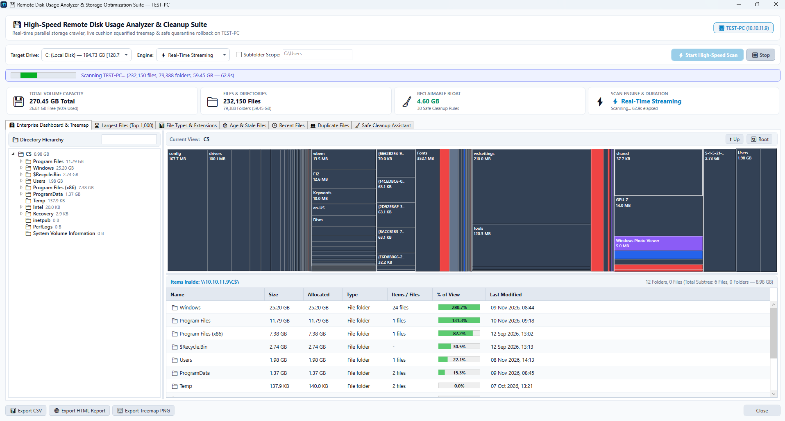

##### 1. Overview & Operational Purpose
The **Remote Disk Usage Analyzer & Storage Optimization Suite** is an enterprise-grade remote storage visualization and cleanup workspace built directly into the Windows AD Remote Administration Control Center.

Traditional remote disk analysis requires either:
- Installing heavy third-party software on each remote machine.
- Manually connecting over slow network shares and waiting hours for Windows Explorer to calculate folder sizes.
- Running complex command-line scripts that provide flat text output without visual context.

The Remote Disk Usage Analyzer solves these challenges by delivering **instant, interactive, and agentless disk forensics**. It scans local workstations and remote enterprise servers across your Active Directory domain in seconds, displaying storage distribution as an interactive 3D cushion treemap alongside deep file analytics, duplicate detection, and safe rule-based cleanup.

###### Primary Capabilities at a Glance:
- **Instant High-Speed Scanning**: Analyzes hundreds of thousands of files across remote hard drives in seconds using hybrid sequential volume cluster parsing and multi-threaded native enumeration.
- **3D Cushion Squarified Treemap**: Visualizes directory storage consumption as intuitive, color-coded blocks.
- **Simultaneous Windows**: Runs in its own top-level window with a dedicated taskbar button. You can minimize, move, or close the main application without interrupting active scans.
- **Multi-Window Support**: Open multiple disk analyzers at the same time to compare different servers or examine multiple drives simultaneously.
- **Duplicate File Candidate Detection**: Identifies identical files taking up duplicate space across different folders with full multi-location visibility.
- **Safe Cleanup Assistant with 7-Day Rollback**: Safely frees gigabytes of unneeded Windows update caches, crash dumps, and temp files with mandatory dry-run preview and reversible quarantine.
- **Full Theme Fidelity**: 100% support for both Light Theme and Dark Theme with high-contrast text and accessible controls.

##### 2. How to Open the Remote Disk Usage Analyzer
You can launch the analyzer for any computer displayed in the fleet inventory using any of the following methods:

- **Method A: Right-Click Context Menu (Recommended)**:
  1. Select any computer in the main dashboard computer list.
  2. Right-click the row to open the context menu.
  3. Navigate to **📁 Files & Shared Folders** -> click **💾 Remote Disk Usage Analyzer & Storage Optimization Suite...**.
- **Method B: Global Keyboard Shortcut**:
  1. Click on any target computer in the fleet list to select it.
  2. Press **`Ctrl + Shift + D`** on your keyboard.
  3. The analyzer window will instantly open centered on your active screen.
- **Method C: Launching Multiple Windows Simultaneously**:
  To analyze two or more computers at the same time:
  1. Select your first target computer and press **`Ctrl + Shift + D`**.
  2. Return to the main dashboard, select your second target computer, and press **`Ctrl + Shift + D`**.
  3. Both analyzer windows operate independently. You can position them side-by-side on multi-monitor setups or minimize one while monitoring the other.

##### 3. Pre-Scan Scope & Engine Configuration
Before clicking Start, you can customize your scan parameters using the top toolbar:

###### 3.1 Target Drive Dropdown
- **What it does**: Automatically detects and lists all fixed physical hard drives and partitions on the remote machine (e.g. `C: (Windows)`, `D: (Data)`, `E: (Backups)`).
- **Displayed Details**: Shows drive letter, volume label, total partition capacity, and current free space.
- **When to use**: Select the drive you want to analyze. If the system has multiple partitions, each partition can be analyzed individually.

###### 3.2 Scan Engine Selection
The suite offers two engine options in the top toolbar:
1. **⚡ Real-Time Streaming (Recommended — Default)**: Scans folders in parallel and streams discovered folders, file sizes, and visual treemap updates onto your screen live as the scan runs. You can immediately see what is taking up space and even stop the scan early once you find the target folder.
2. **📁 Parallel Win32 (32K)**: Designed for very deep folder structures with extended-length paths (up to 32,767 characters, bypassing the standard 260-character Windows path limit), such as deeply nested backups or large user data shares.

> **Which engine is faster?**  
> In practice, **both options run at the exact same high speed**. The built-in Real-Time Streaming engine already combines multi-threaded parallel scanning (4 parallel workers for remote network scans, up to 8 for local drives), extended 32,767-character long-path support, and live on-screen updates—so leaving **Real-Time Streaming** selected gives you maximum speed, deep-path compatibility, and live visual feedback all at once.

###### 3.3 Subfolder Scope
- **What it does**: Restricts scanning exclusively to a designated directory subtree rather than scanning the entire drive.
- **How to use**:
  1. Check the **Subfolder Scope** checkbox.
  2. Enter the desired folder path in the text box (e.g. `C:\Users` or `C:\Program Files\Common Files`).
  3. Click **Start High-Speed Scan**.
- **Result**: The scan will begin directly within that folder, drastically reducing scan time when investigating specific directories.

##### 4. Scanning Controls & Real-Time Progress

###### 4.1 Starting a Scan
Click the vibrant cyan **`⚡ Start High-Speed Scan`** button on the toolbar.
- The button will transition to a disabled state to prevent duplicate operations.
- The **`⏹ Stop`** button will become active.
- The progress banner will animate, and discovered files and folders will begin populating the screen in real time.

###### 4.2 Graceful Scan Cancellation (Stopping an In-Progress Scan)
If you decide to halt a scan before it finishes (e.g. you have already discovered the culprit folder):
1. Click the **`⏹ Stop`** button on the toolbar.
2. The application will immediately update the status banner to:
   ```text
   ⏳ Please wait. The operation is stopping. This may take 10–30 seconds...
   ```
3. **Non-Blocking Operation**: The interface remains completely responsive. You can move the window, switch tabs, or browse folders that were already discovered.
4. **Data Preservation**: The analyzer retains all discovered files and folders. The top metric cards will display `⏹️ Stopped (Data Retained)`, allowing you to immediately analyze, sort, or clean the data collected up to that moment.

##### 5. Top 4 Key Performance Indicator (KPI) Cards
Across the top of the workspace, four high-density cards provide immediate summary intelligence:

- **TOTAL VOLUME CAPACITY**: Displays total partition capacity, current free space, and percentage used (e.g. `929.29 GB Total`, `738.82 GB Free (20% Used)`). Gives an instant health check on volume storage health.
- **FILES & DIRECTORIES**: Displays the cumulative count of scanned files, folders, and total processed byte volume (e.g. `347,015 Files`, `175,672 Folders (199.09 GB)`).
- **RECLAIMABLE BLOAT**: Displays total disk space safe to delete immediately (e.g. `51.96 GB Found`), highlighted in vibrant emerald green, along with the count of active safe cleanup rules that matched files on the machine.
- **SCAN ENGINE & DURATION**: Displays the active scan engine mode (`⚡ Real-Time Streaming` or `⚡ Parallel Win32 (32K)`) and elapsed scanning duration (e.g. `Completed in 21,472 ms`).

##### 6. Tab 1: Directory Hierarchy & Cushion Treemap

The primary default tab combines a **Directory Hierarchy Tree** on the left with a **3D Cushion Squarified Treemap** and **Current View Table** on the right:

###### 6.1 Left-Side Directory Hierarchy Tree
- **Visual Structure**: Displays the full folder tree starting from the drive root down to nested subfolders.
- **Folder Sizes**: Every folder displays its true, recursively calculated storage size (e.g. `📁 Users 67.50 GB`, `📁 Windows 43.22 GB`).
- **High-Contrast Selection**: Clicking any folder highlights it with a vibrant blue banner and bold pure-white text for effortless readability in both Light and Dark themes.
- **Tree Filter Box**: Use the `Filter folders...` text box above the tree to filter visible folders by name in real time.

###### 6.2 Right-Side 3D Cushion Squarified Treemap Canvas
- **Visual Structure**: An interactive 2D visualization where each folder is drawn as a rectangle proportional to its storage size on the disk. Larger folders occupy larger rectangles.
- **Cushion Shading**: Distinct rounded cushion borders give depth to nested folders, making it easy to spot where disk space is concentrated.
- **Color Coding**: Visual blocks are color-coded by file category:
  - 🔵 **Blue**: Videos & Multimedia Files (`.mp4`, `.mkv`, `.avi`, `.mov`)
  - 🟣 **Purple**: Images & Graphical Assets (`.png`, `.jpg`, `.svg`, `.psd`)
  - 🔷 **Cyan**: Audio & Sound Recordings (`.mp3`, `.wav`, `.flac`, `.aac`)
  - 🟡 **Amber**: Archives, Compressed Packages & Installers (`.zip`, `.rar`, `.7z`, `.msi`, `.iso`)
  - 🟢 **Green**: Documents, Spreadsheets & Data (`.docx`, `.xlsx`, `.pdf`, `.csv`, `.sql`)
  - 🔴 **Red**: Executables & System Binaries (`.exe`, `.dll`, `.sys`)
  - 🟪 **Indigo**: Virtual Disks & Drive Images (`.vhd`, `.vhdx`, `.vmdk`)
- **Hover Inspection**: Moving your mouse over any block displays a rich tooltip with folder name, exact formatted size, percentage of current view, file count, and full remote path.
- **Double-Click Drill-Down**: Double-clicking any cushion block zooms into that folder, updating both the treemap and the file table below it.

###### 6.3 Current View Navigation Bar
Located directly above the treemap:
- **Breadcrumbs Path**: Displays your active navigation path (e.g. `Current View: C:\Users\ExampleUser\Downloads`).
- **`⬆ Up` Button**: Navigates one folder level up the hierarchy.
- **`🔄 Reset` Button**: Instantly returns to the drive root view.

###### 6.4 "Items Inside" (Current View) Table & Independent Horizontal Scrolling
Located directly beneath the cushion treemap, the **Items Inside** table provides an exhaustive, row-by-row itemization of all subfolders and files contained within the currently selected directory:
- **Comprehensive Columns**:
  - **Name**: Directory or file name accompanied by visual icon badges distinguishing folders from file types.
  - **Size**: Formatted storage space consumed (e.g. `14.28 GB`, `512.00 MB`).
  - **Allocated**: Actual physical space allocated on disk storage clusters.
  - **Type**: Operational file type or category (e.g. `File folder`, `Executable Application`, `ZIP Archive`).
  - **Items / Files**: Recursive child item count for folders, or single-file indicator.
  - **% of View**: Visual proportional progress bar with high-contrast text indicating percentage of the current folder.
  - **Modified Date**: Full timestamp of last modification down to the second (e.g. `15 Nov 2026, 14:32:08`).
  - **Full Remote Path**: Complete administrative UNC or local drive path to the item.
- **Independent Horizontal & Vertical Scrolling**:
  - Features dedicated, independent horizontal and vertical scrollbars that automatically activate whenever content exceeds the display viewport.
  - Users can smoothly scroll horizontally to inspect every column on the right side (including Modified Date, Full Path, and Type) without column clipping or truncation.
  - **Synchronous Header Alignment**: Column headers stay pixel-perfect aligned with corresponding data cells during horizontal panning, with column virtualization optimized to prevent header drift or visual artifacts.
  - **Responsive Layout**: Designed with robust minimum and default column widths, ensuring optimal usability on compact laptop displays, split-screen multitasking, and full 4K maximized monitors.
- **Interaction**: Double-clicking any folder row drills down into that folder. Right-clicking opens the contextual management menu.

##### 7. Tab 2: Largest Files Leaderboard (Top 1,000)

When a disk suddenly runs out of space, it is almost always caused by a handful of massive files (such as orphaned virtual machine disks, database backups, memory dumps, or video files). The **Largest Files** tab provides an instant, interactive leaderboard of the top space consumers across the entire scanned drive.

###### Dedicated File Analysis Capabilities:
- **Instant Size-Sorted Leaderboard**: Automatically ranks discovered files across the entire drive from largest to smallest upon scan completion without requiring a secondary scan.
- **Minimum Size Threshold Filter**: Dropdown menu enabling operators to instantly isolate files meeting specific size criteria:
  - `All Sizes`: Complete leaderboard of top space consumers.
  - `>= 1 GB`: Massive enterprise virtual disks, ISO images, and full database backups.
  - `>= 500 MB`: High-capacity system images and large archive repositories.
  - `>= 100 MB`: Application installers, crash dumps, and media recordings.
  - `>= 50 MB`: Medium archives and bloated document libraries.
  - `>= 10 MB`: General large files across the volume.
- **Category Filter**: Dropdown menu to filter by file classifications:
  - `All Categories`: Comprehensive display.
  - `Disk Images & VMs`: Virtual disks (`.vhd`, `.vhdx`, `.vmdk`, `.iso`, `.img`, `.wim`).
  - `Archives & Backups`: Compressed files and backups (`.zip`, `.rar`, `.7z`, `.tar`, `.bak`).
  - `Media & Video`: High-definition video and audio recordings (`.mp4`, `.mkv`, `.avi`, `.mov`).
  - `Programs & Binaries`: Executable binaries and installers (`.exe`, `.msi`, `.dll`).
  - `Documents & DBs`: Relational databases, spreadsheets, and document archives (`.mdf`, `.ldf`, `.sql`, `.pdf`, `.docx`).
- **Real-Time Search Bar**: Type into the search box to filter files instantly by name, extension, or containing directory path.
- **Live Summary Badge**: Displays the exact number of matching files and cumulative storage space consumed by the filtered subset.
- **Comprehensive Columns**: Displays File Name, Size, Allocated Size, Category, Extension, Timeline Age, Modified Date, Containing Folder, and Full Remote Path with independent horizontal scrolling.
- **Actions**: Double-click any file to open its containing directory in Windows Explorer. Right-click to copy paths, inspect item properties, or perform targeted actions.

##### 8. Tab 3: Recent Files Chronological Timeline

When disk space suddenly plummets or ransomware activity is suspected, administrators need to know exactly which files were created or modified most recently. The **Recent Files** tab provides an interactive chronological timeline of recent activity across the remote drive.

###### Dedicated Timeline Capabilities:
- **Quick-Access Time Range Filters**: One-click filter buttons to scope recent files:
  - `All (90d)`: Files created or modified within the past 90 days.
  - `Today (< 24h)`: Files created or modified in the last 24 hours.
  - `Last 7 Days`: Activity within the past week.
  - `Last 30 Days`: Activity within the past month.
- **Category Filter**: Quickly isolate specific file types (Office Documents, Executables, Media, Archives, Logs/Temp).
- **Search Filter**: Search by file name, extension, or parent directory in real time.
- **Live Summary Badge**: Displays the total count and cumulative storage consumed by matching recent files.
- **Complete Timestamps & Relative Age**: Displays full date and time of modification alongside human-readable relative age badges.
- **Independent Horizontal Scrolling**: All columns, including full directory paths and timestamps, are smoothly accessible.

##### 9. Tab 4: Duplicate Files Detection Suite with Cryptographic Hashing

Duplicate files often silently consume 10% to 30% of enterprise shared storage and user home directories. The **Duplicate Files** tab features a dedicated master-detail workspace combining high-speed candidate grouping with on-demand cryptographic verification.

###### Master-Detail Architecture & Cryptographic Hashing:
- **Master Group Table (Upper Section)**:
  - Automatically identifies candidate duplicate files based on identical byte lengths and extensions without performing slow network re-scans.
  - **Potential Space Savings Column**: Calculates the exact wasted storage that could be reclaimed by eliminating surplus copies (e.g. `24.50 GB Wasted`).
  - **Comparison Method**: Displays whether duplicates are matched by file length or confirmed via cryptographic fingerprinting.
  - **Content Fingerprint (SHA-256)**: Displays truncated cryptographic hash fingerprints for verified groups.
  - **Filtering**: Search duplicate groups by name or path, and filter by minimum file size (`All`, `>= 1 MB`, `>= 10 MB`, `>= 50 MB`, `>= 100 MB`).
- **Cryptographic Hash Verification (`⚡ Verify Cryptographic Hashes (SHA-256)`)**:
  - Clicking this action computes SHA-256 content hashes across duplicate candidate files.
  - Uses full SHA-256 hashing for files up to 2 MB and high-speed multi-block sampled SHA-256 for larger files.
  - Guarantees 100% mathematical certainty that files share identical content, automatically discarding false positives where files merely share identical byte lengths.
- **Detail Copies Table (Lower Section)**:
  - Selecting any duplicate group in the master table instantly populates the detail view below, listing every physical copy location across the remote machine.
  - **Instance Badging**: Clearly marks `Copy #1 (Original)` versus `Copy #2 (Duplicate)`, `Copy #3 (Duplicate)`, etc.
  - **Verification Status**: Displays `Verified Hash Match` or `Unverified (File Locked / Offline)`.
  - **1-Click Copy All Paths**: Copies the complete remote UNC paths of all duplicate instances to the clipboard for administrative review or scripting.
  - **Independent Horizontal Scrolling**: Both master and detail tables feature independent horizontal scrollbars for complete path and detail visibility.

##### 10. Tab 5: Space Cleanup & Storage Bloat Assistant

The **Space Cleanup** tab provides a safety-first, centralized storage bloat remediation workspace designed specifically for enterprise environments. It analyzes the scan results against 14 safe cleanup locations to identify unneeded caches, temporary files, and system bloat.

###### Safety-First Architecture & Operations:
- **Informative Safety Card**:
  - Highlights that core operating system files, user personal documents (Documents, Desktop, Downloads), and system directories are strictly shielded.
  - Details that safe cleanup rules target only temporary files, update download scratch, crash dumps, and application caches that Windows or applications will safely recreate when needed.
- **Category Filtering**: Dropdown menu to filter cleanup rules by operational group:
  - `All Cleanup Categories`: Complete overview.
  - `Windows System Caches`: System temp, prefetch, delivery optimization, and servicing logs.
  - `User Temp & History`: User %TEMP%, thumbnail caches, recent items, and DirectX shader caches.
  - `Crash & BSOD Dumps`: Kernel memory dumps, mini-dumps, and application crash reports.
  - `Browser Caches`: Temporary internet caches across Edge, Chrome, and Firefox.
- **Batch Selection**: One-click `☑️ Select All Safe` and `⬜ Deselect All` buttons for rapid operational control.
- **Live Reclaimable Badge**: Displays cumulative recoverable space across selected rules (e.g. `Reclaimable: 18.42 GB (8 of 14 selected)`).
- **Comprehensive Columns**: Displays Selection Checkbox, Category / Rule Name, Recoverable Size, File Count, Safety Level, Why Safe to Remove / Operational Purpose, and Target Remote Location.
- **Three-Tier Remediation Controls**:
  1. **`🔍 Dry-Run Preview Staging...`**: Opens an independent, non-modal staging preview window displaying every selected cleanup rule, target directory, file count, and recoverable size before executing any file operations.
  2. **`📦 Safe Quarantine Clean (7-Day Rollback)`**: Safely relocates candidate files into a staging quarantine structure on the remote machine with full 1-click rollback support for 7 days.
  3. **`❌ Permanent Clean (Irreversible)`**: Permanently purges candidate files after explicit administrator confirmation, preserving all parent folder structures and gracefully skipping in-use files.

##### 11. Tab 6: File Types & Extension Analytics

Provides a comprehensive breakdown of what types of data are consuming space across the volume:
- **Categorized Breakdown**: Groups files by file extension (e.g. `.exe`, `.dll`, `.zip`, `.log`, `.mp4`, `.pdf`).
- **Summary Metrics**: Displays total consumed storage, total file count, and percentage of overall drive capacity for each extension.
- **Strategic Value**: Helps administrators determine whether storage bloat is driven by application logs (`.log`), backup archives (`.zip` / `.rar`), or multimedia files.
- **Independent Horizontal Scrolling**: Ensures all metric columns are fully accessible on any display width.

##### 12. Tab 7: Age & Stale File Distribution

Groups volume storage into seven chronological age brackets based on file modification timestamps:
1. `< 24 Hours`: Files modified today.
2. `1 - 7 Days`: Files modified within the past week.
3. `7 - 30 Days`: Files modified within the past month.
4. `1 - 6 Months`: Files modified within the last half year.
5. `6 - 12 Months`: Files untouched for 6 to 12 months.
6. `1 - 3 Years`: Files untouched for 1 to 3 years.
7. `> 3 Years (Stale)`: Abandoned legacy files untouched for over 3 years.

**Operational Benefit**: Allows administrators to quickly calculate how many gigabytes can be safely archived or relocated to cold cloud storage.

##### 13. Context Menu Management Actions
Right-clicking any file or folder in the Directory Tree, Treemap, or Data Tables reveals a context menu with management actions:

| Action | Icon | What it Does |
| :--- | :---: | :--- |
| **Drill Down Into Folder** | 📂 | Zooms the active view into the selected folder. |
| **Open in Windows Explorer** | 🗁 | Opens the remote administrative share (`\\host\C$\...`) in local Windows Explorer. |
| **Copy Full Remote Path** | 📋 | Copies the complete path to the Windows clipboard. |
| **Copy File / Folder Name** | 📄 | Copies only the file or directory name. |
| **View Properties & Item Details** | ℹ️ | Displays recursive file counts, folder counts, total size, and creation/modification timestamps. |
| **Delete (Permanent Cleanup)** | 🗑️ | Permanently deletes the item after explicit administrator confirmation. |

##### 14. Footer Export Suite (CSV, HTML, PNG)
At the bottom of the workspace, three export options allow you to generate audit documentation:
- **📊 Export CSV**: Exports full disk metrics, top 100 largest files, and category breakdowns into a standard `.csv` spreadsheet compatible with Microsoft Excel.
- **🌐 Export HTML Report**: Generates a standalone, beautifully formatted HTML report containing summary KPI cards, scan parameters, and top storage consumers. The HTML file requires no external internet connection and can be emailed or archived.
- **🖼️ Export Treemap PNG**: Captures a high-resolution snapshot of the current 3D Cushion Treemap as a `.png` graphic file for presentations, tickets, or documentation.

##### 15. Simultaneous Multi-Window Operations
The Remote Disk Usage Analyzer allows you to open and run multiple scan windows simultaneously:
1. **Dedicated Taskbar Entry**: Each scan window appears as its own icon on your Windows taskbar and Alt+Tab switcher.
2. **Independent Window Control**:
   - Minimizing the main dashboard leaves all open analyzer windows active and visible on your desktop.
   - Minimizing an analyzer window minimizes only that window, without affecting other open tools or the main application.
3. **Independent Close Behavior**: Closing an analyzer window closes only that window. Active scans on other machines continue running uninterrupted.
4. **Multi-Target Parallel Scans**: You can launch separate analyzer windows for different servers (e.g. `SRV-FILE-01` and `SRV-SQL-02`) or different partitions at the same time. Each window manages its own background thread pool safely.

##### 16. Practical Real-World Usage Scenarios
- **Scenario A: Emergency Low Disk Space Alert on File Server**:
  1. Select the server on the dashboard and press **`Ctrl + Shift + D`**.
  2. Keep Target Drive set to `C:` and click **`⚡ Start High-Speed Scan`**.
  3. In under 20 seconds, the scan completes. Look at the **RECLAIMABLE BLOAT** KPI card: it shows **28.4 GB Found**.
  4. Switch to **Tab 7: Safe Cleanup Assistant**.
  5. Click **`🔍 Dry-Run Preview Staging...`** to verify that 18 GB of Windows Update download cache and 10 GB of memory dumps can be removed.
  6. Click **`📦 Safe Quarantine Clean (7-Day Rollback)`**. Space is immediately recovered, clearing the emergency alert without a reboot.
- **Scenario B: Locating Which User is Storing Large Media Files**:
  1. Launch the analyzer for a shared department workstation.
  2. On **Tab 1**, examine the Cushion Treemap to spot large clusters of green rectangles.
  3. Hover over the green blocks to see that a user profile contains multiple 8 GB video recordings in `C:\Users\ExampleUser\Videos`.
  4. Right-click the folder and select **Open in Windows Explorer** to investigate or archive the files to network storage.
- **Scenario C: Generating a Storage Audit Report for Management**:
  1. Select the domain controller and launch the analyzer.
  2. Run a full scan.
  3. Click **`🌐 Export HTML Report`** at the bottom of the window.
  4. Save the file as `StorageReport_DC01.html`.
  5. Open the HTML file in any browser: it displays executive KPI cards, partition capacity graphs, and the top largest files in an executive-ready format.

##### 17. Troubleshooting, Security & Network Requirements
###### Required Windows Permissions:
- Operating account must be a member of **Domain Admins**, **Enterprise Admins**, or the target machine's **Local Administrators** group.
- Administrative shares (`C$`, `ADMIN$`) must be accessible over the local network.

###### Required Network Firewall Ports:
- **TCP Port 445 (SMB)**: Used for administrative share verification and remote file inspection.
- **TCP Port 135 (RPC / WMI)**: Used for volume capacity discovery and process queries.

###### Tips for Optimal Performance:
- **Local vs Remote**: Scans executed on the local machine run at maximum hardware NVMe speed using sequential cluster reading. Scans run over the network stream data in parallel and are optimized for standard 1 Gbps / 10 Gbps enterprise LANs.
- **Stopping Scans**: Always click the **`⏹ Stop`** button rather than closing the window if you wish to inspect partial results.

---

### 17. Customization, Automation & Software Deployment

#### A. Silent Software & Script Deployer
Right-click any computer (or bulk select) -> **🛠️ Customization, Automation & Deploy** -> **📦 Silent Software / Script Deployer**.
- Remotely deploys MSI installers, EXE setup packages, PowerShell scripts (.ps1), or batch files (.bat / .cmd).
- Supports silent install switches (/qn, /quiet, /s, etc.) and returns real-time execution exit codes.

#### B. Remote File & Script Transfer (Push to Remote PC)
Right-click any computer (or bulk select) -> **📁 Files & Shared Folders** -> **📁 Push File / Script to Remote PC (C$\Temp)...**.
- Copies local files, scripts, or installation binaries directly to \\<Host>\C$\Temp\ on single or multiple target computers simultaneously.

#### C. Remote Group Policy Refresh (GPUpdate /force)
Click **🔄 GPUpdate** on toolbar or right-click computer -> **🛠️ Customization, Automation & Deploy** -> **🔄 Force Remote GPUpdate**.
- Guarantees execution strictly on the remote target endpoint.
- Displays progress indicators and provides direct links to inspect the remote event log to verify policy enforcement.

#### D. Remote Group Policy Diagnostic Report Generator (GPResult HTML)
Access via multiple convenient shortcuts:
- Click **📊 GPResult** on the bottom **Quick Tools** toolbar.
- Right-click either the **⚡ Shadow Session** or **🖥️ Remote Desktop (mstsc)** top toolbar buttons and choose **Generate Group Policy (GPResult) HTML Report...**.
- Right-click any computer -> **📊 Diagnostics & Health** -> **📊 Generate GPResult HTML Report...**.
- **1-Click Policy Forensics**: Executes an authoritative Group Policy result diagnosis directly on the target machine and compiles the full diagnostic results into a formatted HTML document (`C:\report.html`).
- **Instant Browser Verification**: Upon generation, prompts the administrator with a confirmation dialog:
  ```text
  Group Policy HTML report generated successfully on [Host]!
  File Location: C:\report.html
  Network Path: \\[Host]\C$\report.html
  
  Would you like to open the interactive HTML report in your browser now?
  ```
- **Frictionless Inspection**: Selecting **Yes** automatically launches your local default browser connected across the administrative network share, giving technicians immediate visual insight into Applied GPOs, Denied GPOs, Security Group memberships, WMI filters, and registry preference extensions.

#### E. Windows God Mode & Power Tweaks
Right-click any computer (or bulk select) -> **🛠️ Customization, Automation & Deploy** -> **👑 Windows God Mode & Power Tweaks...**.
- Remotely configures Windows System settings, Control Panel master shortcuts, high-performance power plans, and system performance tweaks across single or multiple computers.

#### F. Desktop Info HUD (BgInfo & Floating Companion Widget)
Click **🖥️ HUD (BgInfo)** on toolbar or right-click computer -> **🛠️ Customization, Automation & Deploy** -> **🖥️ Desktop Info HUD (BgInfo)...**.
- **Classic Sysinternals BgInfo Mode**: Composites live system telemetry directly onto desktop wallpaper without intrusive frames, using high-contrast text and drop shadows.
- **Deployment Target Modes**:
  1. **Wallpaper Overlay Only**: Stamps wallpaper directly (no background process).
  2. **Floating HUD Widget Only**: Displays a sleek translucent on-screen companion widget.
  3. **Both (Wallpaper Overlay + Floating Widget)**: Applies wallpaper overlay and floating widget simultaneously.
- **Theme-Accurate Preview**: Dynamic preview matching Classic, Cyber Emerald, Midnight Violet, Solar Flare, and other color schemes.
- **1-Click Wallpaper Backup & Restore**: Automatically backs up original wallpaper before first application and allows restoring original desktop backgrounds in one click.

#### G. Remote Desktop Wallpaper Changer & Manager
Click **🖼️ Wallpaper** on toolbar or right-click computer (or bulk select) -> **🛠️ Customization, Automation & Deploy** -> **🖼️ Change Desktop Wallpaper...**.
- Remotely updates desktop wallpaper image backgrounds across single or multiple computers for corporate branding, security announcements, or policy updates.

#### H. Remote Screen Saver Configuration
Right-click any computer (or bulk select) -> **🛠️ Customization, Automation & Deploy** -> **🖥️ Remote Screen Saver Configuration...**.
- Enables or disables Windows screen savers remotely, customizes inactivity timeouts, and enforces password lockout upon resume across single or multiple workstations.
- When an active screen saver is running on a target workstation with an interactive user logged in, the application's real-time inventory presence dynamically reflects the state as **`💤 Idle (Screensaver)`** (when unlocked) or **`💤 Locked (Screensaver)`** (when locked).

#### I. Windows Win32 Long Path Support Manager
Right-click any computer (or bulk select) -> **📁 Files & Shared Folders** -> **🛣️ Win32 Long Path Support (260+ Chars Check & Enable)...** (or access via **Windows God Mode & Power Tweaks**).
- **Real-Time Path Limit Diagnostic**: Queries both operating system filesystem parameters and Windows Group Policy configurations to verify whether Win32 paths exceeding the classic 260-character limitation are supported.
- **1-Click Enablement & Policy Harmonization**: Sets both kernel and Group Policy filesystem settings to enabled (`LongPathsEnabled = 1`), removing path length restrictions for compatible applications, PowerShell, and file operations up to 32,767 characters.
- **Fleet-Wide Bulk Deployment**: Select multiple workstations to inspect and update long-path support fleet-wide with progress indicators and structured operation reporting.
- **PowerShell Script Generator & Clipboard Copy**: One-click copying of verification and enablement scripts for administrative record-keeping or manual scripting.
- **Testing & Safety Guidance**: Provides recommendations for safe automated script testing (such as keeping dry-run testing modes enabled) and outlines reboot requirements for background services.

---

#### J. Automatic RPC Service Deployment & Firewall Configuration
Right-click any computer (or bulk select) -> **🛠️ Customization, Automation & Deploy** -> **⚡ Automatic RPC Service & Firewall Deployment...** (or access from the **Coordinator Discovery** window).
- **Zero-Touch Remote Provisioning**: Remotely deploys and registers background services without manual console intervention on target machines.
- **Automated Windows Firewall Configuration**: Automatically configures and enables essential inbound Windows Firewall rules via remote procedure calls, including Remote Service Management (port 135 Endpoint Mapper and Service Control Manager), Windows Management Instrumentation, File and Printer Sharing (port 445), and application execution permissions.
- **Component Deployment Selection**: Selectively deploys the Network Monitor Coordinator Service, the Endpoint Inactivity Agent, or both simultaneously.
- **Autonomous Recovery & Immediate Health Verification**: Sets up automatic restart policies upon failure, launches background services, and executes real-time health verification over remote procedure calls.
- **Live Operation Telemetry**: A real-time execution log console provides step-by-step progress tracking with timestamps across every selected server and workstation.

#### K. Workstation Fleet Debloater & Privacy Studio
Right-click any computer -> **🛠️ Customization, Automation & Deploy** -> **🧹 Workstation Fleet Debloater & Privacy Studio...** (also available in the Workstation context menu).

##### Overview & Purpose
Designed for enterprise workstation deployments running Windows 10 or Windows 11. It detects and removes unwanted consumer bloatware packages, stops intrusive telemetry background tasks, and optimizes endpoint privacy—all backed by automated registry snapshot protection, clear pre-execution confirmation dialogs, and one-click rollback.

##### Core Functional Capabilities
- **Safe Pre-Execution Confirmation Dialogs**: When clicking **🛡️ Apply Privacy Baselines** or **↩️ Rollback Snapshot**, the application displays a structured confirmation dialog detailing exactly what will be backed up, modified, or restored, along with the 7-day retention safety notice. Changes only proceed once you review and click **Confirm & Apply** or **Confirm & Restore**.
- **Installed Bloatware Catalog**: Scans and categorizes consumer applications into distinct operational groups:
  - **Sponsored Applications**: Third-party commercial apps often bundled by hardware OEMs (e.g., Spotify, TikTok, Netflix, Disney+, Amazon Prime).
  - **Casual Games**: Pre-installed gaming apps (e.g., Microsoft Solitaire Collection, Candy Crush Saga).
  - **Non-Essential Utilities**: Consumer apps that add background overhead in enterprise environments (e.g., Feedback Hub, MSN Weather, Skype, Phone Link, Tips / Get Started).
- **Per-User & Provisioned Removal**:
  - Uninstalls active application packages from all existing user profiles on the workstation.
  - De-provisions the package from the operating system image repository (DISM). This ensures the application is completely purged and will never reinstall itself when a new domain user logs on.
- **Apply Privacy Baselines**:
  - Applies a comprehensive corporate privacy and system responsiveness baseline with a single click.
  - **What It Configures**:
    1. **Automated Registry Snapshot**: Automatically backs up relevant registry keys to a local temporary backup archive (`WADRACC_DebloatBackup`) before applying any modifications.
    2. **Disables Scheduled Telemetry Tasks**: Deactivates background diagnostic tasks, including the Customer Experience Improvement Program (`Consolidator`, `UsbCeip`) and the daily compatibility appraiser scan.
    3. **Disables Diagnostic Tracking Service**: Stops and disables the `DiagTrack` (*Connected User Experiences and Telemetry*) background service, saving CPU cycles and network bandwidth.
    4. **Disables Start Menu Bing Search**: Prevents local Start Menu searches from sending keystrokes or queries to external Bing cloud servers, keeping internal searches fast, private, and local.
    5. **Enforces File Extension Visibility**: Configures Windows Explorer to always display file extensions, protecting users from social engineering attacks using disguised executable extensions.
  - **Why Use It**: Dramatically reduces background CPU and memory overhead, eliminates unnecessary telemetry traffic on enterprise networks, enhances user privacy, prevents confidential search queries from leaving corporate boundaries, and improves desktop search responsiveness.
- **Reversible Registry Snapshot & 1-Click Rollback**:
  - Every privacy application automatically creates a timestamped registry snapshot.
  - Clicking **↩️ Rollback Snapshot** instantly re-imports the original registry configuration, returning all privacy and telemetry settings to their exact previous state with zero risk.
- **Export Inventory (CSV)**:
  - Exports the current application inventory and compliance status to a clean spreadsheet report for auditing.

---

##### Beginner's Guide: Understanding Backup, Privacy Baselines & 1-Click Rollback

This section explains how the **Backup**, **Apply Privacy Baselines**, and **Rollback Snapshot** features work in everyday language, without technical jargon.

```text
┌─────────────────────────────────────────────────────────────────────────────┐
│                       THE 3-STAGE SAFETY LIFECYCLE                          │
├───────────────────────┬─────────────────────────────┬───────────────────────┤
│ 1. BACKUP (Snapshot)  │ 2. APPLY (Privacy Baseline) │ 3. ROLLBACK (Undo)    │
│ Saves original rules  │ Optimizes settings for      │ Restores original     │
│ into a safe local     │ privacy and speed           │ settings instantly    │
│ folder (100% read-    │ (Confidential searches,     │ if you ever want to   │
│ only, nothing changes)│ less background overhead)   │ revert (7-day window) │
└───────────────────────┴─────────────────────────────┴───────────────────────┘
```

---

###### 1. What is Backup and Why Is It Needed?

- **The Everyday Analogy: The Windows "Master Rulebook"**
  Think of your Windows computer like a busy office building:
  - **The Windows Registry** is like the **Master Operations Rulebook** kept in the manager's office. Every time Windows starts up or opens an application, it consults this rulebook to know how things should operate—such as whether typing in the Start Menu should search the internet, or whether background diagnostic reports should be sent to external servers.
  - **Explorer Settings** are like the **Workspace Display Preferences**. They control how files, folders, and menus appear on your screen (for instance, showing the `.docx` or `.pdf` extension at the end of file names so you know exactly what type of file it is).
  - **Windows Policies** are like **Company Guidelines**. They tell Windows which features are active and which features should remain turned off.
  - **Background Services (`DiagTrack`)** are like an **Office Assistant working behind the scenes**. In this case, `DiagTrack` (*Connected User Experiences and Telemetry*) quietly gathers system diagnostic information and transmits it to Microsoft servers.

- **What Exactly Does This Backup Collect?**
  When you click **🛡️ Apply Privacy Baselines**, before a single setting is modified, the application automatically takes a snapshot of:
  1. **Diagnostic & Telemetry Rules (`DataCollection.reg`)**: The exact pages of the rulebook governing Windows diagnostic reporting and Customer Experience Improvement surveys.
  2. **Start Menu & Explorer Rules (`Explorer.reg`)**: The exact pages governing whether Start Menu searches contact cloud servers and whether file extensions are visible.
  3. **Original Service Startup Mode**: Records whether the diagnostic tracking service was running or stopped, and whether it was set to start automatically or manually.

- **Why Does the Application Back Them Up First?**
  Whenever you customize Windows settings, safety comes first. Windows contains thousands of interconnected settings. Having an exact snapshot of your computer's original configuration guarantees you always have a safe, reliable baseline to return to.

- **What Problems Could Happen If We Proceeded Without a Backup?**
  Without a backup:
  - If you ever changed your mind or if an application required original settings, you would have to manually hunt through dozens of hidden Windows settings menus.
  - You would have to guess what the original factory settings were.
  - You could accidentally set the wrong value and cause configuration discrepancies.
  With the automatic backup, there is zero guesswork—you always have an exact duplicate of your original rules ready to restore in one click.

---

###### 2. What Happens When You Create a Backup?

- **What Information and Settings Are Saved?**
  The backup captures a precise copy of your original privacy, search, and service configuration:
  - The original state of the diagnostic data collection keys.
  - The original state of the Windows Explorer search preferences.
  - The original startup type of the diagnostic tracking service.

- **Where Is the Backup Stored?**
  The backup files are saved directly on the target workstation in a dedicated, secure folder:
  ```text
  %TEMP%\WADRACC_DebloatBackup\
  ```
  *(For example: `C:\Users\<Current-User>\AppData\Local\Temp\WADRACC_DebloatBackup\`)*

- **Does Creating a Backup Change Anything on the PC?**
  **No. Absolutely not.** Creating a backup is a **100% read-only operation**. It simply reads your current settings and saves a copy into the backup folder. Not a single setting, file, or application on your computer is changed, moved, or deleted during the backup process.

- **The Automatic 7-Day Safety Retention Policy**
  - Your backup snapshots are safely preserved on the computer for **7 full days**.
  - This 7-day safety window gives you ample time to use your computer normally, run all your daily business programs, and verify that everything operates smoothly.
  - To prevent unnecessary storage accumulation, snapshots older than 7 days are automatically cleaned up during routine system maintenance.

- **How Does This Backup Help If Something Goes Wrong Later?**
  If any software tool or workflow behaves unexpectedly after applying the privacy baselines, the saved backup files allow you to restore your previous configuration in seconds by clicking **↩️ Rollback Snapshot**.

---

###### 3. What Happens After Applying the Changes?

- **Which Windows Settings Are Modified?**
  When you review the confirmation dialog and click **Confirm & Apply**, four targeted optimizations are applied:
  1. **Customer Experience Improvement Tasks Deactivated**: Background scheduled tasks that collect diagnostic logs and device surveys are turned off.
  2. **Diagnostic Tracking Service (`DiagTrack`) Stopped & Disabled**: The background telemetry service is stopped and set to disabled, preventing it from consuming CPU cycles, memory, or network data in the background.
  3. **Start Menu Bing Cloud Searches Turned Off**: When you press the Windows key and type to search, Windows searches only your local computer (your installed programs, files, and settings) instead of sending your keystrokes to external Bing cloud servers.
  4. **Full File Name Extensions Enabled**: Windows Explorer is configured to always display file extensions (such as `.pdf`, `.docx`, or `.exe`), making it easy to identify file types and preventing malicious files from disguising themselves.

- **What Are the Benefits of Applying These Changes?**
  - **Greater Confidentiality & Privacy**: Your typed search queries, hardware details, and software usage patterns remain strictly on your local PC and are never sent over the internet.
  - **Faster & Smoother System Performance**: Disabling background telemetry tasks frees up CPU processor cycles, system memory (RAM), and network bandwidth.
  - **Instant Start Menu Responses**: Searching in the Start Menu becomes substantially faster because Windows does not wait for internet search results from external servers.
  - **Enhanced Security Protection**: Seeing complete file name extensions protects users from social engineering tricks (for example, a suspicious file named `Invoice.pdf.exe` that looks like a PDF document but is actually an executable).

- **What Changes Will Users Notice in Daily Use?**
  - **Start Menu Search**: Typing in the Start Menu will search only installed applications, control panels, and personal files—no more random internet web results, news headlines, or commercial suggestions.
  - **File Explorer**: Files will display their extensions (e.g., `Report.docx` instead of just `Report`).
  - **System Quietness**: Noticeably less background disk activity and network communication when the computer is sitting idle.

- **Could Any Existing Functionality or Applications Be Affected?**
  - **Standard Business Applications Are 100% Unaffected**: Microsoft Office (Word, Excel, PowerPoint, Outlook), web browsers (Google Chrome, Microsoft Edge, Mozilla Firefox), enterprise ERP tools, Adobe Acrobat, Zoom, Microsoft Teams, and shared network drives operate completely normally.
  - **What Is Affected**:
    - The optional Windows Feedback Hub app will no longer send telemetry feedback to Microsoft.
    - Web searches directly from the Start Menu will not display Bing web results (users simply use their regular web browser to browse the internet instead).

---

###### 4. What Is Rollback and When Should It Be Used?

- **Rollback in Simple Terms: Your One-Click "Undo" Button**
  Rollback is the software equivalent of pressing **Ctrl + Z** ("Undo") on your keyboard. It reads the exact backup files saved before the changes were made and restores them back into Windows.

- **How Does It Restore the Previously Saved Settings?**
  When you click **↩️ Rollback Snapshot** and confirm:
  1. The application checks the backup folder (`%TEMP%\WADRACC_DebloatBackup\`) on the target machine.
  2. It re-imports `DataCollection.reg` back into the Windows rulebook to restore original diagnostic and telemetry settings.
  3. It re-imports `Explorer.reg` to restore original Start Menu search and file display preferences.
  4. It re-configures the diagnostic tracking service (`DiagTrack`) back to its original startup state (Manual startup).
  5. A completion summary dialog appears confirming that all original settings are safely restored.

- **In Which Situations Should You Perform a Rollback?**
  - **Specific App Requirement**: A specialized corporate diagnostic tool or management software requires Windows diagnostic telemetry to be active.
  - **User Preference**: An employee or executive specifically prefers having Bing web search results appear directly inside the Windows Start Menu.
  - **Corporate Compliance Audit**: Your organization's IT department is conducting an official diagnostic survey and requests standard telemetry collection for a designated period.
  - **Baseline Testing**: You were testing system performance differences and wish to return the PC to its original state.

- **Does Rollback Return All Settings to Their Previous State?**
  **Yes, for all privacy, search, and service settings that were modified.** Every registry key, search policy, and service startup configuration adjusted during the optimization is completely restored to its exact pre-change value.

- **Important Limitations Users Should Know About**
  - **Settings vs. Uninstalled Apps**: The Rollback feature restores **system settings, policies, and background services**. If you used the application catalog to *uninstall* an optional consumer app (such as Spotify, Netflix, or a casual game), the Rollback button does *not* reinstall that app. To get an uninstalled app back, simply open the Microsoft Store and click Install.
  - **7-Day Retention Window**: Backups are kept for 7 days. If you wish to revert settings, make sure to do so within this 7-day period.

---

###### 5. Simple Real-World Examples & Step-by-Step Instructions

- **Scenario A: A User Wants Bing Web Search Restored in the Start Menu**
  - **The Situation**: You applied Privacy Baselines on an employee's laptop. The employee contacts you and mentions: *"When I type in my Start Menu, I used to see web search results, but now I only see my local files. Can I have web search back?"*
  - **Step-by-Step Resolution**:
    1. Open the application and find the employee's computer in the computer grid.
    2. Right-click the computer -> **🛠️ Customization, Automation & Deploy** -> **🧹 Workstation Fleet Debloater & Privacy Studio...**.
    3. Click the **↩️ Rollback Snapshot** button at the bottom of the window.
    4. Review the confirmation dialog explaining that the original Explorer and Start Menu settings will be re-applied.
    5. Click **Confirm & Restore**.
    6. Within seconds, the original Start Menu search preferences are restored.

- **Scenario B: An IT Audit Requires Active Telemetry for Diagnostic Reporting**
  - **The Situation**: Your corporate IT security team informs you that they are running an operating system health evaluation across the domain and require the Windows diagnostic tracking service to be running on all test computers.
  - **Step-by-Step Resolution**:
    1. Open the **Workstation Fleet Debloater & Privacy Studio** for the target computer.
    2. Click **↩️ Rollback Snapshot**.
    3. Review the confirmation details showing that `DataCollection.reg` will be restored and `DiagTrack` will be re-configured.
    4. Click **Confirm & Restore**.
    5. The diagnostic service is reset to its standard startup mode, and the PC is immediately compliant with the diagnostic audit.

- **Scenario C: Setting Up a Fast, Distraction-Free PC for a New Hire**
  - **The Situation**: A new employee joins the company, and you need to prepare a brand-new Windows 11 PC that came pre-loaded with consumer trialware, games, and telemetry overhead.
  - **Step-by-Step Resolution**:
    1. Open **Workstation Fleet Debloater & Privacy Studio** targeting the new workstation.
    2. Review the **Installed Bloatware Catalog** table.
    3. Select unwanted consumer packages (e.g., Casual Games, Sponsored Media Apps) and click **Uninstall Selected Packages**.
    4. Click **🛡️ Apply Privacy Baselines**.
    5. The confirmation dialog appears, explaining that a safe backup snapshot will be captured and saved for 7 days before changes are applied.
    6. Click **Confirm & Apply**.
    7. The computer is now clean, responsive, and privacy-protected, with an automatic safety backup in place if ever needed.

---

### 18. Inactivity & Idle Monitor Agent (Enterprise Feature)

Right-click any computer -> **🛠️ Customization, Automation & Deploy** -> **🚀 Deploy Inactivity & Idle Monitor Agent...** (or **🛑 Uninstall Inactivity Agent**).

- **Deployment & Lifecycle**:
  - Deploy or uninstall the lightweight monitoring module (ADRC_IdleAgent.exe) across single or bulk workstation selections in seconds.
  - **Fleet Status Bar & Interactive Quick-Filter Pills**: Positioned directly above the computer grid, the status bar displays live fleet telemetry counters across six operational states:
    - **`Monitored`**: Total workstations with monitoring module installed.
    - **`🟢 Up to Date`**: Endpoints running the latest version matching the local console package.
    - **`🟡 Need Update`**: Endpoints active on the domain running older agent versions.
    - **`🔴 Failed`**: Endpoints where deployment or update encountered an error.
    - **`⚪ Offline`**: Endpoints currently disconnected or powered off (deferred from updates until online).
    - **`⚫ Not Installed`**: Online endpoints without monitoring coverage.
  - **Interactive Filtering**: Clicking any status pill instantly filters the inventory grid to display only matching endpoints. Clicking the same pill again or clicking **`✕ Reset`** restores the full list.
  - **`⚡ Update All Outdated` Action**: When endpoints needing updates or with update errors are detected, a one-click button appears on the status bar to initiate batch updates for all eligible online computers simultaneously.
  - **Dedicated Inactivity Monitor Column**: Displays color-coded badges indicating current agent version and verification status (`🟢 Up to Date (v1.2.0)`, `🟡 Update Available`, `🔵 Checking...`, `🟡 Unknown`, `🏢 N/A (Appliance)`, `🔴 Update Failed`, `⚪ Offline`, `⚫ Not Installed`). Includes intelligent multi-tier sorting to group machines needing attention to the top.
  - **Interactive Failure Diagnostics & Quick Retry**: When an update or deployment fails, right-clicking the host reveals **`🔴 View Inactivity Monitor Update Failure Reason...`** with diagnostic error details and a 1-click **`🔄 Retry Update Now`** action.
  - **High-Speed Parallel Updates & Instant Post-Update Refresh Workflow**: In the **Customization, Automation & Deploy** menu, endpoints running older agent versions display **`🔄 Update Inactivity Monitor Agent (v{installed} ➔ v{latest})...`**. Executing an install, update, service start, or uninstall (across single or bulk selections) runs across up to 8 endpoints in parallel, skips redundant setup steps when configuration is already current, clears stale pre-update telemetry, verifies installed monitor executable version metadata directly, protects active updates from stale background probe overwrites, and immediately updates grid badges, fleet summary counters (**Up to Date**, **Need Update**, **Failed**), top Quick Action toolbar buttons, active filtered views, and local startup snapshots **before** displaying confirmation—eliminating any need to manually click **Refresh AD**. Statuses for **`✅ Installed (Active)`** and **`🟡 Installed (Inactive)`** remain clearly displayed.
  - **Companion Agent Version Notification Banners**: Automatically detects new companion executable updates upon launch, displaying dedicated, scope-isolated top notification banners for both `ADRC_IdleAgent` (purple banner labeled **Inactivity Monitor Agent Update Available**) and `ADRC_MonitorCoordinator` (green banner labeled **ADRC MonitorCoordinator Update Available**). Each banner features the detected version, capability highlights, a **`📄 View Release Highlights`** button, and an action button with isolated targeting:
    - **`⚡ Update Client Agents` (Purple Banner)**: Deploys the latest inactivity monitoring agent across outdated domain client workstations and PCs without impacting coordinator servers.
    - **`⚡ Update Coordinator Server` (Green Banner)**: Targets exclusively the registered Coordinator Servers hosting the 24/7 background network monitoring service without distributing or installing coordinator binaries on client workstations. When multiple coordinator servers are deployed, clicking update automatically updates all outdated coordinator servers sequentially one by one with live progress tracking.
  - **Independent Release Notes & Documentation Viewers**: Access independent, categorized ERP release logs and capability overviews anytime via **`📋 Tools Companion (ADRC_IdleAgent) Release Notes...`** and **`📡 Network Monitor Coordinator Release Notes...`**, or directly from the respective notification banner and Network Monitor Window (**`🏷️ Version Log`** and **`📄 View Release Highlights`**). Production builds query official GitHub release endpoints directly while offline and local development builds fall back to local release documentation seamlessly.
- **Real-Time Presence Tracking & Concurrent Safety**:
  - Tracks user input activity (mouse and keyboard), active and disconnected Remote Desktop sessions, and physical lock screens simultaneously to compute continuous active (`🟢 Active`), screen saver engagement (`💤 Idle (Screensaver)` / `💤 Locked (Screensaver)`), idle duration (`💤 Idle (...)`), workstation lock (`🔒 Locked (...)`), and logoff presence cleanly—even during concurrent background refreshes, eliminating intermittent false `Logged Off` or `Not Installed` flickers.
- **Four-Tier Health & Diagnostics Inspector**:
  - Right-click any computer -> **📊 Diagnostics & Health** -> **🔍 Check Inactivity Agent Status & Diagnostics...**.
  - Evaluates monitoring agent health using a four-state diagnostic model: Installed & Active, Installed but Not Active / Not Reporting, Not Installed, Unknown / Unable to Detect.
  - Inspects background service registration, live process execution, binary filesystem integrity, and telemetry heartbeat freshness, with 1-click repair actions.

#### A. Telemetry Architecture & Capabilities Matrix (With vs. Without Inactivity Agent)

The Windows AD Remote Administration Control Center provides multi-layered monitoring designed to deliver essential visibility across all corporate endpoints even before or without deploying the companion Inactivity Agent. Understanding the operational differences between both modes ensures system administrators leverage the right telemetry depth:

| Operational Metric & Capability | Agentless (Without Inactivity Agent Installed) | With Companion Inactivity Agent Installed (`ADRC_IdleAgent`) |
| :--- | :--- | :--- |
| **Workstation Online / Offline Status** | Detected via high-speed ICMP echo ping and management port connectivity (ports 135, 445, 3389). Resolves IP addresses via Active Directory DNS, NetBIOS over TCP/IP, and reverse lookups. Transitions to Offline when unresponsive. | Continuous ICMP ping and management port verification, reinforced by authoritative background service heartbeats updated in real time. |
| **Active / Idle Presence & Idle Duration** | Evaluates session idle time reported directly by Windows system session telemetry for both local console and Remote Desktop sessions (`.` / `none` = Active < 1 min, `10` = 10 mins idle, `1:23` = 1h 23m idle). Automatically transitions to `💤 Idle (Xm)` when unattended and returns to `🟢 Active` upon operator activity. | Sub-second input sensor tracking physical mouse movements and keyboard strokes in the active session. Detects lock states and screen savers immediately with zero latency. |
| **Logged-In User & Account Detection** | Queries remote Windows session services over authenticated RPC. Accurately identifies all concurrent sessions, distinguishing Domain accounts (`username`) from Local accounts (`username (Local)`). Fallback to system computer queries. | Captures exact active user accounts across all physical and remote sessions with dedicated per-session worker telemetry and instant session event triggers. |
| **Multi-Session & User Switching** | Fully enumerates all concurrent Windows sessions. Strictly prioritizes the actively engaged physical console session over disconnected background accounts so the primary column reflects the active operator. | Real-time session snapshot table enumerating Session ID, Username, Session Type (Console vs. RDP), Connection State, and Inactivity Seconds for every user. |
| **IP Mode (Static vs. DHCP)** | Authenticated remote network adapter queries across corporate VLANs. Evaluates network adapter configuration flags, subnet masks, and default gateways with fallback to remote administration interfaces. | Local adapter configuration captured directly by the companion background service, reporting static IP and DHCP configuration without remote RPC overhead. |
| **Shutdown & Restart Event Detection** | High-frequency active polling detects disconnection within 10–15 seconds. If the endpoint stops responding to ping and administrative ports, status transitions immediately to `Workstation Offline`. | Receives direct Windows Service Control Manager shutdown notifications before the network stack is terminated, recording `Shutdown Initiated` or `Restart Initiated` status badges. |

#### B. Local User vs. Active Directory Domain User Account Identification

Corporate environments often feature administrative workstations where technicians log in using local computer accounts alongside domain users:
- **Domain User Account Display**: When an Active Directory domain account logs in, the **Logged In User** column displays the clean domain username (e.g. `john.doe`), and the **OU (Computer / User)** column displays the full organizational unit path (e.g. `/Corporate/Users/IT Department`).
- **Local Windows Account Display**: When an operator logs in using a local Windows account, the system queries the domain directory. Recognizing that the account does not exist in Active Directory, it automatically appends a clear local indicator: `username (Local)` (e.g. `localadmin (Local)`).
- **Organizational Unit Omission for Local Users**: Because local accounts are defined only on the local machine and do not reside in Active Directory, the User OU column cleanly displays `-` rather than attempting an invalid domain association.
- **Administrative Tool Alignment**: Right-click actions and credential test tools automatically strip the `(Local)` suffix before executing local administrative actions, ensuring smooth operational execution.

#### C. Multi-Session Prioritization & Fast User Switching Alignment

When multiple user sessions exist simultaneously on a workstation (such as when an administrator logs in, leaves the session running, and switches users):
1. **Physical Console Session Precedence**: The session selection engine strictly prioritizes the active physical console session over disconnected background sessions. If User A is disconnected and User B is actively working at the screen, User B is displayed as the primary logged-in user.
2. **Elimination of False RDP Badges**: Disconnected console sessions without active network listeners are properly identified as local console sessions rather than Remote Desktop sessions, preventing erroneous `[RDP]` badges from appearing on physical console logins.
3. **Active Sessions Tooltip**: Hovering over the logged-in user or session status displays a consolidated multi-session summary listing every active and disconnected session, its type (Local Console vs. Remote RDP), and current state.

#### D. Rapid Shutdown & Restart Detection

To eliminate delays where workstations powered off or restarted took several minutes to update in the console:
- **Dedicated Active Pulse**: Workstations currently selected or actively viewed in the console undergo an accelerated 10-second verification pulse.
- **Sub-15 Second Offline Transition**: When a workstation powers down, the loss of ICMP ping and management port responsiveness triggers an immediate transition to `🔴 Offline` within 10–15 seconds.
- **Shutdown & Restart State Identification**: When the companion Inactivity Agent is installed, Windows shutdown notifications are captured before network termination, displaying `🟠 Shutdown Initiated` or `🔄 Restart Initiated` during the shutdown sequence.

---

### 19. Network Diagnostics & Connectivity Tools

#### A. Ping Host & Latency Query (Ctrl + P)
Click **📡 Ping** on toolbar or press **Ctrl + P**.
- **Continuous Real-Time Telemetry Stream**: Initiates an active diagnostic ping loop running every 1 second. The toolbar button dynamically shifts to **`⏹ Stop Ping`** while active. Clicking **Stop Ping** halts execution cleanly and restores the idle button.
- **Dynamic Inline Status Pill**: Displays real-time round-trip latency (ms), IP address, and connection status, updating every second alongside embedded quick-action badges to reset probing (`🔄 Re-Ping`) or launch a route trace (`🧭 Trace`).
- **Target Selection Synchronization**: Selecting a different computer in the inventory grid automatically transfers active real-time monitoring to the newly selected host.
- **Strictly On-Demand Invocation**: The Ping Telemetry HUD is completely decoupled from agent administration tasks. Deploying, updating, or removing Inactivity Monitor agents runs in the background without opening the Ping HUD; the HUD opens strictly when an administrator explicitly invokes ping commands.
- **Sliding Telemetry HUD & Clean Dismissal**:
  - Clicking the status pill expands a diagnostic HUD strip above the bottom toolbar with four dedicated diagnostic tabs:
    1. **Quick Metrics**: Real-time summary of round-trip latency, TTL, resolved IP and DNS status, management ports, and active user session.
    2. **Hop Traceroute**: Visual step-by-step route hops up to 30 intermediate waypoints from your console to the remote target with individual hop latencies, fast reverse hostname lookups, live stop and re-trace controls, min/avg/max latency telemetry, a 1-click `📋 Copy Route` button for incident reporting, and an internal scrollable viewport with mouse-wheel support that keeps window height stable.
    3. **Layer 2 (MAC & NIC)**: Hardware MAC address, network vendor identification, link speed and duplex status, active network adapter model, live gateway physical address via dynamic ARP, and friendly VLAN name mapping.
       - **Interactive VLAN & Subnet Mapping**: Clicking the **VLAN & ACTIVE ADAPTER** card opens a quick configuration studio allowing administrators to assign custom friendly VLAN labels (e.g., Corporate LAN, Servers, Wi-Fi) to any detected subnet. These mappings update instantly across all ping diagnostics and network monitoring consoles.
    4. **Live Pulse Graph**: A continuous real-time latency monitor rendering a live sparkline waveform graph, tracking packet jitter, min/avg/max latency, and packet loss in real time with pause and resume controls.
  - **Clean Dismissal (`✕` Close HUD)**: Closing the Telemetry HUD automatically terminates the real-time ping stream, cancels any running traceroute, and clears all live status badges from the bottom action bar.

#### B. Remote Network & IP Configuration Manager
Click **🌐 IP Config** on the bottom Quick Tools toolbar, right-click computer -> **🌐 Network & Connectivity** -> **🌐 Remote Network & IP Configuration (DHCP / Static IP)...**, or select any adapter in **Live Performance & Hardware Monitor** and click **⚙️ Configure IP / Adapter**.
- **Complete Physical, Virtual, Disconnected & Teamed Adapter Discovery**:
  - Lists every real network interface on the workstation or server—including connected adapters, Virtual Team interfaces (Multiplexor), NIC Team members, Hyper-V virtual switch interfaces and physical uplinks, cable-unplugged adapters (showing APIPA link-local addresses or pre-staged static IPs), IPv4-unbound adapters, and administratively disabled adapters.
  - Adapters are ordered intelligently so active connected or teamed management interfaces appear at the top for safe default selection, while opening directly from **Live Performance Monitor** or **Hardware Specs** automatically preselects the chosen adapter.
  - Clear inline status tags (`[IP: ...]`, `[Cable Unplugged · APIPA: ...]`, `[Cable Unplugged · Static: ...]`, `[Hyper-V vSwitch Uplink · IPv4 Unbound]`, `[Team Member · Team: ...]`, `[IPv4 Unbound]`, `[Disabled]`) help identify each adapter's exact state at a glance. Link-local APIPA fallback addresses are displayed cleanly for diagnostics without being placed into the Static IP editor box.
- **Role-Specific Advisory Banners & 1-Click Inline Recovery**:
  - Displays contextual guidance whenever you select an adapter with a special role or offline state, along with 1-click inline recovery actions right inside the window:
    * **`▶️ Enable Adapter`**: Remotely re-enable an administratively disabled network interface before configuring IP settings.
    * **`🔗 Enable TCP/IPv4 Binding`**: Automatically bind TCP/IPv4 on an unbound adapter or Hyper-V switch uplink with safe confirmation.
    * **`🎯 Switch to Team Interface`**: Jump straight from an individual NIC Team Member to its parent Virtual Team Multiplexor interface where team IP addresses and DNS settings belong.
  - Supports persistent Static IP, DHCP, Default Gateway, DNS, and Interface Metric configuration even on cable-unplugged ports or virtual switch adapters, saving settings permanently so they activate the moment link connectivity returns.
- **Unified 5-Tab TCP/IP Control Center**: Provides remote administrative access mirroring Windows Advanced TCP/IP Settings across five dedicated configuration tabs:
  1. **📋 Basic IP Configuration**: Switch between automatic DHCP addressing and manual Static IP assignment. Configure primary IPv4 address, subnet mask, default gateway, preferred DNS, and alternate DNS. Includes one-click autonomous maintenance tools: One-Click Network Repair, DHCP Release, DHCP Renew, Flush DNS Resolver, Register DNS, Reset Network Adapter, and Enable Remote ICMP Ping Echo.
  2. **🌐 IP Addresses (Multi-Homing)**: Assign multiple IPv4 addresses to the same physical or virtual network interface. Add, edit, or remove secondary IP addresses with custom subnet masks and prefix lengths (e.g. `/24`, `/16`, `/28`). Real-time validation prevents duplicate address conflicts and ensures existing bindings are preserved.
  3. **🚪 Default Gateways**: Manage multiple default gateways on a single adapter with custom route cost metrics (Automatic or 1 to 9999). Includes routing advisories detailing how Windows prioritizes traffic across multiple gateways using combined route and interface metrics.
  4. **📡 DNS Servers**: Manage an arbitrary number of DNS server addresses (IPv4 and IPv6) with priority ordering. Reorder query precedence using intuitive **Move Up** and **Move Down** controls. Explains Windows DNS client query timeout and fallback behavior.
  5. **⚡ Interface Metrics**: Configure IPv4 and IPv6 interface metrics. Enable Automatic Metric to let Windows calculate metric based on link speed, or assign custom metrics to prioritize specific network adapters over slower or virtual connections. Includes dedicated **[ ⚡ Apply Interface Metric ]** and **[ ↺ Reset to Automatic ]** actions for immediate adapter-level metric adjustments without re-applying IP addresses, alongside an embedded Windows dynamic metric reference table.
- **Pre-Apply Safety Verification & Confirmation**: Before committing any changes, a comprehensive pre-flight verification dialog displays a structured side-by-side comparison of current vs. proposed settings (including IPv4-unbound auto-binding and unplugged-media persistence notices) across all five categories. Automatically highlights primary IP, NIC Team Member, Hyper-V vSwitch Uplink, or gateway changes that could interrupt active remote management sessions and requires explicit confirmation before applying.
- **Resilient Direct IP Addressing & Stale DNS Decoupling**: If an endpoint has a stale Active Directory DNS record pointing to an inactive IP address, the configuration manager automatically routes its connection directly to the verified live responding IP. An in-window advisory card alerts administrators to the DNS mismatch and offers a **⚡ Reconcile DNS** button to re-align domain DNS records immediately without leaving the network adapter workspace.
- **Actionable Diagnostic Recovery & Firewall Testing**: If remote connectivity fails due to restricted network ports, firewall boundaries, or disabled services, the manager reports clear plain-English root causes (such as RPC unavailability or access permissions) and provides an inline **🔌 Test Port 135** button to test connectivity instantly.

#### C. DNS Name Resolution & Reverse Lookup (nslookup)
Right-click any computer -> **🌐 Network & Connectivity** -> **🔍 DNS Name Resolution & Reverse Lookup (nslookup)...**.
- Executes forward and reverse DNS resolution lookups to verify hostname-to-IP and IP-to-hostname mappings across domain DNS servers.
- Includes quick-action buttons for instantaneous reverse lookups (PTR), forward host queries (A), and flushing the local resolver cache.

#### C.1. DNS Zone Transfer (AXFR) Leak Audit & Security Probe
Right-click any computer or Domain Controller -> **🌐 Network & Connectivity** (or **👤 Active Directory & User Session**) -> **🛡️ DNS Zone Transfer (AXFR) Leak Audit...**.
- **What it does**: Actively tests whether the target DNS server allows unauthorized zone transfers (AXFR) from untrusted clients. If allowed, an unauthorized host could dump the entire Active Directory DNS namespace, exposing internal server names, IP addresses, domain controllers, and infrastructure topology.
- **How it works**: Sends an active RFC 1035 zone transfer request to the target DNS server:
  - 🟢 **Secure (Protected)**: When the server refuses the query or denies access, confirming zone replication is restricted strictly to authorized secondary nameservers.
  - 🔴 **Critical Leak (Action Required)**: When the server streams zone records, immediately alerting administrators with the exact count of exposed records and guidance to restrict transfers in DNS Management.

#### D. Flush Remote DNS Resolver Cache
Right-click any computer -> **🌐 Network & Connectivity** -> **🌐 Flush Remote DNS (ipconfig /flushdns)**.
- Clears the client DNS resolver cache on the remote workstation to resolve stale IP routing issues.

#### E. One-Click Network Repair & Reset
Right-click any computer -> **🌐 Network & Connectivity** -> **⚡ One-Click Network Repair & Reset...**.
- Sequentially executes IP release/renew, DNS cache flush, Winsock catalog reset, and network adapter refresh in one automated action.

#### F. Enable Remote ICMP Ping Echo (Windows Firewall)
Right-click any computer -> **🌐 Network & Connectivity** -> **📶 Enable Remote ICMP Ping Echo (Windows Firewall)...**.
- Enables inbound ICMPv4 echo request rules in Windows Defender Firewall so unreachable workstations respond to network pings.

#### G. Remote Browser URL & Application Launcher
Right-click any computer -> **🌐 Network & Connectivity** -> **🔗 Open Website URL in Remote User's Browser...**.
- Launches specified web URLs or application paths directly in the active remote user's web browser session.

#### H. Remote Network Profile Manager (Public / Private Network Switch)
Right-click any computer (or bulk select) -> **🌐 Network & Connectivity** -> **🛡️ Network Profile Manager (Public / Private Switch)...** or via the toolbar **Ping** button context menu.
- **Real-Time Network Profile Category Diagnostic**: Inspects active network adapters (Ethernet, Wi-Fi, virtual connections) and displays their current classification:
  - 🟢 **Private Network**: Enables Windows Network Discovery and File & Printer Sharing (SMB). Best suited for corporate office networks and trusted LAN environments.
  - 🟡 **Public Network**: Conceals the workstation from network scans and blocks unsolicited inbound connections through Windows Defender Firewall. Intended for untrusted public Wi-Fi hotspots and guest networks.
  - 🔵 **Domain Network**: Authenticated against an Active Directory Domain Controller and centrally managed via Group Policy.
- **1-Click Remote Category Switching**:
  - Support technicians can switch individual adapters between Public and Private with a single click.
  - Click **"🟢 Switch All to Private Network"** to instantly resolve end-user complaints regarding unreachable network printers, shared folders, or corporate intranet services without taking over the user's screen or requiring administrative elevation.
  - Click **"🟡 Switch All to Public Network"** to quickly shield portable devices connected to untrusted networks.
- **Fleet-Wide Bulk Operations**: Review and switch network profile categories across dozens of selected workstations simultaneously, complete with live progress bars and summary reporting.
- **Automatic Domain Protection**: Safely protects Active Directory Domain-Authenticated profiles from accidental reclassification to maintain domain security compliance.

#### H.2. Advanced Multi-Target Ping & Network Connectivity Diagnostic Studio
Click **📡 Ping** on the Quick Actions top toolbar, or right-click any computer -> **🌐 Network & Connectivity** -> **📡 Advanced Multi-Target Ping & Diagnostic Studio...**, or select multiple computers and choose **📡 Advanced Multi-Target Ping Studio (Bulk)...**.

- **Where to Access**:
  - Top Toolbar: Click the **📡 Ping** button in the **Quick Action** toolbar above the main computer list. The studio opens with an empty target box and no monitors, ready for you to type a host.
  - Single Computer Context Menu: Right-click any workstation or server -> **🌐 Network & Connectivity** -> **📡 Advanced Multi-Target Ping & Diagnostic Studio...**. A monitor for that computer starts straight away.
  - Bulk Multi-Select Menu: Select multiple computers using checkboxes or <kbd>Ctrl</kbd>/<kbd>Shift</kbd> click -> right-click -> **🌐 Network & User Messaging (Bulk)** -> **📡 Advanced Multi-Target Ping Studio (Bulk)...**. One monitor starts for each selected computer.
  - Keyboard Quick Search: Press <kbd>Ctrl</kbd> + <kbd>F</kbd> and type `Advanced Ping` to launch the utility instantly.
  - If the studio is already open, these actions bring it to the front and add only the computers that are not already being monitored.

- **What it does (Operational Purpose & Executive Summary)**:
  Monitors many IP addresses and host names at the same time on one screen, without tabs. Each target gets its own live widget showing latency, jitter, packet loss and a rolling graph or Command Prompt style output. Supported tests are ICMP Echo (standard ping), TCP port connection, UDP reachability, DNS lookup and HTTP/HTTPS response time, with intervals down to 1 ms. Widgets automatically share the whole window, and you can pin and resize any widget to keep it where you want it.

- **Which Controls & Components are Involved**:
  - **Target Host / IP Address**: Accepts IPv4/IPv6 addresses, computer names or full domain names. It always starts empty. Press <kbd>Enter</kbd> to add the target.
  - **Protocol**: ICMP Echo (Standard Ping), TCP Port Handshake, UDP Reachability Probe, DNS Lookup, HTTP Response Time or HTTPS (TLS) Response Time.
  - **Port & Service** (TCP and UDP only): Type a port or pick a preset: RDP (3389), SMB (445), SSH (22), HTTP (80), HTTPS (443), DNS (53), LDAP (389), LDAPS (636), WinRM (5985), WinRM-SSL (5986), MSSQL (1433), MySQL (3306) and PostgreSQL (5432).
  - **Interval (ms)**: A simple input box. Type the time between probes in milliseconds (for example `1000`, or `250`). You can also type `2s` or `1m`.
  - **Delay (ms)** and **Timeout (ms)**: An optional extra wait added after each interval, and how long to wait for each reply before it counts as lost.
  - **Stop After**: One field for both kinds of limit. Type a number of packets (`100`), a length of time (`30s`, `5m`, `1h`), both (`100, 30s`, stops at whichever comes first), or leave it blank to run until you stop it. The text above the field confirms how your entry was understood, and turns red if it was not understood.
  - **Header buttons**: **Start All**, **Stop All**, **Clear** (removes completed and stopped monitors only; running monitors are never touched), **Bulk Add** and **Summary** (a live table of every monitor with CSV export).
  - **View switch**: **Graph** shows latency graphs in every widget, **CMD** shows Command Prompt style ping lines. **Unpin All** returns every pinned or resized widget to the automatic layout.
  - **Widget toolbar** (left to right): **Stop / Restart**, **CMD / Graph** view for this widget, **Report**, **Pin** and **Close**. On narrow widgets the Stop / Restart button shows only its icon.
  - **Resize handle**: The small diagonal grip in the bottom-right corner of each widget.
  - **KPI tiles**: Latency (colour-coded), jitter, minimum / average / maximum latency, sample count, packets sent / received / lost and packet loss percentage.
  - **Live graph**: Shows the most recent samples, scaled to what is on screen. Failed probes appear as red dots at the top; slow replies over 80 ms appear as amber dots.
  - **Report window**: Opens as its own window (it does not block the studio), updates live, and exports to CSV, TXT or the clipboard.

- **Dynamic Widget Layout, Pin and Resize**:
  - Widgets always fill the available space. Every row spans the full width, so no empty cells are left. For example, 5 monitors are shown as a row of 3 and a row of 2, and 7 monitors as a row of 4 and a row of 3.
  - The layout is recalculated whenever a monitor is added, removed or cleared, and whenever the window is resized.
  - Click the **Pin** icon to fix a widget's current position and size. The other widgets re-arrange around it. Click it again to unpin.
  - Drag the bottom-right grip to make a widget larger or smaller. Resizing automatically pins the widget so the automatic layout does not undo your change. A widget can never be resized over another pinned widget or outside the window.
  - When there are more monitors than fit at a readable size, the window shows a scroll bar instead of shrinking widgets further.

- **Step-by-Step How-To (Operator Workflow)**:
  1. Click the **📡 Ping** button in the Quick Action toolbar. The studio opens with an empty target box.
  2. Type a host name or IP address in **Target Host / IP Address**.
  3. Choose the **Protocol** (ICMP Echo by default). For TCP or UDP, type a port or pick a preset.
  4. Type the **Interval** in milliseconds (for example `1000`).
  5. In **Stop After**, type `100` to stop after 100 packets, `5m` to stop after five minutes, or leave it blank to run until you stop it.
  6. Click **➕ Add & Monitor** (or press <kbd>Enter</kbd>). The monitor starts immediately.
  7. Repeat for more targets, or click **Bulk Add** to paste a list. The list starts with `8.8.8.8` and `1.1.1.1`, and every target uses the settings from the main window.
  8. Pin or resize the widgets you want to keep in view.
  9. When monitors finish, click **Restart** on a widget to run it again, or **Clear** to remove all finished monitors at once.
  10. Click the **Report** icon on a widget for its detailed report, or **Summary** for all monitors.

- **Practical Examples**:
  - *Core Gateway Check*: Target `10.10.11.254`, Protocol `ICMP`, Interval `10`, Stop After `1000`. Measures local network round-trip time (for example `0.4 ms`) and loss over 1,000 packets.
  - *Remote Desktop Service Verification*: Target `server01.corp`, Protocol `TCP`, Port `3389`, Interval `500`, Stop After `2m`. Confirms the Remote Desktop port accepts connections for two minutes.
  - *Internet Stability Check*: Bulk Add `8.8.8.8` and `1.1.1.1`, Interval `1000`, Stop After `100, 5m`. Compares two public DNS services side by side and stops after 100 packets or 5 minutes.
  - *Unstable Wi-Fi Investigation*: Target `192.168.1.185`, Protocol `ICMP`, Interval `20`, Stop After blank. Shows intermittent drops as red dots in the live graph until you stop it.

- **Real-World Operational Scenarios**:
  - *Intermittent Network Micro-Drops*: A normal command prompt ping runs once per second and can miss short drop bursts that disrupt calls or remote desktop sessions. Pinging every 10 ms captures them and shows the exact loss percentage.
  - *Comparing Several Servers*: Monitoring several domain controllers and file servers side by side shows whether a latency spike affects one server or all of them (for example a shared switch).
  - *Watching One Critical Link*: Pin and enlarge the widget for the most important link, and let the other monitors arrange themselves around it.
  - *Firewall Change Verification*: After a firewall change, adding TCP monitors for ports 445, 135 and 3389 confirms reachability in seconds.
  - *Edge cases*: A target that does not answer shows **NO REPLY** and 100% loss without slowing the other monitors. An invalid interval, timeout, port or Stop After entry shows a clear message and nothing is started.

- **Cross-Module Interactions**:
  - The studio is an independent window with its own taskbar entry. Minimising or closing other windows never interrupts running monitors, and opening the studio again brings the existing window to the front.
  - The studio follows the application's light or dark theme and switches instantly when the theme changes, keeping all running monitors.
  - The feature can be turned on or off centrally by your organisation's administrators.

- **Dependencies & Limitations**:
  - No driver, raw socket or administrator rights are needed.
  - Some devices and firewalls block or rate-limit ping; use the TCP test against an open port for those.
  - A UDP test that receives neither a reply nor a "port unreachable" message is shown as *No Reply (Open|Filtered)*, because UDP cannot tell an open port from a filtered one.
  - HTTPS tests accept any certificate, because they measure reachability and response time, not certificate validity.

- **Validation Rules & Calculations**:
  - *Round-trip latency*: Measured with a high-resolution timer and shown in milliseconds.
  - *Jitter*: Calculated with the industry-standard RFC 3550 method: each new difference between consecutive round-trip times moves the jitter value 1/16 of the way towards it.
  - *Packet loss*: Packets lost ÷ packets sent × 100.
  - *Packet limit*: Exactly the number of packets you entered is sent, even at very short intervals.
  - *Actual interval*: Total elapsed time ÷ packets sent, shown next to the configured interval and delay.
  - *Input ranges*: Interval 1 ms to 1 hour, timeout 1 to 60,000 ms, delay 0 to 3,600,000 ms, port 1 to 65535, Stop After up to 100,000,000 packets or 7 days.

- **Testing & Verification Benchmarks**:
  - Automated layout checks with 1, 2, 3, 4, 5, 6, 8 and 10 monitors in both light and dark themes: no overlapping widgets, nothing outside the window, every widget at a readable size, and 96–100% of the space used.
  - Verified pinning, resizing (including blocked resizing into another pinned widget), adding and removing monitors, shrinking and enlarging the window, Clear, the Graph / CMD switch and a live theme switch.
  - Verified that a monitor stopped and restarted immediately keeps running, and that a 20-packet limit at a 1 ms interval sends exactly 20 packets.

#### I. Quick Port Status Check & TCP Socket Diagnostic (Test-NetConnection)
Click **🔌 Check Port** on the Quick Actions top toolbar, or right-click any computer -> **🌐 Network & Connectivity** -> **🔌 Check Port (Test-NetConnection)...**.

- **What it does**:
  Performs an instant TCP socket connectivity test against any target computer or IP address and port number (equivalent to the native PowerShell `Test-NetConnection -ComputerName <Host> -Port <Port>` command), evaluating whether the listening service is accepting connections, blocked by firewall, or timing out.
- **Step-by-Step How-To**:
  1. Select any workstation or server in the fleet directory.
  2. Click the **🔌 Check Port** button on the Quick Actions toolbar (or right-click the computer and navigate to **🌐 Network & Connectivity** -> **🔌 Check Port (Test-NetConnection)...**).
  3. The dialog automatically pre-populates with the selected computer's verified IP address or hostname.
  4. Enter the target port number (or click any of the one-click quick port preset pills: `135 RPC`, `445 SMB`, `3389 RDP`, `5985 WinRM`, `80 HTTP`, `443 HTTPS`, `53 DNS`, `88 Kerberos`, `389 LDAP`, `22 SSH`).
  5. Click **🔌 Check Port** or press **Enter**.
  6. The test result displays immediately:
     - 🟢 **Open**: Service is actively listening and established connection successfully.
     - 🔴 **Closed**: Target machine responded with connection reset (port rejected).
     - 🟡 **Timeout / Unreachable**: Packet dropped, host offline, or firewall silently filtering traffic.
  7. Exact round-trip response latency in milliseconds, resolved target IP address, and socket details are displayed in the results card.
- **Practical Real-World Use Case**:
  A user reports that Remote Desktop or file sharing to an accounting server is failing. Instead of remotely connecting to the server or launching command line utilities, the administrator selects the server, clicks **Check Port**, clicks the `3389 RDP` or `445 SMB` pill, and verifies within 200 milliseconds whether the port is open or blocked by host firewall rules.
- **Operational Benefits**:
  - Eliminates context-switching to command prompts or PowerShell consoles.
  - Sub-second execution with configurable timeout thresholds.
  - Instant pre-population from selected grid rows saving manual typing.

#### J. Find Open Ports (Fast Multi-Port Scanner)
Click **🔌 Check Port** on the toolbar and switch to the **🔍 Find Open Ports** tab, or right-click any computer -> **🌐 Network & Connectivity** -> **🔍 Find Open Ports (Fast Port Scanner)...**.

- **What it does**:
  Executes a rapid, multi-threaded agentless TCP port scan across a target computer, scanning multiple ports in parallel and streaming discovered open services directly to the results grid in real time without stalling or waiting for closed ports to time out.
- **Step-by-Step How-To**:
  1. Right-click any workstation or server -> **🌐 Network & Connectivity** -> **🔍 Find Open Ports (Fast Port Scanner)...**.
  2. Select a predefined port profile from the dropdown:
     - **Common Administrative Ports (Default)**: Tests RDP (3389), SMB (445), RPC (135), WinRM (5985/5986), SSH (22), Telnet (23), FTP (21), DNS (53), Web (80/443), LDAP (389/636), Kerberos (88), and SQL (1433/1521/3306/5432).
     - **Web & Network Infrastructure**: Tests ports 80, 443, 8080, 8443, 53, 21, 22, 23, 161, 8000, 8888.
     - **Database & Directory Services**: Tests ports 88, 135, 389, 445, 636, 1433, 1521, 3306, 5432, 3268.
     - **Standard Well-Known Ports (1–1024)**: Comprehensive scan of system and privileged ports.
     - **Custom Port Range / List**: Enter any custom ports or ranges (e.g. `80, 443, 8000-8080, 9000`).
  3. Click **🔍 Start Scan**.
  4. Discovered open ports appear in the live results grid with service protocol name, round-trip latency, and status badges.
  5. Click **📊 Export CSV** anytime to save the open port discovery audit to file.
- **Practical Real-World Use Case**:
  During a security posture check or server deployment verification, an administrator needs to confirm which network management and remote access ports are actively listening on a newly staged Domain Controller or application server. Running the scan uncovers all active listening sockets in under two seconds.
- **Operational Benefits**:
  - Blazing-fast parallel connection probes that never freeze or block on closed/filtered ports.
  - Live progress bar and discovered open port counter updating dynamically.
  - Supports quick one-click CSV exporting for audit documentation.

#### K. Enterprise Subnets & Multi-VLAN Scope Manager (Optional Discovery Scope)
Click **🌐 Subnets & VLANs** on the Quick Tools toolbar, or right-click any computer -> **🌐 Network & Connectivity** -> **🌐 Enterprise Subnets & VLAN Scope Manager...**, or press <kbd>Ctrl</kbd> + <kbd>F</kbd> and search for `Subnets & VLANs`.

- **Overview & Core Operational Principle**:
  A common question among network administrators is whether they must manually define every corporate VLAN and subnet in this window before the Control Center can discover their domain computers.
  - **Standard Domain Discovery is 100% Automatic**: The Control Center communicates directly with Active Directory Domain Services hosted on your enterprise Domain Controllers. Every domain-joined computer, server, and appliance registered in your Active Directory domain is cataloged centrally in the directory database. When the Control Center launches or performs an inventory refresh, it queries Active Directory directory services to enumerate all domain devices across your entire enterprise—regardless of whether endpoints reside on VLAN 10 (Domain Controllers), VLAN 11 (Workstations), VLAN 20 (Printers), VLAN 30 (Application Servers), or branch office subnets connected over routed WAN connections. Provided standard IP routing connects your administration console to those network segments, all domain computers appear automatically in the inventory grid without adding any subnets.
  - **Purpose of this Tool (The Fallback Recovery Concept)**: The Enterprise Subnets & VLAN Scope Manager is strictly an **optional auxiliary tool**. In enterprise environments, computers occasionally encounter broken DNS records, corrupted name resolution, or accidental record deletion (for example, during aggressive DNS scavenging or after major operating system updates). When an endpoint cannot be resolved by its domain hostname, standard directory queries cannot determine its live IP address. The Control Center incorporates an autonomous background identity sweep that pings reachable IP ranges, identifies live responding machines, inspects their hardware MAC address and NetBIOS/system identity, and matches them back to their unresolved Active Directory computer accounts. This scope manager allows administrators to inspect registered subnets and optionally configure custom subnet ranges for these fallback sweeps.

- **Dual Discovery Sources: Automatic Directory Subnets vs. Custom Monitored Scopes**:
  - **Tab 1: Active Directory Sites & Services Subnets (Automatic)**:
    - Windows domain controllers publish corporate network subnets within Active Directory Sites & Services to manage replication topologies and authentication boundaries.
    - The Control Center automatically queries and displays these registered corporate subnets without requiring manual operator intervention.
    - Administrators can review all published enterprise prefixes, site associations, and network masks directly in this view.
  - **Tab 2: Custom Monitored VLAN Subnets (Optional Administrator Scopes)**:
    - What additional capability does manually adding a subnet provide?
      1. *Unregistered or Newly Deployed VLANs*: If network engineers stage a new VLAN (for example, `10.10.50.0/24` for a new department or testing lab) but the Active Directory Sites & Services directory configuration has not yet been updated by the directory administrators, the automatic site query will not know this subnet exists. Adding the subnet CIDR here ensures the background fallback sweep covers this new network segment immediately.
      2. *Custom Business VLAN Labeling*: Administrators can assign friendly business labels (e.g., "Corporate Management", "Executive Suite Wi-Fi", "Warehouse Logistics", "Cardiology Lab") to any subnet. These labels appear instantly across ping diagnostics, network status cards, and monitoring views.
      3. *Targeted Network Sweeping*: Allows administrators to run an instant on-demand scan across designated subnets to rapidly discover newly connected hardware.

- **When is Subnet Configuration Required vs. Optional? (Clear Decision Reference)**:
  | Administrative Scenario | Requirement Level | System Behavior & Discovery Method |
  | :--- | :--- | :--- |
  | **Normal Domain Device Discovery** | **Optional (Not Required)** | 100% automatic. Active Directory directory services queries discover all domain-joined computers across all routed corporate VLANs. |
  | **Managing Devices Across Different VLANs** | **Optional (Not Required)** | Automatic. As long as standard IP routing exists between VLANs, remote management, screen shadowing, and diagnostics work out of the box. |
  | **Recovering Devices with Broken or Dead DNS** | **Recommended (Optional Fallback)** | Custom CIDRs instruct the background identity sweep to probe IP ranges and match live responding MAC/NetBIOS identities to orphaned domain accounts. |
  | **Newly Staged VLANs Not in Sites & Services** | **Recommended** | Ensures the background sweep immediately covers newly introduced network segments before Active Directory directory configurations are updated. |
  | **Assigning Custom Business Names to VLANs** | **Optional** | Enriches network monitoring cards and ping diagnostic tooltips with meaningful business department labels. |

- **Step-by-Step How-To**:
  1. Click **🌐 Subnets & VLANs** on the bottom Quick Tools toolbar (or right-click any device and select **🌐 Network & Connectivity** -> **🌐 Enterprise Subnets & VLAN Scope Manager...**).
  2. Review the prominent informational notice banner at the top of the window confirming that standard domain discovery is automatic across all enterprise VLANs.
  3. Inspect the **Active Directory Sites & Services Subnets** tab to review automatically discovered corporate subnets and site associations.
  4. If you wish to configure an optional sweep scope, switch to the **Custom Monitored VLAN Subnets** tab.
  5. Enter your network subnet CIDR (e.g. `192.168.30.0/24` or `10.10.50.0/24`), assign an optional business label, and click **➕ Add Subnet CIDR**.
  6. Click **💾 Save Subnet Configuration** to commit your monitored list (settings persist permanently across application restarts).
  7. Optionally click **🔍 Scan Monitored Subnets Now** to trigger an immediate multi-subnet sweep across all configured scopes.

- **Practical Real-World Operational Scenarios**:
  - *Scenario 1: Departmental Workstation VLAN Migration*: An IT department migrates 50 workstations from VLAN 10 to a newly created VLAN 25 (`10.10.25.0/24`). Because the Active Directory Sites & Services configuration has not yet been updated, DNS records temporarily point to old leases. The administrator adds `10.10.25.0/24` to Custom Monitored Subnets and clicks "Scan Monitored Subnets Now". The Control Center sweeps the range, identifies the live endpoints, matches their identities to their Active Directory accounts, and updates the inventory instantly.
  - *Scenario 2: Scavenged DNS Record Recovery*: A critical production workstation was powered off during routine DNS scavenging, causing its DNS host record to be purged. When powered on, standard name resolution fails. The background sweep sweeps the local subnet, detects the active machine, and re-links it to its computer account.

- **Operational Benefits**:
  - Eliminates confusion regarding domain discovery prerequisites across enterprise VLANs.
  - Provides a targeted, non-intrusive fallback recovery mechanism for devices with broken DNS.
  - Subnet configurations persist permanently across sessions for continuous monitoring.

#### L. Fleet IP & Active Directory DNS Discrepancy Analyzer
Click **⚡ Fix DNS** on the Quick Tools toolbar, or right-click any computer -> **🌐 Network & Connectivity** -> **⚡ Fleet IP & DNS Discrepancy Analyzer...**, or press <kbd>Ctrl</kbd> + <kbd>F</kbd> and search for `Fleet IP & DNS`.

- **Overview & Operational Purpose**:
  In enterprise Windows domains, outdated or mismatched DNS records ("Stale DNS") represent one of the leading causes of remote management failures, screen shadowing errors, PowerShell timeouts, and file share access denials. When an administrator initiates a remote connection, the operating system resolves the target machine's hostname via DNS. If the workstation was reassigned a new IP address (through a DHCP lease change or a static IP reconfiguration) but its DNS host record still points to an old IP address, connections either connect to the wrong computer or fail completely.
  The **Fleet IP & Active Directory DNS Discrepancy Analyzer** provides a centralized diagnostic and remediation studio that continuously audits the entire corporate fleet, comparing live responding network adapter IP addresses against registered Active Directory DNS server records.

- **Key Features & Dashboard Components**:
  - **Real-Time KPI Summary Cards**:
    - **Total Fleet Endpoints**: Total domain computers evaluated in the current administrative session.
    - **Static IP Endpoints**: Workstations and servers confirmed to be running on permanent, manually assigned IP addresses.
    - **Stale DNS Mismatches**: Endpoints whose live IP address differs from the authoritative DNS host record, flagged with `⚠️ Stale DNS`.
  - **High-Performance Filtering Suite**:
    - **Stale DNS Only**: Instantly isolates endpoints with mismatched or unverified DNS records.
    - **All Static IPs**: Filters the view to show only static IP devices, simplifying IP assignment audits.
    - **Entire Fleet**: Displays all computers with their current IP mode, live IP, and authoritative DNS record.
    - **Live Search**: Instant real-time search by computer name, IP address, or operational status.
  - **Interactive Action Suite**:
    - **⚡ Reconcile Selected Host**: Executes full authoritative 4-step reconciliation on the selected computer.
    - **⚡ Reconcile All Stale Records**: Batch reconciliation mode that automatically iterates through all stale endpoints, reconciling and verifying each record on the authoritative Domain Controller DNS server.
    - **📋 Copy Table**: Copies the full synchronization grid to clipboard for documentation or spreadsheet reporting.
    - **Double-Click Row Inspection**: Double-clicking any row opens the full, step-by-step diagnostic verification trace dialog.

- **Bulk Reconciliation Workflow**:
  1. Click **⚡ Fix DNS** on the Quick Tools toolbar.
  2. Review the top KPI cards to assess fleet name resolution health.
  3. Click **⚡ Reconcile All Stale Records**.
  4. The system opens a real-time progress dialog, sequentially processing each stale endpoint: identifying IP assignment mode, connecting to the authoritative Domain Controller DNS server, applying tailored remediation, and performing authoritative re-query verification.
  5. Upon completion, the system presents an executive summary dialog detailing how many endpoints were successfully reconciled, how many were already up to date, and any warnings.

- **Operational Benefits**:
  - Eliminates "ghost connections" and connection timeouts caused by stale DNS entries.
  - One-click bulk remediation saves hours of manual DNS console auditing.
  - Real-time synchronization verification guarantees records are validated directly against Domain Controllers.

#### M. One-Click Authoritative DNS Reconciliation & Verification (Static IP & DHCP)
Right-click any computer displaying `⚠️ Stale DNS` -> **🌐 Network & Connectivity** -> **⚡ Reconcile Stale DNS Record with Live Static IP...**, or click **⚡ Fix DNS** in the toolbar.

- **Understanding the Problem: Why Local Cache Flushing Fails**:
  Many legacy administrative scripts and basic tools claim to "fix DNS" simply by flushing the local DNS resolver cache and executing a dynamic registration command. However, this approach is fundamentally ineffective in corporate environments, particularly for **Static IP devices**:
  - **What Local DNS Flushing Actually Does**: Running a local cache flush only clears temporary lookup entries stored on the *administrator's local workstation*. It does **not** update, modify, or correct the actual DNS database records residing on the enterprise Domain Controller DNS server.
  - **Why Registration Commands Fail on Static IP Endpoints**:
    1. Static IP devices do not have an active DHCP server communicating with DNS on their behalf.
    2. On enterprise Windows domains configured for "Secure Dynamic Updates Only", workstations frequently lack permission to overwrite DNS records registered by other security principals or previous DHCP service accounts.
    3. If a computer previously had IP `10.10.11.9` and was reconfigured with static IP `10.10.11.11`, running local registration commands often fails silently. The authoritative DNS server continues serving the outdated IP address indefinitely.
  - **The Authoritative Solution**: The Control Center connects directly to the authoritative Domain Controller DNS server using administrative authority, deletes obsolete records, creates verified forward and reverse records, and verifies the update directly on the server itself.

- **The Complete 4-Step Authoritative DNS Reconciliation Workflow**:
  1. **Step 1: Identify Endpoint Configuration & IP Mode**:
     - Evaluates the target computer's hostname, fully qualified domain name (FQDN), and live responding IPv4 address.
     - Inspects the active network adapter to determine whether the device uses **DHCP** (dynamic lease) or a **Static IP** (manually assigned permanent address). This classification determines the exact remediation strategy.
  2. **Step 2: Authoritative Baseline Query (Bypassing Local Caches)**:
     - Connects directly to the domain's authoritative Domain Controller DNS server hosting the forward and reverse lookup zones.
     - Queries the authoritative DNS zone directly, bypassing all local client caches and intermediate caching forwarders.
     - Compares the registered Forward Host (A) record and Reverse Lookup Pointer (PTR) record against the verified live IP address.
  3. **Step 3: Tailored Remediation Protocol**:
     - **For Static IP Endpoints**:
       1. Connects to the authoritative Domain Controller DNS server with administrative authority.
       2. Deletes obsolete stale forward host (A) records pointing to old addresses.
       3. Registers the verified live static IP address as the authoritative forward host record.
       4. Accesses the appropriate reverse lookup zone (e.g. `11.10.10.in-addr.arpa`) and creates or reconciles the reverse pointer (PTR) record.
       5. Commands the remote workstation's network adapter to refresh its internal network configuration.
       6. Flushes local resolver caches to eliminate stale local entries.
     - **For DHCP Endpoints**:
       1. Commands the remote workstation network adapter to initiate an immediate dynamic DNS update request.
       2. If DHCP lease ownership policies prevent client-side updates, the Control Center updates the authoritative DNS server directly.
       3. Flushes local resolver caches.
  4. **Step 4: Authoritative Verification & Validation**:
     - The Control Center performs a fresh direct query against the authoritative Domain Controller DNS server.
     - Verifies that the forward host (A) record on the server strictly matches the live responding IP address.
     - Verifies that the reverse pointer (PTR) record resolves back to the correct computer FQDN.
     - Verifies that no conflicting duplicate records remain in the zone.
     - **Reporting Rule**: The Control Center reports success **only** when the authoritative DNS server confirms the updated record. If the DNS server still returns the previous address, or if an operation fails, the system reports an explicit warning or error.

- **The 10 Real-World Operational Scenarios & Diagnostic Outcomes**:
  The authoritative DNS engine evaluates and handles 10 distinct operational scenarios:
  | Scenario | Initial State | System Remediation & Verification | Diagnostic Outcome |
  | :--- | :--- | :--- | :--- |
  | **1. DHCP Device with Correct DNS Record** | Live IP matches registered DNS record. | Authoritative query confirms records match. No server modifications necessary. | **Already Up to Date** |
  | **2. DHCP Device with Stale DNS Record** | Live IP differs from DNS record. | Remote network adapter dynamic registration triggered; authoritative server re-queried and verified. | **Verified & Synchronized** |
  | **3. Static IP Device with Correct DNS Record** | Live static IP matches registered DNS record. | Authoritative query confirms records match. No server modifications necessary. | **Already Up to Date** |
  | **4. Static IP Device with Outdated/Mismatched A Record** | Device static IP was changed (e.g. `10.10.11.11`), but DNS still holds old IP (e.g. `10.10.11.9`). | Obsolete record purged directly from Domain Controller DNS server, verified live static IP registered, reverse PTR updated, and authoritative verification confirmed. | **Verified & Synchronized** |
  | **5. Device with Missing Forward (A) Record** | Device is online and responding, but no DNS record exists. | Authoritative DNS server creates new host record pointing to live IP; reverse pointer registered and verified. | **Verified & Synchronized** |
  | **6. Device with Missing or Mismatched Reverse (PTR) Record** | Forward host record is correct, but reverse lookup is missing or points to another host. | Reverse lookup zone queried, reverse pointer record created or updated, and reverse resolution verified. | **Verified & Synchronized** |
  | **7. Duplicate or Conflicting Records** | Multiple IP addresses registered for the same computer name, or another machine shares the record. | Stale duplicate records purged from authoritative server; verified primary active adapter IP registered and confirmed. | **Verified & Synchronized** |
  | **8. Insufficient DNS Permissions** | Current administrator account lacks write permissions on the DNS server (not in Domain Admins or DnsAdmins). | System notifies operator: "Insufficient DNS Permissions: Record modification requires Domain Admins or DnsAdmins membership. DNS records were not modified." | **Permission Notice** |
  | **9. Authoritative DNS Server Unreachable** | Domain Controller or DNS service is offline or blocked by network firewall. | Connection timeout reported; system informs operator that the authoritative server could not be contacted. | **Authoritative DNS Server Unreachable** |
  | **10. Target Device Offline / Disconnected** | Target machine cannot be reached on the network to verify its live adapter IP. | Operation halted to prevent recording inaccurate or unverified IP data in directory DNS. | **Endpoint Unreachable / Offline** |

- **Security & Permissions Requirements**:
  - **Querying DNS Records**: Requires standard domain user network access.
  - **Modifying Authoritative DNS Records**: Modifying forward host records and reverse pointer records on Active Directory-integrated DNS servers requires membership in the **Domain Admins** group or the built-in **DnsAdmins** security group.
  - **Remote Adapter Management**: Triggering remote network adapter dynamic registration commands requires local Administrator rights on the target computer.
  - **Transparency Guarantee**: If the operator account lacks write permissions, the tool displays an explicit permission notice and confirms that DNS records were not modified, preventing false success reporting.

- **The Interactive Diagnostic Window & Trace Log**:
  When reconciling an endpoint, the Control Center opens the dedicated **DNS Reconciliation & Verification** dialog featuring:
  - **Outcome Status Banner**: Prominent color-coded banner indicating the exact operational outcome (Green: Verified & Synchronized; Blue: Already Up to Date; Amber: Verification Warning; Slate/Red: Permission Notice or Unreachable).
  - **Side-by-Side Comparison Matrix**:
    - Target Computer Name & Fully Qualified Domain Name (FQDN)
    - IP Assignment Mode (Static IP vs. DHCP)
    - Verified Live Responding IP Address
    - Authoritative Domain Controller DNS Server
    - Previous DNS Host Record vs. Updated DNS Host Record
    - Reverse Lookup (PTR) Verification Status
    - Final Authoritative Verification Status
  - **Step-by-Step Execution Trace Log**: A chronological audit trail detailing each execution phase with precise timestamps, including server connections, record purges, record writes, cache flushes, and verification re-queries.
  - **Copy Diagnostic Report**: One-click clipboard export for change management tickets, escalation logs, and audit records.

- **Operational Benefits**:
  - Genuine DNS server reconciliation: guarantees records on the authoritative server match live static IPs.
  - Resolves stubborn static IP discrepancies that cannot be fixed by local client cache flushing.
  - Transparent diagnostic audit reporting eliminates guesswork and verifies domain-wide name resolution health.

#### N. Autonomous IP Mode Detection & Network Adapter Configuration
- **Where**: Available directly in the main device inventory grid under the dedicated **IP Mode** column, and within the **Remote Network & IP Configuration Manager** (**🌐 Net Config** toolbar button or right-click -> **🌐 Network & Connectivity** -> **🌐 Remote Network & IP Configuration...**).
- **What it does**:
  - Autonomously determines whether each network endpoint is configured with a dynamically leased address (**DHCP**) or a manually assigned permanent address (**Static IP**).
  - Operates completely independently of Active Directory DNS records, ensuring that stale, missing, or mismatched DNS records never obscure the endpoint's true physical network adapter configuration.
  - Displays real-time operational status badges with dedicated hover tooltips that detail the active network adapter, confirmed IPv4 address, and connectivity status.
- **Visual Status Badges & Operational Indicators**:
  | Badge | Visual Accent | Operating State | Operational Meaning |
  | :--- | :--- | :--- | :--- |
  | **[Static IP]** | 🔵 Royal Blue Pill | Confirmed Static IP | Network adapter has a manually configured permanent IPv4 address and default gateway. |
  | **[DHCP]** | 🟢 Emerald Green Pill | Confirmed DHCP Lease | Network adapter has an active dynamic IPv4 lease assigned by an enterprise DHCP server. |
  | **[Checking...]** | 🔷 Cyan Pill | Active In-Flight Query | Background network queries are actively querying the endpoint adapter. Displayed during live probing instead of prematurely marking the device as unknown. |
  | **[Unknown]** | ⚪ Slate Gray Pill | Undetermined Configuration | Remote management connectivity is blocked by firewalls or administrative permissions after detection attempts have completed. |
  | **[-]** | ⚪ Muted Text | Unprobed / Offline | Device is offline or has not yet been queued for live network evaluation. |
- **Underlying Workflow & Autonomous Logic**:
  1. **Instant Startup Cache Restoration**: Upon opening the Control Center, confirmed **Static IP** and **DHCP** classifications from the previous session appear immediately from the local application cache, eliminating startup delays.
  2. **Tier 1 Fast Telemetry (Sub-Millisecond)**: For computers running the background Inactivity Agent, IP mode, subnet mask, and default gateway are retrieved directly from local adapter metrics in under 10 milliseconds over file-sharing channels, bypassing slow remote queries entirely.
  3. **Tier 2 Parallel Remote Management Fallback**: For agentless computers, an intelligent adapter scoring engine queries remote network adapters in parallel, automatically identifying the primary physical adapter and filtering out virtual machine interfaces, VPN tunnels, and loopback adapters.
  4. **Responsive In-Flight State Machine**: Devices being probed immediately display the cyan **[Checking...]** badge. Only if remote queries complete and connectivity is blocked does the badge transition to **[Unknown]**, ensuring operators always distinguish between in-progress checks and genuine communication barriers.
  5. **Atomic IP Mutation & Smart Connection Migration**: When reconfiguring an endpoint with a new static IP address or switching to DHCP, the system bundles IP addresses, subnet masks, default gateways, DNS servers, and interface metrics into a single atomic execution payload. If the active management connection drops when the remote network adapter re-binds to its new IP address, the system anticipates the transition, verifies reachability on the new IP, automatically updates the active session, and refreshes the adapter profile without false error warnings.
- **Practical Real-World Use Cases**:
  - *Scenario 1 (Server & Workstation Inventory Audit)*: An administrator performs an IP address audit to verify that all domain controllers, database servers, and network printers are operating on Static IPs while general workstations remain on DHCP. The administrator filters the **IP Mode** column to immediately identify any workstation inadvertently configured with a static address.
  - *Scenario 2 (Troubleshooting Unreachable Machines)*: A computer shows **[Unknown]** in the IP Mode column. Hovering over the badge reveals that remote management ports are blocked by Windows Firewall. The administrator uses **Enable Remote ICMP Ping Echo** and **Remote Network Profile Manager** to restore connectivity in one click.
- **Operational Benefits**:
  - Instant visibility into fleet-wide IP assignment modes without opening command prompts or remote desktop sessions.
  - 100% decoupling from DNS: accurate detection even when DNS servers hold outdated lease records.
  - Zero application freezes or UI stuttering during fleet scans thanks to high-speed background parallel processing.
  - Seamless remote IP address re-binding with smart session migration, eliminating false disconnection alerts when modifying workstation network addresses.

---

#### O. Silent Per-User PC Internet Bandwidth Limiter (Upload & Download Control)
Right-click any computer (or bulk select) -> **🌐 Network & Connectivity** -> **⚡ Silent Internet Bandwidth Limiter (Upload / Download Cap)...** or search **Bandwidth Limiter** in Quick Search (<kbd>Ctrl</kbd> + <kbd>F</kbd>).

- **Overview & Operational Purpose**:
  Enterprise administrators often face network bottlenecks caused by individual workstations consuming excessive internet bandwidth through unauthorized video streaming, large file uploads, cloud backups, or heavy background downloads. The **Silent Per-User PC Internet Bandwidth Limiter** provides granular, host-level traffic control, allowing administrators to restrict upload and download internet speeds independently or simultaneously on target computers without user disruption.

- **Stealth & Transparency Prevention (100% Silent Operation)**:
  - **Zero User Visibility**: Operates completely in the background without installing third-party agent software, displaying system tray icons, opening popups, or generating desktop notifications on the target PC.
  - **Adapter Link Speed Preservation**: The network adapter continues reporting its full physical link speed (e.g., 1.0 Gbps or 2.5 Gbps) in Windows Settings, Task Manager, Control Panel, and adapter status dialogs.
  - **Zero Network Reconfiguration**: IP addresses, subnet masks, default gateways, and DNS server settings remain completely untouched.

- **Independent Upload & Download Speed Options**:
  The configuration studio provides three distinct operating modes:
  1. **Combined (Upload & Download)**: Simultaneously restricts both outbound upload and inbound download speeds to independent administrator-defined thresholds.
  2. **Upload Only**: Limits outbound transmission rates (e.g., preventing large file sharing or cloud sync from congesting the upstream connection) while leaving downstream download bandwidth unrestricted.
  3. **Download Only**: Limits inbound web and internet transfer speeds while preserving unrestricted upload capabilities.

- **Automatic Corporate LAN & Active Directory Protection**:
  - **Full Gigabit Corporate Throughput**: Built-in enterprise traffic discrimination automatically exempts private corporate subnets (including Class A 10.0.0.0/8, Class B 172.16.0.0/12, Class C 192.168.0.0/16, and local loopback 127.0.0.0/8) from bandwidth restrictions.
  - **Zero Business Impact**: Active Directory domain logons, Kerberos authentication, Group Policy enforcement, SMB file sharing, local print spooling, and Remote Desktop (RDP) sessions always operate at full physical wire speed (1.0 Gbps+) without degradation.

- **Step-by-Step How-To (Operator Walkthrough)**:
  1. **Select Target Workstation(s)**: Right-click a single computer or multi-select workstations from the inventory grid and navigate to **🌐 Network & Connectivity** -> **⚡ Silent Internet Bandwidth Limiter (Upload / Download Cap)...**.
  2. **Audit Live System Configuration**: The studio automatically queries the target computer upon opening, displaying live adapter link speed, active enforcement state, current upload and download bandwidth caps, and any detected external network policies.
  3. **Choose Limiting Mode**: In the configuration studio, select **Combined**, **Upload Only**, or **Download Only**.
  4. **Configure Bandwidth Limits**:
     - Adjust the **Upload Limit (Mbps)** slider or type a value (0.5 to 100 Mbps), or click quick presets (**1**, **2**, **5**, **10**, **25**, **50 Mbps**).
     - Adjust the **Download Limit (Mbps)** slider or type a value (0.5 to 100 Mbps), or click quick presets (**2**, **5**, **10**, **25**, **50**, **100 Mbps**).
  5. **Configure Network Exemption Rules**:
     - **Exempt Local Network**: Keep selected to preserve full gigabit throughput for internal corporate subnets, domain authentication, file servers, and cross-VLAN network communication. Uncheck this option only if internal local network file transfers should also be throttled.
     - **Exempt Dedicated Speedtest Tools**: Select to allow standalone diagnostic network utilities (such as official network throughput benchmarks) to test true connection capacity without restriction.
     - **Domain & Destination IP Exemptions**: Specify comma- or semicolon-separated domain names (e.g., `portal.company.com`, `erp.contoso.com`, `teams.microsoft.com`) or specific destination IP subnets. The application automatically resolves and configures high-priority bypass policies so critical corporate cloud services run at full speed without restriction.
  6. **Apply Restrictions**: Click **⚡ Apply Bandwidth Limits**. The policy activates immediately on the target computer without requiring a Windows reboot. Inbound download limits are enforced at the operating system networking stack level through dynamic TCP receive window auto-tuning and modern web protocol alignment, ensuring web browser downloads and streaming file transfers strictly adhere to configured caps.
  7. **Temporary 5-Minute Speed Test Bypass**: Click **⚡ Temporary 5-Min Speed Test Bypass** to temporarily suspend throttling for five minutes, allowing browser-based speed testing before limits automatically re-engage.
  8. **Reset to Unrestricted (Restore Full Speed)**: To completely remove all bandwidth restrictions, click **🔄 Reset to Unrestricted (Restore Full Speed)**. All application-applied policies are purged and full wire speed is immediately restored without altering corporate domain policies.

- **Speed Test Diagnostics & Traffic Isolation**:
  - *Browser Testing vs Dedicated Utilities*: Web-based speed test services dynamically route traffic across thousands of arbitrary third-party servers shared with normal web browsing. Rather than creating an insecure browsing loophole, administrators can use the **Temporary 5-Minute Speed Test Bypass** to conduct ad-hoc web tests, or enable **Exempt Dedicated Speedtest Tools** to allow IT throughput tools to verify full line speed independently.
  - *Domain Exemptions vs Content Delivery Networks (CDNs)*: Domain exemptions apply to the specified hostnames and resolved endpoints. Note that global speed-testing websites and streaming platforms dynamically route heavy data payloads across regional content delivery networks and ISP test nodes that differ from their main web domain. For ad-hoc speed testing on such platforms, use the Temporary 5-Minute Speed Test Bypass.
  - *Internal VLAN & Subnet Traffic*: Because internal corporate networks utilize private address spaces, all cross-VLAN communications routed through corporate switches or firewalls remain fully protected at full line speed when local network exemption is enabled.

- **Bulk Fleet Administration**:
  - When invoked with multiple computers selected, the studio displays a unified multi-target management table showing hostnames, live connection status, adapter speeds, and active policy states.
  - Administrators can push uniform speed policies or remove restrictions across dozens of endpoints concurrently in a single action.

- **Practical Real-World Use Cases**:
  - *Scenario 1 (Branch Office Internet Uplink Congestion)*: A remote branch office with a shared 50 Mbps internet connection experiences severe latency because a few workstations run continuous cloud backups. The administrator selects the offending PCs and silently caps their upload speed to 2 Mbps, immediately stabilizing voice calls and critical ERP applications without alerting users.
  - *Scenario 2 (Restricting High-Bandwidth Streaming)*: A user frequently streams 4K video during peak business hours. The administrator applies a 5 Mbps download limit. Web pages and business tools continue loading normally, while high-bitrate video automatically downsamples without displaying error messages.
  - *Scenario 3 (Immediate Unrestricted Restoration)*: An engineer requires temporary access to download large ISO images or system updates. The administrator clicks **Remove Limits**, instantly returning the workstation to full 1.0 Gbps bandwidth.

- **Operational Benefits**:
  - Independent, bidirectional bandwidth regulation tailored to enterprise workflows.
  - 100% stealth deployment with zero visible artifacts or altered network adapter properties.
  - Guaranteed preservation of internal Active Directory, file sharing, and remote management speeds.
  - Dynamic, reboot-free policy application and one-click removal.

#### P. Driverless Per-Process Network Bandwidth & QoS Monitor
Right-click any computer -> **🌐 Network & Connectivity** -> **📡 Per-Process Network Bandwidth & QoS Monitor...**.
- **Comprehensive Process Identity & Resource Telemetry**: Maps every active TCP and UDP socket connection to its exact process name, full executable file path, Process ID (PID), associated Windows service or application identity (such as specific IIS Application Pools), CPU execution time, memory usage, and command-line arguments.
- **Real-Time Multi-Field Search & Filtering**: Provides an instant filter input that filters active sockets in real time across Process Name, PID, Associated Service or Application, Local Address, Remote Address, Executable Binary Path, and Command Line, complete with match count indicators and one-click filter clearing.
- **Driverless Bandwidth Throttling**: Enforces granular bandwidth limits (e.g., 256 KB/s, 512 KB/s, 1 MB/s, 2 MB/s, 5 MB/s) on a per-process basis using native Windows Quality of Service policies, without requiring any third-party kernel drivers or risk of system instability.
- **Bandwidth Throttling Architecture & Operating Principles**: Native Windows Quality of Service enforces bandwidth limits directly on the outbound transmission queue (upload/egress). For inbound download streams (such as web speed tests), bandwidth is regulated via TCP ACK pacing, ensuring high-bandwidth processes do not starve critical domain network traffic while avoiding unstable network drivers.
- **Process Management & CSV Export**: Provides instant one-click termination for rogue or high-bandwidth processes and exports complete socket and process telemetry records to CSV.
- **One-Click Reset & Policy Removal**: Clears active bandwidth throttling policies instantly upon demand, restoring full network throughput immediately.

#### Q. 5-Stage RPC, WMI & Remote Management Diagnostic Studio
Right-click any computer -> **🌐 Network & Connectivity** -> **🔬 5-Stage RPC, WMI & Remote Management Deep Diagnostic...** (also accessible from Quick Search via `5-Stage` or `RPC`).

- **What It Is**:
  A sequential five-stage connectivity and management-stack verifier that pinpoints the exact layer blocking agentless Windows remote administration against any domain computer.
- **Why It Is Needed**:
  Generic *"The RPC server is unavailable"* errors do not tell technicians whether the failure is a blocked TCP port, a stopped Windows service, a firewall dropping dynamic DCOM high ports (`49152–65535`), missing WMI permissions, or WinRM configuration issues. Testing each protocol layer sequentially isolates the exact root cause in seconds.
- **Key Benefits**:
  - Pinpoints the exact failing layer (Network Socket, Core Windows Service, DCOM High-Port Negotiation, WMI/Registry Authorization, or Remote Execution) with plain-English remediation advice.
  - Eliminates trial-and-error firewall debugging by verifying both DCOM/RPC and WinRM (`TCP 5985`) fallback paths simultaneously.
  - Produces a structured Markdown audit report copyable in one click (`📋 Copy Report`) for firewall tickets and escalation records.
- **The 5 Diagnostic Stages**:
  1. **Stage 1 — Raw Network & Socket Connectivity (L3/L4)**: Tests ICMP Echo Ping reachability alongside management TCP ports `135` (RPC Endpoint Mapper), `445` (SMB), `5985` (WinRM HTTP), and `3389` (RDP).
  2. **Stage 2 — Core Windows RPC & Management Services (L5/L6)**: Queries remote service state for `RpcSs` (Remote Procedure Call), `RpcEptMapper`, `Winmgmt` (WMI), `RemoteRegistry`, and `WinRM`.
  3. **Stage 3 — DCOM Protocol & Dynamic High-Port Negotiation**: Evaluates DCOM endpoint mapper negotiation and dynamic RPC ephemeral high-port reachability.
  4. **Stage 4 — Remote WMI & Registry Query Authorization**: Verifies authenticated WMI namespace access and remote registry authorization, testing WinRM remoting as an automatic fallback if DCOM high ports are firewalled.
  5. **Stage 5 — Live Canary Execution & Verification**: Executes a lightweight non-destructive verification query end-to-end to confirm remote management commands succeed reliably.
- **Step-by-Step How-To**:
  1. Right-click the workstation or server experiencing remote management timeouts -> **🌐 Network & Connectivity** -> **🔬 5-Stage RPC, WMI & Remote Management Deep Diagnostic...**.
  2. Confirm or edit the **Target Host / IP** box if needed; the 5-stage audit starts automatically on window load (or click **🚀 Run 5-Stage Audit** to re-test after making firewall fixes).
  3. Review the per-stage pass/fail badges and diagnostic summary banner at the bottom of the window.
  4. Click **📋 Copy Report** to copy the formatted diagnostic summary to your clipboard.
- **Real-World Use Cases & Examples**:
  - *Cross-VLAN Firewall Requests*: After deploying a new branch subnet where **Hardware Specs** or **Task Manager** reports timeouts, run the 5-stage audit against a workstation IP (e.g., `10.20.30.15`). If Stages 1–2 pass (`TCP 135 Open`) but Stage 3 fails, the ticket clearly identifies blocked dynamic RPC high ports (or recommends enabling WinRM `TCP 5985` fallback).
  - *Broken WMI Troubleshooting*: If Stages 1–3 pass cleanly (`Open`) while Stage 4 fails authorization or WMI queries, immediately run **🛠️ Repair Remote WMI Repository** or verify local Administrator group membership.
- **Requirements & Prerequisites**:
  - Valid domain administrative credentials (`Domain Admins` or local Administrator rights on the target endpoint).
  - Basic Layer 3 IP routing between the console and the target subnet; **TCP 135**, **TCP 445**, **TCP 5985**, and ephemeral RPC high ports for full 5-stage completion.

---

### 20. Network Monitor (Network Device Monitoring & WhatsApp Alerting)

The **Network Monitor** is a major module with its own dedicated guide. Open **📖 User Guide** and select the **📡 Network Monitor** tab at the top of the window. (The same guide is published as `Documentation/NETWORK_MONITOR_GUIDE.md`.)

#### A. What the Network Monitor Does
- Watches switches, routers, firewalls, servers, storage, cameras, printers and other network devices 24 hours a day, with no software installed on the monitored devices.
- Checks each device on up to three layers: **ICMP Ping**, **TCP/UDP Ports** and **Windows Services / application protocols**.
- Runs in the background through the **Network Coordinator** Windows service, so monitoring and alerting continue when the application is closed.
- Records every outage and partial failure as an incident and sends WhatsApp alerts, reminders and recovery messages to your on-call team.
- Supports several coordinators at different sites, with optional **Distributed Multi-Coordinator Consensus** to prevent false alarms caused by a problem at one location.

#### B. Where to Find It
- Click **📡 Network Monitor** on the main toolbar, or press **Ctrl+Shift+M**.
- Right-click a server → **📡 Deploy Network Monitor Coordinator Service...** to install the background service on that server.

#### C. What the Network Monitor Tab Covers
1. Installation and initial setup of the Network Coordinator service.
2. Coordinator service management, multi-server synchronization and updates.
3. Device and target management (every field of the Add / Edit Device window).
4. **Normal Monitoring** and **Real-Time Monitoring**, with a side-by-side comparison.
5. Incident detection timing, explained with four practical scenarios (Real-Time and Normal, ping only and ping + ports + services).
6. Coordinator consensus and multi-coordinator monitoring.
7. Incident management, notifications and WhatsApp alert configuration.
8. Multiple ping sessions and monitoring layouts in the Ping Studio.
9. Reports, logs, the complete settings reference, practical setting samples and troubleshooting.

> ⚠️ **Real-Time Monitoring is intended for devices connected to the local network.** It uses very short intervals and fast verification timings, so it is not intended for VPN-connected branch devices, remote networks or cloud servers where network latency and packet loss may cause misleading results.

---

### 21. Active Directory Server & Workstation Management Suites

When managing enterprise domain infrastructure, administrators frequently need to verify directory health, partner replication, DNS resolution, Kerberos authentication, network interface bindings, group policies, and end-user workstation performance. The **Active Directory Server & Workstation Management** suite provides an exhaustive remote management console structured into a comprehensive deterministic health diagnostic engine, 9 focused submenus for Domain Controllers and Windows Servers, and a streamlined management suite for client workstations.

#### Accessing Management & Health Audit
- **Smart Context Menu**: Right-click any domain controller, member server, or workstation in the main roster -> select **🏛️ Active Directory Server Management** (for servers) or **🖥️ Workstation Management & Diagnostics** (for workstations).
- **Context Menu Quick Search**: Right-click any computer and type `health audit`, `auto detect`, `server health`, or any individual tool name directly into the menu search box.
- **Device Monitoring Configuration**: From the **Network Monitor** window, edit any server and click the **🩺 Server Health Audit** button right next to the auto-detect controls.

#### A. Windows Server Health Monitoring & Auto-Detect Recommendations (5-State Engine across 8 Domains)

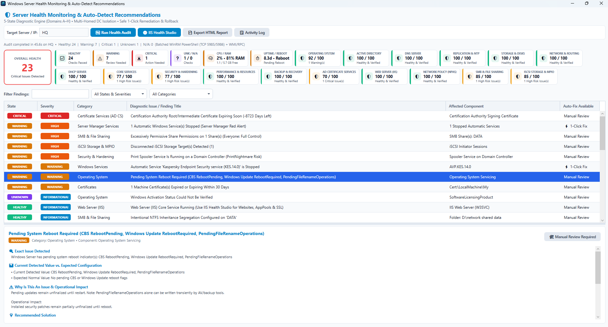

> [!TIP]
> **Consistent Responsive UI & Standardized Loading Experience Across All Server Management Tools**: Every workspace under **Active Directory Server Management / Windows Server Management** features responsive wrapping toolbars (so all buttons remain visible even on compact or snapped windows), auto-sized tables with horizontal scrolling whenever column width exceeds the window, and a standardized centered loading overlay displaying real-time progress stages, an elapsed timer, fast pre-flight reachability verification, timeout protection, and one-click **Retry / Dismiss** controls if a target server is unreachable.

##### 1. Overview & Operational Purpose
The **Auto Detect Errors & Recommendations (Deep Server Health Audit)** workspace is an enterprise diagnostic suite designed to provide immediate, agentless health assessment across Microsoft Windows Servers, Domain Controllers, and enterprise workstations.

Traditional server health audits require administrators to manually run dozens of disconnected command-line utilities, query multiple MMC snap-ins, parse obscure event logs, and manually calculate free storage thresholds. The Deep Server Health Audit engine automates this entire diagnostic procedure into a **single, deterministic health sweep** completed in seconds.

The engine inspects critical directory services, network interface bindings, DNS zones, DHCP scopes, security configurations, and core operating system services. It aggregates telemetry into an intuitive **Overall Server Health Score (0–100)**, categorizes findings by severity, and provides **1-click safe remediation** to resolve misconfigurations instantly.

##### 2. How to Launch the Health Audit Workspace
You can launch the Health Audit workspace for any managed server or workstation through multiple convenient paths:

- **Method A: Right-Click Context Menu (Recommended for Servers)**:
  1. Select any Domain Controller or Windows Server in the main dashboard computer roster.
  2. Right-click the row and navigate to **🏛️ Active Directory Server Management** (or **Windows Server Management**).
  3. Click **🛡️ Windows Server Health Monitoring & Auto-Detect Recommendations...**.
- **Method B: Right-Click Context Menu (For Workstations)**:
  1. Select any client PC or workstation in the computer list.
  2. Right-click the row and navigate to **🖥️ Workstation Management & Diagnostics**.
  3. Click **🛡️ Auto Detect Errors & Recommendations (Workstation Audit)...**.
- **Method C: Context Menu Quick Search**:
  1. Right-click any computer row to open the smart context menu (focuses the built-in action search bar automatically).
  2. Type `health audit`, `server health`, or `auto detect`.
  3. Press Enter to launch the audit for the selected computer.
- **Method D: From the Network Monitor**:
  1. Open **📡 Network Monitor** from the top header navigation bar.
  2. Select any registered server and click **Edit Device**.
  3. Click the **🩺 Server Health Audit** button to run an immediate diagnostic sweep.

##### 3. Workspace Layout, 5-State Evaluation Model & Visual Controls Tour

Every evaluated check is classified into one of **five distinct, evidence-based states** so administrators never face false alarms from uninstalled roles or unreachable remote endpoints:
- **🟢 Healthy**: Verified compliant with operational and security standards.
- **🟡 Warning**: Degraded condition, approaching threshold, or recommended hardening improvement backed by real telemetry.
- **🔴 Critical**: Immediate operational fault, outage risk, or high-impact security gap requiring urgent attention.
- **⚪ Unknown**: Required remote data could not be collected (for example, firewall or remote management port blocked); never assumed to be a confirmed fault.
- **➖ Not Applicable (Hidden Automatically)**: Optional roles or services not installed on the target server (such as Windows SNMP, Windows Server Backup, or Hyper-V on non-virtualization hosts) are automatically omitted from the findings table and category strip so operators see only actionable, relevant checks.

The Health Audit workspace is organized into coordinated functional zones:

###### 3.1 Header Controls & Target Selector
- **Target Host / IP Text Box & Dynamic Role Badge**: Displays the active hostname or IP address alongside an interactive, color-coded classification badge (`[💻 Workstation (Windows 10/11 Pro)]`, `[🛡️ Domain Controller (Windows Server 2022)]`, or `[🖥️ Windows Server (Windows Server 2019)]`). When auditing a workstation, the window title and header automatically adapt to **Workstation Health Monitoring & Auto-Detect Recommendations** and update the target label to **Target Workstation / IP**. You can type any reachable domain machine or IP and initiate a new audit without closing the window.
- **`🔄 Re-Scan Health Audit` Button**: Initiates an immediate fresh diagnostic sweep across all applicable health domains.
- **`🌐 IIS Health Studio` Button** *(Dynamic)*: Appears automatically whenever the IIS web server role is detected on the target server, providing a one-click handoff to the dedicated IIS Web Server Management Studio without cluttering general server health results.
- **`🌐 Export Diagnostic Report (HTML)` Button**: Generates a self-contained, formatted HTML health audit report complete with executive summary, 5-state counts, evidence findings, and verification commands suitable for management sign-off or compliance archives.
- **Loading Overlay & Multi-Stage Progress**: Displays the active diagnostic phase in real time while collecting telemetry across all domains.

###### 3.2 Overall Health Score Card & 5-State Summary
The prominent top-left KPI card synthesizes all applicable evaluated findings into a deterministic 0–100 score (while cleanly displaying counts of **Healthy**, **Warning**, **Critical**, **Unknown**, and **Not Applicable** checks so absent optional roles never distort the score):
- **🟢 Healthy (Score 90–100)**: All applicable server and directory subsystems operating optimally with zero critical issues.
- **🟡 Warning / Minor Attention (Score 75–89)**: Non-critical warnings or hardening opportunities detected.
- **🟠 Degraded / Subsystem Impact (Score 50–74)**: Significant issues detected requiring timely investigation.
- **🔴 Critical / Immediate Action (Score < 50)**: Severe failure impacting production operations.

###### 3.3 Subsystems Health Summary Grid & 8 Comprehensive Assessment Domains (A–H)
The engine evaluates verified server telemetry across **8 comprehensive Windows Server domains**:
- **A. Operating System & Server Health**: Windows Server version/edition/build lifecycle, OS licensing and activation status, pending reboot detection, uptime and unexpected shutdown/BSOD history, critical automatic services (excluding normal trigger-start/delayed-start services), Windows Update patch age, and hardware error events.
- **B. Active Directory & Domain Services**: Domain secure channel health, core Domain Controller services, AD replication partner status, FSMO role reachability, SYSVOL and NETLOGON share availability, Global Catalog status, LDAPS certificate availability and expiry, Kerberos/unsigned LDAP auditing, and NTP time synchronization.
- **C. Storage & Disk Health**: Hybrid percentage and free-gigabyte volume thresholds (preventing false alarms on multi-terabyte drives), physical disk and storage pool health, NTFS dirty-bit and disk I/O error events, and Volume Shadow Copy Service (VSS) writer health.
- **D. Network & Connectivity**: Dynamic primary gateway interface detection, network adapter packet error/discard ratio monitoring, DNS resolution health, multi-homed DNS/DHCP isolation checks, and firewall profile verification.
- **E. Security & Configuration**: Windows Defender and third-party antivirus/EDR detection, SMBv1 and SMB signing posture, Remote Desktop Network Level Authentication (NLA), OS-build-aware TLS protocol configuration, expiring machine certificates, Local Administrators membership auditing, legacy/risky services, and Domain Controller Print Spooler hardening.
- **F. Performance & Resource Monitoring**: Multi-sample CPU utilization and processor queue length, SQL-aware memory and pagefile pressure analysis, disk latency, and resource exhaustion event indicators.
- **G. Backup & Recovery**: Windows Server Backup status plus detection of third-party enterprise backup agents (so servers protected by third-party backup platforms are not falsely flagged as unbacked-up), alongside VSS writer verification.
- **H. Virtualization & Server Roles**: Role-gated Hyper-V host and VM health checks (cleanly marked **Not Applicable** when Hyper-V is not installed), DHCP scope utilization and conflict detection, and lightweight IIS role detection with direct handoff to the dedicated IIS Studio.

###### 3.4 Findings Search & Multi-Criteria Filter Bar
Directly above the findings table, four controls allow administrators to isolate specific items:
- **🔍 Search Filter Box**: Real-time filtering by keyword, finding title, or component name.
- **5-State Filter Dropdown**: Filter by **All States**, **Critical**, **Warning**, **Healthy**, **Unknown**, or **Not Applicable**.
- **Severity Dropdown**: Filter by severity level.
- **Category Dropdown**: Filter findings by any of the 8 server domains.

###### 3.5 Findings DataGrid & 8-Field Structured Detail Inspector
Every finding provides **8 structured evidence fields** so administrators always know *why* a condition was flagged and how to verify it independently:
1. **Issue Title**
2. **State & Severity** (`Healthy`, `Warning`, `Critical`, `Unknown`, `Not Applicable`)
3. **Actual Detected Value / Evidence**
4. **Expected or Recommended Standard**
5. **Root Cause or Explanation**
6. **Potential Operational Impact**
7. **Recommended Corrective Action** (with **⚡ 1-Click Fix** only where safe, verified remote remediation exists, or **Manual Review** otherwise)
8. **Verification Command** to independently confirm the finding or validate remediation.

###### 3.6 Adaptive Device Role Classification & Workstation Health Auditing
The diagnostic engine dynamically adapts its analysis based on the operating system role of the target machine:
- **Operating System Role Awareness**: Automatically detects whether the target is an end-user Windows Workstation, a Member Server, or an Active Directory Domain Controller.
- **Contextual Findings & Category Terminology**: Eliminates server-specific terminology when auditing client workstations. For example, stopped background services are evaluated under **Windows Services** with a **Workstation Services Alert** rather than "Server Manager Red Alert", and SMB packet signing findings provide client-focused NTLM relay mitigation guidance.
- **Domain Trust vs Active Directory Subsystems**: When auditing client endpoints, the Active Directory subsystem card dynamically transitions to **DOMAIN TRUST**, evaluating the workstation's secure channel health and communication readiness with domain controllers instead of flagging missing server roles.
- **Virtualization Tile Adaptation**: The virtualization KPI tile evaluates **VIRTUALIZATION (WSL / HYPER-V)** on workstations, reflecting client-side virtualization and WSL environments without expecting enterprise server clustering.
- **Accurate Machine Certificate Lifecycle**: Intelligently identifies active certification authority certificates and cleanly reports expired certificates with their elapsed time (e.g., *Has Expired (X Days Ago)*) rather than confusing negative remaining days displays.

##### 4. What Each Assessment Category Checks (Comprehensive Technical Breakdown)

###### 4.1 Active Directory Domain Services
- **SYSVOL & NETLOGON Availability**: Verifies that standard domain shares (`SYSVOL`, `NETLOGON`) are actively shared, authenticated, and reachable across the network for client Group Policy and logon processing.
- **Directory Advertising & Diagnostics**: Verifies that the domain controller is properly advertising directory services, responding to LDAP/Kerberos queries, and passing core domain controller diagnostic checks.
- **NTDS Database Capacity & Log Growth**: Inspects Active Directory database (`ntds.dit`) storage consumption and calculates free storage headroom to prevent unrecoverable database lockups caused by disk exhaustion.
- **Replication Link Integrity**: Audits inbound and outbound partner replication links across the Active Directory forest, pinpointing failing partners and replication latency deltas.
- **FSMO Role Holders**: Verifies operational connectivity and response readiness of Flexible Single Master Operation role holders (Schema Master, Domain Naming Master, PDC Emulator, RID Master, Infrastructure Master).

###### 4.2 DNS Infrastructure & Multi-Homed Network Leakage
- **DNS Server Service & Zones**: Inspects forward lookup and reverse lookup zones to detect paused, unauthenticated, or corrupted zones.
- **Interface Listener Isolation**: Verifies which network IP addresses the Microsoft DNS Server service is actively listening on. On multi-homed domain controllers with separate storage or management subnets, the engine flags if DNS is listening on private non-routable interfaces, preventing client queries from routing to unreachable endpoints.
- **Secondary Network Adapter DNS Registration**: Detects whether secondary, backup, or iSCSI storage network adapters have dynamic DNS registration enabled. When enabled on secondary adapters, domain controllers advertise non-routable IP addresses to client workstations, causing intermittent workstation authentication failures.
- **Root Hints & Upstream Forwarders**: Verifies internet name resolution and WAN query forwarding integrity.

###### 4.3 DHCP Server Multi-NIC Binding Isolation & Lease Protection
- **Multi-NIC Interface Binding Audit**: Audits the interface bindings of the Windows DHCP Server service. By default, Windows DHCP binds across all static network interfaces. When an infrastructure server connects to secondary subnets (such as dedicated storage, iSCSI, or backup networks), DHCP listening on those secondary interfaces risks serving rogue IP addresses or encountering return routing asymmetry. The engine identifies this condition and enables instant interface isolation.
- **Scope IP Address Consumption**: Calculates address pool utilization and warns administrators before subnets experience lease exhaustion.
- **Address Conflict Detection**: Audits DHCP conflict detection attempts. When disabled (`0`), the server issues IP addresses without verifying whether an unmanaged device is already using the address. The engine recommends setting conflict detection to `1` or `2` attempts to eliminate IP address collision outages.
- **Failover Partner Synchronization**: Audits high-availability lease synchronization states between redundant DHCP failover partners.

###### 4.4 Core Windows System Services
- **Automatic Services Audit**: Continuously inspects all Windows services configured for Automatic startup. If any automatic service is stopped, it is flagged with its service display name, description, and dependency chain.
- **Domain & Role Dependencies**: Specifically validates essential infrastructure services (Active Directory Domain Services, DNS Server, DHCP Server, Windows Time, Kerberos Key Distribution Center, Netlogon, Server service, and Workstation service).

###### 4.5 Network Interfaces & Active Sockets
- **Physical & Virtual Adapter Health**: Inspects link speed, duplex state, connection status, IP address assignments, and default gateway reachability.
- **Listening Sockets & Port Readiness**: Audits active TCP and UDP listening sockets to verify that core management and service ports are accepting connections.
- **Intelligent Role Disambiguation**: Intelligently verifies whether underlying Windows Features and Server Roles (such as SNMP) are actually installed on the server before probing network sockets. If an optional capability is not installed, the engine classifies the missing listener as Informational ("Feature Not Installed") rather than reporting a false-positive network outage.

###### 4.6 Security & Attack Surface Hardening
- **SMBv1 Legacy Protocol Audit**: Inspects whether the outdated and vulnerable SMBv1 protocol is enabled on the server. SMBv1 is a primary propagation vector for ransomware and lacks modern encryption. The engine highlights SMBv1 and provides 1-click safe remediation to disable it.
- **Windows Firewall Profile Enforcement**: Verifies active firewall protection across Domain, Private, and Public profiles, alerting administrators if host defenses are disabled.
- **Kerberos Ticket Health**: Inspects authentication ticket health and security provider communication.

###### 4.7 Storage & Volume Capacity
- **System Volume (C:) Health**: Evaluates free storage capacity on the operating system drive, warning at 15% free and raising critical alerts if free space falls below 5%.
- **Data & Active Directory Drives**: Inspects dedicated drives hosting database files, transaction logs, and SYSVOL shares to protect against sudden disk exhaustion.

###### 4.8 System Event Logs & Stability
- **Critical Event Log Bursts**: Scans System, Application, Directory Service, and DNS Server logs for critical events and error spikes occurring within the past 24 hours.
- **Hardware & Disk Fault Detection**: Pinpoints underlying disk controller errors, file system corruption notices, or memory faults before they lead to unexpected server reboots.

##### 5. How Recommendations are Generated
The audit engine uses a **deterministic rule evaluation pipeline** that compares observed server telemetry against enterprise baselines:
1. **Multi-Point Data Collection**: Simultaneously queries WMI, Active Directory ADSI, Service Control Manager, and Registry settings over secure RPC.
2. **Rule Correlation**: Cross-references findings across subsystems (for example, verifying whether a stopped service is required by active server roles).
3. **Severity Weighting**: Evaluates the potential operational impact of each finding, assigning appropriate severity and calculating the composite score.
4. **Actionable Remediation Mapping**: Maps each finding to a pre-validated PowerShell remediation script with parameter safety checks and rollback mechanisms.

##### 6. Safe 1-Click Administrative Remediation & Reversible Rollback
When an issue supports automated remediation (indicated by the **⚡ 1-Click Fix** badge):
- Clicking **`⚡ Apply Recommended Remediation`** prompts for explicit administrator confirmation detailing the exact changes to be executed.
- The action executes atomically in the background.
- Upon completion, the engine automatically re-evaluates that specific rule to verify that the issue has been successfully resolved.
- If a remediation needs to be reversed, the suite maintains an immutable activity history enabling safe rollback.

##### 7. Practical Real-World Operational Scenarios
- **Scenario A: Client Workstations Intermittently Cannot Authenticate**:
  - *Symptom*: Users report random "No Logon Servers Available" errors.
  - *Audit Finding*: Under **DNS Infrastructure**, the engine reports: `Secondary Storage Adapter IP Registered in DNS`.
  - *Remediation*: Click **`⚡ Apply Recommended Remediation`** to unbind DNS dynamic registration from the storage adapter and flush stale DNS records. Authentication immediately stabilizes across the domain.
- **Scenario B: DHCP IP Collisions Across Office Subnet**:
  - *Symptom*: Users report duplicate IP address error popups.
  - *Audit Finding*: Under **DHCP Server**, the engine reports: `Conflict Detection Attempts = 0`.
  - *Remediation*: Click **`⚡ Apply Recommended Remediation`** to set conflict detection to `1`. The DHCP server now pings addresses before leasing, eliminating duplicate IP conflicts.
- **Scenario C: Critical Automatic Service Stopped After Windows Updates**:
  - *Symptom*: Server rebooted after patch Tuesday, but remote management tools fail to connect.
  - *Audit Finding*: Under **Core Windows Services**, the engine reports: `Automatic Service 'RemoteRegistry' is Stopped`.
  - *Remediation*: Click **`⚡ Apply Recommended Remediation`** to start the service and verify its startup configuration.

##### 8. Required Permissions & Network Requirements
- **Administrative Rights**: Operating account must be a member of **Domain Admins**, **Enterprise Admins**, or the target server's local **Administrators** group.
- **Required Inbound Firewall Ports**:
  - **TCP Port 135 (RPC Endpoint Mapper)**: Core service and WMI connectivity.
  - **TCP Port 445 (SMB)**: Administrative share and registry verification.
  - **TCP Port 5985 / 5986 (WinRM)**: Remote PowerShell remediation execution.
  - **ICMP Echo Request (Ping)**: Basic host reachability verification.

#### B. Multi-Homed Domain Controller Network Binding & Interface Isolation
Multi-homed domain controllers and enterprise servers frequently utilize multiple physical or virtual network adapters:
- **Primary Domain Adapter**: Connects to the corporate LAN and active directory workstations (e.g. `10.10.10.10`).
- **Dedicated Storage / iSCSI Adapters**: Connect directly to SAN, NAS, or storage arrays (e.g. `172.20.10.2`, `172.20.30.2`).
- **Management or Backup Adapters**: Connect to isolated out-of-band management or backup networks.

##### The Multi-Homed DC Problem
1. **Unintended DHCP Server Bindings**:
   - Windows DHCP Server listens on all static interfaces by default.
   - If secondary network adapters are plugged into storage or backup switches, the DHCP server will answer DHCP discover requests on those secondary subnets, handing out wrong IP addresses or causing routing conflicts.
2. **DNS Record Pollution**:
   - By default, Windows network adapters are set to register their IP addresses in DNS.
   - Consequently, the domain controller registers its storage IP addresses into the domain DNS zone.
   - Workstations querying DNS for a domain controller will randomly receive storage IP addresses that are physically unreachable from client subnets, causing random workstation logon delays, group policy timeouts, and mapped drive disconnects.

##### How WADRACC Audits & Fixes Multi-Homed Servers
The **Auto Detect Errors & Recommendations** engine inspects all active network adapters on the server, compares their IP configurations against the server's primary domain IP, and flags:
- DHCP Server actively bound to secondary storage/backup adapters.
- Secondary adapters actively configured to register their addresses in DNS.
- DNS Server listening on secondary non-routable IP addresses.

With 1 click, the administrator can apply **Isolate DHCP Bindings to Primary Adapter** and **Disable Secondary Adapter DNS Registration** to eliminate client connection drops instantly.

#### C. Safe 1-Click Administrative Remediation, Reversible Rollback & HTML Export
Every detected issue in the diagnostic findings table includes an interactive detail inspector showing **Actual Detected Evidence**, **Expected Baseline**, **Root Cause & Operational Impact**, **Recommended Solution**, and **Verification Commands** with one-click copy cards.

##### Built-In Reversible Rollback Protection
To guarantee zero downtime and maximum enterprise safety, automated remediation follows a strict 5-step safety workflow:
1. **Automated Pre-Change Backup Snapshot**: Captures affected server settings into a local JSON snapshot before applying any change.
2. **Targeted Atomic Application**: Executes exclusively on the targeted remote server after explicit administrator confirmation.
3. **Automated Verification Check**: Immediately re-queries the subsystem to confirm the fix took effect.
4. **Live Result Reporting**: Displays clear before-and-after confirmation results.
5. **Instant 1-Click Rollback**: Provides an **↩️ Undo / Rollback** action to restore the original pre-change state at any time.

##### Available 1-Click Remediations & Interactive Command Copying
- **Isolate DHCP Bindings to Primary Interface** & **Disable Secondary Adapter DNS Registration**
- **Isolate DNS Server Listening Interfaces** & **Enable DHCP Address Conflict Detection**
- **Start Stopped Automatic Services**, **Enable Windows Firewall**, and **Disable Insecure Legacy SMBv1 Protocol**
- **Enable WinVerifyTrust Signature Padding Check (CVE-2013-3900)**: Enforces Authenticode signature verification across both 32-bit and 64-bit cryptography configurations, preventing attackers from appending malicious payloads to digitally signed binaries without invalidating signatures.
- **Enable Process Creation Command-Line Auditing (Event ID 4688)**: Configures audit policies to record full command-line arguments and script parameters during process execution, providing critical forensic visibility into obfuscated script execution and suspicious command flags.
- **Enable PowerShell ScriptBlock Logging (Event ID 4104)**: Enables deep execution block inspection so encoded or obfuscated memory-resident PowerShell scripts are completely decoded and recorded in the event log for incident investigation.
- **Suppress Credential UI Local Administrator Account Enumeration**: Prevents elevation prompts from displaying lists of administrative usernames on shared or operator workstations, reducing attacker shoulder-surfing and credential discovery risks.
- **Dedicated Command Cards**: Every manual fix and verification command displays in a high-contrast command block with inline **📋 Copy** and **📋 Copy All Commands** buttons.

##### Standalone HTML Health Audit Report Export
Click **📄 Export HTML Report** on the Server Health toolbar to generate a self-contained HTML report containing server metadata, Overall Health Score, 5-state summary counts, subsystem scorecards, all findings with evidence and verification commands, and remediation history—ready for compliance archiving or management review.

#### D. SMB Shared Folder Permissions, Domain Performance & Health Activity Log

##### SMB Shared Folder Permissions & NTFS Inheritance Audit
Audits published network shares across file servers and Domain Controllers:
- **NTFS Permission Inheritance Tracking**: Distinguishes intentional segregation on sensitive folders (HR, Finance, Payroll, Admin) from accidental inheritance breaks.
- **Orphaned Security Identifiers (SIDs)**: Identifies leftover deleted accounts (`Account Unknown`) on share and folder ACLs.
- **Per-Share Effective Access Evaluation**: Accurately inspects each share individually without cross-contaminating findings across unrelated shares, flagging risky `Everyone: Full Control` exposures.

##### Domain Performance, Startup & Shutdown Delay Diagnostics
Pinpoints root causes of slow boots, logons, and shutdowns on domain servers and workstations:
- **Virtual Memory Pagefile Clearing at Shutdown** and excessive **Service Shutdown Timeouts** (with 1-click safe remediation).
- **Synchronous Network Boot Policies** causing prolonged logon waits on client laptops.
- **DFS Replication SYSVOL Dirty Shutdown (Events 2213 & 4012)**: Automatically verifies whether recovery Event 2214 already completed before alerting, eliminating false alarms.
- **User Profile Registry Handle Leaks (Event 1530)** delaying logoffs.

##### Server Health Activity Log & Execution History
Click **📋 Activity Log** on the Server Health toolbar to review timestamped audit history, color-coded outcome badges, execution methods, and one-click **Export Audit Log (CSV)**.

---

#### E. Multi-Server Health & Configuration Drift Comparison

**Menu Path**:
- *Single Server Menu*: **🏛️ Active Directory Server Management** ▸ **📊 Multi-Server Health & Configuration Drift Comparison...**
- *Multi-Select Bulk Menu*: Select multiple servers ▸ right-click ▸ **🏛️ Multi-Server Administration** ▸ **📊 Multi-Server Health & Configuration Drift Comparison...**

##### Purpose & Capabilities
Audits multiple Windows Servers in parallel (up to 6 concurrently with independent per-server timeout protection so one unreachable server never blocks other results) and compares health, roles, and configuration drift side by side.

##### Workspace Tabs, Controls & Responsive Layout
- **Responsive Wrapping Toolbar**: Includes the comma-separated **Servers** list, **🔄 Compare Servers**, and **📄 Export HTML**—automatically wrapping onto clean rows on small or snapped windows so no button is ever hidden.
- **Standardized Progress Overlay**: Displays live completion progress (`Completed X of Y servers...`), active server feedback, and a live elapsed timer immediately upon launch.
- **Tab 1 — 📊 Side-by-Side Server Matrix**: Auto-sized, horizontally scrollable table displaying **Server**, color-coded **Score** (unreachable servers clearly display a purple **N/A** or **TIMEOUT** badge instead of a misleading score), **Crit / Warn / OK / Unk** counts, **Detected Roles**, **CPU / RAM**, **Min Disk Free**, **Uptime**, **Reboot**, **Firewall**, **SMB**, **Antivirus / EDR**, and **Operating System**. Double-click any server row to open its full **Windows Server Health Monitoring** window immediately.
- **Tab 2 — ⚖️ Configuration Drift Analysis**: Automatically groups reachable servers across OS build, Firewall posture, SMB signing/SMBv1, Antivirus/EDR, Pending Reboot, and NTP Time Source to pinpoint exact configuration drift between redundant peers.

##### Practical Real-World Use Case
*Scenario*: Two production application servers (`APP01` and `APP02`) behave inconsistently after monthly patching while a retired lab server (`ADMIN`) is powered off.
*Resolution*: Running **Multi-Server Health & Configuration Drift Comparison** immediately marks `ADMIN` as `N/A (Unreachable)` in ~2 seconds without stalling the rest of the scan, compares all reachable servers in parallel, highlights that `APP02` still has a pending reboot and an older OS build in the **Configuration Drift Analysis** tab, and lets the administrator double-click `APP02` to inspect full details.

---

#### F. Interactive Server Topology & Infrastructure Discovery Map

**Menu Path**:
- *Single Server Menu*: **🏛️ Active Directory Server Management** ▸ **🗺️ Server Topology & Infrastructure Discovery Map...**
- *Multi-Select Bulk Menu*: Select multiple servers ▸ right-click ▸ **🏛️ Multi-Server Administration** ▸ **🗺️ Server Topology & Infrastructure Discovery Map...**

##### Purpose & Capabilities
Automatically discovers and renders an interactive, zoomable visual map of your Active Directory and server infrastructure—replacing stale static network diagrams with live, verified relationships.

##### Key Interactive Features & Toolbar Controls
- **Clean Non-Crossing Tiered Placement**: Organizes your infrastructure cleanly from top to bottom:
  1. **Tier 0 — AD Forest / Domain Root**: Displays the domain name and resolved Domain Functional Level (e.g., Windows Server 2016 / 2025).
  2. **Tier 1 — Active Directory Sites**: Positioned cleanly between the Domain Root and all servers belonging to that site (Domain Controllers, Member Servers, and Hyper-V Hosts) so relationship lines never slash through site boxes.
  3. **Tier 2 — Domain Controllers, Primary/Secondary DNS Servers, Member Servers & Physical Hyper-V Hosts**: Domain Controllers display FSMO role crowns and Global Catalog badges; DNS servers automatically show whether they host **Primary DNS**, **Secondary DNS**, or both (with dashed **Secondary DNS Sync** zone-transfer edges linking Primary and Secondary DNS servers) alongside each server's own independently discovered DNS forwarder list; and physical Hyper-V hosts display live VM counts while hosted guest VMs identify their parent physical Hyper-V host in the Inspector.
  4. **Tier 3 — DNS Upstream Forwarders & Hyper-V Guest Virtual Machines**: Aligned neatly beneath their parent DNS servers and physical Hyper-V hosts, with each upstream DNS forwarder card clearly attributing which Primary and/or Secondary DNS server(s) independently forward to it via color-coded non-overlapping links.
- **Server IP Addresses & DNS Resolver Details**: Every Domain Controller, Member Server, Hyper-V Host, and running Hyper-V Guest VM (where reported) displays its resolved IPv4 address right inside the card (`IP: 10.x.x.x`), in hover tooltips, in the right-hand **Infrastructure Node Inspector** (including each server's configured Primary and Secondary DNS servers, hosted DNS zones, and physical vs. virtual hardware classification), and in exported SVG/HTML diagrams.
- **Mouse & Touch Drag-and-Drop Repositioning**: Click and drag (or touch and drag) any node on the canvas to organize complex topologies the way you want. Connected lines and edge badges dynamically re-anchor and follow in real time, and smart anti-overlap separation prevents dropped nodes from piling on top of neighboring cards.
- **Toolbar Controls (Fully Responsive Wrapping Bar)**:
  - **Layer Filter Dropdown**: Switch between *All Infrastructure Layers*, *AD Sites, DCs & Replication*, *DNS & Server Roles*, and *Hyper-V Hosts & VMs*.
  - **`DNS Fwd Links` Toggle**: Show or hide dashed DNS upstream forwarder lines to keep large topologies crisp and uncluttered.
  - **`➖ Zoom` / `100%` / `➕ Zoom`**: Smoothly scale the topology canvas around the centre of the view.
  - **Mouse-Wheel Zoom**: Scroll the wheel **up to zoom in** and **down to zoom out**. The map point under the mouse pointer stays exactly where it is while you zoom, so you can magnify a specific server, site or link without losing it. Zoom ranges from 25% to 300%; dragging nodes, selecting nodes, the scroll bars and the toolbar buttons keep working as before.
  - **`↺ Auto-Arrange`**: Instantly resets manually moved nodes back to the clean automatic hierarchical layout.
  - **`🔄 Rediscover`**: Refreshes live AD, IP, DNS, and Hyper-V topology data behind the standardized loading overlay with stage progress and elapsed timer.
  - **`📄 Export SVG/HTML`**: Exports a standalone SVG/HTML diagram preserving your custom dragged node positions and server IP addresses.

##### Step-by-Step How-To Guide
1. Right-click any server in the roster and choose **🏛️ Active Directory Server Management** ▸ **🗺️ Server Topology & Infrastructure Discovery Map...**.
2. Wait briefly while the standardized progress overlay discovers AD Sites, Domain Controllers, Server IP addresses, DNS Forwarders, and Hyper-V guests in parallel.
3. Click any node to view full roles, IP address, and relationship links in the right-hand **Infrastructure Node Inspector**.
4. Point at the area you want to inspect and scroll the mouse wheel to zoom in or out, drag any node with your mouse or touchscreen to arrange the layout, toggle **DNS Fwd Links** if desired, or click **↺ Auto-Arrange** to reset.
5. Click **📄 Export SVG/HTML** to save and share the visual diagram.

---

#### F.1. Active Directory Multi-DC Health & Replication Command Center

**Menu Path**:
- *Single Server Menu*: **🏛️ Active Directory Server Management** ▸ **🏛️ Multi-DC Health & Replication Command Center...** (or open a specific focus tab directly from **🔄 AD Replication & Diagnostics**, **🌐 DNS Health & Resolution**, **📁 SYSVOL, DFSR & GPO Consistency**, or **👑 FSMO Roles & Global Catalog**)
- *Multi-Select Bulk Menu*: Select multiple Domain Controllers ▸ right-click ▸ **🏛️ Multi-Server Administration** ▸ **🏛️ Multi-DC Health & Replication Command Center...**

The **Active Directory Multi-DC Health & Replication Command Center** is an independent, non-modal 7-tab workspace built specifically for daily administration of multi-DC topologies across headquarters and branch sites. Instead of inspecting Domain Controllers one at a time via plain text popups, administrators see every Domain Controller's health, replication status, DNS zones, SYSVOL/GPO consistency, FSMO placement, and event diagnostics in a single screen.

##### Top KPI Summary Cards & Toolbar
- **Live Fleet KPI Badges**: **DOMAIN CONTROLLERS**, **REPLICATION**, **DNS HEALTH**, **SYSVOL & GPO**, **FSMO & GC**, and **EVENTS (24H)**—click any tile to jump straight to that tab.
- **Domain, Site & Search Filtering**: Filter the entire fleet simultaneously by **Domain**, **Active Directory Site**, live search text, or **Show Issues / Warnings Only**.
- **Full Horizontal Scrolling & Double-Click Inspection**: All 7 tabs size columns dynamically to display full FQDNs, replication partner details, DNS diagnostic strings, and `dcdiag` test messages with automatic horizontal scrollbars—plus double-click any **Fleet Overview** row to open its full Server Health suite, or double-click any **DNS Health Check**, **DCDiag Test**, or **Event Log** row to open a clean, copyable detail popup.
- **On-Demand Refresh & Multi-Format Exports**: Click **🔄 Refresh All** to re-collect multi-DC state in parallel, or export structured reports to **📊 7-Sheet Excel (`.xlsx`)**, **🌐 Interactive Light/Dark HTML Report**, or **📄 CSV**.

##### Seven Specialized Workspace Tabs
1. **🏛️ Fleet Overview Tab**: Consolidates **Server Name**, **IP Address**, **Site**, **Domain / Forest**, **DC Type** (`Writable` / `RODC` / `GC`), **FSMO Roles**, **OS & Build**, **DC Promotion Date**, **Last Boot & Uptime**, core services (**AD DS**, **DNS**, **Netlogon**, **DFSR**), **LDAP / LDAPS** availability, **SYSVOL / NETLOGON** readiness, **Replication Status** (`Healthy` / `Warning` / `Failed`), **Last Successful Sync**, **NTP Drift**, **CPU / RAM / Disk**, **24h Critical Events**, and **Overall Health**. Click any Domain Controller row to populate the bottom **Selected DC Metadata & Storage Inspector** with quick action buttons (**⚡ Replicate Now**, **🔁 Run KCC Check**, **🔍 Run Live DCDiag**, **🛡️ Open Server Health**, **🗺️ Topology Map**, **💻 Remote Console**).
2. **🔄 Replication Matrix Tab**:
   - Inspects inbound/outbound replication partners across Directory Partitions (`Domain`, `Configuration`, `Schema`, `DomainDnsZones`, `ForestDnsZones`) with **Source DC**, **Destination DC**, **Partition**, **Last Attempt**, **Last Success**, **Latency**, **Consecutive Failures**, and **Status**.
   - Translates obscure directory failure codes into plain-English failure explanations and remediation guidance.
   - Provides confirmation-gated **⚡ Replicate Selected Partner Link...**, **🔄 Replicate All Partners on DC...**, and **🔁 Recalculate Topology (KCC)** (recalculates replication topology connections without modifying FSMO ownership).
3. **🌐 DNS Health Tab**:
   - Audits **DNS Zones** across Domain Controllers (Zone Type, AD-Integrated Replication Scope such as `Forest` / `Domain` / `Legacy`, Dynamic Updates mode, **Aging / Scavenging** enabled vs. disabled, SOA Serial consistency, and configured Forwarders).
   - Validates per-DC **DNS Registration & Record Health**: `_ldap._tcp.dc._msdcs` SRV records, `_kerberos` SRV records, DC CNAME GUID record, A/PTR records, and **Lingering / Stale DC Records** pointing to decommissioned servers.
4. **📁 SYSVOL & GPO Consistency Tab**:
   - Monitors per-DC **DFSR Service** status, **SYSVOL & NETLOGON Share Availability**, replication backlog status, and readiness state.
   - Compares every Group Policy Object's directory version against each Domain Controller's live SYSVOL `GPT.INI` policy folder to immediately flag version mismatches or missing policy files.
5. **👑 FSMO & Global Catalog Tab**:
   - Identifies the authoritative owner of all five FSMO roles (**Schema Master**, **Domain Naming Master**, **PDC Emulator**, **RID Master**, **Infrastructure Master**) alongside live **Reachability** and **Latency (ms)**, plus complete **Global Catalog** and **RODC** status per DC.
   - Provides a **🔁 Guided FSMO Role Transfer...** workflow allowing authorized Domain/Enterprise Administrators to safely move FSMO roles between healthy online Domain Controllers with explicit pre-flight reachability verification and multi-step confirmation. *(Destructive offline FSMO role seizing is intentionally excluded to safeguard directory consistency.)*
6. **📋 Events & DCDiag Tab**:
   - Aggregates critical and error events from the last 24 hours across **Directory Service**, **DNS Server**, **DFS Replication**, **Netlogon**, and **Kerberos** channels.
   - Runs live on-demand Domain Controller diagnostic suites (`dcdiag`) for any selected Domain Controller, parsing test results (`Connectivity`, `Advertising`, `Replications`, `Services`, `SysVolCheck`, `KccEvent`, `VerifyReferences`, etc.) cleanly into pass/fail rows alongside **📄 View Raw DCDiag Output** and horizontal/double-click full-line inspection.
7. **📜 Replication History Tab**:
   - Automatically records timestamped fleet health and replication check snapshots locally so administrators can track historical replication failures, sync trends, and recovery timelines across audits.

##### Practical Real-World Use Case
*Scenario*: Users at a branch office report delayed sign-ins and Group Policy changes made at HQ are missing on the branch Domain Controller.
*Resolution*: Right-click any Domain Controller ▸ **🏛️ Active Directory Server Management** ▸ **🏛️ Multi-DC Health & Replication Command Center...**. Immediately see in **Fleet Overview** that `BRANCH-DC02` shows `Warning` in Replication, switch to **Replication Matrix** to read the translated RPC/firewall diagnostic error, click **🔄 Replicate All Partners on DC...** after resolving connectivity, check **SYSVOL & GPO Consistency** to confirm all GPOs report `Synced`, and export the **Interactive HTML** or **7-Sheet Excel (`.xlsx`)** verification report.

---

#### G. Active Directory, Replication, DNS, SYSVOL, FSMO & DHCP Infrastructure Management

**Menu Path**: **🏛️ Active Directory Server Management** ▸ **🔄 AD Replication & Diagnostics**, **🌐 DNS Health & Resolution**, **📁 SYSVOL, DFSR & GPO Consistency**, **👑 FSMO Roles & Global Catalog**, and **📡 DHCP Server Infrastructure**

These submenus combine multi-DC Command Center tabs with direct per-server diagnostic utilities and confirmation-protected administrative actions. When selecting any single-server tool below, the application connects remotely to the targeted server, runs the audit or confirmed operation, and displays timestamped results inside a scrollable report viewer.

##### 🔄 AD Replication & Diagnostics
1. **📊 Multi-DC Replication Matrix, Partner Health & Sync...**: Opens the Command Center directly on the **Replication Matrix** tab to inspect partner deltas, failure codes, and run confirmation-gated partner synchronization.
2. **🩺 AD Critical Events & Live DCDiag Console...**: Opens the Command Center directly on the **Events & DCDiag** tab to review 24-hour critical events and run live parsed `dcdiag` tests.
3. **📜 Replication Check History & Trends...**: Opens the persistent **Replication History** tab to review trends across saved checks.
4. **🔄 Active Directory Replication Summary (`repadmin /replsummary`)**:
   - **Purpose**: Quickly verifies replication health across all Domain Controllers from a single text summary table.
   - **What Happens When Clicked**: Connects remotely and runs `repadmin /replsummary`, listing inbound/outbound deltas, total links, error counts, and failure percentages without modifying Active Directory.
5. **🩺 Domain Controller Health & Diagnostics (`dcdiag /q`)**:
   - **Purpose**: Rapid error-only Domain Controller diagnostic sweep highlighting failing tests while suppressing passing checks.
   - **What Happens When Clicked**: Runs quiet mode diagnostics (`dcdiag /q`) covering directory advertising, Netlogons, replication, KCC topology, and DFSR SYSVOL integrity. *(If output is minimal, all quiet tests passed; use **🔍 Run Live DCDiag Tests** in the Command Center for full pass/fail test-by-test breakdown.)*
6. **💾 NTDS Database & SYSVOL Disk Space Audit**:
   - **Purpose**: Prevents Active Directory halts and replication corruption caused by full database or SYSVOL volumes.
   - **What Happens When Clicked**: Dynamically locates the Domain Controller's actual Active Directory database (`ntds.dit`), transaction log directory, and `SYSVOL` share path—even on custom non-default volumes—reports file size in MB, and audits free capacity across local fixed drives.

##### 🌐 DNS Health & Resolution
7. **🌐 DNS Zones, Replication Scope & SRV Health Studio...**: Opens the Command Center directly on **Tab 3 (DNS Health)** showing zone types, AD replication scopes, **Aging / Scavenging** status, SOA serials, forwarders, SRV records, and lingering DC record checks.
8. **📋 Active DNS Zones Health & Status Audit**:
   - **Purpose**: Confirms every forward and reverse lookup zone on the selected DNS server is loaded, unpaused, and actively serving queries.
   - **What Happens When Clicked**: Lists all DNS zones with Zone Type, AD Integration status, Paused flag, and Shutdown flag.
9. **🔍 DNS Server Forwarders & Root Hints**:
   - **Purpose**: Troubleshoots broken external internet resolution or slow DNS lookup timeouts.
   - **What Happens When Clicked**: Displays upstream DNS forwarder IP addresses configured on the remote DNS server.
10. **📡 Domain Controller Locator SRV Records Check**:
    - **Purpose**: Verifies workstations and member servers can locate Domain Controllers during sign-in and Group Policy refreshes.
    - **What Happens When Clicked**: Queries `_ldap._tcp.dc._msdcs` SRV records for the domain and lists all registered DC hostnames, ports (`389`), priorities, weights, and TTL values.
11. **🔎 DNS Name Resolution & AXFR Leak Audit (`nslookup`)...**:
    - **Purpose**: Interactive DNS record lookup and zone-transfer security verification against a specific DNS server.
    - **How to Use**: Opens the interactive DNS lookup studio pre-targeted at the selected server so you can test `A`, `AAAA`, `PTR`, `MX`, `TXT`, `SRV`, and zone-transfer (`AXFR`) exposure directly.
12. **⚡ Fleet IP & DNS Discrepancy Analyzer...**:
    - **Purpose**: Identifies computers whose live IP address no longer matches what is registered in Active Directory DNS.
    - **What Happens When Clicked**: Opens the fleet discrepancy studio to isolate stale DNS entries and reconcile mismatched host records.
13. **🧹 Trigger DNS Stale Records Scavenging...** *(Confirmation Required)*:
    - **Purpose**: Cleans up outdated, orphaned dynamic DNS records (such as old DHCP leases from retired or reimaged machines) without ever deleting static DNS records.
    - **Safety & Confirmation**: Always prompts **Yes / No** before running. Static records (servers, routers, manual host entries without timestamps) are never touched.
    - **What Happens After Clicking Yes**:
      1. Queues an immediate manual background scavenging pass on the remote Windows DNS Server service. *(Queuing itself returns immediately because DNS Server executes record deletion asynchronously in the background.)*
      2. Audits the server's **Scavenging Interval** and displays a **Per-Zone Aging Summary Table** showing whether **Aging / Scavenging** (`AgingEnabled`), `NoRefresh`, and `Refresh` intervals are enabled or disabled for every Primary zone.
      3. Queries the remote **DNS Server** Event Log for recent scavenging completion events (**Event ID `2501` / `2502`**) showing deleted record counts.
    - **Understanding the Output**:
      - Scavenging deletes **only** dynamic timestamped records whose age exceeds **No-Refresh + Refresh** in zones where **Aging / Scavenging is Enabled**.
      - If the zone audit shows **`AgingEnabled: False`** (also shown as **`Disabled`** in the Command Center **DNS Health** tab), the command queues cleanly without errors, **but 0 records are deleted** until Aging/Scavenging is turned on for those zones in Windows DNS Manager (*Zone Properties → General → Aging...* and *Server Properties → Advanced → Enable automatic scavenging*).

##### 📁 SYSVOL, DFSR & GPO Consistency
14. **📁 SYSVOL, DFSR & GPO Consistency Studio...**: Opens the Command Center directly on **Tab 4 (SYSVOL & GPO)** to compare DFSR health and Group Policy version consistency across all Domain Controllers.
15. **📁 SYSVOL & Netlogon Share Availability Test**:
    - **Purpose**: Confirms logon scripts and Group Policy folders are published and reachable over SMB.
    - **What Happens When Clicked**: Inspects `SYSVOL` and `NETLOGON` share publication and tests UNC reachability.
16. **📑 Export Complete GPO Report (HTML)...**:
    - **Purpose**: Generates a full Group Policy Object settings audit document for compliance or change tracking.
    - **What Happens When Clicked**: Saves a responsive HTML report of all domain GPO settings to your local Reports directory.
17. **🔄 Force Server Group Policy Update (`gpupdate /force`)...** *(Confirmation Required)*:
    - **Purpose**: Immediately reapplies Computer and User Group Policy settings on the remote server without waiting for background refresh intervals.
    - **What Happens After Clicking Yes**: Prompts for confirmation and executes non-blocking remote `gpupdate /force`, ideal after firewall, security baseline, or audit policy updates.

##### 👑 FSMO Roles & Global Catalog
18. **👑 FSMO Role Holders, RID Pool & Global Catalog Studio...**: Opens the Command Center directly on **Tab 5 (FSMO & Global Catalog)** displaying all 5 role holders, Global Catalog/RODC posture, RID pool capacity, and confirmation-gated **Guided Online FSMO Role Transfer**.
19. **👑 Locate Active Directory FSMO Roles (`netdom query fsmo`)**:
    - **Purpose**: Rapid single-window check identifying the server holding all 5 FSMO roles (Schema Master, Domain Naming Master, PDC Emulator, RID Master, Infrastructure Master).

##### 📡 DHCP Server Infrastructure
20. **📊 DHCP Scopes IP Utilization & Pool Audit**:
    - **Purpose**: Detects DHCP subnet IP exhaustion before endpoints lose network leases.
    - **What Happens When Clicked**: Queries IPv4 DHCP scopes and reports Total Addresses, Free Addresses, In Use count, and Utilization %.
21. **🤝 DHCP High Availability & Failover Sync Status**:
    - **Purpose**: Verifies failover health between redundant DHCP servers.
    - **What Happens When Clicked**: Lists DHCP failover relationships, mode (Load Balance / Hot Standby), partner state, and server role.
22. **🔄 Refresh DHCP & DNS Records / Cache...** *(Confirmation Required)*:
    - **Purpose**: Clears stale DNS client/server caches and forces dynamic DNS registration after IP or DHCP changes.
    - **What Happens After Clicking Yes**: Prompts for confirmation, flushes local DNS resolver cache (`ipconfig /flushdns`), clears DNS Server cache if present, and triggers dynamic DNS registration (`ipconfig /registerdns`).

---

#### H. Time Synchronization (NTP) & Critical Active Directory Services

**Menu Path**: **🏛️ Active Directory Server Management** ▸ **⚡ Time Sync (NTP) & Critical Services**

Active Directory Kerberos authentication fails if Domain Controllers or servers drift more than 5 minutes. Every service restart and NTP topology reconfiguration action includes a **Yes / No confirmation dialog** to prevent accidental disruption in production.

- **⏱️ Time Server (NTP) Status & Health Audit**: Inspects Windows Time synchronization source (`Local CMOS Clock`, `VM IC Time Synchronization Provider`, `domhier`, or external NTP server), stratum, dispersion, and clock drift without changing settings.
- **🔄 Force Immediate NTP Time Resync**: Forces immediate time rediscovery and synchronization against authorized time peers (`w32tm /resync /rediscover`).
- **🌐 Configure as Authoritative NTP Server (PDC)...** *(Confirmation Required)*: Reconfigures the PDC Emulator as an authoritative external NTP master using external time sources. *(Confirmation reminds operators to run this only on the forest-root PDC Emulator.)*
- **🏢 Configure as Domain Hierarchy NTP Client...** *(Confirmation Required)*: Reconfigures member servers or non-PDC DCs to synchronize automatically from the AD domain hierarchy (`domhier`) and restarts `w32time`.
- **🧹 Flush & Re-Register DNS Client Cache**: Clears and re-registers the DNS resolver client cache on the targeted server.
- **Critical Services Lifecycle Controls *(Confirmation Required)***: Safely cycles **Active Directory Web Services (ADWS)**, **Kerberos Key Distribution Center (KDC)**, **Netlogon Service (`Netlogon`)**, **DNS Server Service (`DNS`)**, and **DHCP Server Service (`DHCPServer`)** remotely after explicit confirmation—printing the verified post-restart service state without rebooting the server.

---

#### I. IIS Web Server Management Studio (Websites, App Pools, SSL, Logs & Backups)

**Menu Path**: **🏛️ Active Directory Server Management** ▸ **🌐 IIS Web Server Management**

The **IIS Web Server Management Studio** is a dedicated, standalone 6-tab monitoring and administration console exclusively focused on Microsoft Internet Information Services (IIS). It is **completely separate from Windows Server Health Monitoring** so web diagnostics never mix with general operating system checks. When targeted at a server without IIS installed, it cleanly reports **Not Applicable** rather than false errors.

##### Six Dedicated Workspace Tabs & 13 IIS Assessment Areas
- **Interactive KPI Summary Tiles**: Displays the overall IIS Health Score alongside compact, responsive, color-coded summary tiles (**Healthy**, **Warning**, **Critical**, **Unknown / N/A**, **Websites**, **Web Apps**, **App Pools**, **SSL Certs**, and **Workers**) that automatically wrap across window sizes—click any state tile to filter Health Assessment checks or any inventory tile to jump straight to that tab.
1. **🛡️ Health Assessment Tab (13-Area 5-State Audit)**: Evaluates IIS websites, application pools, crash/rapid-fail events, pool identities, HTTP/HTTPS bindings, SSL certificate validity/expiry, live HTTP availability/latency, recycling policies, worker memory/CPU, IIS configuration integrity, W3C error rates, Failed Request Tracing (FREB), and IIS security posture (legacy TLS, directory browsing, headers, HSTS).
2. **🌐 Websites & Bindings Tab**: Lists all websites, hosted IIS web applications (sub-applications, virtual paths, mapped application pools, and physical directories), states, default pools, physical paths, HTTP/HTTPS bindings, and live HTTP/HTTPS availability probes with response codes, TLS details, and millisecond latency—plus confirmation-gated **Start Site** and **Stop Site** buttons. All displayed URLs across websites, web applications, configured bindings, and availability probes are interactive clickable links; left-click any URL to copy it instantly to the clipboard, or right-click to open a context menu to copy the URL, open in your web browser, or launch the security hardening auditor.
3. **⚙️ App Pools & Workers Tab (with Side-by-Side Comparison)**: Displays all application pools (showing both bound root websites and bound hosted web applications), .NET runtime, pipeline mode, identity, recycling settings, active worker process RAM/CPU, confirmation-gated **Start / Recycle / Stop Pool** buttons, and an interactive **Compare Selected Pools (Ctrl+Click)** analyzer.
4. **🔒 SSL Certificates Tab**: Lists bound SSL/TLS certificates across Local Machine and Web Hosting stores with live TLS handshake verification (reconciling auto-rebound renewed certificates automatically), subject/CN, issuer & SANs, expiration date, days remaining, active thumbprint, and color-coded validity badges.
5. **📋 Events, Logs & FREB Tab**: Surfaces recent WAS/IIS crash & recycle events (48h), W3C HTTP 2xx–5xx summaries, top failing URIs, and FREB trace file counts.
6. **💾 Backups & Operations Tab**: Lists IIS configuration backups, creates named on-demand backups, restarts **WAS + W3SVC** with confirmation, and exports complete **HTML** and multi-worksheet **Excel (`.xls`)** reports covering every tab and table to `Documents\Windows AD RACC Reports\IIS Health\`.

##### Practical Real-World Use Case
*Scenario*: An intranet payroll portal returns `HTTP 503 Service Unavailable`.
*Resolution*: Right-click the web server ▸ **🌐 IIS Web Server Management** ▸ **📊 IIS Web Sites & Application Pools Health...** to open the dedicated IIS Studio directly. Spot the stopped `PayrollAppPool` and its WAS crash event in the Events tab, compare its settings against a healthy pool, start/recycle it with confirmation, and confirm `HTTP 200 OK` via the built-in live HTTP probe in under 20 seconds.

##### IIS Web Security Headers & Cookie Attributes Auditor
- **Menu Path**: **🏛️ Active Directory Server Management** ▸ **🌐 IIS Web Server Management** ▸ **🛡️ IIS Web Security Headers & Cookie Auditor...**
- **What it does**: Audits live HTTP and HTTPS responses across hosted IIS websites, checking for the presence of recommended security headers (HSTS, Content-Security-Policy, X-Frame-Options, X-Content-Type-Options, Referrer-Policy, Permissions-Policy) and evaluating whether authentication cookies include the `Secure`, `HttpOnly`, and `SameSite` protective attributes.
- **Automatic Multi-Website & Application Discovery**: Automatically queries the target server to detect all active IIS websites, applications, and custom port endpoints (such as `https://intranet.contoso.com/` and `http://10.10.10.20:8081/`), pre-populating them into the audit list rather than requiring manual URL entry.
- **Unified Diagnostic Logic**: Works in tandem with **IIS Web Server Management**, allowing one-click launching from the "🛡️ Security Hardening" button in the IIS Studio toolbar.
- **Host Header Precedence & Intranet DNS Resilience**: Preserves configured host headers and automatically falls back to connecting directly via the server's IP address when internal intranet domain names are not resolvable on public workstation DNS.
- **Accurate Direct IP Binding Evaluation**: Differentiates between functional website endpoints and direct IP default bindings, clearly explaining when an endpoint returns HTTP 404 because a specific Host Header is required.
- **Operational Benefits**: Ensures corporate web applications comply with modern web security baselines, flagging missing security headers and unprotected session cookies before external audits or vulnerability scans.

---

#### J. Hyper-V Virtualization Management Console

**Menu Path**: **🏛️ Active Directory Server Management** ▸ **🖥️ Hyper-V Virtualization Management**

Provides agentless visibility and safe lifecycle management for Microsoft Hyper-V hosts and virtual machines. Cleanly displays **Not Applicable** when targeted at servers without the Hyper-V role.

##### Key Tabs, Controls & Responsive Tables
- **Responsive Wrapping Header, Modern KPI Summary Tiles & Standardized Loading Overlay**: Keeps **Hyper-V Host**, **🔄 Refresh Host**, **📄 Export HTML** (complete 5-section report), and **📊 Export Excel** (multi-worksheet `.xls` workbook with Host Summary, Virtual Machines, Virtual Switches, VHDX Storage, Checkpoints, and Event Logs) visible at all window sizes, displays 9 compact color-coded host metric tiles (**Host & VMMS**, **Logical Cores**, **Host RAM**, **VM Memory**, **Virtual Machines**, **Switches**, **VHDX Storage**, **Checkpoints**, and **Events**) that automatically wrap cleanly across window widths, and shows real-time loading progress while querying host virtualization data.
- **Tab 1 — 🖥️ Virtual Machines**: Displays accurate host memory utilization (matching Windows Task Manager usable RAM, used/free memory, installed DIMM capacity, and total VM assigned/demand memory) alongside an auto-sized, horizontally scrollable table showing VM **State**, **VM Name**, **IP Address**, **Status**, clear **Heartbeat** (`OK (Healthy)`, `OK (Apps Healthy)`, `No Contact`), **vCPU**, **CPU %**, **RAM Mode** (Dynamic/Static), **RAM Assigned / Demand (MB)**, **Uptime**, **Generation**, **Snapshots**, and **Integration Services** status—with confirmation-gated **▶ Start VM**, **⏹ Graceful Shutdown**, and **🔄 Restart VM** buttons.
- **Tab 2 — 🔀 Switches, Storage & Checkpoints**: Horizontally scrollable tables for **Virtual Switches** (switch type, management OS sharing, physical uplink adapter), **Virtual Hard Disks (VHD / VHDX)** (used vs. max GB, path existence, full path), and **VM Checkpoints / Snapshots** (creation time and age in days to catch forgotten snapshots before they fill host storage).
- **Tab 3 — 📋 Hyper-V Event Logs**: Displays Hyper-V Worker and VMMS error, warning, and recent operational events over the last 7 days so administrators always see both fault alerts and routine host activity.

---

#### K. Remote Server Administration Suite & Server-to-Server Connectivity Matrix

**Menu Path**: **🏛️ Active Directory Server Management** ▸ **🛠️ Remote Server Administration**

##### 4-Tab Remote Server Administration Suite
Opens a fast, independent 4-tab window with a standardized loading overlay, responsive wrapping toolbar, and horizontally scrollable auto-sized tables:
1. **⏰ Scheduled Tasks**: Lists non-default and running tasks with state, last run time, hex exit code, next run time, run-as account, and a one-click **Show Non-Zero Last Result (Failed Tasks) Only** filter.
2. **🔄 Windows Updates & Reboot**: Displays Windows Update service state, WSUS configuration, exact pending reboot triggers, and the 60 most recently installed hotfixes/KBs.
3. **🔐 Certificate Store**: Audits machine certificates across `My`, `WebHosting`, and `Remote Desktop` stores with color-coded expiration status badges.
4. **🔥 Windows Firewall**: Summarizes Domain, Private, and Public profile enforcement alongside enabled inbound allow rules, protocols, local ports, and remote IP scopes.

##### 🔌 Server-to-Server Cross-VLAN Connectivity Matrix
Tests true TCP port reachability directly *from* one or more source servers *to* destination servers across subnets and firewalls (executed in parallel per source server behind a standardized progress overlay):
- Includes one-click port presets (**AD Core**, **Remote Mgmt**, **Web & SQL**) or custom port lists.
- Displays color-coded `OPEN` / `BLOCKED` / `UNKNOWN` badges with round-trip latency (ms) and **📄 Export CSV** for firewall engineering tickets.

##### Additional Quick Diagnostic Actions in This Submenu
- **🔍 Active Directory Core Listening Ports Audit** (Ports 53, 88, 135, 389, 445, 464, 636, 3268, 3269)
- **🌐 DC Network Adapters & DNS Configuration Audit**
- **📊 Event Log Capacity & Retention Monitor...** (inspect and resize core event logs up to 8 GB)

*(Note: **📑 Export Complete GPO Report (HTML)...** and **🔄 Force Server Group Policy Update (`gpupdate /force`)...** are organized directly under **📁 SYSVOL, DFSR & GPO Consistency**.)*

---

#### L. Server Security & Compliance Assessment (Hardening Auditor & Kerberos Tools)

**Menu Path**:
- *Single Server Menu*: **🏛️ Active Directory Server Management** ▸ **🛡️ Server Security & Compliance** ▸ **🛡️ Server Security & Hardening Assessment...**
- *Multi-Select Bulk Menu*: Select multiple servers ▸ right-click ▸ **🏛️ Multi-Server Administration** ▸ **🛡️ Multi-Server Security & Hardening Assessment...**

##### Dedicated Security & Hardening Compliance Auditor
- Runs parallel, timeout-protected security posture audits across one or multiple servers behind the standardized centered loading overlay (with live stage progress and elapsed timer).
- Evaluates **SMBv1 & SMB Signing**, **RDP Network Level Authentication (NLA)**, **TLS / SCHANNEL Protocol Posture**, **Windows Defender & Third-Party Antivirus / EDR**, **Windows Firewall Profiles**, **Expiring Machine Certificates**, **Local Administrators Membership**, **NTLM / LDAP Integrity**, **Legacy Risky Services**, and **Elevated Failed Logon / Lockout Events (4625 / 4740)**.
- **Advanced System Hardening & Privilege Governance (CHAPS Security Audits)**:
  - **AlwaysInstallElevated Privilege Audit**: Audits machine and user policy configurations to detect if Windows Installer is permitted to run MSI packages with elevated system rights, preventing unprivileged users from gaining full administrative privileges through crafted installer files.
  - **Untrusted Font Mitigation Audit**: Evaluates kernel font protection policies to verify whether untrusted fonts loaded outside the system fonts directory are blocked or logged, defending against memory-corruption font parsing exploits.
  - **Living-off-the-Land Compilers & Interpreters Inventory**: Catalogs administrative script hosts, compilers, and runtime engines (such as C# compiler, MSBuild, Visual Basic compiler, and scripting interpreters) installed on the system, giving administrators immediate visibility into tools that can be repurposed during living-off-the-land attacks.
- Features an auto-sized, horizontally scrollable findings grid, full detail inspector (evidence, expected baseline, remediation, verification command), and one-click **📄 Export HTML** for compliance audits.

##### Directory Security & Kerberos Quick Tools
- **🔒 Domain-Wide Locked Out User Accounts Scanner**: Lists all currently locked-out domain accounts.
- **📜 Domain Password & Account Lockout Policy**: Displays domain password complexity, max age, and lockout thresholds.
- **🎫 Purge & Refresh Kerberos Ticket Cache (`klist purge`)...**: Confirmation-gated remote flush of stale Kerberos tickets.

##### Insecure Service Permissions & DLL Hijack Auditor
- **Menu Path**: **🏛️ Active Directory Server Management** ▸ **🛡️ Server Security & Compliance** ▸ **🛡️ Insecure Service Permissions & DLL Hijack Auditor...** (also available in the Workstation and Security menus).
- **What it does**: Scans installed Windows services for unquoted executable paths containing space characters, as well as weak file and folder permissions granting write or modify rights to unprivileged groups (Everyone, Users).
- **Operational Benefits**: Eliminates privilege escalation vulnerabilities through automated 1-click remediation that encloses unquoted binary paths in quotation marks, with protective exclusions safeguarding core Windows operating system services.

##### DFIR Incident Response & Live Forensic Triage Suite
- **Menu Path**: **🏛️ Active Directory Server Management** ▸ **🛡️ Server Security & Compliance** ▸ **🚨 DFIR Incident Response & Live Forensic Triage...** (also available in Diagnostics, Workstation, and Security menus).
- **What it does**: Gathers critical live forensic evidence from target endpoints across four distinct investigation areas: active Windows Defender exclusions, recent malware detection logs, historical USB storage insertion records, and interactive command execution history.
- **Operational Benefits**: Enables rapid threat containment during active security incidents, identifying unauthorized persistence mechanisms and suspicious execution patterns without requiring intrusive software installations.

##### Rogue Remote Access Software & Shadow IT Scanner
- **Menu Path**: **🏛️ Active Directory Server Management** ▸ **🛡️ Server Security & Compliance** ▸ **📡 Rogue Remote Access Software & Shadow IT Scanner...** (also available under Workstation Management & Diagnostics, Security & Power Control, and Bulk Multi-Computer selection).
- **What it does**: Scans active processes, registered Windows services, and program installation directories across the target or entire fleet to detect more than 165 unauthorized remote access tools, RATs, shadow RMM agents, covert reverse tunnels, and mesh VPNs (including AnyDesk, TeamViewer, RustDesk, LogMeIn, Atera, Kaseya, NinjaOne, ScreenConnect, OpenSSH, VNC variants, ngrok, Cloudflared, FRP, Chisel, Ligolo-ng, Tailscale, ZeroTier, and Tor).
- **Operational Benefits**: Rapidly discovers shadow IT remote control tools and allows administrators to immediately terminate unauthorized processes and stop rogue background services with a single click.

---

#### L.1. GPO Baseline Studio (Automated Policy Importer & Exporter)

**Menu Path**:
- *Server Menu*: **🏛️ Active Directory Server Management** ▸ **🛡️ Server Security & Compliance** ▸ **📜 GPO Baseline Studio (Importer & Exporter)...**
- *Security & Power Menu*: **⚡ Security & Power Control** ▸ **📜 GPO Baseline Studio (Importer & Exporter)...**
- *Multi-Select Bulk Menu*: Select multiple computers ▸ right-click ▸ **🏛️ Multi-Server Administration** or **⚡ Security & Power Control** ▸ **📜 GPO Baseline Studio (STIG / CIS Engine)...**
- *Security Auditor*: Click **📜 GPO Baseline Studio...** in the Server Security & Hardening Assessment window toolbar.
- *Remote Shadow / RDP Menu*: Right-click **Connect Shadow** or **Connect RDP** ▸ **📜 GPO Baseline Studio (Importer & Exporter)...**
- *Quick Search*: Press `Ctrl+F` and type "GPO", "Baseline", or "STIG".

##### Purpose & Capabilities
Provides a centralized, visual management workspace for creating, inspecting, customizing, and exporting enterprise-grade Group Policy security baselines. Built upon established regulatory frameworks including DISA STIG, CIS Level 1, and Microsoft Security Baselines, the studio converts abstract security requirements into tangible, deployment-ready policy files without requiring third-party agents.

##### Dual-Option Microsoft Office Macro Hardening (Safe vs. Complete Blocking)
Under the **Office & Endpoint Hardening** category, administrators can choose between two purpose-built baseline options to match organizational policy:
1. **MS Office Safe Macro Hardening (Block Internet Macros + AMSI Scan)**:
   - **Operational Purpose**: Eliminates weaponized phishing threats by blocking macros on files downloaded from the internet or received via external email (Mark of the Web), while keeping legitimate internal business macros operational.
   - **Protection Mechanism**: Enforces mandatory Microsoft Defender Antimalware Scan Interface (AMSI) runtime scanning on all VBA code before execution, preventing obfuscated and memory-resident macro payloads from running.
   - **Recommended For**: Standard corporate workstations, finance, and accounting departments where daily workflow relies on verified internal spreadsheets and templates.
2. **MS Office Complete Macro Blocking (Strict Zero-Trust / Air-Gap)**:
   - **Operational Purpose**: Imposes strict zero-trust macro security by disabling all VBA macros without displaying notification dialogs to users.
   - **Protection Mechanism**: Shuts down macro execution entirely across Word, Excel, and PowerPoint, removing the macro attack surface completely.
   - **Recommended For**: High-security environments, air-gapped systems, Domain Controllers, administrative bastion hosts, and environments with strict zero-macro compliance policies.

##### Key Capabilities & Supported Export Formats
- **Native Microsoft Binary Registry.pol (PReg Engine)**: Directly generates and decodes binary Group Policy registry files adhering strictly to Microsoft GPMC specifications, complete with the 4-byte signature header and bracketed Unicode tuples.
- **Security Template GptTmpl.inf (SecEdit Compatible)**: Exports standard Windows Security Templates formatted in UTF-16LE with BOM, ready for immediate local application on isolated, air-gapped, or workgroup systems via the Windows Security Configuration tool (`secedit.exe`).
- **Complete GPMC Backup Bundle ({GUID})**: Packages policy settings into a ready-to-import Group Policy Management Console backup folder structure (including unique GUID directory, `Backup.xml`, `bkupInfo.xml`, `Registry.pol`, and `GptTmpl.inf`). Administrators can restore or import the package directly in the Group Policy Management Console (`gpmc.msc`) with zero manual configuration.
- **Automated PowerShell Deployment Generator**: Produces fully non-destructive, standalone PowerShell deployment scripts featuring pre-change validation, automatic subkey creation, and post-application policy refresh triggers.
- **Policy Discrepancy & Risk Inspector**: Automatically scans imported `.pol` and `.inf` files, flagging dangerous settings (such as enabled legacy NTLMv1, active SMBv1 protocols, or exposed LLMNR multicast resolution) with immediate visual warnings.

##### Pre-Configured Baseline Profiles
- **🛡️ DISA STIG & CIS Level 1 High Security**: Enforces mandatory enterprise safeguards including LSA Protected Process Light (RunAsPPL) to prevent memory-scraping credential theft, mandatory SMB server and client cryptographic signing to neutralize NTLM relay attacks, complete SMBv1 disabling, NTLMv2-only restriction, LLMNR and WPAD multicast disablement, Process Creation command-line auditing (Security Event 4688), deep PowerShell ScriptBlock logging (Security Event 4104), Authenticode signature padding verification (WinVerifyTrust padding check), RDP Network Level Authentication (NLA) enforcement, and User Account Control (UAC) elevation prompts on the Secure Desktop.
- **🏛️ Domain Controller Tier-0 Baseline**: Applies strict Active Directory identity infrastructure protections, including LDAP server signing and channel binding token enforcement, Kerberos ticket encryption restricted strictly to AES-128 and AES-256 (disabling weak RC4 and legacy DES), ticket lifetime controls, and Kerberos pre-authentication auditing.
- **💻 Ransomware & Credential Dumping Defense**: Rapid-response baseline focusing on high-impact attack vectors, combining SMB signing, LSA protection, autorun deactivation across all drive types, and developer binary override suppression.
- **🧪 Custom / Scratchpad Mode**: Enables operators to define, edit, and organize custom organization-specific registry policies with live type validation.

##### Step-by-Step How-To
1. Open the studio from any of the menu paths above.
2. Select your desired baseline profile from the **Baseline Profile** dropdown (e.g., *🛡️ DISA STIG & CIS Level 1*), or click **📂 Open / Import File...** to inspect an existing `Registry.pol` or `GptTmpl.inf` file.
3. Review the policy settings in the interactive table. Check or uncheck individual items, filter by category or search keywords, or click **➕ Add Custom Rule...** to incorporate organization-specific settings.
4. Click your desired export format:
   - **💾 Export Registry.pol**: Saves a binary policy file for local or domain GPO deployment.
   - **📜 Export GptTmpl.inf**: Saves a security template for `secedit.exe` execution.
   - **📦 Export GPMC Backup Bundle**: Creates a complete GPMC backup directory under `Documents\Windows AD RACC Reports\GPO Baselines\` and offers to open the folder in Windows Explorer.
   - **⚡ Deployment Script**: Generates a self-contained PowerShell deployment script ready to copy to clipboard or save as a `.ps1` file.

##### Practical Real-World Use Case
When hardening new member servers or preparing for a rigorous compliance audit, an administrator can launch GPO Baseline Studio, export the complete GPMC Backup Bundle with a single click, open `gpmc.msc`, select **Manage Backups...**, and restore the entire hardened baseline into Active Directory in under two minutes—guaranteeing 100% compliance without manually browsing through hundreds of administrative template nodes.

##### Operational Benefits
Saves hours of manual administrative effort, eliminates human misconfiguration errors, provides seamless offline and domain-wide deployment paths, and delivers transparent, verifiable security governance across all Windows enterprise endpoints.

---

#### L.2. Attack Surface Reduction (ASR) Rules Audit & Policy Studio

**Menu Path**:
- *Server Menu*: **🏛️ Active Directory Server Management** ▸ **🛡️ Server Security & Compliance** ▸ **🛡️ Attack Surface Reduction (ASR) Rules Studio...**
- *Security & Power Menu*: **⚡ Security & Power Control** ▸ **🛡️ Attack Surface Reduction (ASR) Rules Studio...**
- *Multi-Select Bulk Menu*: Select multiple computers ▸ right-click ▸ **🏛️ Multi-Server Administration** or **⚡ Security & Power Control** ▸ **🛡️ Attack Surface Reduction (ASR) Studio...**
- *Security Auditor*: Click **🛡️ ASR Studio...** in the Server Security & Hardening Assessment window toolbar.
- *Remote Shadow / RDP Menu*: Right-click **Connect Shadow** or **Connect RDP** ▸ **🛡️ Attack Surface Reduction (ASR) Studio...**
- *Quick Search*: Press `Ctrl+F` and type "ASR", "Attack Surface Reduction", or "Exploit Guard".

##### Purpose & Capabilities
Delivers a centralized visual console for auditing, inspecting, and enforcing all 19 canonical Microsoft Defender Exploit Guard Attack Surface Reduction (ASR) rules across local and remote Windows servers and workstations. The studio connects agentlessly to the target endpoint, evaluates current policy enforcement states, and enables administrators to apply pre-configured baselines, customize individual rules, and generate automated compliance reports without third-party agents.

##### Target Host & Device Role Telemetry Card
At the top of the ASR Studio workspace, the telemetry header dynamically displays essential identity, role, and protection metrics for the audited computer:
- **Host & Resolved Target**: Target computer name and IP address.
- **Dynamic Device Role**: Automatically categorizes target computers as **Domain Controller**, **Member Server**, **Print Server**, or **Workstation / Client** using real-time Active Directory inventory intelligence and operating system attributes.
- **Operating System Caption**: Full operating system release title and build version.
- **Microsoft Defender Real-Time Protection (RTP)**: Live verification of real-time antivirus shield status.
- **Connection Protocol Badge**: Displays the active remote management protocol utilized for the audit (WinRM, WMI CIM over RPC, or Remote Registry over SMB).

##### Resilient Multi-Tier Auditing Engine
To eliminate connection timeouts and false zero-rule reporting on firewalled or non-WinRM endpoints, the studio employs a resilient three-tier query fallback architecture:
1. **Pre-Flight Port Connectivity Probe**: Instantly tests required management ports (WinRM 5985, WMI/RPC 135, and SMB 445) before initiating heavy queries.
2. **Tier 1 (WinRM)**: Executes authenticated PowerShell queries when WinRM is active.
3. **Tier 2 (WMI CIM over RPC)**: Falls back automatically to WMI CIM namespaces on TCP port 135 if WinRM is inactive.
4. **Tier 3 (Remote Registry over SMB)**: Inspects the Exploit Guard policy store directly over SMB TCP port 445 if WMI execution is restricted.
5. **Accurate Status & Troubleshooting Assistance**: If an endpoint is completely unreachable or blocked by firewalls, rules are clearly designated as **Unaudited (?)** with neutral gray status badges, preventing false "Disabled (0)" reports. An actionable troubleshooting guide immediately assists administrators in resolving firewall or service blockages.

##### Interactive Dynamic Security Profiles
Selecting a security profile from the dropdown menu instantly updates the studio interface in real time:
- Automatically toggles the relevant enforcement checkboxes.
- Sets appropriate per-rule enforcement modes (Block, Audit, or Warn) in the action dropdowns.
- Dynamically recalculates the summary KPI tiles across the header.
- Instantly refreshes the configuration command preview in the lower inspector pane.

##### Mandatory Pre-Enforcement Impact Confirmation
Before applying changes to any local or remote machine, the studio presents a comprehensive confirmation dialog detailing:
- The target computer name and active baseline profile.
- An itemized breakdown of rules being switched to **Block Mode**, **Audit Mode**, **Warn Mode**, or **Disabled**.
- Clear operational impact warnings, ensuring administrators verify the scope of changes before execution.

##### The 19 Canonical Microsoft ASR Rules Catalog
1. **Block credential stealing from LSASS** (`9e6c4e1f-7d60-472f-ba1a-a39ef669e4b2`) – Neutralizes memory dumping tools from extracting credentials from Local Security Authority memory.
2. **Use advanced protection against ransomware** (`c1db55ab-c21a-4637-bb3f-a12568109d35`) – Uses behavioral telemetry to block mass file encryption and unauthorized shadow copy deletion.
3. **Block executable content from email client and webmail** (`be9ba2d9-53ea-4cad-84e1-61b4f72533ac`) – Stops executable attachments launched directly from email clients or webmail downloads.
4. **Block Office applications from creating child processes** (`d4f940ab-401b-4efc-aadc-ad5f3c50688a`) – Blocks Word, Excel, and PowerPoint from launching command shells or staging tools.
5. **Block Office applications from creating executable content** (`3b5764c1-7da3-4a18-8c07-b050e57627e6`) – Blocks Office documents from writing malicious executables to disk.
6. **Block Office applications from injecting code into other processes** (`756ac828-e4eb-4c64-9093-30abf4418817`) – Thwarts process hollowing and memory injection initiated by Office documents.
7. **Block Win32 API calls from Office macros** (`92e97fa1-2edf-4476-bdd6-9dd0b4dddc7b`) – Restricts VBA macros from calling dangerous unmanaged Win32 memory APIs.
8. **Block Adobe Reader from creating child processes** (`76743d55-394e-4e36-afaa-71502b4c1224`) – Prevents weaponized PDF files from spawning background processes or downloaders.
9. **Block persistence through WMI event subscription** (`e6db77e5-3e12-422a-8146-8144f100e470`) – Blocks permanent WMI event consumers used for stealthy boot persistence.
10. **Block process creations originating from PSExec and WMI** (`d1e49aac-8f56-4280-b9ba-993a6d77406c`) – Restricts lateral movement using remote WMI or service execution tools.
11. **Block untrusted and unsigned processes that run from USB** (`b2b3f03d-6a65-4f7b-a9c7-1c7ef74a9ba4`) – Prevents unsigned executables on USB drives from running on enterprise hosts.
12. **Block execution of potentially obfuscated scripts** (`5beb7efe-f997-40c0-b05c-4e3e40f30241`) – Detects and halts multi-layered obfuscated scripts before execution.
13. **Block JavaScript/VBScript from launching downloaded executables** (`d3e037e1-3eb8-44c8-a917-57927947596d`) – Restricts script engines from downloading and executing internet files.
14. **Block abuse of exploited vulnerable signed drivers (BYOVD)** (`56a863a9-875e-4185-98a7-b882c64b5ce5`) – Blocks vulnerable kernel drivers used to bypass Driver Signature Enforcement and blind security tools.
15. **Block rebooting machine in Safe Mode** (`33ddedf1-c6e0-47cb-833e-de6133960387`) – Prevents tampering with boot parameters to disable security software in Safe Mode.
16. **Block Webshell creation for Servers** (`a8f5898e-1dc8-49a9-9878-85004b8a61e6`) – Restricts web server processes (such as IIS) from dropping script files into web roots.
17. **Block executable files unless meeting prevalence, age, or trust criteria** (`01443614-cd74-433a-b99e-2ecdc07bfc25`) – Restricts newly observed, rarely seen, or untrusted executables unless verified by cloud intelligence.
18. **Block use of copied or impersonated system tools** (`c0033c00-d16d-4114-a5a0-dc9b3a7d2ceb`) – Blocks execution of copied, renamed, or relocated native Windows utilities (LOLBins) running from user or temporary directories.
19. **Block Office communication application from creating child processes** (`26190899-1602-49e8-8b27-eb1d0a1ce869`) – Blocks Microsoft Outlook and communication applications from spawning command shells, scripts, or payload droppers.

##### Complete 8-Point Beginner's Operational Framework

###### 1. What is Attack Surface Reduction (ASR)?
Attack Surface Reduction (ASR) is a core component of Windows Defender Exploit Guard built directly into Windows 10, Windows 11, and Windows Server. It provides specialized security shields that stop dangerous behaviors commonly exploited by ransomware, phishing emails, malware droppers, and credential harvesting tools—such as preventing Microsoft Word from launching hidden command prompts, blocking suspicious memory dumping of security accounts, or halting unauthorized driver abuse.

###### 2. Why do we need it?
Standard antivirus protection scans files on disk to identify known malware signatures. However, modern adversaries and ransomware often use **fileless attack techniques** and **living-off-the-land binaries (LOLBins)**—using trusted built-in Windows utilities, Office macros, or legitimate system tools to execute malicious code in memory. ASR closes these operational pathways before attacks can execute, providing proactive behavioral defense that stops zero-day exploits even when traditional antivirus signatures do not yet exist.

###### 3. What does it do?
The Attack Surface Reduction Studio provides a unified, visual management center across local computers, remote domain workstations, servers, domain controllers, and cloud-managed environments. It audits the active state of all 19 canonical Microsoft security rules, highlights vulnerable or unconfigured protections, allows one-click enforcement of tested corporate baselines, generates ready-to-use cloud policies for Microsoft Intune, creates complete Active Directory Group Policy deployment and rollback scripts, and inspects binary Group Policy files for configuration conflicts.

###### 4. When should we use it?
- **Security Hardening Initiatives**: When onboarding new computers, configuring servers, or preparing domain baselines for regulatory compliance audits (CIS Benchmarks, NIST SP 800-53, DISA STIG).
- **Ransomware Prevention**: When locking down domain endpoints against phishing documents, malicious email attachments, and unauthorized script execution.
- **Credential Protection**: When preventing unauthorized tools from dumping plain-text passwords or Kerberos tickets from system memory.
- **Phased Policy Rollouts**: When assessing whether enabling strict security rules will impact legitimate business applications using non-disruptive **Audit Mode** before transitioning to **Block Mode**.
- **Incident Response & Emergency Rollback**: When immediately identifying whether an endpoint was breached due to missing Exploit Guard protections, or quickly rolling back an enforcement rule if an operational issue arises.

###### 5. How do we use it? (Step-by-Step for Every Tab)
The studio features four dedicated operational tabs designed for different administrative workflows:
- **Tab 1: Live Endpoint Audit & Enforcement** – For direct real-time auditing and instant configuration of a single target computer.
- **Tab 2: Intune & Azure AD Policy Studio** – For creating cloud policies, exporting JSON/XML templates, and publishing directly to Microsoft Intune via Microsoft Graph API.
- **Tab 3: PowerShell GPO Generator & Rollbacks** – For generating Active Directory Group Policy deployment scripts, instant rollback scripts, and complete GPMC backup bundles.
- **Tab 4: Binary Registry.pol & Policy Inspector** – For inspecting raw binary Group Policy files and detecting precedence conflicts.

###### 6. What happens after using it?
- **On Local/Remote Endpoints**: The selected security rules are written into the Windows Defender Exploit Guard policy store (`HKLM\SOFTWARE\Policies\Microsoft\Windows Defender\Windows Defender Exploit Guard\ASR\Rules`) and immediately registered with the active Defender security engine.
- **In Microsoft Intune**: A standardized Settings Catalog configuration policy is created in your cloud tenant, ready to be assigned to device groups.
- **In Active Directory Domain Services**: Group Policy Objects are created, linked to target Organizational Units, and replicated across domain controllers.
- **System Protection**: Endpoints actively block unauthorized child processes, memory scraping, and script abuse, while generating structured security events in the Windows Event Viewer.

###### 7. How can we verify that it works?
- **In the Studio**: Click **🔍 Audit Target** to confirm that status badges have updated to green (**Block Mode**) or amber (**Audit Mode**).
- **In Windows Event Viewer**: Open `Applications and Services Logs > Microsoft > Windows > Windows Defender > Operational`:
  - **Event ID 1121**: Indicates that an ASR rule blocked an unauthorized action (**Block Mode**).
  - **Event ID 1122**: Indicates that an action was detected and logged without being stopped (**Audit Mode**).
  - **Event ID 1123**: Indicates that an interactive user warning was displayed (**Warn Mode**).
- **Verification Query**: Run the copyable verification line provided in the studio's inspector panel to confirm active policy identifiers.

###### 8. What should we do if something goes wrong?
- **Identify the Impacted Rule**: Open Windows Event Viewer (Event ID 1121) to identify which rule blocked the application and which file or process was affected.
- **Switch Rule to Audit Mode**: Change the specific rule from **Block Mode (1)** to **Audit Mode (2)** and apply the change. This allows the business process to run normally while continuing to log activity for review.
- **Configure an ASR Exclusion**: Add the specific application executable path or folder to the **File & Folder Exclusions** list to exempt it from ASR restrictions without turning off security protections for the rest of the computer.
- **Use the Rollback Script**: If an entire policy needs to be undone, navigate to Tab 3, select **↩️ Rollback Script**, and execute the generated reversal script to clear ASR policy values from the target Group Policy Object.

---

##### Tab-by-Tab and Button-by-Button Operational Reference

```
┌────────────────────────────────────────────────────────────────────────────────────────┐
│ Attack Surface Reduction (ASR) Rules Audit & Policy Studio                             │
├─────────────────────────┬──────────────────────────┬───────────────────────────────────┤
│ Tab 1: Live Endpoint    │ Tab 2: Intune & Cloud    │ Tab 3: PowerShell GPO & Rollback  │
│ - Real-time Target Audit│ - Settings Catalog JSON  │ - Automated New-GPO Deployment    │
│ - 19 Canonical Rules    │ - Cloud Graph API Push   │ - Instant Safe Rollback Script    │
│ - Dynamic Profiles      │ - ASR-Only Exclusions    │ - GPMC Backup Bundle Export       │
│ - 1-Click Enforcement   │ - Eye Show/Hide Toggle   │ - In-Place Editor Unlock          │
├─────────────────────────┴──────────────────────────┴───────────────────────────────────┤
│ Tab 4: Binary Registry.pol & Policy Inspector (Binary Decoding & Conflict Engine)      │
└────────────────────────────────────────────────────────────────────────────────────────┘
```

#### Tab 1: 🛡️ Live Endpoint Audit & Enforcement

This tab performs real-time diagnostics and direct policy enforcement on the target computer.

##### Screen Fields & Controls:
- **Target Computer Input**: Displays the computer name or IP address being inspected (e.g. `SERVER01`, `192.168.1.50`, or `127.0.0.1` for local machine). You can enter any domain computer name here.
- **Device Telemetry Badge**: Located directly under the header. Displays the verified computer name, detected role (Domain Controller, Member Server, or Workstation/Client), installed Windows Operating System version, Windows Defender service running state, and the active remote management connection protocol (WinRM, WMI RPC, or Remote Registry).
- **Summary KPI Tiles**:
  - **Canonical Catalog (19)**: The total number of official Microsoft ASR rules monitored.
  - **Block Mode**: Number of rules currently actively blocking attacks (Green).
  - **Audit Mode**: Number of rules logging behavioral events without blocking (Amber).
  - **Warn Mode**: Number of rules alerting desktop users before proceeding (Orange).
  - **Unconfigured**: Number of rules currently disabled or unmanaged (Gray).
- **Category Filter Dropdown**: Allows filtering the rules table by protection domain (e.g. *Credential Protection*, *Office & Adobe Applications*, *Ransomware & Exploit Shield*, *Script & Persistence Defense*, *Server & Web Defense*).
- **Search Box**: Instant real-time text filter. Type any rule name, keyword, or MITRE ATT&CK technique identifier to find matching rules immediately.
- **Interactive Rules DataGrid**:
  - **Apply Checkbox**: Selects whether this rule will be included when clicking *Apply to Computer*.
  - **Current State Badge**: Displays the actual live state retrieved from the remote computer (**Block Mode (1)**, **Audit Mode (2)**, **Warn Mode (6)**, **Not Configured (0)**, or **Unaudited (?)**).
  - **Severity Badge**: Indicates security impact level (**CRITICAL**, **HIGH**, **MEDIUM**).
  - **Attack Surface Reduction Rule Name**: Plain-English name of the security capability.
  - **Category**: Security classification and functional domain.
  - **MITRE ATT&CK**: Industry-standard adversary technique identifier (e.g. `T1003.001 - OS Credential Dumping: LSASS`).
  - **Enforcement Action Dropdown**: Allows changing the desired state for this specific rule (Block, Audit, Warn, Disabled).
  - **Canonical Rule GUID**: Unique Microsoft identifier registered in Windows Defender.
- **Lower Detail Inspector**: Selecting any rule in the table displays its complete technical description, threat vector mitigated, operational rationale, and a copyable instant PowerShell enforcement command line.

##### Action Buttons:
- **🔍 Audit Target**:
  - *What it does*: Probes the target computer across WinRM (5985), WMI RPC (135), and Remote Registry (445), retrieves the live configuration of all 19 rules, detects the operating system, and refreshes the summary badges.
  - *When to use*: Upon opening the studio, after changing target computers, or after applying changes to verify enforcement.
  - *Safety & Prerequisites*: Requires network connectivity and administrative privileges on the remote computer.
- **Select All / Deselect All / Select Critical Only**:
  - *What they do*: Bulk toggles rule selection checkboxes. *Select Critical Only* checks only the highest-risk exploit rules (LSASS dumping, ransomware, vulnerable signed drivers, webshells, WMI persistence).
  - *When to use*: For rapid policy tailoring without manual row-by-row clicking.
- **Baseline Profile Dropdown & Set Profile Button**:
  - *What they do*: Loads pre-configured, tested enterprise baselines (*Enterprise Recommended*, *Strict Zero-Trust*, *Workstation Standard*, *Server & Domain Controller Safe*, *Audit & Observability Only*, or *Disabled*). Clicking **Set Profile** updates all dropdowns and checkboxes in the grid to match the selected profile.
  - *When to use*: When applying standardized security templates across departments.
- **💾 Apply to Computer**:
  - *What it does*: Opens a structured impact confirmation dialog listing every rule being changed. Upon confirmation, connects to the target computer and applies the selected configuration directly to Windows Defender Exploit Guard.
  - *What is affected*: Modifies the remote registry store (`HKLM\SOFTWARE\Policies\Microsoft\Windows Defender\Windows Defender Exploit Guard\ASR\Rules`), configures ASR file exclusions if specified, and activates settings in the Defender engine.
  - *Expected result*: The target computer updates its defenses immediately without requiring a system restart.
- **📜 Script**:
  - *What it does*: Opens a standalone script dialog containing a complete, self-contained PowerShell deployment script for the selected rules and exclusions. Includes built-in event log verification commands.
  - *When to use*: For offline execution, manual administrator review, or packaging into third-party deployment tools.
- **📊 HTML / 📋 CSV**:
  - *What they do*: Exports comprehensive audit reports in formatted HTML or CSV format for executive review, compliance archiving, and audit documentation.
- **📋 Copy (Instant PowerShell Line)**:
  - *What it does*: Copies the single-line configuration command for the currently highlighted rule to the Windows clipboard.

---

#### Tab 2: ☁️ Intune & Azure AD Policy Studio

This tab generates cloud-ready policy payloads and enables direct cloud deployment to Microsoft Intune tenants.

##### Screen Fields & Controls:
- **Deployment Mode Dropdown**:
  1. **Offline Export (No Azure Credentials Required)**: Generates clean, RFC 8259-compliant JSON or OMA-URI XML policy files ready to be downloaded and imported into the Microsoft Intune Admin Center.
  2. **Direct Cloud Push (Azure AD App Registration)**: Connects directly to Microsoft Graph API using an Entra ID (Azure AD) Service Principal to publish configuration policies into your cloud tenant in one click.
  3. **Interactive Admin Sign-In**: Uses delegated browser OAuth2 authentication for interactive administrators without storing client secrets locally.
- **Azure AD Credentials Card (Shown during Direct Cloud Push)**:
  - **Tenant ID (Directory ID) Input**: Your Microsoft Entra ID tenant identifier (e.g. `xxxxxxxx-xxxx-xxxx-xxxx-xxxxxxxxxxxx`).
  - **Client ID (Application ID) Input**: The Application ID of your registered Entra ID App.
  - **Client Secret (Secret Value) Input**: The secret key generated for your App Registration. Features masked entry with asterisks (`••••••`) by default.
  - **Secret Show/Hide Eye Button (`👁️` / Crossed-Out Eye)**:
    - *Visual Indicator*: When the secret value is masked/hidden, the button displays a **crossed-out eye icon**. When the secret is shown in plain text, the button displays a **normal open eye icon**.
    - *Operational Value*: Allows administrators to safely verify secret characters while preventing shoulder surfing in open office environments.
- **Target Format Dropdown**:
  - **Microsoft Intune Settings Catalog (JSON)**: Modern RFC 8259-compliant JSON structure utilized by Microsoft Intune Admin Center.
  - **Microsoft Graph API Direct Payload (JSON)**: Raw payload structure formatted for direct Microsoft Graph Explorer or automated API deployment.
  - **Custom OMA-URI Policy (SyncML / XML)**: Standard mobile device management (MDM) XML structure used in hybrid and legacy MDM environments.
- **Policy Display Name Field**: The descriptive name that will appear in your Microsoft Intune policy catalog (e.g. `Production - ASR Baseline Windows 10/11 (Enterprise Shield)`).
- **File & Folder Exclusions (ASR-Specific) Input**: A dedicated text box allowing one path per line to exempt vetted enterprise applications from ASR blocking.
- **Intune Policy Schema Preview**: An interactive preview box displaying the synthesized JSON or XML policy.
- **🔓 Customize / Edit Button (Editor Lock Toggle)**:
  - *What it does*: Toggles between automatic schema generation (**Locked & Auto-Syncing**) and manual in-place customization (**Unlocked for Editing**).
  - *Why it is locked by default*: Ensures that generated policies maintain 100% syntactical compliance with Microsoft Graph RFC 8259 schema standards.
  - *When to unlock*: When an experienced cloud administrator needs to add custom corporate tags, role scopes, or specialized policy metadata directly before exporting.

##### Action Buttons:
- **🔄 Test Entra Connection**:
  - *What it does*: Sends an authenticated test request to `https://login.microsoftonline.com/{tenantId}/oauth2/v2.0/token` to verify that your Tenant ID, Client ID, and Client Secret are valid and authorized to communicate with Microsoft Graph.
  - *Expected result*: Displays a success confirmation showing token acquisition, expiration timeframe, and target API scope (`DeviceManagementConfiguration.ReadWrite.All`).
- **🚀 Push Direct to Intune Tenant**:
  - *What it does*: Prompts for explicit confirmation, acquires an OAuth2 Bearer token, and performs a direct API post to publish the policy into your Microsoft Intune Admin Center.
  - *Expected result*: Generates a unique Intune Policy ID and activates the policy in your cloud tenant. Targeted devices will receive the configuration upon their next MDM sync.
- **💾 Download Intune Policy File**:
  - *What it does*: Prompts for a file location and saves the active schema preview as a `.json` or `.xml` file on your computer.
- **📋 Copy Payload to Clipboard**:
  - *What it does*: Copies the complete JSON or XML schema payload to the clipboard for pasting into Microsoft Graph Explorer or documentation.
- **📖 Intune Portal Import Instructions**:
  - *What it does*: Opens a guided modal walkthrough explaining step-by-step how to navigate the Microsoft Intune Admin Center (*Endpoint security > Attack surface reduction > Create Policy*) and import your policy file manually.

---

#### Tab 3: 📜 PowerShell GPO Generator & Rollbacks

This tab generates production-grade Active Directory Group Policy deployment scripts, instant rollback scripts, and native Group Policy Management Console (GPMC) backup packages.

##### Screen Fields & Controls:
- **Group Policy Object (GPO) Name Input**: The name of the Group Policy Object in Active Directory (defaults to `CorpSec - Attack Surface Reduction Enterprise Baseline`).
- **Target Active Directory OU Input**: The Distinguished Name of the Organizational Unit containing computer accounts that will receive the policy (e.g. `OU=Workstations,DC=corp,DC=local` or `OU=Servers,DC=corp,DC=local`).
- **Automatically link GPO to target OU Checkbox**: When checked, includes the command to link the GPO directly to the specified Organizational Unit.
- **Enforce GPO (Prevent Block Inheritance) Checkbox**: When checked, sets the GPO link to **Enforced** (`-Enforced Yes`), ensuring that child Organizational Units with "Block Inheritance" enabled still receive the security baseline.
- **Include Global Master Switch Checkbox**: When checked, includes the mandatory Windows Defender Exploit Guard master enablement registry flag (`ExploitGuard_ASR_Rules = 1`).
- **PowerShell Group Policy Script Preview**: Displays the dynamically compiled, syntax-verified PowerShell script.
- **🔓 Customize / Edit Button (Script Lock Toggle)**:
  - *What it does*: Toggles between automatic script compilation and manual in-place customization.
  - *When to use*: When adding custom logging, corporate notification webhooks, or specific Active Directory change-management tickets to the script header.

##### Action Buttons:
- **⚡ Deployment Script (Sub-Tab Button)**:
  - *What it does*: Switches the generator to create an elevated provisioning script.
  - *Detailed Breakdown*: See dedicated section below.
- **↩️ Rollback Script (Sub-Tab Button)**:
  - *What it does*: Switches the generator to create an elevated safe reversal script.
  - *Detailed Breakdown*: See dedicated section below.
- **💾 Export Script (.ps1)**:
  - *What it does*: Saves the currently displayed script as an elevated `.ps1` file (`Deploy_ASR_GPO.ps1` or `Rollback_ASR_GPO.ps1`).
- **📋 Copy Script to Clipboard**:
  - *What it does*: Copies the entire PowerShell script to the Windows clipboard.
- **📦 Export GPMC Backup Bundle**:
  - *What it does*: Generates a complete Microsoft Group Policy Management Console (GPMC) backup bundle on your Desktop in a `{GUID}` folder structure containing `bkupInfo.xml`, `Backup.xml`, and the native binary `Registry.pol` file.
  - *How to use in GPMC*: Open `gpmc.msc`, create a new empty GPO, right-click it, select **Import Settings...**, and choose this folder to import all 19 ASR rules instantly without running any scripts.

---

#### Tab 4: 🔍 Binary Registry.pol & Policy Inspector

This tab provides deep binary inspection of Windows Group Policy files, decoding the binary format used by Active Directory domain sysvol and local machine policies.

##### Screen Fields & Controls:
- **Header Metadata Badges**:
  - **Signature Badge**: Validates the binary header signature (must be `PReg` / `0x50526567`).
  - **Version Badge**: Validates the Group Policy file format version (Version 1).
  - **Decoded Tuples Badge**: Displays the total number of decoded registry instruction records and indicates how many correspond to Attack Surface Reduction rules.
  - **Precedence & Conflict Badge**: Indicates whether any conflicting policy values exist (**Clean Alignment** or **Precedence Conflict**).
- **Inspection DataGrid**:
  - **Status**: Indicates whether the entry is an active **[!] BASELINE** or **[!] ASR RULE**.
  - **Registry Subkey Path**: The full registry path targeted by the policy.
  - **Value Name / Rule GUID**: The specific registry value or ASR rule GUID being set.
  - **Type**: The underlying registry data type (`REG_DWORD`, `REG_SZ`, `REG_BINARY`, `REG_MULTI_SZ`).
  - **Data Value**: The raw value configured in the policy.
  - **Decoded Human Meaning**: Translates raw GUIDs and registry paths into plain-English security explanations (e.g. translating `9e6c4e1f-... = 1` to *Block credential stealing from LSASS [Block Mode]*).
- **Immutability & Conflict Engine Box**: Displays guidance on Group Policy precedence, explaining how domain policies take precedence over local configuration.

##### Action Buttons:
- **📂 Open / Import Registry.pol...**:
  - *What it does*: Opens a file browser to select and decode any `Registry.pol` file from domain backups, Sysvol shares, or exported security templates.
- **🖥️ Inspect Local Machine Registry.pol**:
  - *What it does*: Directly inspects the active Group Policy store on the current computer (`C:\Windows\System32\GroupPolicy\Machine\Registry.pol`), revealing exactly what domain GPOs have configured on the endpoint.

---

##### Deep Dive: File & Folder Exclusions (ASR-Specific)

###### What is this feature?
The **File & Folder Exclusions** capability allows administrators to specify specific executable paths, directories, or shared folders that Windows Defender Attack Surface Reduction rules will completely exempt from blocking.

###### Why is it needed?
When aggressive ASR rules are placed into **Block Mode** (such as blocking Office applications from launching child processes or blocking unverified executables), legitimate in-house business applications, internal accounting software, or automated batch processes might occasionally trigger an ASR rule. Without exclusions, an administrator would be forced to disable the entire security rule for everyone. By using an ASR-specific exclusion, the security rule remains 100% active across the entire organization, while the trusted in-house application is permitted to run without interference.

###### Scope of Exclusions: ASR-Specific vs Antivirus Exclusions
It is critical to understand the distinction between an **ASR Exclusion** and a **General Antivirus Exclusion**:
- **General Antivirus Exclusion**: Completely stops Defender from scanning the file. If malware enters that folder, Defender will not detect it.
- **ASR-Specific Exclusion (`AttackSurfaceReductionOnlyExclusions`)**: Only exempts the file from **Attack Surface Reduction behavioral blocking**. Windows Defender's real-time scanning, cloud intelligence, and behavioral monitoring remain **100% active**. If the excluded executable is genuinely infected with malware, Defender will still block and quarantine it immediately.

###### What types of paths can be excluded?
1. **Specific Executable File**:
   - Example: `C:\Program Files\InternalERP\SyncClient.exe`
   - Use case: Permits a specific business tool to spawn auxiliary utilities without opening exclusions to other files.
2. **Entire Application Folder**:
   - Example: `C:\CorporateTools\`
   - Use case: Exempts an entire proprietary development or automation directory.
3. **Subfolder Trees with Wildcards**:
   - Example: `D:\AccountingSoftware\*`
   - Use case: Covers all executables and subdirectories within a dedicated business directory.
4. **Network Shared Paths (UNC)**:
   - Example: `\\fileserver01\finance\reporting\`
   - Use case: Exempts central reporting scripts hosted on a protected network file share.
5. **System Environment Variables**:
   - Example: `%ProgramFiles%\LineOfBusiness\Runner.exe`
   - Use case: Standardizes paths across computers where installation drives might vary.

###### Practical Real-World Scenarios
- **Scenario 1: Custom In-House ERP Tool**: An organization uses a proprietary tool (`C:\AcmeCorp\ClientManager.exe`) that launches PowerShell in the background to collect user printer mappings. Rule 4 (*Block Office applications from creating child processes*) or Rule 10 (*Block process creations originating from WMI*) might detect this. By adding `C:\AcmeCorp\ClientManager.exe` to the exclusions, the tool runs seamlessly without disabling protection elsewhere.
- **Scenario 2: Financial Macro Export Automation**: The finance department relies on an Excel template that generates PDF invoices using a background command-line converter located in `C:\FinanceTools\Converter.exe`. Adding this single executable path ensures daily operations continue uninterrupted.
- **Scenario 3: Development & Testing Staging Area**: A quality assurance team tests newly compiled software builds in `C:\QATesting\*`. Excluded paths prevent Rule 17 (*Block executable files unless meeting prevalence criteria*) from blocking newly compiled test binaries.

###### Step-by-Step Verifiable Test Cases
To verify that ASR File & Folder Exclusions operate correctly:

| Test Step | Action Taken | Expected Result | Verification Evidence |
| :--- | :--- | :--- | :--- |
| **Test Case 1 (Baseline Blocking)** | Enable Rule 4 (*Block Office apps from creating child processes*) in **Block Mode (1)** without exclusions. Launch a test Office macro designed to open `cmd.exe`. | The command prompt is immediately blocked from launching. An alert notification is displayed to the user. | Windows Defender Operational Log records **Event ID 1121** noting that `cmd.exe` was blocked by rule GUID `d4f940ab-...`. |
| **Test Case 2 (Configuring Exclusion)** | In Tab 2 or Tab 3, enter `C:\Windows\System32\cmd.exe` (or the specific testing tool path) in the **File & Folder Exclusions** box and apply/deploy the policy. | The exclusion is registered in Defender's `ASR\Exclusions` registry store. | The registry key `HKLM\SOFTWARE\Policies\Microsoft\Windows Defender\Windows Defender Exploit Guard\ASR\Exclusions` contains the path with a DWORD value of `0`. |
| **Test Case 3 (Verifying Exemption)** | Execute the exact same macro test from Test Case 1. | The tool launches successfully. No blocking alert appears. | Event ID 1121 is suppressed for the excluded path. Normal antivirus real-time scanning remains fully operational. |

---

##### Deep Dive: Deployment Script vs Rollback Script

The studio provides two specialized script operational modes in Tab 3 to ensure zero-risk enterprise deployments.

```
┌────────────────────────────────────────────────────────┐
│ Comparison: Deployment Script vs Rollback Script       │
├──────────────────────────┬─────────────────────────────┤
│ ⚡ Deployment Script      │ ↩️ Rollback Script           │
├──────────────────────────┼─────────────────────────────┤
│ - Creates or checks GPO  │ - Connects to existing GPO  │
│ - Sets Exploit Guard     │ - Leaves GPO shell intact   │
│   master DWORD = 1       │ - Purges ASR rule values    │
│ - Writes 19 ASR GUIDs    │ - Clears ASR exclusions     │
│ - Configures Exclusions  │ - Endpoints revert to       │
│ - Links GPO to target OU │   unmanaged/default state   │
│ - Enforces GPO link      │ - Instant emergency recovery│
└──────────────────────────┴─────────────────────────────┘
```

###### ⚡ Deployment Script
- **Operational Purpose**: Establishes enterprise-wide compliance by creating and enforcing the Attack Surface Reduction baseline across all targeted domain computers.
- **Workflow & Execution Steps**:
  1. **Group Policy Verification**: Checks whether the designated Group Policy Object (e.g. `CorpSec - Attack Surface Reduction Enterprise Baseline`) exists in the domain. If missing, it creates a new GPO automatically using `New-GPO`.
  2. **Master Enablement Flag**: Sets the master policy DWORD flag (`ExploitGuard_ASR_Rules = 1`) under `HKLM\SOFTWARE\Policies\Microsoft\Windows Defender\Windows Defender Exploit Guard\ASR`.
  3. **Canonical Rule Registration**: Writes each selected ASR rule GUID as a String value (`"1"` for Block, `"2"` for Audit, `"6"` for Warn) into `HKLM\SOFTWARE\Policies\Microsoft\Windows Defender\Windows Defender Exploit Guard\ASR\Rules`.
  4. **Exclusion Configuration**: If exclusions were specified, writes each path into `HKLM\SOFTWARE\Policies\Microsoft\Windows Defender\Windows Defender Exploit Guard\ASR\Exclusions`.
  5. **Organizational Unit Linking**: Links the GPO directly to the target Active Directory container (e.g. `OU=Workstations,DC=corp,DC=local`) using `New-GPLink`, with optional inheritance enforcement (`-Enforced Yes`).
- **When to Use**: During scheduled security rollouts, domain workstation migrations, or compliance hardening enforcement.

###### ↩️ Rollback Script
- **Operational Purpose**: Safely and selectively purges ASR policy settings from the domain GPO without deleting or damaging other unrelated domain policies.
- **Workflow & Execution Steps**:
  1. **GPO Attachment**: Connects to the target GPO. If the GPO does not exist, it issues an informational warning and safely terminates.
  2. **Rule Purging**: For each selected rule, executes `Remove-GPRegistryValue` against the ASR Rules registry subkey.
  3. **Exclusion Cleanup**: Clears any configured file and folder exclusions associated with the policy.
  4. **Policy Refresh Reversion**: As endpoints perform their standard background Group Policy refresh (or when running `gpupdate /force`), the removed registry values are deleted from endpoint registries, returning Defender Exploit Guard to unmanaged baseline behavior.
- **When to Use**: During pilot testing if unforeseen application conflicts arise, or during incident recovery when an administrator needs to temporarily suspend behavioral restrictions to perform emergency troubleshooting.

---

##### Deep Dive: Policy Preview & Script Generator (Read-Only vs Editable Mode)

###### Why are the preview boxes read-only by default?
Both the **Intune Policy Schema Preview** (Tab 2) and the **PowerShell Group Policy Script Preview** (Tab 3) are locked in read-only mode upon loading. This is an intentional architectural protection:
1. **Dynamic Reactive Compilation**: The studio operates as an automated code generator. Every time you toggle a checkbox, filter a category, select a security profile, or edit an OU name, the application automatically re-compiles the entire schema or script to ensure 100% consistency with your selections. If the box were freely editable while auto-syncing, any UI click would instantly overwrite your typing.
2. **Syntax & Schema Protection**: Microsoft Graph API and Intune require strict RFC 8259 JSON formatting. A missing bracket, unescaped quotation mark, or misspelled GUID will cause Intune to reject the policy with an HTTP 400 error. Group Policy scripts run with Domain Admin authority; preventing accidental typographical errors protects Active Directory stability.

###### How to Customize Using In-Place Unlock
For advanced administrators who require custom modifications before exporting:
1. Look at the header directly above either preview box.
2. Click the **🔓 Customize / Edit** button.
3. The button changes to **🔒 Lock & Re-Sync** and the text box background unlocks for editing.
4. Auto-generation is temporarily paused, allowing you to freely type, paste, or tweak parameters directly in the window.
5. You can now click **💾 Export Script** or **💾 Download Intune Policy File** to save your customized version.
6. When finished, clicking **🔒 Lock & Re-Sync** re-locks the editor and prompts you to re-synchronize the preview with the active UI controls.

---

#### M. Print Server & Spooler Management (Queues, Corrupted Jobs & Service Recovery)

**Menu Path**: **🏛️ Active Directory Server Management** ▸ **🖨️ Print Server & Spooler Management**

- **🖨️ Manage Remote Printers & Queues...**: Inspects shared printers, drivers, ports, live print queues, and individual job controls.
- **🧹 Purge Corrupted Stuck Print Jobs (.SPL / .SHD)...**: After explicit administrator confirmation, safely stops the Print Spooler service, purges orphaned `.SPL` and `.SHD` lock files from the spool directory, and restarts the spooler cleanly to unblock frozen queues in seconds.
- **⚙️ Configure Print Document Name Logging (Privacy Audit)...**: Configures Windows Print Service document-name auditing for per-user printing analytics.
- **🔄 Restart Print Spooler Service (Spooler)...**: After explicit confirmation, gracefully restarts the remote Print Spooler service without rebooting the server.

---

#### N. Workstation Management & Diagnostics (Health Audit, Temp Cleanup, Network Reset & Spooler Purge)

When right-clicking Windows client workstations and laptops, the dynamic menu adapts into **🖥️ Workstation Management & Diagnostics** for rapid desktop troubleshooting:

- **🛡️ Auto Detect Errors & Recommendations (Workstation Audit)...**: Runs an automated client health audit evaluating workstation operating system build lifecycle, domain secure channel trust, system drive free space, memory paging, temp bloat, pending reboots, workstation service health, and security posture with role-adapted terminology and 1-click safe remediation.
- **🧹 Clean Orphaned Temporary Files (%TEMP% Bloat)...**: Safely purges accumulated temp files across Windows and user profile temp folders while skipping locked files.
- **⚡ One-Click Network Repair & Reset...**: Runs a 5-stage network recovery (DNS flush, DHCP release/renew, Winsock reset, TCP/IP reset, adapter cycle).
- **🔄 Force Remote GPUpdate (`gpupdate /force`)...**: Refreshes Computer and User Group Policies remotely without disrupting the user.
- **🖨️ Clear Local Print Queue & Stuck Jobs...**: Clears stalled local print queues and restarts the client spooler.
- **⚙️ Configure Print Document Name Logging (Privacy Audit)...** & **👥 Local Computer Users & Accounts Manager...**.

---
### 22. Remote Power Actions & Scheduled Task Operations

#### A. Immediate Remote Power Actions

Located on the main bottom toolbar and right-click menus:

| Power Action | Toolbar Button | Context Menu Path | User Impact & Behavior |
| :--- | :--- | :--- | :--- |
| **Wake-on-LAN** | ⚡ WOL | 🌐 Network & Connectivity ▸ ⚡ Wake-on-LAN | Transmits UDP magic packets to wake sleeping machines. |
| **Instant Lock** | 🔒 Lock Screen | ⚡ Security & Power Control ▸ 🔒 Instant Lock | Prompts confirmation reason and immediately locks display session. |
| **Logoff User** | 🚪 Logoff | 👤 Active Directory & User Session ▸ 🚪 Logoff Active User Session | Gracefully closes user applications and ends session. |
| **Reboot / Restart** | 🔄 Restart | ⚡ Security & Power Control ▸ 🔄 Restart Computer | Prompts operational reason confirmation and reboots with countdown grace period. |
| **Shutdown** | 🛑 Shutdown | ⚡ Security & Power Control ▸ 🛑 Shutdown Computer | Prompts operational reason confirmation and powers off with countdown grace period. |
| **Sleep (Standby)** | 💤 Sleep | ⚡ Security & Power Control ▸ 💤 Sleep Computer | Prompts operational reason confirmation and transitions machine into standby mode (ACPI S3 or Modern Standby). |
| **Hibernate** | ❄️ Hibernate | ⚡ Security & Power Control ▸ ❄️ Hibernate Computer | Prompts operational reason confirmation, saves system state to disk, and completely powers off (ACPI S4). |

#### B. Enterprise Power Confirmation & Change-Management Reason Selection
When initiating **Restart**, **Shutdown**, **Sleep**, **Hibernate**, or **Lock Screen** on one or multiple computers:
- **Reason Logging**: Select from pre-classified operational reasons (System Updates, Hardware Maintenance, Troubleshooting, Off-Hours Power Conservation, Security Incident Response, Scheduled Maintenance, or Custom Note).
- **Grace Period Timer**: Configure an optional countdown warning from 0 seconds (immediate) up to 300 seconds (5 minutes) with user notifications.
- **Forced Application Closure**: Option to cleanly terminate hung applications to ensure reliable power cycling.
- **Audit Logging**: Every action is recorded with administrator identity, selected reason, and timestamps in the local Activity Log.

#### C. Dynamic Multi-Selection Badges & Bulk Action Counts
When multi-selecting computers in the inventory grid:
- **Tally Indicator**: The status badge below the table displays live selection counts: `Total (Workstations, Servers) • 🎯 N Selected`.
- **Button Badges**: Action buttons dynamically update their labels to reflect target counts (e.g. `🔄 Restart (3)`, `🛑 Shutdown (3)`, `💤 Sleep (3)`, `❄️ Hibernate (3)`, `🔒 Lock Screen (3)`, `🖼️ Wallpaper (3)`), ensuring clear operational awareness before executing bulk tasks.

#### D. Interactive Domain Selector & Custom Forest Discovery
Located in the top header domain bar:
- Automatically discovers all available Active Directory domains and forests.
- Allows typing custom domain names or fully qualified domain names and clicking **🔄 Refresh AD** to synchronize computers from any target domain.

#### E. Remote Workstation Lock & Unlock Controller & Direct Credential Session Unlock
Right-click any computer -> **⚡ Security & Power Control** -> **🔒 Remote Workstation Lock & Unlock Controller**.
- **Real-Time Workstation Lock Detection**: Inspects whether the screen is actively locked, unlocked, or disconnected.
- **Direct Credential Session Unlock**:
  - Unlocks locked workstations directly with the user password silently on the target physical console.
  - Transmits session credentials securely to the session manager to transition the locked session directly to the console desktop without third-party connection prompts or manual approvals.
- **Fast Console Reconnect**: Instantly reconnects disconnected or separated user sessions back to the physical screen.

#### F. Scheduled Remote Power Operations (Reboot, Shutdown, Sleep, Hibernate, Logoff, Lock)
Right-click any computer (or bulk select) -> **⚡ Security & Power Control** -> **⏰ Schedule Power Action...**.
- Allows scheduling future power actions (Restart, Shutdown, Sleep, Hibernate, Logoff, Lock) for single or multiple computers.
- Select exact date and time using visual calendar pickers, configure optional on-screen countdown warnings for logged-in users, view scheduled tasks, or cancel pending jobs in one click.

---

### 23. Deep Temporary Files Cleaner (4-Path Cleanup)

Click **🧹 Temp Clean** on the toolbar or right-click any computer (or bulk select) -> **⚡ Security & Power Control** -> **🧹 Deep Temp Clean**.

Executes automated cleanup across 4 system paths:
1. C:\Windows\Temp
2. C:\Users\<User>\AppData\Local\Temp (cleaned across all user profiles)
3. C:\Users\<User>\AppData\Roaming\Microsoft\Windows\Recent (cleaned across all user profiles)
4. C:\Windows\Prefetch

Calculates exact file counts removed, megabytes freed, and records results in the Activity Log.

---

### 24. Reverse-Chronological Activity Audit Log & Notification Broadcasts

#### A. Endpoint Activity Audit Log
Click **📜 Activity Log** on the top header or right-click any computer -> **📊 Diagnostics & Health** -> **📜 Open Activity Log for This Computer**.
- Displays administrative actions in reverse-chronological order (newest first).
- Tracks action type, timestamp, target host, administrator identity, and outcome (SUCCESS, FAILED, CANCELLED).
- Isolates administrative actions from background routine checks for clean auditing.

#### B. Toast Notifications & In-App Broadcast Studio with Read Receipts
The application provides two distinct, purpose-built messaging workflows designed for fleet-wide broadcasts versus targeted individual communications:

- **Quick Actions → 💬 Bulk Message (Fleet-Wide Workstation Broadcast)**:
  - **Zero Selection Requirement**: Immediately opens the notification composition dialog without requiring individual computers to be selected in the inventory table.
  - **Automatic Fleet Targeting**: Broadcasts the composed alert to all online workstations across the domain inventory upon clicking **🚀 Broadcast to Online Workstations**.
  - **Intelligent Offline Skipping**: Automatically filters out and safely skips offline workstations and non-workstation infrastructure (such as servers and domain controllers) to prevent delivery hangs or unintended messaging.
  - **Live Delivery Progress & Results Tracker**: Displays a comprehensive real-time dashboard listing total workstations, online recipients, delivery progress, acknowledgements, failures, and skipped offline workstations, complete with a one-click CSV report export.

- **Bottom Quick Tools → 💬 Message (Targeted Workstation Messaging)**:
  - **Explicit Selection Enforcement (Ctrl + M)**: Exclusively targets the currently selected workstation or multiple highlighted computers. If no computer is selected, the application displays a clear prompt asking the operator to select at least one workstation.
  - **Zero Fleet Broadcast Fallback**: Strictly confines message delivery to the highlighted devices, guaranteeing that unselected workstations never receive messages.

- **Delivery Modes**:
  - **Standard Action Center Toast**: Transmits Windows Action Center alerts accompanied by a notification chime.
  - **Modal Broadcast Notice**: Displays prominent on-screen announcement dialogs requiring user acknowledgement.
- **Mandatory Read Receipts & Acknowledgement Tracker**:
  - Tracks broadcast notifications through full lifecycle: Sent, Received, Read, Acknowledged.
  - Launches real-time delivery dashboard displaying recipient usernames, delivery status, and exact timestamps when recipients click **✓ Acknowledge**.
  - Displays completion banner when all targeted recipients acknowledge the broadcast.

---

### 25. Release Notes Viewer & Version Update Verification

Click **🏷️ Release Notes** on the top header bar.

- **Centralized Multi-Tab Version History**: Inspect release notes directly inside the application across four dedicated tabs: **Main Application**, **Inactivity & Idle Agent**, **Network Monitor Coordinator**, and **Disk Usage Analyzer**.
- **Check for Updates**: Click **🚀 Check for Updates** at the bottom right of the Release Notes window (or **🌐 GitHub Repo** to open official GitHub Releases in your browser) to compare your current build against the latest published release.
- **Online Sync & Fast Cache-First Viewing**: Loads previously cached release notes instantaneously without waiting for GitHub while verifying in the background via conditional requests; silently refreshes content while preserving your reading position when updates are found, and works cleanly offline.

---

### 26. Universal Keyboard Shortcuts

The application provides universal keyboard shortcuts for high-frequency operations:

| Category | Keyboard Shortcut | Action Description | Operational Scope |
| :--- | :--- | :--- | :--- |
| **Search & Discovery** | **`Ctrl + S` / `Ctrl + F`** | Focus Quick Search Box & select all text | Main Inventory Window |
| **Search & Discovery** | **`F5` / `Ctrl + R`** | Refresh computer inventory from Active Directory (preserves cache) | Main Inventory Window |
| **Search & Discovery** | **`Shift + F5` / `Ctrl + Shift + R`** | **Reset Application Cache** — Clear local snapshot and rebuild fresh directory data in background | Main Inventory Window |
| **Remote Sessions** | **`Enter`** | Connect Remote Shadow Session (screen mirror) to selected computer | Main Inventory DataGrid |
| **Remote Sessions** | **`Ctrl + Enter`** | Connect Remote Desktop (Standard RDP Login) | Main Inventory Window |
| **Remote Sessions** | **`🚀 Quick Assist`** *(Toolbar / Windows `Ctrl + Win + Q`)* | Launch Microsoft Quick Assist (toolbar button in app; native Windows hotkey) | Main Inventory Window |
| **Diagnostics & Tools** | **`Ctrl + P`** | Ping selected computer with live ICMP latency response | Main Inventory Window |
| **Diagnostics & Tools** | **`Ctrl + T`** | Open interactive in-app Remote Console (CMD / PowerShell) | Main Inventory Window |
| **Diagnostics & Tools** | **`Ctrl + I`** | Open Workstation Hardware Diagnostics & Live Resource Performance Monitor | Main Inventory Window |
| **Diagnostics & Tools** | **`Ctrl + Shift + I`** | Open Centralized IT Hardware & Workstation Inventory Report (Offline + Online) | Main Inventory Window |
| **Diagnostics & Tools** | **`Ctrl + D`** | Open Remote Mapped Network Drives Manager (Add / Edit / Remove) | Main Inventory Window |
| **Storage & Analysis** | **`Ctrl + Shift + D`** | Open Remote Disk Usage Analyzer & Storage Optimization Suite | Main Inventory Window |
| **User & Security** | **`Ctrl + M`** | Open Send User Notification Message dialog | Main Inventory Window |
| **User & Security** | **`Ctrl + U`** | Unlock logged-in user account in Active Directory | Main Inventory Window |
| **User & Security** | **`Ctrl + Shift + P`** | Reset domain user password modal dialog | Main Inventory Window |
| **User & Security** | **`Ctrl + Shift + U`** | Open 360° Active Directory User Profile Inspector Card | Main Inventory Window |
| **Monitoring & Alerting** | **`Ctrl + Shift + M`** | Open the 24/7 Network Monitor (network device monitoring & WhatsApp alerting) | Main Inventory Window |
| **Audits & Governance** | **`Ctrl + Shift + A`** | Open Active Directory Assessment Studio Hub | Main Inventory Window |
| **Workspace & Layout** | **`Ctrl + B`** | Toggle Show/Hide Bottom Action & Connection Control Deck | Main Inventory Window |
| **Window Navigation** | **`ESC`** | Deselect active computer row, clear search text (when focused), or dismiss active modal dialog | Universal across all windows |

---

### 27. Group Policy, Firewall & Endpoint Setup Guide

This guide provides the complete, authoritative operational and configuration manual for IT administrators to configure Microsoft Active Directory Group Policy Objects (GPOs), network firewalls, and endpoints for **Desktop Shadowing** and remote systems administration.

---

#### A. Desktop Shadow Architecture & Operating Mechanics

**What Desktop Shadow Does**:  
Desktop Shadowing is a native Windows Remote Desktop Services capability that enables an authorized systems administrator to attach directly to an active user session in real time. Unlike standard Remote Desktop (which disconnects the local user and locks their physical console), Desktop Shadow mirrors the user's active desktop without disconnecting or logging them out.

- **How It Works**:
  - **Agentless Execution**: Operates using Microsoft Terminal Services client binaries (`mstsc.exe /shadow:<SessionId> /v:<ComputerName>`). No background agents or proprietary third-party software are installed on managed endpoints.
  - **Active Session ID Detection**: The application automatically inspects the target endpoint's active session table via authenticated remote queries, identifying the interactive user session (typically `Session 1` or `Session 2`) with zero manual input required.
  - **Self-Healing Diagnostics**: Before launching the shadow session, the application verifies that TCP port 3389 is active, validates that the Remote Desktop service is running, and ensures that service registry parameters are intact.
  - **On-the-Fly Permission Alignment**: If the target computer's local registry lacks the necessary remote control permissions, the application's authenticated remote management engine automatically applies the policy to allow instant assistance.

---

#### B. Domain Prerequisites & Environmental Requirements

To ensure seamless, uninterrupted remote shadowing across your enterprise fleet, verify the following prerequisites:

1. **Active Directory Domain Infrastructure**:
   - Both the administrative management workstation and all target client computers must be joined to the same Active Directory Domain or trusted domain forests.
2. **Operating System Compatibility**:
   - **Supported Client Endpoints**: Windows 11 (all editions except Home), Windows 10 (Pro, Enterprise, Education), Windows 8.1 / 7 (Enterprise, Pro).
   - **Supported Server Operating Systems**: Windows Server 2025, 2022, 2019, 2016, 2012 R2.
3. **Administrative Access Rights**:
   - The operator launching the application must be an active member of one of the authorized Active Directory administrative groups:
     - **Domain Admins**
     - **Enterprise Admins**
     - **Server Operators**
     - **Account Operators**
     - **Schema Admins**
   - Or possess delegated local administrative privileges on the target computer.
4. **Required Inbound Network Ports & Firewall Protocols**:
   The following inbound protocols must be permitted through Windows Defender Firewall and any network firewalls between administrative jump boxes and endpoints:

| Protocol / Feature | Port / Rule Name | Direction | Operational Purpose in Windows AD Remote Control |
| :--- | :--- | :--- | :--- |
| **Remote Desktop** | TCP 3389 | Inbound | Remote Shadowing screen mirror and RDP interactive sessions. |
| **WMI & RPC Endpoint Mapper** | TCP 135 + Dynamic RPC Ports | Inbound | Hardware specs, Task Manager, Services, software inventory, remote terminal, and drive mapping. |
| **File and Printer Sharing** | TCP 445, TCP 139 | Inbound | SMB administrative shares (C$), 4-path deep temp cleaning, file transfer. |
| **Windows Remote Management** | TCP 5985 (WinRM HTTP) | Inbound | Action Center Toast notifications transmitted directly to the user's taskbar clock. |
| **Remote Registry Service** | RPC Dynamic Ports | Inbound | Software inventory and user profile registry inspection. |
| **ICMPv4 Echo Request** | ICMPv4 Type 8 | Inbound | Real-time ping latency and online/offline status detection. |

---

#### C. Step-by-Step Group Policy (GPO) Setup Guide in GPMC

Configure the required Group Policy Objects on your Active Directory Domain Controller or administrative workstation with Group Policy Management Tools (RSAT).

##### 1. Open Group Policy Management Console
1. Log in to your Domain Controller or administrative management workstation as a **Domain Admin**.
2. Press `Win + R`, type `gpmc.msc`, and press **Enter** to open the **Group Policy Management Console**.

##### 2. Create or Select a Group Policy Object (GPO)
1. In the console tree, navigate to your domain forest: `Forest > Domains > yourdomain.local`.
2. Locate the **Organizational Unit (OU)** containing your target computers (e.g., `OU=Workstations` or `OU=Corporate_Computers`).
3. Right-click the target OU and select **Create a GPO in this domain, and Link it here...**.
4. Enter a descriptive name for the GPO, such as:
   `ADRC - Remote Desktop Shadow & Administration Policy`
5. Click **OK**.
6. Right-click the newly created GPO and select **Edit** to launch the **Group Policy Management Editor**.

##### 3. Configure Policy 1: Remote Control Rules (Set Shadowing Permissions)
This is the core policy that controls whether administrators can shadow sessions and whether user consent is required.

1. In the Group Policy Management Editor, navigate to:
   `Computer Configuration > Policies > Administrative Templates > Windows Components > Remote Desktop Services > Remote Desktop Session Host > Connections`
2. In the right pane, locate and double-click:
   **Set rules for remote control of Remote Desktop Services user sessions**
3. Select the **Enabled** radio button.
4. Under the **Options** drop-down list, select your preferred remote control mode:
   - **Full Control without user's permission** (Recommended) — Allows IT administrators to immediately assist users without requiring on-screen user consent. Perfect for IT helpdesks and unattended kiosks.
   - **Full Control with user's permission** — Prompts the remote user on their screen: *"Administrator is requesting remote control of your desktop. Do you allow this?"*. Requires the user to click Allow.
   - **View Session without user's permission** — Grants view-only screen mirroring without keyboard or mouse interaction.
   - **View Session with user's permission** — Prompts the user and grants view-only screen mirroring once accepted.
   - **No remote control allowed** — Strictly blocks all shadow sessions.
5. Click **Apply** and then click **OK**.

> **Security & Compliance Note**: When **Full Control without user's permission** is enabled, the application's built-in **Alert User** feature automatically transmits a polite, branded Windows Action Center Toast notification with an audible chime directly to the user's taskbar clock before connecting, ensuring complete organizational transparency.

##### 4. Configure Policy 2: Allow Remote Desktop Connections
1. In the same folder (`Remote Desktop Session Host > Connections`), locate and double-click:
   **Allow users to connect remotely by using Remote Desktop Services**
2. Select **Enabled**.
3. Click **Apply** and then click **OK**.

##### 5. Configure Policy 3: Eliminate UAC Secure Desktop Black Screen
By default, Windows switches to an isolated "Secure Desktop" window whenever a User Account Control (UAC) administrative elevation prompt appears. Because screen shadowing cannot mirror the isolated secure desktop buffer, the administrator's shadow viewer displays a black screen until the user responds locally. Disabling secure desktop dimming allows the remote administrator to view and enter administrative credentials into UAC prompts without interruption.

1. In the Group Policy Management Editor, navigate to:
   `Computer Configuration > Policies > Windows Settings > Security Settings > Local Policies > Security Options`
2. In the right pane, locate and double-click:
   **User Account Control: Switch to the secure desktop when prompting for elevation**
3. Check **Define this policy setting**.
4. Select **Disabled**.
5. Click **Apply** and then click **OK**.

##### 6. Configure Policy 4: Inbound Windows Defender Firewall Rules
Ensure the target computers permit inbound administrative traffic:

1. In the Group Policy Management Editor, navigate to:
   `Computer Configuration > Policies > Windows Settings > Security Settings > Windows Defender Firewall with Advanced Security > Windows Defender Firewall with Advanced Security > Inbound Rules`
2. Right-click **Inbound Rules** and select **New Rule...**:
   - **Remote Desktop Rule**: Select **Predefined**, choose **Remote Desktop**, set to **Allow the connection**, and click **Finish**.
   - **WMI Rule**: Select **Predefined**, choose **Windows Management Instrumentation (WMI)**, set to **Allow the connection**, and click **Finish**.
   - **File and Printer Sharing Rule**: Select **Predefined**, choose **File and Printer Sharing**, set to **Allow the connection**, and click **Finish**.
   - **ICMP Echo Request Rule (Ping)**: Select **Custom**, protocol **ICMPv4**, type **Echo Request**, set to **Allow the connection**, and click **Finish**.
3. Close the Group Policy Management Editor.

---

#### D. Automated Domain GPO Deployment via PowerShell (Deploy_Domain_Shadow_GPO.ps1)

For administrators who manage Group Policy via PowerShell, the application suite includes an automated domain GPO deployment script located at `PS Scripts/Deploy_Domain_Shadow_GPO.ps1` (and `Public_Distribution/PS Scripts/Deploy_Domain_Shadow_GPO.ps1`).

- **Script Name**: `Deploy_Domain_Shadow_GPO.ps1`
- **Execution Environment**: Must run on an Active Directory Domain Controller OR an administrative workstation with the Active Directory RSAT `GroupPolicy` module installed.
- **Required Permissions**: Domain Admin or GPO Delegation permissions ("Group Policy Creator Owners").
- **What It Does**:
  1. Displays a clear introduction, execution environment check (Domain, PDC, user privileges, RSAT `GroupPolicy` availability, and existing GPO state), and exact summary of changes before prompting for confirmation (or pass `-Force` for non-interactive scripts).
  2. Creates or updates the Domain GPO: `ADRC - Remote Desktop Shadow & Administration Policy` and sets the required registry values:
     - `HKLM\SOFTWARE\Policies\Microsoft\Windows NT\Terminal Services\Shadow = 2` (Full Control without user consent).
     - `HKLM\System\CurrentControlSet\Control\Terminal Server\fDenyTSConnections = 0` (Permit Remote Desktop).
     - `HKLM\System\CurrentControlSet\Control\Terminal Server\WinStations\RDP-Tcp\UserAuthentication = 0` (Compatibility).
     - `HKLM\SOFTWARE\Microsoft\Windows\CurrentVersion\Policies\System\PromptOnSecureDesktop = 0` (Eliminates UAC black screen).
  3. Optionally links the GPO to your target Organizational Unit and performs live post-execution read-back verification (`Get-GPO`, `Get-GPRegistryValue`, `Get-GPInheritance`).
  4. Reports clear `SUCCESS` / `WARNING` / `FAILED` step status, displays target verification commands, and keeps the window open (`Press any key to close this window...`, or pass `-NoPause` for automation).

**Deployment Syntax**:
```powershell
# Run from an elevated PowerShell console on your Domain Controller or RSAT workstation:
cd "PS Scripts"
.\Deploy_Domain_Shadow_GPO.ps1 -TargetOU "OU=Workstations,DC=yourdomain,DC=local"
```

**Reversal / Rollback**:
```powershell
# Safely unlinks and removes the GPO from Active Directory:
.\Deploy_Domain_Shadow_GPO.ps1 -RemoveGPO
```

---

#### E. Endpoint Configuration Script Reference (Configure_Endpoint_GPO.ps1)

The application distribution includes a dedicated endpoint setup script located at `PS Scripts/Configure_Endpoint_GPO.ps1` (and `Public_Distribution/PS Scripts/Configure_Endpoint_GPO.ps1`). Below is the comprehensive technical breakdown answering all operational questions regarding this script:

1. **What is the purpose of this script?**  
   It is a local endpoint provisioning script designed to configure a single Windows workstation or server for agentless remote assistance, Desktop Shadowing, WMI diagnostics, and WinRM toast notifications.
2. **What configurations and settings does it create or modify?**
   - **Terminal Services Listener**: Sets `fDenyTSConnections = 0` to permit incoming Remote Desktop connections.
   - **Shadow Compatibility**: Sets `UserAuthentication = 0` on the RDP-Tcp listener.
   - **Service Integrity Healing**: Verifies and restores missing `termsrv.dll` service parameter registrations.
   - **Desktop Shadow Policy**: Sets `HKLM\SOFTWARE\Policies\Microsoft\Windows NT\Terminal Services\Shadow = 2` (Full Control without user consent).
   - **UAC Secure Desktop**: Sets `HKLM\SOFTWARE\Microsoft\Windows\CurrentVersion\Policies\System\PromptOnSecureDesktop = 0` to eliminate black screens during admin elevation.
   - **Windows Defender Firewall**: Enables inbound firewall rule groups for *Remote Desktop*, *WMI*, *File and Printer Sharing*, *Windows Remote Management*, and *ICMPv4 Echo (Ping)* across all network profiles (Domain, Private, Public).
   - **Administrative Services**: Sets the `RemoteRegistry` and `TermService` services to Automatic startup and starts them.
   - **WinRM Quick Configuration**: Initializes WinRM listeners (`winrm quickconfig -q -force`) for Action Center toast notifications.
3. **Does it configure the complete Desktop Shadow environment automatically?**  
   - **On the target machine where it is run**: **YES**. It completes 100% of the required endpoint configuration immediately.
   - **Across an entire Active Directory domain**: It configures individual endpoints. To apply domain-wide, either deploy it as a Group Policy Computer Startup Script (see below) or configure the Domain GPO via GPMC / `Deploy_Domain_Shadow_GPO.ps1`.
4. **Does the administrator need to execute it manually?**  
   - For single-workstation testing or manual onboarding: **YES**, run it once locally on the target computer.
   - For domain-wide automated onboarding: **NO manual execution on individual PCs is required** if you assign the script as an Active Directory **GPO Computer Startup Script** (`Computer Configuration > Policies > Windows Settings > Scripts > Startup`). Endpoints will execute it automatically during system boot with SYSTEM privileges.
5. **Where should it be executed?**  
   - It is designed to be executed **ON THE CLIENT ENDPOINT** (the target computer you want to manage).
   - If executed on a Domain Controller, it will configure the Domain Controller itself, not client computers.
6. **Does the application execute this script automatically?**  
   - **NO**. The desktop application does not run this script file.
   - **HOWEVER**, when you click **Connect Shadow** in the application, the desktop client's internal management engine automatically applies the equivalent registry settings (`Shadow = 2`, `PromptOnSecureDesktop = 0`, `fDenyTSConnections = 0`) directly over authenticated WMI to the target computer at connection time, provided WMI and RPC are reachable.
7. **What parameters, permissions, prerequisites, and execution policies are required?**  
   - **Permissions**: Requires elevated Administrator (`Run as Administrator`). If opened un-elevated, displays clear remediation guidance and waits before closing.
   - **Interactive Confirmation & Verification**: Before changing settings, displays target computer details and a full summary of planned changes, requires `Y/Yes` confirmation (skip with `-Force`), validates every registry key, firewall rule, and service by live read-back, reports `SUCCESS` / `WARNING` / `FAILED` status clearly, and holds the window open (`Press any key to close this window...`, or `-NoPause` for GPO startup automation).
   - **Parameters**:
     - `-ShadowMode [1|2|3|4]` (Default: `2` = Full Control without consent).
     - `-DisableUACSecureDesktop` (Default: `$true`).
     - `-Revert` (Switch to undo all changes and restore Windows defaults).
     - `-Force` (Skip interactive confirmation prompt for automated deployments).
     - `-NoPause` (Exit immediately without waiting for keypress, e.g. GPO Startup Script).
   - **Prerequisites**: Windows PowerShell 3.0 or higher.
   - **Execution Policy**: `powershell.exe -ExecutionPolicy Bypass -File .\Configure_Endpoint_GPO.ps1`.
8. **Does it create a new GPO or modify an existing GPO?**  
   - **NEITHER**. Despite having `_GPO` in its filename, this script modifies the **LOCAL computer registry** under the policy keys (`HKLM\SOFTWARE\Policies\...`). It does not alter domain GPO objects in Active Directory.
9. **How can the administrator verify that the configuration was successfully applied?**  
   - Check Shadow Policy: `Get-ItemProperty -Path 'HKLM:\SOFTWARE\Policies\Microsoft\Windows NT\Terminal Services' -Name Shadow`
   - Check RDP State: `Get-ItemProperty -Path 'HKLM:\System\CurrentControlSet\Control\Terminal Server' -Name fDenyTSConnections`
   - Check Firewall: `Get-NetFirewallRule -DisplayGroup "Remote Desktop" | Select-Object Name, Enabled`
   - Test Shadowing: Launch `mstsc.exe /shadow:1 /v:<ComputerName> /control /noConsentPrompt` from your management PC.
10. **How can the changes be safely reversed if required?**  
    - Run the script with the `-Revert` switch:
      ```powershell
      .\Configure_Endpoint_GPO.ps1 -Revert
      ```
    - This automatically clears the Shadow policy override, restores UAC Secure Desktop dimming (`PromptOnSecureDesktop = 1`), disables Remote Desktop connections (`fDenyTSConnections = 1`), and disables the remote firewall rule groups.

---

#### F. Execution Model Comparison: Manual GPO vs. Endpoint Script vs. Application Engine

The following matrix clarifies how the three configuration approaches relate to one another and when to use each:

| Operational Dimension | Method 1: Domain Group Policy (`gpmc.msc` / `Deploy_Domain_Shadow_GPO.ps1`) | Method 2: Endpoint Setup Script (`Configure_Endpoint_GPO.ps1`) | Method 3: In-App Automatic Handshake (`Connect Shadow` Button) |
| :--- | :--- | :--- | :--- |
| **Where It Executes** | Domain Controller / GPO Management Server | Target Client Workstation (or via GPO Startup Script) | In-memory on Administrator PC via remote WMI |
| **Scope of Impact** | Entire Organizational Unit (OU) or Domain | Single Target Machine (or OU if deployed as startup script) | Specific Target Machine selected in inventory |
| **Automated by App?** | No (One-time Administrator setup) | No (Administrative deployment tool) | **Yes** (Executes automatically upon connection) |
| **GPO Persistence** | **Permanent** (Enforced continuously every 90 minutes) | Local Registry (Can be overwritten if domain GPO conflicts) | Local Registry (Applied dynamically at connection time) |
| **Firewall Setup** | Deployed domain-wide via GPO Firewall Rules | Configures local Windows Defender Firewall | Assumes port 135/RPC is reachable to configure ports |
| **Best Used For** | **Enterprise Fleet Standard**: Recommended for enterprise-wide deployment across hundreds or thousands of PCs. | **Rapid Testing & Imaging**: Ideal for standalone test machines, non-domain PCs, or golden master OS images. | **Zero-Touch Maintenance**: Seamless out-of-the-box support for machines that already allow remote administration. |

---

#### G. Policy Application, Verification & Troubleshooting Runbook

##### 1. Forcing Group Policy Updates on Endpoints
Once a Domain GPO is configured and linked in Active Directory, policies apply automatically during background refresh cycles (every 90–120 minutes) or at computer reboot. To force immediate policy enforcement:

- **From the Target Client Computer**:
  ```cmd
  gpupdate /force
  ```
- **Remotely from the Application**:
  Select the computer in the inventory, right-click, navigate to **Customization & Automation**, and select **Remote Group Policy Refresh (GPUpdate /force)**.

##### 2. Verifying Applied Policies
- **Verify GPO Enrollment**:
  Run `gpresult /r` in an elevated command prompt on the client computer and verify that `ADRC - Remote Desktop Shadow & Administration Policy` appears under **Applied Group Policy Objects**.
- **Generate Comprehensive HTML Diagnostic Report**:
  Use the application's built-in diagnostic tool by selecting the target computer, right-clicking, and choosing **Generate Remote Group Policy Diagnostic Report (GPResult HTML)** (Shortcut: `Ctrl + Shift + R`). The application generates a complete, collapsible HTML report detailing every active policy setting.

##### 3. Troubleshooting Common Desktop Shadow & GPO Errors

###### Error 1: "Shadow Error: This computer name is invalid"
- **Root Cause**: The remote computer's Terminal Services service parameter registration (`ServiceDll`) is missing or corrupted, causing the Remote Desktop subsystem to fail when binding to the host name.
- **Resolution**:
  1. The application's built-in self-healing engine automatically checks and restores `HKLM\System\CurrentControlSet\Services\TermService\Parameters\ServiceDll` to `%SystemRoot%\System32\termsrv.dll` at connection time.
  2. Alternatively, run `Configure_Endpoint_GPO.ps1` on the target endpoint to repair service registrations.

###### Error 2: "The connection was denied because the user account is not authorized"
- **Root Cause**: The operator account lacks administrative privileges on the target endpoint, or Remote Desktop connections are restricted to specific local groups.
- **Resolution**:
  1. Ensure your administrative user is a member of **Domain Admins** or the local **Administrators** group on the target machine.
  2. If using standard domain user delegation, add the administrative group to the target computer's local **Remote Desktop Users** group.

###### Error 3: Black Screen Appears When UAC Elevation Prompts Occur
- **Root Cause**: Windows User Account Control is configured to dim the desktop using the segregated "Secure Desktop" (`PromptOnSecureDesktop = 1`), which prevents remote shadow display buffers from rendering the elevation prompt.
- **Resolution**:
  1. Set **User Account Control: Switch to the secure desktop when prompting for elevation** to **Disabled** in your Domain GPO.
  2. Or run `Configure_Endpoint_GPO.ps1`, which automatically sets `PromptOnSecureDesktop = 0`.

###### Error 4: "The session ID is invalid or cannot be found"
- **Root Cause**: The remote user has logged off, the computer is sitting at the lock screen without an active user, or multiple sessions exist on a multi-user terminal server.
- **Resolution**:
  1. Check the computer's **Logged-In User** status in the application inventory data grid.
  2. Use the application's **Resolve Session ID** feature (leave Session ID set to `Auto`), which automatically detects active interactive console sessions.
  3. If the user session is disconnected, use the application's **Direct Credential Session Unlock** feature to restore the console desktop.

###### Error 5: TCP Port 3389 or WMI RPC Port Closed / Firewall Blocking
- **Root Cause**: Inbound firewall rules for Remote Desktop (TCP 3389) or WMI (TCP 135) are disabled on the client.
- **Resolution**:
  1. Verify the GPO Firewall rules in Section 27.C are linked to the computer's OU.
  2. Or run `Configure_Endpoint_GPO.ps1` to immediately enable all required firewall display groups.

---

### 28. Enterprise Security & Role-Based Access Governance

- **Domain-Joined Computer Enforcement**:
  - The application strictly requires a domain-joined computer to run. Standalone or workgroup devices cannot launch the application or enroll into administrative directories. The application uses authoritative Windows system checks to verify domain membership before initializing.
- **Strict 5-Group Active Directory Authorization Enforcement**:
  - Device domain membership is evaluated separately from operator permissions. A computer being joined to a domain does not grant access unless the logged-in operator is an active member of one of the five explicitly authorized Active Directory security groups: **Domain Admins**, **Enterprise Admins**, **Schema Admins**, **Account Operators**, or **Server Operators**. Standard domain users, delegated custom administrative groups, and local workstation administrators (`BUILTIN\Administrators`) are strictly blocked.
- **Clear Access Restriction Guidance**:
  - If access is blocked, a user-friendly, professional restriction window explains why access was restricted, highlights whether the computer or user account requires remediation, displays the detected environment details, and provides a direct verification retry action.
- **Binary Integrity & Hardening**:
  - The compiled executable is a native PE binary hardened against tampering and reverse engineering.
- **Enterprise Access Policy Controls**:
  - Supports organizational policy restrictions, workstation quarantine rules, version retirement checks, and periodic online verification where configured by an organization.

#### A. Application Lockout Screen, Unlock Requests & Internet Connection Requirement

- **Where**: The lockout screen appears when the application starts, or while it is running, if access to the application is restricted on this computer.
- **What**: It explains why access is restricted, lists every restriction that is active, and offers the recovery options that fit each restriction. Users can send their contact details to their administrator to ask for an unlock code, enter an unlock PIN they received, or restore access automatically by reconnecting to the internet when the restriction is an internet requirement.

##### 1. Types of Restriction and How Each One Is Cleared

| Restriction | Typical reason | How access is restored |
| :--- | :--- | :--- |
| **Administrative policy lockout** | Your organization suspended application access | Administrator approval or an authorized unlock PIN |
| **Workstation quarantine / blocked computer** | The computer was reported lost or blocked by the administrator | Administrator release (approval or unlock PIN) |
| **Domain suspension** | Access is suspended for the whole organization or domain | Administrator authorization |
| **Minimum version policy** | This version of the application is no longer supported | Update the application, or administrator approval / unlock PIN |
| **Internet connection required** | The application has not been able to verify its license for more than 30 days | Restored automatically as soon as the computer is connected to the internet |
| **Emergency incident lockout** | A security incident is in progress | A valid unlock PIN or administrator approval |

- An approval or unlock PIN applies only to the restriction it was issued for, on this computer, for the time the administrator chose. It never clears a different restriction.
- Reconnecting clears only the internet-connection restriction. If the computer is also quarantined or blocked, the lockout screen stays and shows that restriction next.
- When more than one restriction is active, the lockout screen lists all of them, each with its own recovery method.

##### 2. Requesting an Unlock Code (Administrative Lockouts)

1. On the lockout screen, click **📨 Request Unlock Code / Contact Administrator**.
2. Fill in **Full Name**, **Email Address** and **WhatsApp Number** (international format, for example `966501234567`). **Additional Notes** are optional.
3. Click **📨 Submit Request**. The form checks every required field before sending.
4. Keep the lockout screen open. The screen shows the request number and its status:
   - **Waiting for the administrator**: nothing to do yet.
   - **Approved**: the application unlocks by itself within about 10 seconds; no code needs to be typed.
   - **Unlock PIN issued**: you will receive an 8-digit PIN by WhatsApp or email.
   - **Rejected**: the administrator's reason is shown; you can send a new request.
5. If you received a PIN, click **🔢 Enter Unlock PIN**, type it (for example `1234-5678`) and click **🔓 Verify & Unlock**.

**Unlock PIN rules**
- A PIN works only once, only on the computer that sent the request, and only until it expires.
- After 5 wrong attempts the PIN is disabled; ask the administrator for a new one.
- Repeated wrong PINs on this computer also lock PIN entry for a period of time.
- The existing **🔑 Request Unlock** button (administrator override with the master authorization passcode) is unchanged.

##### 3. The Internet Connection Requirement (Every 30 Days)

- **Why it exists**: Every installation must verify its license over the internet at least once every 30 days.
- **Before the deadline**: During the last 7 days a notice at the top of the main window says how many days are left. It can be hidden for the rest of the day and returns the next day until the computer is connected.
- **When the deadline passes**: The lockout screen shows **Internet Connection Required** with this message: "This application hasn't been able to verify its license for 34 days. Please connect this computer to the internet. Access will return automatically." Three options are offered:
  - **🔍 Check Connection Now**: shows whether the computer has an internet connection and whether verification worked, and when it last succeeded.
  - **🔄 Retry Connection**: tries to connect immediately. If it works, access returns right away.
  - **📞 Contact Administrator**: sends your contact details to the administrator (needs a working internet connection).
- **Automatic restore**: The lockout screen keeps trying in the background. As soon as the computer is connected, the restriction is removed without any PIN, provided no other restriction is active.
- **Changing the computer clock does not extend the 30-day period.**

**Practical scenarios**

| Scenario | What the user sees | What to do |
| :--- | :--- | :--- |
| Laptop used offline for three weeks | A notice to connect to the internet within 7 days | Connect to the internet once |
| Computer reconnects after 35 days | The lockout clears automatically within a few seconds | Nothing |
| Computer reconnects but is also quarantined | The internet requirement clears; the quarantine lockout is shown next | Request an unlock code from the administrator |

---

### 29. Cloud Documentation, WhatsApp Credential Protection & Monitoring Controls

#### A. Centralized Tab-Based Release Notes Suite & GitHub Cloud Documentation
- **Centralized Multi-Tab Release Notes Window**:
  - The application top header features the **`🏷️ Release Notes`** button, providing instant access to a unified, non-modal multi-tab release notes viewer.
  - Features dedicated tabs for each application and supporting module:
    1. **🖥️ Main Application (WADRACC)**: Complete changelog, new features, and improvements for the primary application.
    2. **🏃 Idle Agent (ADRC_IdleAgent)**: Version history and updates for the background inactivity monitoring agent.
    3. **📡 Network Monitor (ADRC_MonitorCoordinator)**: Release notes for the Network Monitor module and its Network Coordinator background service.
    4. **💾 Disk Analyzer (ADRC_DiskScanner)**: Storage analyzer and safe cleanup assistant release notes.
- **Instant Cache-First Loading & Background GitHub Synchronization**:
  - **First-Time Open**: Fetches documentation online from the official GitHub repository, displays it, and persists a local copy with version validators in `%LocalAppData%\ADRemoteControl\DocCache\`.
  - **Instant Repeat Opens**: Both the **📖 User Guide** tabs and all four **🏷️ Release Notes** tabs open instantaneously from local cache on subsequent launches without waiting on network requests, while checking GitHub in the background via HTTP conditional validators (`ETag` / `Last-Modified`).
  - **Live Silent Refresh**: If a newer document version is published online, the cache updates atomically and refreshes the open view while preserving your exact reading scroll position; if unchanged or offline, the cached copy remains intact with zero disruption.
- **Offline Access Guidance**:
  - If internet connectivity is unavailable, the viewer provides a friendly notice and a clickable link to access the documentation repository whenever connection is restored:
    `https://github.com/SuperUser-exe/Windows-Active-Directory-Remote-Administration-Control-Center`
  - A convenient reload action is available to refresh the documentation once connectivity returns.

#### B. Secured WhatsApp Alerting Credentials & System Hardening
- **Windows DPAPI Machine-Level Protection**:
  - Sensitive WhatsApp messaging tokens and API authentication keys are encrypted using Windows Data Protection API (DPAPI) with machine-level scope on disk (`C:\ProgramData\ADRemoteControl\monitoring\config\whatsapp.json`).
  - Sensitive secrets are never stored in readable plain text, protecting credentials against local file inspection.
- **Restricted File System Access Controls**:
  - The monitoring configuration directory enforces strict Windows NTFS permissions, limiting access exclusively to the local SYSTEM account and authorized Administrators.
- **Seamless Automatic Migration**:
  - Existing configurations are automatically migrated to encrypted DPAPI storage upon initialization without requiring service restarts or manual reconfiguration.
- **Multi-Server Configuration Synchronization**:
  - When coordinating multiple monitoring servers, configuration updates are securely synced across authorized servers using protected cryptographic envelopes.

#### C. Streamlined Monitoring Bulk Controls & Column Hierarchy
- **1-Click Bulk Enable & Disable**:
  - The Network Monitor window provides streamlined **Enable** and **Disable** bulk action buttons.
  - Operators can select multiple devices using standard row selection or multi-select shortcuts to pause or resume 24/7 monitoring instantly across all selected equipment.
- **Optimized Column Ordering**:
  - The device monitoring table presents a natural diagnostic flow: **Loss %** is followed immediately by **Alert Status**, and then **Live Status**, allowing operators to evaluate loss rates and alert thresholds alongside current reachability at a glance.
- **Dual-Header Coordinator Update Alerts**:
  - Whenever an updated monitoring coordinator engine is available, update alerts appear prominently in both the main application header and the Network Monitor window.
  - Dismissing an update banner in one location preserves visibility in the other location so administrators remain aware of available enhancements.

#### D. Active Directory Cache Management & First-Time Startup Optimization
- **First-Time Administrator Setup**: When launching the application on a new administrator workstation, the suite performs an initial full discovery across Active Directory, verifying computer records, DNS hostnames, DHCP leases, IP addresses, and live connectivity. During this initial discovery, a dedicated status display shows active progress so operators know the system is actively mapping network resources.
- **Continuous Progress Indicator**: The startup loading bar features a continuous easing engine that stays smoothly in motion throughout directory cataloging and endpoint verification, ensuring administrators always have real-time visual confirmation that discovery is progressing.
- **Fast-Bypass Option**: If an administrator needs immediate access to the workspace during extended scans, a "Skip & Open Workspace" button becomes available to open the workspace right away while discovery finishes in the background.

#### E. Refresh Active Directory (F5 / Ctrl + R) & Visual Feedback
- **Immediate Operational Status**: Clicking the **🔄 Refresh AD** button on the main toolbar (or pressing <kbd>F5</kbd> / <kbd>Ctrl</kbd> + <kbd>R</kbd>) triggers an immediate visual transformation:
  - **In Progress Indicator**: The button text updates to **⏳ Refreshing AD...** with reduced opacity, and further clicks are temporarily locked out to prevent overlapping background queries.
  - **Verified Success Badge**: As soon as Active Directory endpoints and domain inventory are confirmed synchronized, the button updates to **✅ Refreshed!** for 2.5 seconds before resetting to its ready state.
  - **Diagnostic Error Indication**: If a network interruption or directory access error occurs, the button displays **❌ Failed** and the main status bar details the exact diagnostic reason.

#### F. Shift + F5 – Reset Application Cache
- **Purpose & When to Use It**: Pressing <kbd>Shift</kbd> + <kbd>F5</kbd> (or <kbd>Ctrl</kbd> + <kbd>Shift</kbd> + <kbd>R</kbd>, holding <kbd>Shift</kbd> while clicking **🔄 Refresh AD**, or right-clicking **🔄 Refresh AD** -> **🧹 Clear Computer Cache & Re-Sync**) clears the locally stored device cache and triggers a full background rebuild from Active Directory and live endpoints. Use **Shift + F5** whenever:
  - Device information (hostnames, IP addresses, operating systems, or logged-in users) appears outdated.
  - Monitoring data is not updating correctly or appears stuck.
  - Incorrect or inconsistent cached information is displayed in the dashboard table.
  - The application appears to be using corrupted or stale cached data (such as after major DNS or Active Directory cleanup changes).
  - Refreshing the normal monitoring views (<kbd>F5</kbd> / **Rescan Ping**) does not resolve the issue.
- **Important Rebuild Notice**:
  > ⚠️ **Warning**: Resetting the application cache removes locally stored device snapshots, so the application must temporarily rebuild its directory catalog and live reachability information from the network (typically 30–60 seconds depending on domain size).
- **Non-Blocking Background Rebuild & Live Progress Indicator**:
  - The reset and rebuild run in the background without freezing the main window, allowing you to continue navigating unaffected workspace views, searching, and reviewing existing controls while fresh data loads.
  - Only while a cache reset/rebuild is active, a color-coded progress bar appears directly below the **Inactivity Monitor Status** bar showing real processing stages (*Clearing cache...* -> *Rebuilding cache...* -> *Loading device information...* -> *Finalizing...*), honest completion percentages (`0%` to `100%`), and active device counts.
  - You can click **✕ Cancel** anytime to stop an active rebuild, or if a network interruption occurs, view the error message and click **🔄 Retry** or **✕ Dismiss**. Once completion reaches 100%, the indicator hides automatically and fresh device inventory is immediately active.
- **Manual Cache Folder Access & Cleanup Options**:
  - **In-App Option 1**: Right-click the **🔄 Refresh AD** button on the main toolbar and select **🧹 Clear Computer Cache & Re-Sync**.
  - **In-App Option 2**: Hold <kbd>Shift</kbd> and click **🔄 Refresh AD** (or press <kbd>Shift</kbd> + <kbd>F5</kbd>).
  - **In-App Option 3**: Right-click **🔄 Refresh AD** and select **📁 Open Cache Folder in Explorer** to inspect the cached file directly.
  - **PowerShell One-Liner**:
    ```powershell
    Remove-Item "$env:LOCALAPPDATA\WindowsADRemoteControlHub\ad_computers_cache.tsv" -Force -ErrorAction SilentlyContinue
    ```

#### G. Intelligent Non-Windows Appliance Discovery & Zero-Delay Startup Engine
- **Instant Non-Windows Appliance Handling**: Network appliances, storage systems, and Linux servers (such as Synology DiskStation, Buffalo TeraStation, and QNAP systems) frequently join Active Directory domains to authenticate storage shares. Because these appliances do not run Windows Remote Procedure Call (RPC) or Windows Management services, legacy discovery engines waited for lengthy 45-second network connection timeouts. The upgraded discovery engine performs a lightning-fast pre-flight check on management ports before initiating user session queries. Non-Windows endpoints are processed instantaneously in less than a millisecond, completely eliminating startup freezes.
- **Accurate Operating System & Appliance Identification**: Computer accounts joined to Active Directory by storage appliances often leave the operating system attribute blank or unpopulated. The discovery engine automatically inspects hardware appliance signatures, DNS names, and service signatures to classify and display devices accurately as **Synology DSM (Linux)**, **Buffalo NAS (Linux)**, **QNAP QTS (Linux)**, or **Network Attached Storage (NAS)**, displaying a dedicated appliance role status rather than generic logged-off indicators.

---

### 30. Supporting Tools & External Modules Manager (Automatic Detection & GitHub Sync)

The **Supporting Tools & External Modules Manager** provides a completely self-contained, automated management pipeline for all secondary companion binaries, background monitoring agents, and diagnostic modules required by specialized application features. By eliminating the need for manual file extraction, folder copying, or separate installer downloads, this subsystem ensures that the application is 100% operational immediately upon launch.

```
┌────────────────────────────────────────────────────────────────────────┐
│           Supporting Tools & External Modules Architecture             │
├─────────────────────────┬──────────────────────────┬───────────────────┤
│  Automatic Detection    │  Secure GitHub Pipeline  │ Integrity Engine  │
│  - Startup auto-scan    │  - Official repo enforce │ - SHA-256 hashes  │
│  - Auto-create Tools/   │  - Temp file staging     │ - PE structure    │
│  - Multi-path search    │  - Atomic replacement    │ - Version guards  │
└─────────────────────────┴──────────────────────────┴───────────────────┘
```

#### A. Self-Contained Architecture & Automatic Module Detection
- **Zero-Configuration Out-of-the-Box Operation**: Administrators and support operators no longer need to manually manage supporting executables. When the application launches or when any tool-dependent feature is requested, the subsystem automatically verifies the local repository environment.
- **Automatic Tools Directory Creation**: If the canonical `Tools` directory does not exist in the application folder, the manager automatically creates it with proper administrative access permissions.
- **Multi-Location Search & Auto-Consolidation**: If supporting executables are located in legacy subdirectories or previous distribution paths (such as `Tools\bin\` or root tool caches), the manager automatically identifies them, validates their integrity, and safely consolidates them into the canonical `Tools` folder.
- **Supported Module Registry**:
  1. **Inactivity & Idle Monitor Agent (`ADRC_IdleAgent.exe`)**: High-efficiency background agent that captures real-time user presence, active/idle durations, fast user switching, and rapid power state changes on remote client workstations.
  2. **Remote Disk Usage Scanner (`ADRC_DiskScanner.exe`)**: High-performance multi-threaded volume and directory scanner that generates visual folder tree breakdowns, large file heatmaps, and cleanup recommendations without consuming server memory.
  3. **Network Monitor Coordinator (`ADRC_MonitorCoordinator.exe`)**: Autonomous 24/7 background service for continuous ICMP ping, TCP port monitoring, and administrative failure notifications across domain infrastructure.

#### B. Official GitHub Download Pipeline & SHA-256 Integrity Verification
- **Strict Official Source Enforcement**: To protect enterprise environments against unauthorized mirrors or tampered files, all automated downloads are strictly restricted to the official project repository:
  `https://github.com/SuperUser-exe/Windows-Active-Directory-Remote-Administration-Control-Center/`
  Any attempt to configure or redirect downloads to untrusted domains or unauthorized repositories is strictly blocked.
- **Deep Binary Integrity & Portable Executable (PE) Validation**:
  Downloaded files undergo rigorous two-tier validation prior to being staged:
  - **Cryptographic Hash Verification**: Validates the SHA-256 checksum against predefined authoritative release signatures.
  - **Binary Structure Inspection**: Verifies standard Windows executable header signatures, valid architecture (x86/x64), valid section tables, and authentic application version metadata.
  - **Minimum Size Thresholds**: Enforces minimum file size requirements to instantly reject truncated, partial, or HTML error responses.
- **Atomic Staging & Safe Replacement**: Downloads stream directly into temporary staging files (`.tmp`). The file is validated in its isolated staging container; only after passing all integrity and structure checks is it atomically moved to the destination `Tools\` directory.
- **Downgrade Guard**: The manager inspects local file versions against remote releases. If an administrator is running a custom or newer build locally, the manager automatically prevents accidental overwrites or downgrades.
- **File Lock & Active Process Guard**: Before attempting any update or file replacement, the engine verifies that the target file is not actively locked or in use by a running background service. If a file lock is detected, the operation alerts the administrator rather than causing corruption or system lockouts.

#### C. On-Demand Feature Preparation & Offline Resilience
- **Seamless Feature Launching**: When an operator initiates a feature requiring a supporting module (such as opening the Remote Disk Usage Analyzer or deploying an Inactivity Agent), the feature engine queries the Tools Manager in the background:
  - If the module is already present and verified, the feature opens instantly without interruption.
  - If the module is missing, an interactive non-modal progress dialog displays the download progress, transfer speed, and integrity verification in real time. Once completed, the requested feature continues seamlessly.
- **Offline & Remote Unreleased Resilience**:
  If the application is running in an air-gapped network, behind a strict corporate proxy, or if a newly developed module has not yet been pushed to the remote GitHub repository:
  - The application displays an informative notification explaining that the module is currently unavailable from the remote repository.
  - A **🔄 Retry** button allows administrators to re-attempt the download once network access is restored.
  - The rest of the application remains 100% operational with zero application crashes or freezes.

#### D. Supporting Tools & Modules Manager Console
The dedicated **Supporting Tools & External Modules Manager** dialog provides administrators with a centralized control center to monitor and maintain all companion binaries.

```
┌────────────────────────────────────────────────────────────────────────┐
│            🛠️ Supporting Tools & External Modules Manager              │
├────────────────────────────────────────────────────────────────────────┤
│  [⬇️ Download All Missing]   [🔍 Re-Scan Tools Folder]   [📁 Open Folder]│
├────────────────────────────────────────────────────────────────────────┤
│  ■ Inactivity & Idle Monitor Agent (ADRC_IdleAgent.exe)                │
│    Status: [ Verified & Operational ]    Version: 1.2.0    Bundled     │
│    SHA-256: <Verified Checksum>                                        │
│    [ 🔄 Update / Reinstall ]   [ 🔍 Verify Integrity ]                 │
├────────────────────────────────────────────────────────────────────────┤
│  ■ Remote Disk Usage Scanner (ADRC_DiskScanner.exe)                    │
│    Status: [ Verified & Operational ]    Version: 1.0.0    Bundled     │
│    [ ⬇️ Download from GitHub ] [ 🔍 Verify Integrity ]                 │
├────────────────────────────────────────────────────────────────────────┤
│  ■ Network Monitor Coordinator (ADRC_MonitorCoordinator.exe)           │
│    Status: [ Verified & Operational ]    Version: 1.0.0    Bundled     │
│    [ ⬇️ Download from GitHub ] [ 🔍 Verify Integrity ]                 │
└────────────────────────────────────────────────────────────────────────┘
```

- **How to Open**:
  - **Context Menu**: Right-click any workstation or server in the inventory grid, expand **🛠️ Customization, Automation & Deploy**, and select **🛠️ Supporting Tools & External Modules Manager...**.
  - **Quick Search**: Type `tools`, `modules`, `download`, `scanner`, or `coordinator` in the context menu Quick Search bar, or press <kbd>Ctrl</kbd> + <kbd>F</kbd> in the main window to locate a computer and right-click it.
- **Console Features**:
  - **Real-Time Module Cards**: Each registered tool displays its executable name, operational purpose, current installation status, detected version, file size on disk, and cryptographic SHA-256 hash.
  - **Status Indicators**: Color-coded badges instantly convey module health:
    - 🟢 **Verified & Operational**: The executable is present, passes PE binary validation, and matches integrity standards.
    - 🔴 **Missing from Tools Folder**: The executable is not present on disk.
    - 🟡 **Pending Remote Release**: The tool is configured in the registry but has not yet been pushed to the remote repository.
    - 🟠 **Integrity Compromised**: The file exists but failed binary structure or size validation.
  - **Individual Module Controls**: Each card provides dedicated buttons to **⬇️ Download**, **🔄 Update / Reinstall**, or **🔍 Verify Integrity**.
  - **Batch Operations**: The top toolbar provides **⬇️ Download All Missing** to fetch all required companion tools concurrently, **🔍 Re-Scan Tools Folder** to refresh hashes, and **📁 Open Tools Folder** to open the folder directly in Windows Explorer.
  - **Independent Non-Modal Lifecycle**: The manager window opens independently with its own Windows taskbar entry, allowing administrators to keep it open on a second monitor while working in the main inventory grid.

#### E. Step-by-Step Operational Workflows

##### Workflow 1: Automatic Setup on a Fresh Workstation
1. Launch the application on a new administrator workstation.
2. The background detection engine automatically creates the `Tools` folder and inspects all registered modules.
3. Missing modules are automatically retrieved and validated from GitHub in the background without interrupting the operator.
4. When you open a feature such as Inactivity Monitoring or Disk Analysis, the required modules are already staged and operational.

##### Workflow 2: On-Demand Automatic Download from Feature Dialogs
1. From the main inventory grid, right-click a remote computer and select **📁 Files & Shared Folders** -> **💾 Remote Disk Usage Analyzer & Storage Optimization Suite...** (or press <kbd>Ctrl</kbd> + <kbd>Shift</kbd> + <kbd>D</kbd>).
2. If `ADRC_DiskScanner.exe` is missing from the local `Tools` directory, the application automatically displays the download dialog.
3. The progress bar displays transfer progress and completes binary validation.
4. The Remote Disk Usage Analyzer window opens immediately and begins analyzing disk usage on the target computer.

##### Workflow 3: Verifying File Integrity & Viewing Hashes
1. Right-click any computer to open the context menu, type `tools` into the menu's search box, and select **🛠️ Supporting Tools & External Modules Manager...**.
2. Review the live status cards to confirm that all required executables display the green **Verified & Operational** badge.
3. Click **🔍 Verify Integrity** on any tool to re-calculate its SHA-256 hash and verify its binary header structure.
4. If an executable was accidentally modified or corrupted, click **🔄 Update / Reinstall** to re-download a fresh, verified copy directly from GitHub.

---

### 31. Active Directory Assessment Suite (11 Security, Health, Topology & GPO Audits)

The **Active Directory Assessment Suite** integrates eleven specialized enterprise-grade domain auditing tools directly into the Windows AD Remote Administration Control Center workspace. Originally developed as an advanced set of administrative audit scripts by Mohamed Zeghlache and integrated directly into the WADRACC native client, this suite delivers an enterprise-grade auditing powerhouse. Powered by non-blocking background execution, live terminal streaming, automatic executive HTML reporting, and an upstream GitHub update synchronization engine, this suite provides comprehensive visibility into Active Directory health, replication, security hardening, and group policy configurations.

#### A. Assessment Hub & Multi-Auditing Architecture
Accessible via the top header action button (**🛡️ AD Assessment**), right-click context menus (**🛡️ Active Directory Assessment**), or the universal shortcut <kbd>Ctrl</kbd> + <kbd>Shift</kbd> + <kbd>A</kbd>, the **Active Directory Assessment Studio Hub** provides a centralized control dashboard for all eleven diagnostic audits.

The assessment studio allows administrators to:
- Review the operational scope, prerequisites, and execution status of every audit tool.
- Launch single or multiple assessments in parallel using independent, non-modal windows that never freeze or block the primary application workspace.
- Monitor live console execution with color-coded syntax and real-time progress counters.
- Automatically generate executive WADRACC Enterprise HTML reports saved into organized timestamped directories.
- Keep assessment scripts synchronized with the upstream open-source GitHub repository while safeguarding local custom configurations.

---

#### B. Complete Active Directory Audit Suite (All-In-One Master Report)

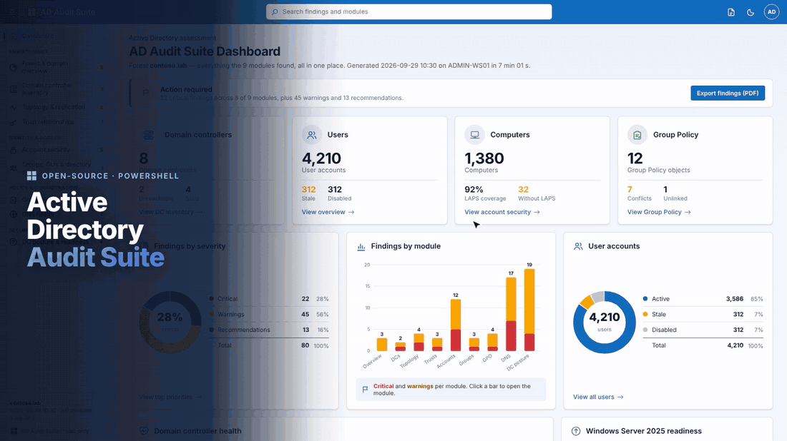

- **Overview & Operational Scope**:
  The **Complete Active Directory Audit Suite** is the flagship all-in-one assessment engine. It orchestrates all eleven individual assessment modules sequentially in isolated background processes with timeout protection, synthesizing their collective findings into a single, cohesive, interactive executive report.
- **Key Capabilities & Executive Summary**:
  - **Executive Dashboard**: Categorizes all directory findings by severity (Critical, High, Medium, Low) and by functional area across domain controllers, accounts, group policies, DNS, trusts, and servers.
  - **Universal Search**: Integrated search bar in the top navigation header allows instant filtering across all findings, modules, and recommendations.
  - **Embedded Full Reports**: Each module's complete diagnostic report is preserved and accessible within individual expandable and collapsible sections in the same file.
  - **1-Click Executive PDF Export**: Browser print integration formatted specifically for executive summaries, prioritizing remediation steps, risk severity, and plain-language explanations for IT leadership and compliance auditors.
  - **Process Isolation**: Each individual module executes in an isolated process with dedicated timeout limits; a slow or failing module never terminates or impedes the overall audit run.
- **How to Access & Run in WADRACC**:
  - **Context Menu**: Right-click any computer or empty space in the inventory grid, navigate to `🛡️ Active Directory Assessment`, and select `🚀 Complete AD Audit Suite (All-In-One Report)...`.
  - **Studio Hub**: Press <kbd>Ctrl</kbd> + <kbd>Shift</kbd> + <kbd>A</kbd> to open the Studio Hub, locate the **Complete Active Directory Audit Suite** card, and click `▶️ Run Assessment`.
- **Generated Report Storage**:
  - Automatically saved to: `Windows AD RACC Reports/AD Assessment/Master Audit Suite/AD_AuditSuite_[YYYYMMDD]_[HHMMSS].html`.
- **Prerequisites & Permissions**:
  - Standard Active Directory Domain User read access.
  - Remote Administration / RPC access (TCP port 135) or WinRM (TCP port 5985) to Domain Controllers for hardware and security event metrics.
- **Troubleshooting & Optimization Tips**:
  - Because Server Inventory contacts every member server in the domain, it typically takes the longest to complete. In large environments with hundreds of servers, administrators can pass custom arguments to evaluate servers from Active Directory attributes only, reducing runtimes from hours to minutes.

---

#### C. Forest & Domain Overview

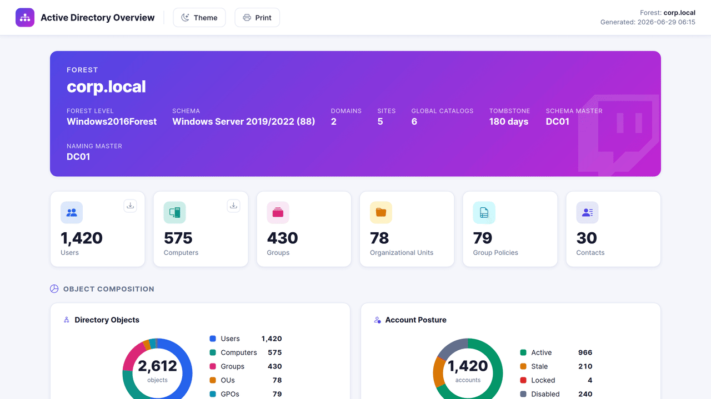

- **Overview & Operational Scope**:
  Provides a comprehensive, high-level operational inventory and security summary across the entire Active Directory forest and all associated domains. It serves as the natural landing page and baseline check for domain infrastructure.
- **Key Findings & Metrics**:
  - **Forest Facts**: Forest and domain functional levels, Active Directory schema version, all five Flexible Single Master Operation (FSMO) role holders, and domain tombstone lifetime.
  - **Directory Object Metrics**: Complete counts and distribution of user accounts, computer objects, security groups, distribution groups, and organizational units.
  - **Account Posture Analytics**: Interactive donut charts highlighting enabled vs. disabled accounts, stale accounts, never-logged-on users, locked accounts, and accounts configured with passwords that never expire.
  - **Operating System Distribution**: Breakdown of client and server operating system versions across all domain-joined computer objects.
  - **Client-Side CSV Export**: KPI stat cards feature an integrated download icon that exports filtered object lists (Name, SamAccountName, Enabled, LastLogon, DistinguishedName) straight to CSV completely client-side without re-querying Active Directory.
- **How to Access & Run in WADRACC**:
  - **Context Menu**: Right-click and select `🛡️ Active Directory Assessment -> 🌐 Domain & Forest Structure -> 🌐 Forest & Domain Overview...`.
  - **Studio Hub**: Locate the **Forest & Domain Overview** card and click `▶️ Run Assessment`.
- **Generated Report Storage**:
  - Automatically saved to: `Windows AD RACC Reports/AD Assessment/Forest & Domain Overview/AD_Overview_[YYYYMMDD]_[HHMMSS].html`.
- **Prerequisites & Permissions**:
  - Standard Active Directory domain user read permissions. No elevated administrative privileges required.

---

#### D. Forest Topology & Replication Matrix

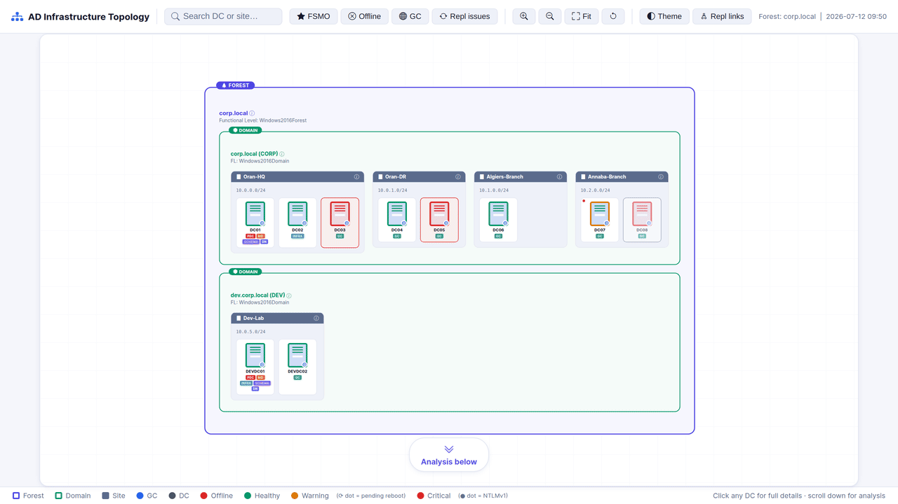

- **Overview & Operational Scope**:
  Maps the entire structural hierarchy and replication topology across all domains in the forest, delivering interactive visualization, directional partner matrices, and orphaned metadata detection.
- **Key Findings & Metrics**:
  - **Interactive Forest Map**: Pannable and zoomable visual hierarchy card tree showing Forest → Domain → Site → Domain Controller relationships, color-coded by health status.
  - **Slide-In Detail Panels**: Clicking any node opens detailed properties covering FSMO roles, site IP subnets, bridgehead configurations, inter-site link costs, replication frequency, and dcdiag diagnostic summaries.
  - **Replication Health Matrix**: Directional source-to-destination grid auditing every DC partnership across all directory naming contexts (Domain, Configuration, Schema, DomainDnsZones, ForestDnsZones). Cells display the worst-case partition state to highlight partial replication failures that standard checks miss.
  - **Site-Aware Delay Thresholds**: Built-in thresholds distinguish between fast intra-site replication and scheduled inter-site replication intervals, eliminating false alarms on healthy remote branch links.
  - **Stale & Orphaned Objects Scan**: Inspects the Configuration partition and Active Directory Sites & Services for orphaned domain controller metadata, empty sites, unlinked subnets, and lingering connection objects with clear remediation guidance.
  - **Smart Multi-Port Reachability**: Probes reachability using ping or core domain controller ports (389, 88, 135, 445, 9389), preventing false unreachable flags when ICMP echo is blocked by enterprise firewalls.
- **How to Access & Run in WADRACC**:
  - **Context Menu**: Right-click and select `🛡️ Active Directory Assessment -> 🌐 Domain & Forest Structure -> 🗺️ AD Forest Topology & Replication Matrix...`.
  - **Studio Hub**: Locate the **Forest Topology & Replication** card and click `▶️ Run Assessment`.
- **Generated Report Storage**:
  - Automatically saved to: `Windows AD RACC Reports/AD Assessment/Forest Topology & Replication/AD_Topology_[YYYYMMDD]_[HHMMSS].html`.
- **Prerequisites & Permissions**:
  - Standard Active Directory domain user read permissions and network connectivity to domain controllers over LDAP, RPC, or Active Directory Web Services (TCP 9389).

---

#### E. Group & Organizational Unit Structure Analysis with IDFix

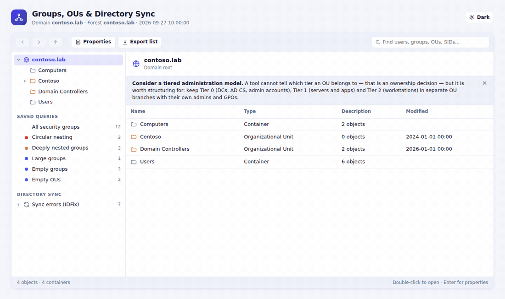

- **Overview & Operational Scope**:
  Delivers a three-in-one architecture audit examining security group nesting graphs, organizational unit hierarchies, and Microsoft 365 / Entra ID identity synchronization readiness.
- **Key Findings & Metrics**:
  - **Recursive Group Nesting Graph**: Unpacks nested security group memberships recursively, detecting circular group references (Group A inside Group B inside Group A), empty groups, and excessively large group memberships.
  - **OU Architecture & Tiering Recommendations**: Visualizes the organizational unit container hierarchy, calculates object densities per OU, highlights empty containers, and provides structural recommendations aligning with modern administrative tiering models.
  - **Integrated IDFix Cloud Sync Scan**: Natively implements Microsoft IDFix rules, scanning Active Directory for invalid characters, attribute length violations, malformed email addresses, and duplicate UserPrincipalName (UPN) or proxyAddresses that block Microsoft 365 and Entra ID synchronization.
  - **Read-Only Safety**: Strictly inspects directory objects and highlights recommendations with zero write actions to Active Directory.
- **How to Access & Run in WADRACC**:
  - **Context Menu**: Right-click and select `🛡️ Active Directory Assessment -> 🌐 Domain & Forest Structure -> 👥 Group & OU Structure Analysis (with IDFix)...`.
  - **Studio Hub**: Locate the **Groups, OUs & IDFix** card and click `▶️ Run Assessment`.
- **Generated Report Storage**:
  - Automatically saved to: `Windows AD RACC Reports/AD Assessment/Group & OU Structure/AD_GroupOU_[YYYYMMDD]_[HHMMSS].html`.
- **Prerequisites & Permissions**:
  - Standard Active Directory domain user read access.

---

#### F. Domain Trust Relationships & Security Posture

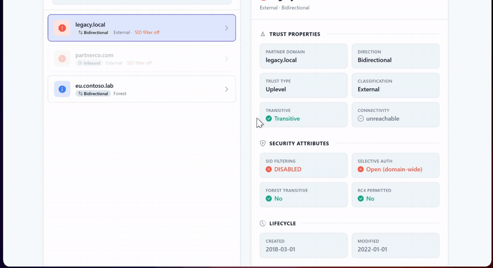

- **Overview & Operational Scope**:
  Enumerates every Active Directory trust relationship connected to the forest and assesses its operational health, directionality, and security hardening posture.
- **Key Findings & Metrics**:
  - **Trust Inventory**: Maps all forest, external, realm, parent-child, and tree-root trusts with direction (Inbound, Outbound, Bidirectional) and transitivity status.
  - **Security Baseline Verification**: Evaluates Security Identifier (SID) filtering and quarantine enforcement, selective authentication policies, TGT delegation, and forest-transitive trust flags.
  - **Derived Risk Findings**: Flags security discrepancies such as external trusts operating with SID filtering disabled, missing selective authentication on partner domains, and stale or unverified trust relationships.
  - **Live Connectivity Probes**: Performs network probes against partner domain controllers, gracefully reporting "Unavailable / Not tested" in locked-down perimeter environments.
  - **Interactive Trust Map**: Visualizes trust boundaries, partner domains, and directional routing in an interactive graphical map.
- **How to Access & Run in WADRACC**:
  - **Context Menu**: Right-click and select `🛡️ Active Directory Assessment -> 🌐 Domain & Forest Structure -> 🤝 Domain Trust Relationships & Posture...`.
  - **Studio Hub**: Locate the **Domain Trusts & Security** card and click `▶️ Run Assessment`.
- **Generated Report Storage**:
  - Automatically saved to: `Windows AD RACC Reports/AD Assessment/Domain Trust Relationships/AD_TrustRelationships_[YYYYMMDD]_[HHMMSS].html`.
- **Prerequisites & Permissions**:
  - Standard Active Directory domain user read permissions.

---

#### G. Domain Controller Hardware & OS Inventory

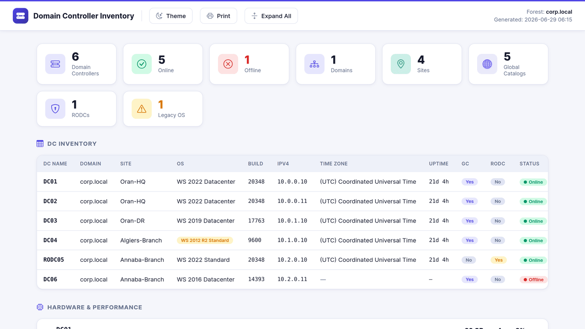

- **Overview & Operational Scope**:
  Conducts deep hardware, operating system, and capacity discovery across all domain controllers in the forest.
- **Key Findings & Metrics**:
  - **Hardware & Platform**: Manufacturer, motherboard model, BIOS version, physical vs. virtual deployment (Hyper-V, VMware, Physical Server), and CPU core specifications.
  - **Resource Utilization**: Real-time physical memory (RAM) usage, processor utilization, and Active Directory database (`ntds.dit`) storage footprint.
  - **Storage Volumes**: Logical disk drives with visual capacity gauges and free space alerts.
  - **Network Configuration**: Network interface adapters, IPv4 and IPv6 addressing, DNS server configuration, time zone, and system uptime.
  - **Domain Role Badges**: Identifies Global Catalog (GC) servers, Read-Only Domain Controllers (RODCs), and functional role placements.
- **How to Access & Run in WADRACC**:
  - **Context Menu**: Right-click and select `🛡️ Active Directory Assessment -> 🖥️ Domain Controllers & Infrastructure -> 🖥️ DC Hardware & OS Inventory...`.
  - **Studio Hub**: Locate the **DC Hardware & OS Inventory** card and click `▶️ Run Assessment`.
- **Generated Report Storage**:
  - Automatically saved to: `Windows AD RACC Reports/AD Assessment/Domain Controller Inventory/AD_DCInventory_[YYYYMMDD]_[HHMMSS].html`.
- **Prerequisites & Permissions**:
  - Domain user read access, plus WMI / DCOM (TCP port 135) or WinRM (TCP port 5985) access to domain controllers.

---

#### H. Domain Controller Security Posture & Hardening

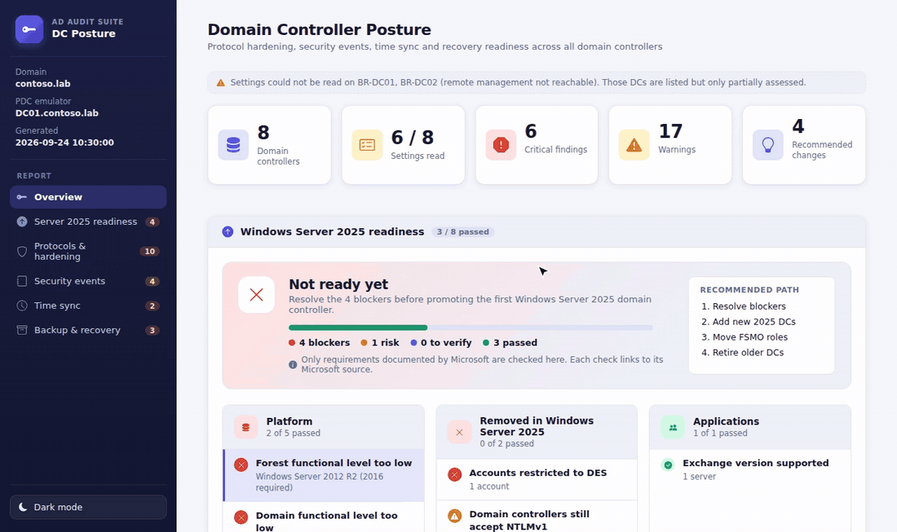

- **Overview & Operational Scope**:
  Forest-wide security protocol hardening and operational readiness audit across domain controllers, focusing on defense-in-depth protocols, security event logs, and modern operating system baselines.
- **Key Findings & Metrics**:
  - **Protocols & Protocol Hardening**: LDAP signing and channel binding enforcement, LDAP event 2889 logging, LDAPS SSL certificates, NTLM restriction levels, LM hash storage blocking, SMB signing, SMBv1 enablement status, SSL/TLS protocol versions, LLMNR, NetBIOS over TCP/IP, WDigest, LSA protection, Kerberos encryption baselines, Print Spooler service presence, and DES-only accounts.
  - **Security Event Log Auditing**: Analyzes recent event logs across all DCs: account lockouts (Event ID 4740), failed logons (Event ID 4625) with password-spray detection, Kerberos pre-authentication failures (Event ID 4771), privileged group modifications, cleared audit logs (Event ID 1102), cleartext LDAP binds with client IP addresses, LDAPS binds lacking channel binding (Event ID 3039), NTLMv1 logons (Event ID 4624), RC4/DES Kerberos tickets (Event IDs 4768/4769), and SMBv1 connections (Event ID 3000).
  - **Time Synchronization Hierarchy**: Validates time source, NTP peer configurations, Group Policy influence, last successful sync timestamp, and clock offset relative to the forest root PDC emulator.
  - **Backup & Recovery Posture**: Active Directory Recycle Bin status, tombstone lifetime, last system state backup per partition, and SYSVOL replication technology (DFSR vs. legacy FRS).
  - **Windows Server 2025 Readiness**: Evaluates Microsoft formal upgrade requirements (functional levels 2016+, DC versions, SYSVOL on DFSR, DES-only accounts removal, NTLMv1 elimination, and supported Exchange versions).
- **How to Access & Run in WADRACC**:
  - **Context Menu**: Right-click and select `🛡️ Active Directory Assessment -> 🖥️ Domain Controllers & Infrastructure -> 🛡️ DC Security Posture & Hardening...`.
  - **Studio Hub**: Locate the **DC Security Posture & Hardening** card and click `▶️ Run Assessment`.
- **Generated Report Storage**:
  - Automatically saved to: `Windows AD RACC Reports/AD Assessment/DC Security Posture/AD_DCPosture_[YYYYMMDD]_[HHMMSS].html`.
- **Prerequisites & Permissions**:
  - Domain Admin privileges, or Event Log Readers membership plus Remote Registry access on Domain Controllers.

---

#### I. Active Directory DNS Health & Zone Diagnostics

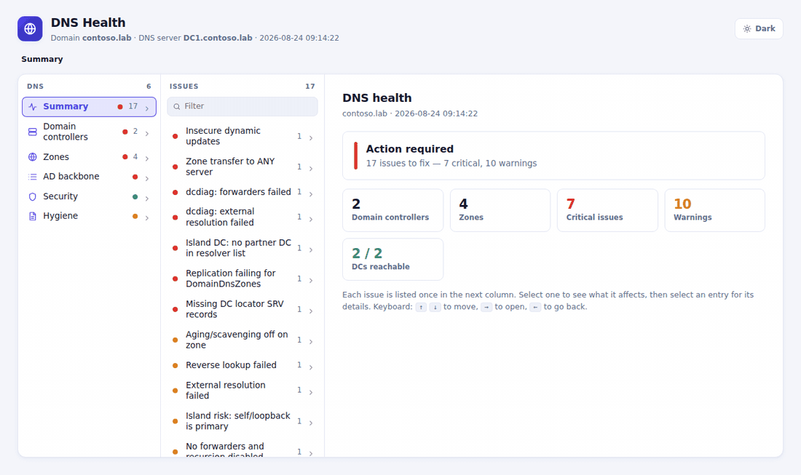

- **Overview & Operational Scope**:
  Audits the DNS infrastructure underpinning Active Directory from two complementary angles: configuration integrity and live domain controller resolution health.
- **Key Findings & Metrics**:
  - **Zone Configuration Audit**: Inspects zone types, Active Directory integration status, replication scopes, dynamic update security policies, aging and scavenging intervals, zone transfer restrictions, DNSSEC signing, and Name Server (NS) records.
  - **Live Resolution Verification**: Tests forward and reverse resolution, DNS forwarders responsiveness, root hints reachability, and directory locator SRV record registration.
  - **Lingering Record Detection**: Scans for orphaned `_msdcs` SRV and CNAME records pointing to decommissioned domain controllers, preventing client logon delays and domain join failures.
- **How to Access & Run in WADRACC**:
  - **Context Menu**: Right-click and select `🛡️ Active Directory Assessment -> 🖥️ Domain Controllers & Infrastructure -> 🌐 AD DNS Health & Zone Analysis...`.
  - **Studio Hub**: Locate the **AD DNS Health & Zones** card and click `▶️ Run Assessment`.
- **Generated Report Storage**:
  - Automatically saved to: `Windows AD RACC Reports/AD Assessment/AD DNS Health & Zones/AD_DNSHealth_[YYYYMMDD]_[HHMMSS].html`.
- **Prerequisites & Permissions**:
  - Standard Active Directory domain user read access; DNS Admin privileges if querying DNS Server service settings directly.

---

#### J. Account Security & Credential Hygiene Audit

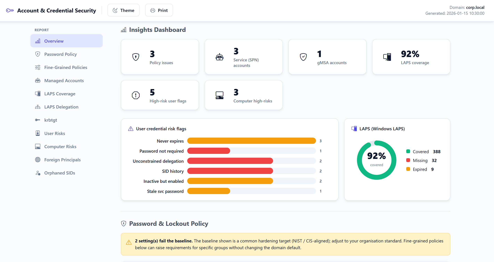

- **Overview & Operational Scope**:
  Identifies stale accounts, authentication vulnerabilities, and credential hygiene weaknesses across the entire Active Directory domain.
- **Key Findings & Metrics**:
  - **Password & Lockout Policy Scoring**: Compares domain default password and lockout policies against industry-standard security baselines.
  - **Fine-Grained Password Policies (PSOs)**: Inventories Password Settings Objects, evaluation precedence, and targeted security groups.
  - **Service Account & LAPS Posture**: Inventories Group Managed Service Accounts (gMSA) and Standalone Managed Service Accounts (sMSA), and audits Windows LAPS and Legacy LAPS schema coverage.
  - **High-Risk Account Discovery**: Flags user accounts with non-expiring passwords, accounts with password-not-required flags, unconstrained Kerberos delegation, SID history entries, inactive-but-enabled accounts (90+ days), accounts lacking AES encryption keys, and `krbtgt` password age.
- **How to Access & Run in WADRACC**:
  - **Context Menu**: Right-click and select `🛡️ Active Directory Assessment -> 🔑 Security, GPO & Governance -> 🔑 Account Security & Credential Hygiene...`.
  - **Studio Hub**: Locate the **Account Security & Hygiene** card and click `▶️ Run Assessment`.
- **Generated Report Storage**:
  - Automatically saved to: `Windows AD RACC Reports/AD Assessment/Account Security & Hygiene/AD_AccountSecurity_[YYYYMMDD]_[HHMMSS].html`.
- **Prerequisites & Permissions**:
  - Domain user read access. Reading fine-grained password policies requires read access to the Password Settings Container (Domain Admins or delegated read).

---

#### K. Group Policy Object Analyzer & Conflict Detection

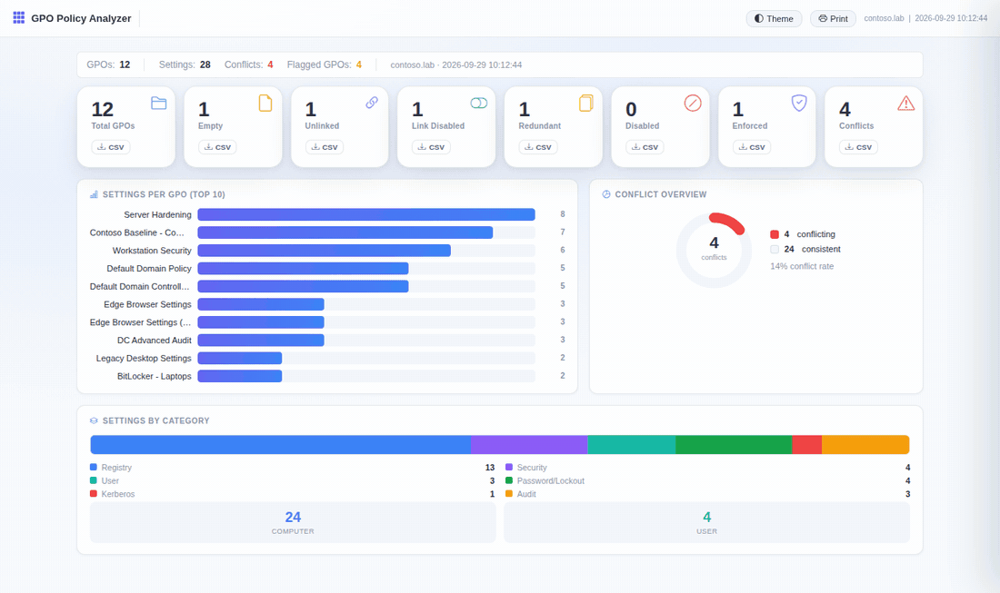

- **Overview & Operational Scope**:
  Automates what Microsoft Policy Analyzer does manually across domain Group Policy Objects, parsing raw policy templates directly to pinpoint conflicts, redundant links, and scope mismatches.
- **Key Findings & Metrics**:
  - **Policy Hierarchy & Linkage**: Inventories all domain GPOs, mapping link associations across Sites, Domains, and Organizational Units.
  - **Conflict Identification**: Parses raw `Registry.pol` and `GptTmpl.inf` files, maps registry settings to human-readable policy names via ADMX templates, and flags settings where GPOs contradict each other.
  - **WMI Filter Evaluation**: Associates conflicting policies with their attached WMI filters, explaining scenarios where policies appear contradictory but target disjoint hardware scopes.
  - **Dedicated Application-Managed Backup Storage**: Automatically exports and organizes GPO backups in `Windows AD RACC Reports/AD Assessment/GPOBackups/`, avoiding temporary folder permission errors and preserving policy archives.
- **How to Access & Run in WADRACC**:
  - **Context Menu**: Right-click and select `🛡️ Active Directory Assessment -> 🔑 Security, GPO & Governance -> 📜 GPO Policy Analyzer & Conflict Detection...`.
  - **Studio Hub**: Locate the **GPO Policy Analyzer** card and click `▶️ Run Assessment`.
- **Generated Report Storage**:
  - Automatically saved to: `Windows AD RACC Reports/AD Assessment/GPO Policy Analyzer/GPO_PolicyAnalysis_[YYYYMMDD]_[HHMMSS].html`.
- **Prerequisites & Permissions**:
  - Domain read access to Group Policies and SYSVOL; Group Policy Management Tools (RSAT-GPMC) installed on the audit workstation.

---

#### L. Forest-Wide Member Server Inventory & Lifecycle Tracking

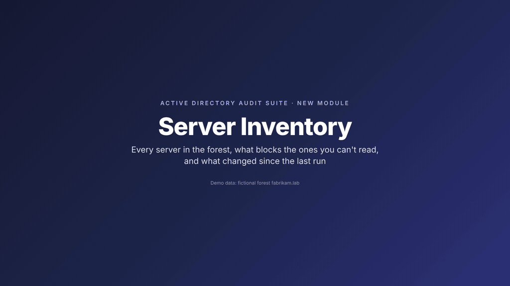

- **Overview & Operational Scope**:
  Discovers and catalogs every domain member server across the forest, tracking operating system lifecycles, service roles, SQL Server instances, and patch currency.
- **Key Findings & Metrics**:
  - **Operating System Lifecycle Tracking**: Catalogs Windows Server editions and build versions, cross-referencing Microsoft official Mainstream and Extended Support end-of-life dates.
  - **Server Role Discovery**: Detects installed roles including Domain Controllers, SQL Server instances (`MSSQLSvc` SPNs), failover clusters, Exchange Server, Certificate Authorities, and Configuration Manager management points.
  - **Hardware & Hypervisor Specifications**: CPU sockets, logical cores, installed RAM, physical vs. virtual platform, and server uptime.
  - **Patch & Maintenance Currency**: Last installed Windows update, pending restart flags, and servers exceeding uptime patch thresholds.
  - **Management Access Diagnostics**: Groups unreachable servers by category (firewall blocked ports 135/5985, DNS resolution failure, access denied, offline) with explicit instructions on what to open or fix.
- **How to Access & Run in WADRACC**:
  - **Context Menu**: Right-click and select `🛡️ Active Directory Assessment -> 🔑 Security, GPO & Governance -> 🗄️ Forest-Wide Member Server Inventory & Lifecycle...`.
  - **Studio Hub**: Locate the **Server Inventory & Lifecycle** card and click `▶️ Run Assessment`.
- **Generated Report Storage**:
  - Automatically saved to: `Windows AD RACC Reports/AD Assessment/Server Inventory & Lifecycle/AD_ServerInventory_[YYYYMMDD]_[HHMMSS].html`.
- **Prerequisites & Permissions**:
  - Local Administrator rights on member servers and RPC/DCOM (or WinRM) connectivity for full hardware inventory; falls back to Active Directory attributes if servers are blocked.

---

#### M. Server Access & Management Port Diagnostic Companion (Test-ServerAccess)
- **Overview & Operational Scope**:
  Targeted single-server diagnostic companion tool validating remote administrative reachability across critical management ports.
- **Key Findings & Metrics**:
  - Tests DNS resolution, ICMP ping, RPC Endpoint Mapper (TCP port 135), SMB File Sharing (TCP port 445), Remote Desktop (TCP port 3389), and WinRM (TCP ports 5985/5986).
  - Delivers a concise single-sentence verdict explaining the root cause of connection failures (e.g. *Host answers Ping and SMB, but RPC port 135 is blocked by Windows Firewall*).
- **How to Access & Run in WADRACC**:
  - Right-click any server in the inventory and select `🛡️ Active Directory Assessment -> 🔑 Security, GPO & Governance -> 🔌 Test Server Access & Management Ports...`.
- **Report Format & Dedicated Spreadsheet Launcher**:
  - Outputs a detailed CSV report saved to: `Windows AD RACC Reports/AD Assessment/Test Server Access/Test_ServerAccess_[Target]_[Timestamp].csv`.
  - Features an explicit **📊 Open CSV Report** button that launches the generated report in Microsoft Excel or your default spreadsheet application.

---

#### N. Background Execution, Live Console & Progress Tracking
Every assessment launched within WADRACC benefits from a dedicated asynchronous execution architecture:
- **Responsive Multi-Threading**: Assessment scripts execute in separate background processes. The main WADRACC dashboard, live performance monitors, and remote sessions remain 100% fluid and responsive.
- **Independent Modeless Windows**: Each running assessment opens in its own independent window with a dedicated taskbar button. Operators can minimize, move, or run multiple different assessments concurrently without mutual interference.
- **Real-Time Progress Indicators**: The interface analyzes script milestones and displays current assessment phase, active processing stage, item counters, and real-time percentage progress bars.
- **Live Colored Output Terminal**: An integrated terminal streams console output in real time with distinct color coding for headers, informational notices, warnings, and error messages.
- **Safe Cancelation**: Operators can click **✕ Cancel Assessment** at any time to terminate the background process gracefully without leaving orphaned tasks.

---

#### O. Native WADRACC Executive HTML Report Generation & Directory Architecture
All reports produced by the assessment suite are automatically branded and formatted to meet WADRACC Enterprise presentation standards:
- **Master Header Branding & Application Icon**: Features the official WADRACC application icon, enterprise masthead, execution timestamp, operator identity, and browser tab favicon for instant recognition across multiple open tabs.
- **Executive Navigation & Print Actions**: Includes 1-click **🖨️ Print / Save as PDF** controls and clean table layouts formatted for standard executive reporting.
- **Report Organization & Dedicated Directory Architecture**:
  All generated reports are neatly organized into dedicated subfolders per assessment module inside the centralized application reports directory:
  `Windows AD RACC Reports/AD Assessment/`

  Each assessment type manages its own dedicated subfolder:
  - `Master Audit Suite/` – Unified all-in-one executive audit reports.
  - `Forest & Domain Overview/` – Forest configuration, functional levels, and tombstone audits.
  - `Forest Topology & Replication/` – Topology replication health matrices and inter-site maps.
  - `Group & OU Structure/` – Group nesting graphs and companion IDFix synchronization exports.
  - `Domain Trust Relationships/` – Forest, external, and realm trust authentication analyses.
  - `Domain Controller Inventory/` – Hardware specifications, volume allocations, and NTDS databases.
  - `DC Security Posture/` – Protocol hardening, event logs, and modern server readiness audits.
  - `AD DNS Health & Zones/` – DNS zone infrastructure, aging/scavenging, and resolution tests.
  - `Account Security & Hygiene/` – Password policies, credential hygiene, and privileged accounts.
  - `GPO Policy Analyzer/` – Group Policy conflict analyses and dedicated `GPOBackups/` archives.
  - `Server Inventory & Lifecycle/` – Fleet-wide operating system lifecycle, role, and patch audits.
  - `Test Server Access/` – Server management connectivity and port reachability CSV audits.

- **Dynamic Card Report Button & Folder Integration**:
  The assessment cards in the Studio Hub feature intelligent, real-time report buttons:
  - **Report Ready State**: When a report exists, the button highlights with bold text and an emerald accent (`📄 Report` or `📊 CSV Report`). Left-clicking opens the latest report directly in the system web browser (or Excel for CSV).
  - **Initial & Empty State**: When no report exists yet, left-clicking the button automatically creates the dedicated subfolder (if missing), opens it in Windows Explorer, and displays an informative guidance message directing the operator to run the audit.
  - **Right-Click Direct Folder Access**: Right-clicking the button at any time directly opens that module's dedicated report folder in Windows Explorer.
  - **Instant Real-Time Refresh**: As soon as any assessment finishes execution, the Studio Hub card button automatically detects the new report and updates in real time without requiring the window to be closed or reopened.
  Reports follow a strict timestamped naming convention: `[Assessment_Name]_[YYYYMMDD]_[HHMMSS].html` (or `.csv`).
- **Automatic Browser Launch**: Upon successful completion, the report opens automatically in the default Windows web browser. If an assessment encounters fatal errors or is canceled, invalid reports are safely prevented from opening.

---

#### P. Upstream GitHub Repository Monitoring, Sync & Safe Rollback Manager
The assessment suite source repository is publicly maintained and receives continuous updates, security rules, and performance enhancements. WADRACC provides an integrated **GitHub Update Manager** accessible directly from the assessment menu:
- **Upstream Tracking**: Monitors the official repository (`https://github.com/Mohamed-Zeghlache/AD-Assessment-PowerShell-Script`) on the `main` branch.
- **Change Detection**: Compares currently integrated script versions with the upstream commit history, identifying new scripts, modified logic, and deprecated files.
- **Safe Staging**: Upstream updates are staged into a controlled environment and inspected before installation.
- **Automated Rollback Snapshots**: Before applying any upstream script updates, the manager creates a full timestamped backup snapshot in `Tools/AD_Assessment/backups/`. If an update causes compatibility issues, administrators can restore prior working versions in a single click.
- **Customization Protection**: WADRACC branding, report styling, and custom parameter routing are implemented as post-processing wrappers, ensuring upstream script updates never overwrite application customizations.

---

### 32. Community, Technical Support & Feedback

#### A. Submitting In-App Technical Support & Feedback
Administrators and technical operators can access official community channels, submit satisfaction ratings, share usability suggestions, or file technical support requests directly inside the application through the dedicated **Support & Feedback Center**:
1. Click the **💬 Support/Feedback** button located on the top header navigation bar.
2. **Community, Updates & Direct GitHub Support Cards** (displayed directly below the title and description):
   - **WhatsApp Updates Channel**: Follow our official channel for application updates, announcements, new features, and important notifications.
   - **Join Our WhatsApp Community**: Connect with other ADRC users, share experiences, discuss features, and participate in community conversations.
   - **Join Our Telegram Community**: Connect with the ADRC community through Telegram.
   - **GitHub Discussions & Feature Requests**: Share suggestions, discuss improvements, ask questions, and participate in technical discussions.
   - **Report a Bug or Technical Issue**: Report application bugs, technical problems, unexpected behavior, and other issues directly through GitHub.
   - Clicking any card opens the destination directly in your default web browser.
3. Below the community links, the window provides two clearly distinguishable operational modes:
   - **💬 Share Your Feedback**:
     - Select a satisfaction rating from **1 to 5 Stars**.
     - Choose an appropriate feedback category (General Experience & Praise, Feature Request / Enhancement, Performance / Speed Suggestion, Usability & UI Design, Other Feedback).
     - Enter your comments, suggestions, or ideas.
   - **🛠️ Need Technical Support?**:
     - Use this mode when experiencing a bug, error message, unexpected behavior, or difficulty operating any feature.
     - Select the **Affected Feature / Module** (Active Directory Assessment Suite, Remote Desktop Shadowing, Remote Disk Usage Analyzer, Services Controller, Network Monitoring, Print Fleet, LAPS, DNS / IP Config, or General Issue).
     - Enter an **Issue Summary** and detailed **Problem Description with Steps to Reproduce**.
     - **Diagnostic Log Guidance & Manual Collection**: If you encounter an error, click **📋 Paste Recent Activity Log Errors** to scan and insert recent sanitized diagnostic entries from the activity log directly into the error log box (you can also type or paste error details manually, or expand/resize the box). The form remains clean when switching to this tab until you choose to paste recent errors.
     - **Privacy & Data Protection Guarantee**: All diagnostic submissions undergo strict automated log sanitization before transmission. Passwords, secret keys, access tokens, administrative PINs, and sensitive corporate credentials are completely excluded.
     - Review the automatically populated application version and operating environment details.
4. **Optional Contact Information**:
   - Both modes include an optional contact information field (Email Address or WhatsApp Number). Provide your contact details only if you would like our engineering team to follow up regarding your report or feedback.
5. Click **🚀 Submit Feedback** or **🛠️ Submit Support Request**. Requests are transmitted securely over an encrypted connection to assist our engineering team in resolving issues.

#### B. Official Support & Community Channels
- **WhatsApp Updates Channel**: Follow the [WhatsApp Updates Channel](https://whatsapp.com/channel/0029VbDZfvhCMY0H1PxerW2c) for application updates, announcements, new features, and important notifications.
- **WhatsApp Community Group**: [Join Our WhatsApp Community](https://chat.whatsapp.com/FFnsz5kSWND2FTZt8WNpZX) to connect with other ADRC users, share experiences, discuss features, and participate in community conversations.
- **Telegram Community**: [Join Our Telegram Community](https://t.me/WADRACC) for real-time chat, instant support, updates, and IT discussions.
- **GitHub Discussions & Feature Requests**: [GitHub Discussions & Feature Requests](https://github.com/SuperUser-exe/Windows-Active-Directory-Remote-Administration-Control-Center/discussions/new/choose) to share suggestions, discuss improvements, ask questions, and participate in technical discussions.
- **GitHub Issue Tracker**: [Report a Bug or Technical Issue](https://github.com/SuperUser-exe/Windows-Active-Directory-Remote-Administration-Control-Center/issues) directly through GitHub.
- **Official GitHub Releases**: [SuperUser-exe/Windows-Active-Directory-Remote-Administration-Control-Center](https://github.com/SuperUser-exe/Windows-Active-Directory-Remote-Administration-Control-Center/releases)
- **Developer Attribution**: Askarali Mattummal — Network Engineer | System Administrator | Web & Application Developer ([LinkedIn](https://www.linkedin.com/in/askaralimattummal/))

---

### 33. Independent Window Management & Multitasking Architecture

#### A. Decoupled Modeless Multi-Window Architecture
In demanding enterprise environments, IT systems engineers cannot be restricted by modal dialogs that lock the entire application while waiting for an audit, scan, or remote query to finish. **Windows Active Directory Remote Administration Control Center** enforces an independent window architecture across all secondary tools, management consoles, diagnostic suites, and assessment windows:
- **Strict Non-Modal Lifecycle**: Secondary windows are created modelessly using standard window activation. No secondary management window utilizes modal blocking loops, ensuring the main workstation inventory dashboard and other active windows remain completely accessible and interactive at all times.
- **Independent Taskbar Identity**: Every secondary window maintains its own taskbar presence and independent window state. Administrators can minimize, maximize, restore, or position different tools across multiple physical monitors simultaneously.
- **Decoupled Window State**: Minimizing, maximizing, restoring, or closing the main dashboard or any other tool window never hides, minimizes, or terminates secondary feature windows. Each window operates with its own independent lifecycle.

#### B. Concurrent Administrative Multi-Tasking Workflows
The independent window architecture enables true multitasking across diverse administrative duties:
- **Simultaneous Diagnostic Execution**: An administrator can launch a comprehensive Active Directory Audit Suite assessment in one window, open the Remote Disk Usage Analyzer with its 3D Cushion Treemap in a second window, inspect live ping latency on a core network switch in a third window, and shadow an end-user session — all executing concurrently.
- **Multi-Monitor Productivity**: Windows can be dragged to different monitors in multi-display workstations, allowing an administrator to keep a live monitoring wall on one screen while actively managing directory accounts and remote services on another.
- **Window Switching**: Operators can freely switch between running administrative tasks using standard Windows shortcuts (<kbd>Alt</kbd> + <kbd>Tab</kbd>) or the Windows taskbar.

#### C. Multi-Instance vs. Thread-Safe Single-Instance Refocus
WADRACC balances multitasking flexibility with operational safety through intelligent instance management:
- **Multi-Instance Tools**: Diagnostic utilities and assessments that operate on distinct targets or different audit scopes can be opened in multiple simultaneous windows.
- **Thread-Safe Single-Instance Refocus for Host Configuration**: For configuration tools targeting a specific computer (such as the Bandwidth Limiter or Remote Terminal for a particular machine), the application maintains a thread-safe registry. If an operator triggers the tool again for the same computer, the application automatically restores, activates, and brings the existing window to the front rather than opening conflicting duplicate windows.

#### D. True Non-Blocking Background Workloads
All long-running administrative tasks execute asynchronously:
- Heavy queries (Active Directory object sweeps, WMI hardware inspections, port probing, and PowerShell assessment scripts) run on dedicated background threads and worker processes.
- Execution milestones and diagnostic output are dispatched asynchronously to the UI, guaranteeing high responsiveness and fluid frame rates without application freezing.

#### E. Operational Considerations & Boundaries
While WADRACC provides comprehensive multi-window freedom, administrators should observe reasonable operational boundaries:
- **Workstation Resource Consumption**: Concurrently launching multiple heavy domain-wide audits (such as the All-In-One Master Audit and Forest-Wide Server Inventory simultaneously) places computational and network RPC load on the administrative workstation and domain controllers. Operators should schedule heavy forest-wide audits responsibly.
- **Target Mutual Exclusion**: Modifying the same configuration setting simultaneously on the same host from multiple sessions is prevented by design through single-instance host management.
