# ⚡ Windows AD Remote Administration Control Center — Enterprise Remote Control & Administration Suite

<p align="center">
  <a href="https://github.com/SuperUser-exe/Windows-Active-Directory-Remote-Administration-Control-Center/releases"></a>
  <a href="Documentation/Release_Notes/Main_Application/CHANGELOG.md"></a>
  <a href="Documentation/LICENSE"></a>
</p>

<p align="center">
  
  
  
</p>

<p align="center">
  
  <a href="https://github.com/SuperUser-exe/Windows-Active-Directory-Remote-Administration-Control-Center/stargazers"></a>
  <a href="https://github.com/SuperUser-exe/Windows-Active-Directory-Remote-Administration-Control-Center/network/members"></a>
  <a href="https://github.com/SuperUser-exe/Windows-Active-Directory-Remote-Administration-Control-Center/watchers"></a>
  <a href="https://github.com/SuperUser-exe/Windows-Active-Directory-Remote-Administration-Control-Center/issues"></a>
</p>

<p align="center">
  <a href="https://hits.sh/github.com/SuperUser-exe/Windows-Active-Directory-Remote-Administration-Control-Center/"></a>
  <a href="https://github.com/SuperUser-exe/Windows-Active-Directory-Remote-Administration-Control-Center/releases"></a>
  <a href="https://github.com/SuperUser-exe/Windows-Active-Directory-Remote-Administration-Control-Center/releases/latest"></a>
  <a href="https://github.com/SuperUser-exe/Windows-Active-Directory-Remote-Administration-Control-Center/commits/main"></a>
</p>

<p align="center">
  
  <a href="Documentation/USAGE_GUIDE.md"></a>
  <a href="Documentation/NETWORK_MONITOR_GUIDE.md"></a>
</p>

<p align="center">
  <a href="https://whatsapp.com/channel/0029VbDZfvhCMY0H1PxerW2c"></a>
  <a href="https://chat.whatsapp.com/FFnsz5kSWND2FTZt8WNpZX"></a>
  <a href="https://t.me/WADRACC"></a>
  <a href="https://www.linkedin.com/in/askaralimattummal/"></a>
</p>

> **Created & Developed by [Askarali Mattummal](https://www.linkedin.com/in/askaralimattummal/)** | **[GitHub Profile](https://github.com/SuperUser-exe)** | **[WhatsApp Updates Channel](https://whatsapp.com/channel/0029VbDZfvhCMY0H1PxerW2c)** | **[WhatsApp Community](https://chat.whatsapp.com/FFnsz5kSWND2FTZt8WNpZX)** | **[Telegram Community](https://t.me/WADRACC)**  
> *A high-performance, 100% agentless Windows & Active Directory remote management, screen mirroring, diagnostics, 24/7 network device monitoring, and security audit control center.*

---

> [!NOTE]
> **Windows SmartScreen / "Unknown Publisher" Notice (Windows Security Prompt) — Please Read Before Downloading**
>
> I originally built **ADRC** for my own daily Windows and Active Directory administration work and decided to share it with the IT community completely free of charge. Because publicly trusted **OV/EV Code Signing Certificates** cost around **$200–$600+ per year**, the public builds are currently distributed unsigned—so Windows Defender SmartScreen may display an **"Unknown publisher"** or **"Windows protected your PC"** prompt when you first download or open the `.exe`.
>
> * **How to run safely:** Always download releases strictly from this official GitHub repository, confirm the SHA-256 hash against `CHECKSUMS.txt`, and launch **`Run_AD_Remote_Control.bat`** (or click **More info → Run anyway**).
> * **Need an officially signed release?** If your organization requires digitally signed executables and is willing to cover or sponsor a code-signing certificate, please reach out via [WhatsApp Community](https://chat.whatsapp.com/FFnsz5kSWND2FTZt8WNpZX), [Telegram Community](https://t.me/WADRACC), [LinkedIn](https://www.linkedin.com/in/askaralimattummal/), or [GitHub Issues](https://github.com/SuperUser-exe/Windows-Active-Directory-Remote-Administration-Control-Center/issues) and I will gladly provide commercially signed builds.

---

<p align="center">
  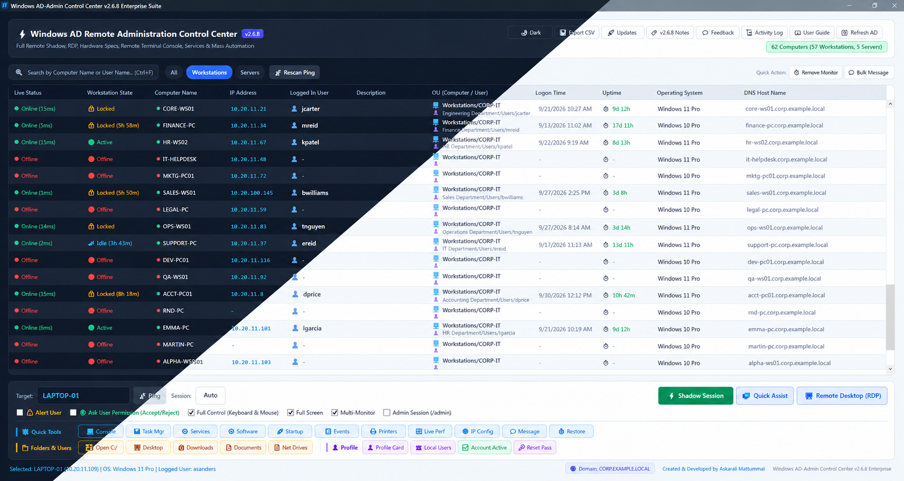
</p>

---

### 📊 Project Overview & Technical Specifications

**Windows Active Directory Remote Administration Control Center (WADRACC)** is an enterprise-grade administrative workstation suite designed to eliminate the friction of domain systems management. By uniting real-time workstation discovery, non-intrusive Remote Desktop Services (RDS) screen shadowing, in-depth hardware telemetry, 24/7 autonomous network device monitoring, and comprehensive Active Directory security auditing into a single portable binary, administrators can manage their entire fleet with zero agent installations and zero third-party cloud relays.

#### 💡 Core Operational Dimensions
* **Application Purpose**: Replaces fragmented MMC consoles, command-line utilities, and bloated third-party commercial RMM agents with a single, high-performance administrative command cockpit.
* **Main Capabilities**: 1-click zero-latency screen shadowing, 360° Active Directory user management, deep WMI hardware diagnostics, live event log security auditing, remote mapped drives and printer administration, and remote command execution.
* **Supported Windows Environments**: Operates seamlessly across **Windows 11**, **Windows 10**, and **Windows Server 2025, 2022, 2019, 2016, and 2012 R2** (64-bit architectures).
* **Active Directory Administration Benefits**: 100% agentless domain operations over native Windows protocols (LDAP, Kerberos, WMI, RPC, SMB), eliminating client software deployments and preserving endpoint integrity.
* **24/7 Network Monitoring & Remote Diagnostics**: Sub-second ICMP and TCP port reachability tracking across 12 hardware types with automated coordinator failover and encrypted WhatsApp outage alerts.
* **Security Assessment Capabilities**: 11 dedicated security, topology, health, DNS, and GPO policy audits delivering offline interactive HTML reports with client-side search and 1-click executive PDF exports.

| Architecture Dimension | Specification & Technical Reality | Operational Value & Enterprise Advantage |
| :--- | :--- | :--- |
| **Binary Footprint** | Single Standalone Portable Executable (~6.5 MB) | Zero installation, zero MSI installers, zero extraction wizards; runs directly from USB or IT shares. |
| **Agentless Operation** | 100% Agentless & Driverless Architecture | Zero client software or third-party background services required on managed endpoints; zero attack surface expansion. |
| **Integrated Feature Scope** | 20+ Dedicated Operational Feature Suites | Unifies ADUC, MMC snap-ins, Remote Desktop, command terminals, disk analyzers, and print management in one unified workspace. |
| **Directory Assessment Studio** | 11 Integrated Security & Health Audits | Evaluates topology, DC posture, GPO conflicts, DNS health, account hygiene, and member servers with offline HTML reports. |
| **24/7 Network Monitoring** | Autonomous Background Service (ADRC_NetworkMonitor) | Continuous sub-second reachability probing across 12 hardware types with encrypted WhatsApp outage notifications. |
| **Remote Screen Mirroring** | Native RDS Shadowing (mstsc.exe /shadow) | Zero-latency, hardware-accelerated remote control without kicking users off, disturbing their session, or locking screens. |
| **Multitasking Architecture** | Decoupled Modeless Windows | Multi-monitor ready; tool windows run with independent lifecycles and dedicated taskbar entries without blocking the console. |
| **Automatic Tools Manager** | Self-Contained Supporting Modules Pipeline | Automatically detects, downloads from official GitHub, validates SHA-256 hashes, and stages supporting companion tools without manual intervention. |
| **Enterprise Authorization** | Tiered Role-Based Access Control | Strictly validates memberships across 5 authorized Active Directory groups with granular permission enforcement. |
| **Supported OS Fleet** | Windows Server 2012 R2 – 2025 \| Windows 10 / 11 (x64) | Full domain fleet coverage across legacy and modern enterprise Windows environments. |
| **Dependencies & Security** | Zero External DLLs \| Standard .NET 4.0 / 4.8 | Fully self-contained, enterprise AV clean, and operable in air-gapped environments without internet access. |

## 👋 Welcome to Windows AD Remote Administration Control Center!

### 💡 Background, Motivation & Why I Created This
As a systems engineer managing active enterprise Active Directory environments, I frequently found myself frustrated by the constant friction of daily IT administration. Performing routine support tasks meant constantly switching between a dozen separate tools:
- Opening **Active Directory Users & Computers (ADUC)** just to unlock an account or check a user's department and group memberships;
- Launching multiple **MMC snap-ins** (Computer Management, Services, Event Viewer, Print Management);
- Opening command prompts for `shadow.exe`, `net use`, `ipconfig`, `gpupdate`, or PowerShell remoting;
- Relying on heavy, commercial remote support tools that require background client services, third-party cloud relays, and expensive recurring licenses.

To solve this, I originally designed and built **Windows AD Remote Administration Control Center** as my own personal, all-in-one administrative workstation console. My goal was simple: **a single, blazing-fast, portable executable (~6.5 MB) that connects directly to domain computers using native Windows protocols (LDAP, WMI, RPC, SMB, Terminal Services) with zero external dependencies and zero agents to install.**

### 🎯 Who Is This Application For?
This suite was crafted specifically for IT professionals, including:
* **Active Directory & Windows Domain Administrators** managing enterprise domain workstations and servers.
* **Systems Engineers & Network Administrators** needing fast remote diagnostics, live hardware telemetry, IP configuration, and event log auditing.
* **IT Helpdesk & Desktop Support Specialists** who need to shadow user sessions instantly, reset passwords, clear print queues, and clean temporary junk without interrupting users.
* **Managed Service Providers (MSPs)** who want a 100% portable, agentless tool that runs from a USB flash drive or secure administrative share.

### 🌍 Purpose of the Public Release
After colleagues and fellow sysadmin friends used the tool and experienced how much time it saved them daily, they urged me to release it publicly. I decided to publish this project so that the wider IT administration community can benefit from it freely.

---

### 🛡️ Official Release & Authenticity Notice

> [!IMPORTANT]
> The **only official and authentic release source** for this project is:  
> * **Official Enterprise Release**: **Version 3.0.0** — featuring the **Multi-DC Health & Replication Command Center**, **Centralized IT Hardware & Workstation Inventory Report**, **Multi-Monitor & Windows License Detection**, **Advanced Multi-Target Ping Studio**, **Dedicated Network Monitor User Guide**, **two-tab cache-first User Guide & Release Notes**, companion modules (**ADRC_IdleAgent v1.2.0**, **ADRC_MonitorCoordinator v1.0.0**, **ADRC_DiskScanner v1.0.0**), and expanded security & remote power tools.
> * **Publisher & Authenticode Verification**: All public release builds carry consistent publisher metadata (`Askarali Mattummal`) and are designed for post-build SHA-256 Authenticode code signing with trusted timestamping alongside `CHECKSUMS.txt` SHA-256 verification. Always download only from official GitHub Releases.
> * **Do not trust unofficial copies**: If downloaded from third-party sites, file-sharing platforms, or re-hosted mirrors, the author assumes no responsibility for modified, corrupted, or repackaged binaries.
> * **Integrity Check**: Always verify the official release SHA-256 checksums provided in `CHECKSUMS.txt`.
> * **Community & Discussions**: We have enabled **[GitHub Discussions](https://github.com/SuperUser-exe/Windows-Active-Directory-Remote-Administration-Control-Center/discussions/new/choose)**! Come say hello, share workflow feedback, report issues, or suggest new features.
> * **WhatsApp Updates Channel**: Follow the official [WhatsApp Updates Channel](https://whatsapp.com/channel/0029VbDZfvhCMY0H1PxerW2c) for new releases, feature announcements, and important notifications.
> * **WhatsApp Community Group**: Join our [WhatsApp Community](https://chat.whatsapp.com/FFnsz5kSWND2FTZt8WNpZX) to connect with other users, share experiences, and participate in community conversations.
> * **Telegram Community Chat**: Join our active Telegram group at **[t.me/WADRACC](https://t.me/WADRACC)** for instant community chat, direct feedback, updates, and IT discussions.

---

### 📈 Live Repository Statistics & Per-Version Download Tracker

Track live community adoption, repository engagement, and exact download counts across every published release:

#### 🌐 Repository Status & Traffic Overview
| Metric | Live Status Badge | Details |
| :--- | :--- | :--- |
| **👀 Page Views (Today / Total)** | [](https://hits.sh/github.com/SuperUser-exe/Windows-Active-Directory-Remote-Administration-Control-Center/) | Counts every repository page visit (including repeat visits) in real time; live counter badge is displayed at the top of this page. |
| **📥 All Releases Combined** | [](https://github.com/SuperUser-exe/Windows-Active-Directory-Remote-Administration-Control-Center/releases) | Cumulative downloads across all published release binaries, installers, and verification packages. |
| **🚀 Latest Release (`v3.0.0`)** | [](https://github.com/SuperUser-exe/Windows-Active-Directory-Remote-Administration-Control-Center/releases/latest) | Automatically tracks downloads for the newest official GitHub release. |
| **📅 Latest Release Date** | [](https://github.com/SuperUser-exe/Windows-Active-Directory-Remote-Administration-Control-Center/releases/latest) | Publication timestamp of the latest official public release. |
| **📦 Repository Footprint** | [](https://github.com/SuperUser-exe/Windows-Active-Directory-Remote-Administration-Control-Center) | Total size of the public distribution repository including tools, scripts, and visual documentation. |

#### 📦 Per-Version Release Download Counts
| Version | Release Date | Edition / Milestone | Live Download Count | Release Page |
| :--- | :--- | :--- | :--- | :--- |
| **v3.0.0** | 26 Nov 2026 | Enterprise Release *(Latest)* | [](https://github.com/SuperUser-exe/Windows-Active-Directory-Remote-Administration-Control-Center/releases/tag/v3.0.0) | [View v3.0.0 Release](https://github.com/SuperUser-exe/Windows-Active-Directory-Remote-Administration-Control-Center/releases/tag/v3.0.0) |
| **v2.9.0** | 29 Oct 2026 | Enterprise Release | [](https://github.com/SuperUser-exe/Windows-Active-Directory-Remote-Administration-Control-Center/releases/tag/v2.9.0) | [View v2.9.0 Release](https://github.com/SuperUser-exe/Windows-Active-Directory-Remote-Administration-Control-Center/releases/tag/v2.9.0) |
| **v2.8.0** | 13 Oct 2026 | Enterprise Release | [](https://github.com/SuperUser-exe/Windows-Active-Directory-Remote-Administration-Control-Center/releases/tag/v2.8.0) | [View v2.8.0 Release](https://github.com/SuperUser-exe/Windows-Active-Directory-Remote-Administration-Control-Center/releases/tag/v2.8.0) |
| **v2.7.0** | 02 Oct 2026 | Enterprise Release | [](https://github.com/SuperUser-exe/Windows-Active-Directory-Remote-Administration-Control-Center/releases/tag/v2.7.0) | [View v2.7.0 Release](https://github.com/SuperUser-exe/Windows-Active-Directory-Remote-Administration-Control-Center/releases/tag/v2.7.0) |
| **v2.6.5** | 12 Sep 2026 | Enterprise Release | [](https://github.com/SuperUser-exe/Windows-Active-Directory-Remote-Administration-Control-Center/releases/tag/v2.6.5) | [View v2.6.5 Release](https://github.com/SuperUser-exe/Windows-Active-Directory-Remote-Administration-Control-Center/releases/tag/v2.6.5) |
| **v2.6.0** | 10 Sep 2026 | Initial Public Release | [](https://github.com/SuperUser-exe/Windows-Active-Directory-Remote-Administration-Control-Center/releases/tag/v2.6.0) | [View v2.6.0 Release](https://github.com/SuperUser-exe/Windows-Active-Directory-Remote-Administration-Control-Center/releases/tag/v2.6.0) |

---

## 🧠 How the Application Works & Why It’s a Game Changer

> ### 🚀 *"Try my application once — then tell me how it is! This tool will help you and your IT team 100,000%!"*

### 💡 The Problem with Modern IT Support Tools
Most remote management tools (RMMs) and commercial support platforms force you to install bloated background services on every single computer, set up complex web portals, configure SQL databases, or pay exorbitant monthly subscriptions per endpoint.

### ⚡ The Breakthrough: Pure Native Windows, WMI & Active Directory Power
**Windows AD Remote Administration Control Center** works on a fundamentally different, ultra-lightweight architectural principle:
- **100% Agentless & Fully Portable**: No client software, drivers, or background services are ever installed on managed endpoints. Everything runs on-demand from a single, self-contained portable executable (~6.5 MB).
- **Background In-Memory Management Engine**: Under the hood, the application executes pure, native Windows management protocols—reading and modifying system properties, LDAP directories, and Windows management APIs directly in memory.
- **Zero Foreign Binaries or Residual Payloads**: There are no temporary batch scripts, remote agents, or third-party background daemons left behind on client computers.
- **Direct RDS Screen Shadowing**: Hooks directly into built-in Windows Terminal Services (`query.exe session` + `mstsc.exe /shadow`), allowing IT administrators to mirror and control user screens in real-time with zero latency—without kicking users off, disturbing their session, or locking their screen.

---

### 🏛️ Under-the-Hood Architecture: How It Actually Works

```text
                        ┌────────────────────────────────────────────────────────┐
                        │   Windows AD Remote Administration Control Center      │
                        │        Single Standalone Portable Executable           │
                        │       Native C# / WPF + In-Memory Windows APIs         │
                        └───────────────────────────┬────────────────────────────┘
                                                    │
        ┌───────────────────┬───────────────────────┼───────────────────────┬───────────────────┐
        ▼                   ▼                       ▼                       ▼                   ▼
┌───────────────┐   ┌───────────────┐       ┌───────────────┐       ┌───────────────┐   ┌───────────────┐
│ Active Dir.   │   │ Workstation & │       │ Remote Shadow │       │ Remote Disk   │   │ 24/7 Network  │
│ (LDAP / ADSI) │   │ WMI / CIM     │       │ & Terminal    │       │ & Health Hub  │   │ Probing Hub   │
└───────┬───────┘   └───────┬───────┘       └───────┬───────┘       └───────┬───────┘   └───────┬───────┘
        │ Direct DC         │ Deep Remote           │ Native Shadow         │ Hybrid Engine     │ 24/7 Probing
        ▼ Protocols         ▼ Telemetry             ▼ & RDP                 ▼ & Diagnostics     ▼ & Alerts
┌───────────────┐   ┌───────────────┐       ┌───────────────┐       ┌───────────────┐   ┌───────────────┐
│ • User Accts  │   │ • Hardware    │       │ • query.exe   │       │ • 3D Treemap  │   │ • Background  │
│ • Lockouts    │   │ • Processes   │       │ • mstsc.exe   │       │ • Duplicates  │   │   Service     │
│ • Passwords   │   │ • Services    │       │ • Zero-Lag    │       │ • Cleanup     │   │ • Multi-Node  │
│ • Attributes  │   │ • Printers    │       │ • Screen Ctrl │       │ • Health Audit│   │ • WhatsApp    │
└───────────────┘   └───────────────┘       └───────────────┘       └───────────────┘   └───────────────┘
```

#### 1. 👤 Active Directory Layer (ADSI / LDAP / Kerberos)
- **Direct Domain Controller Queries**: Communicates directly with domain controllers using native directory services over secure LDAP/Kerberos.
- **Real-Time Attribute Inspection**: Reads user properties dynamically (`lockoutTime`, `badPwdCount`, `userAccountControl`, `pwdLastSet`, `memberOf`, contact metadata, hierarchy).
- **Instant Account Unlocking & Resets**: Unlocks accounts immediately, or triggers secure password resets natively without requiring RSAT on the technician's workstation.

#### 2. ⚙️ Workstation Management & Telemetry Layer (WMI, CIM & Remote Registry)
- **Live Hardware Telemetry**: Queries hardware specifications, active processes, system services, and installed software directly from client systems.
- **Per-Printer Queue Management**: Enumerates printer drivers and inspects remote print jobs, clearing hung documents with precision without affecting other printers.
- **Cross-Profile Software & Drive Auditing**: Inspects system uninstall records and queries all loaded user profiles in `HKEY_USERS` to discover per-user apps (Teams, Zoom, VS Code) and mapped network drives (`Ctrl + D`) even when remote users are idle.
- **Dynamic Profile Path Resolution**: Dynamically discovers the active user's physical profile directory on disk, ensuring wallpaper changes and telemetry overlays apply correctly across all user sessions.

#### 3. 🖥️ Session Layer (Native Windows Remote Desktop Services Shadowing)
- **Console Session Discovery**: Uses native Windows `query.exe session` to instantly detect the logged-in user's active console or RDP session ID.
- **Zero-Lag Hardware Screen Control**: Launches native Microsoft `mstsc.exe /shadow:<id> /control /noConsentPrompt` for zero-lag, hardware-accelerated remote control without installing third-party VNC servers or display capture drivers.

#### 4. 🌐 24/7 Distributed Network Probing & Incident Alerting Layer
- **Autonomous Windows Service (`ADRC_NetworkMonitor`)**: Operates continuously in the background on coordinator servers, conducting 24/7 reachability probing without requiring an active administrator logon session.
- **Multi-Server Coordinator Clustering**: Distributes probe workloads across multiple coordinator nodes with dynamic discovery, heartbeat monitoring, and automatic failover clustering.
- **Flap-Resistant Incident Lifecycle & WhatsApp Alerts**: Tracks sub-second ICMP round-trip latency, calculates packet loss percentages, triggers multi-tier threshold verification to eliminate false alarms, and dispatches real-time WhatsApp incident notifications upon outage and recovery with encrypted credential protection.

#### 5. 💾 Storage Intelligence, Server Health & Dedicated Server Management Layer
- **High-Speed MFT & Volume Analytics**: Native disk analyzer combining direct volume Master File Table analysis and recursive NTFS enumeration to generate interactive 3D cushion treemaps in seconds.
- **5-State Windows Server Health Diagnostic Suite (8 Domains)**: Scans Operating System, Active Directory/DNS/LDAPS, Storage & VSS, Network, Security & Hardening, Performance, Backup & Recovery, and Virtualization/Server Roles using strict 5-state classification (**Healthy**, **Warning**, **Critical**, **Unknown**, **Not Applicable**), 8-field evidence findings, and safe 1-click remediation.
- **Dedicated IIS Studio, Hyper-V, Multi-Server Drift & Visual Topology Toolkit**: Includes a standalone 6-tab IIS Web Server Management Studio (websites, live HTTP/HTTPS probes, app pool comparison, SSL expiry, crash/W3C/FREB logs, backups), Hyper-V Virtualization Console, Multi-Server Health & Configuration Drift Comparison, Server-to-Server Cross-VLAN Connectivity Matrix, Remote Server Administration Suite (Scheduled Tasks, Windows Updates, Certificate Store, Firewall), Security & Compliance Auditor, and an interactive Visual Server Topology & Infrastructure Discovery Map with SVG/HTML export.

#### 6. 🛡️ Active Directory Assessment & Security Governance Layer
- **Integrated Domain Auditing Engine**: Evaluates domain-wide health, replication topology, protocol hardening (LDAP signing, SMB signing, Kerberos encryption), DNS infrastructure, GPO setting conflicts, and credential hygiene.
- **100% Self-Contained Offline HTML Reports**: Compiles interactive offline HTML audit reports with client-side search, stat card CSV exports, and 1-click executive PDF print formatting without cloud dependencies.
- **High-Speed Hybrid Storage Engine**: Combines sequential NTFS volume indexing with multi-threaded parallel directory crawling supporting deep extended-length paths (`\\?\`).
- **Interactive 3D Cushion Squarified Treemap**: Renders hardware-accelerated, cushion-shaded treemaps with smooth hierarchy drill-downs, breadcrumb navigation, and real-time percentage indicators.
- **Byte-Identical Duplicate Detection Suite**: Groups identical files by exact size and hash, uncovering every duplicate instance across all folders with containing folder navigation links.
- **Safe 14-Location Cleanup & 7-Day Reversible Quarantine**: Automated detection across 14 cache, temp, and update locations with pre-cleanup dry-run staging and 7-day reversible quarantine rollback.
- **Multi-Layer Server Health Diagnostic Engine**: Evaluates 8 core subsystems (AD DS, DNS Infrastructure, DHCP Multi-NIC Isolation, Core Services, Sockets, Attack Surface, Storage, Event Logs) with 0–100 health scoring, pre-change backup snapshots, and reversible remediation rollback.

---

## 📦 Comprehensive Module & Feature Architecture

To provide complete administrative command while maintaining an intuitive user experience, WADRACC organizes its capabilities into six primary operational pillars:

### 1. 👤 Active Directory Administration & Management
Comprehensive directory management directly within the main console. Inspect complete 360° user profiles, unlock locked-out accounts in one click, reset passwords with complexity verification, manage security and distribution group memberships with primary group safeguards, validate credentials against domain controllers, and execute bulk profile attribute updates from CSV or text templates with pre-flight dry run validation.

### 2. 📈 Remote Diagnostics & Monitoring
Live deep telemetry without user interruption. Stream real-time CPU, RAM, network bandwidth, and disk I/O metrics with historical sparklines. Access the advanced Event Log Viewer featuring 35+ pre-configured security and audit presets (logon auditing, account lockouts, Kerberos tickets, Group Policy events). Launch interactive remote command consoles (CMD and PowerShell) with lock-resilient streaming, inspect running Windows services, and utilize the in-app Ping Telemetry HUD with Layer 2 MAC address and vendor discovery.

### 3. 🌐 Network Device Monitoring & Incident Response
Autonomous 24/7 infrastructure vigilance powered by the background Windows Service (ADRC_NetworkMonitor). Conducts sub-second reachability checks across 12 hardware types (routers, switches, firewalls, servers, workstations, IP cameras, access points, printers). Features multi-server coordinator clustering with automated failover, a flap-resistant incident lifecycle to eliminate transient false alarms, and encrypted real-time WhatsApp outage and recovery notifications.

### 4. 🛡️ Active Directory Assessment Studio
An enterprise-grade auditing powerhouse featuring 11 dedicated security, topology, health, DNS, and GPO policy audits. Automatically evaluates domain controller protocol hardening (LDAP signing, SMB signing, Kerberos AES), detects orphaned replication metadata, inspects recursive group nesting loops, validates IDFix cloud synchronization compatibility, resolves GPO conflicts via ADMX definitions, and inventories forest-wide member server lifecycles. Compiles all findings into self-contained offline interactive HTML reports with 1-click executive PDF printing.

### 5. 🖥️ Remote Support & Screen Shadowing
Non-intrusive helpdesk assistance powered by native Windows Remote Desktop Services shadowing (mstsc.exe /shadow). Automatically discovers active user console and RDP session IDs, allowing administrators to view or control remote screens in real-time without disconnecting the user or interrupting their workflow. Supported by unobtrusive Action Center toast notifications, 1-click Microsoft Quick Assist integration, remote user notification broadcasts, and session-safe mouse/keyboard input suppression during maintenance.

### 6. 🛠️ System Administration Utilities
High-impact diagnostic and maintenance tools for day-to-day operations. Features the Remote Disk Usage Analyzer with 3D cushion treemaps and 7-day reversible cleanup quarantine, Remote Mapped Drives Manager, Remote Printers and Print Queue Manager with comprehensive Print Fleet Consumption Analytics, Remote Software Inventory with silent uninstallers, Win32 Long Path Support Manager (>260 chars), Windows God Mode & Power Tweaks Hub, and Desktop Info HUD (Sysinternals BgInfo engine).

---
### 🚀 Key Highlights
- **📊 Centralized IT Hardware & Workstation Inventory Report (`Ctrl + Shift + I`)**: Complete offline-capable domain asset registry covering **65+ hardware, OS, licensing, user, and multi-adapter network fields** across all domain devices—even powered-off, remote, or disconnected laptops—via persistent identity tracking that handles computer renames without duplicates. Features **Automatic Daily Idle-Aware Asset Updates**, **Multi-Monitor Hardware & Serial Number Detection**, **Multi-Source Corporate Email Resolution**, **6 Live KPI Cards**, **12 Interactive Filters** (including Stale Threshold and Collected Date Ranges), **6 One-Click Column Presets**, an **Executive Summary & Charts** tab across 7 fleet dimensions, a **Per-Adapter Network Details** view, a **360° Complete Asset Record** popup, and instant exports to **Complete Interactive HTML / Print-PDF**, **Filter-Scoped 4-Sheet Excel (`.xlsx`)**, and **CSV**.
- **💾 Remote Disk Usage Analyzer & Storage Optimization Suite (`Ctrl + Shift + D`)**: High-speed remote storage diagnostics featuring hybrid dual-path scanning (high-speed sequential NTFS volume indexing + parallel directory crawler with extended path support). Includes interactive 3D cushion squarified treemaps, independent horizontal scrolling across all folder item columns, dedicated file analysis tabs (Largest Files with multi-tier size and category filtering, Recent Files chronological timeline, Duplicate Files with cryptographic SHA-256 hash verification and potential space savings calculation, and Space Cleanup with an informative safety card, non-modal dry-run staging preview, and 7-day reversible quarantine rollback).
- **🛡️ Expanded 5-State Windows Server Health & Active Directory Diagnostics Audit (8 Domains)**: Non-destructive, agentless multi-layer diagnostic engine evaluating Operating System health, Active Directory & DNS/LDAPS, Storage & VSS, Network & Multi-Homing, Security & Hardening, Performance, Backup & Recovery, and Virtualization/Server Roles. Classifies every check into **Healthy**, **Warning**, **Critical**, **Unknown**, or **Not Applicable** (zero false alarms on uninstalled optional roles or unreachable ports) with 8-field structured evidence findings, safe 1-click remote remediation, dynamic **IIS Health Studio** handoff, and executive HTML report export.
- **🌐 Dedicated IIS Web Server Management Studio**: Completely decoupled 6-tab IIS monitoring and administration console covering websites, bindings, live HTTP/HTTPS response probes, application pools, worker processes, side-by-side pool configuration comparison, SSL certificate expiration monitoring, crash/W3C/FREB logs, IIS configuration backups, and confirmation-gated service controls.
- **🏛️ Enterprise Multi-DC Command Center, Hyper-V, Security & Interactive Visual Topology Toolkit**: Includes the **Active Directory Multi-DC Health & Replication Command Center** (7-tab unified studio for fleet health, replication matrix with confirmation-gated Replicate Now and KCC check, DNS zones/SRV/lingering record validation, SYSVOL/DFSR & GPO consistency, guided online FSMO role transfer, live parsed diagnostics, persistent replication history, and 7-sheet Excel/HTML/CSV exports), **Hyper-V Virtualization Management Console** (VMs, switches, VHDX disks, checkpoints, logs), **Multi-Server Health & Configuration Drift Comparison**, **Server-to-Server Cross-VLAN Connectivity Matrix**, **Interactive Drag-and-Drop Server Topology Map** (AD Forest/Sites/DCs/FSMO/Replication/Hyper-V with live server IP addresses on every node, mouse/touch repositioning, Auto-Arrange, and SVG/HTML export), **Remote Server Administration Suite** (Scheduled Tasks, Updates, Certificates, Firewall), **Server Security & Compliance Auditor**, **GPO Baseline Studio** (Automated Importer & Exporter for binary Registry.pol, Security Template GptTmpl.inf, and GPMC backup folders with DISA STIG, CIS Level 1, and Tier-0 Domain Controller baselines), and **Attack Surface Reduction (ASR) Studio** (auditing and configuring all 19 canonical Microsoft Defender Exploit Guard rules with 1-click baselines and HTML/CSV exports)—all built with responsive small-window toolbars, auto-sized horizontally scrollable tables, fast pre-flight timeout protection, and a unified live progress loading experience.
- **🪟 Non-Blocking Independent Multi-Window Management**: All secondary tool windows (Remote Disk Usage Analyzer, Network Monitoring Center, Live Performance Monitor, Remote Terminal, Event Viewer, User Profile Card) operate independently with dedicated taskbar presence. Minimizing or closing any window never interrupts other active windows or freezes the main application dashboard, allowing seamless multitasking across fleet management operations.
- **🔍 Deep In-App Documentation Search & Visual Heading Locator**: High-precision documentation search engine featuring typo auto-correction, domain synonym intent mapping, and weighted relevance ranking. Equipped with an animated visual heading locator and smooth scroll-into-view that highlights destination sections instantly.
- **🌐 24/7 Distributed Network Device Monitoring & Incident Intelligence Hub**: Dedicated 24/7 background Windows Service (`ADRC_NetworkMonitor`) for combined multi-layer health monitoring across critical network devices (routers, core switches, firewalls, servers, workstations, IP cameras, printers, access points, NAS appliances, VoIP phones, and scanners). Combines **ICMP Ping**, **TCP/UDP Port Monitoring**, and **Windows Service & Agentless Application Protocol Checks** (HTTP/HTTPS, SSH, RDP, SMB, RTSP, SNMP, SIP, DNS, SQL, SMTP) with automatic configuration across all 12 hardware types, individual layer visibility, false-incident prevention policies, instant automatic status updates when adding, editing, enabling, or changing device IPs (preserving existing device configs and rules), bounded unreachable-host timeouts, isolated per-device incidents across shared gateway IPs, distributed coordinator failover, encrypted WhatsApp outage and recovery alerts, real-time auto-refreshing **Outage Incidents** and **Notification Delivery Log** windows with **Clear History** confirmation controls, color-coded **Type** badges and filters, and populated destination device targets (`Device (IP)`).
- **🗄️ Fleet Status & Live Activity Stream**: Interactive sidebar Show/Hide toggle (☰ or Ctrl+B) expanding the workspace to full width for maximum density. Real-time **Live Activity Feed** showing fleet events as they happen, scalable up to 5,000 streams with Pause/Start controls for hands-on troubleshooting without losing data.
- **🛡️ Enterprise Security Policy & Multi-Tier Lockout Governance**: Dynamic policy enforcement protecting endpoints across Version Retirement, Workstation Quarantine, and Domain Suspension. Features a streamlined Request Unlock workflow with administrative verification, Granular Scope Lockout Policies with targeted workstation hardware locks, and flexible authorization duration controls.
- **⚡ Sub-Second Cold Startup & Telemetry Persistence**: High-speed caching engine with 24-thread parallel network endpoint scanning; hydrates and verifies 40+ endpoints with real-time green/red statuses and active user accounts in under 1.5 seconds.
- **🚀 Dedicated Quick Assist Remote Assistance Button**: 1-Click launcher for Microsoft Quick Assist positioned in the primary bottom connection bar, featuring the official Microsoft Fluent Quick Assist icon embedded locally as an offline resource (100% functional in air-gapped environments).
- **⏱️ Dedicated Live Uptime Column & Duration Intelligence**: Real-time system uptime column in main inventory grid with instant 1-click numerical sorting by total uptime duration, health color thresholds (green for active, amber for >30 days without reboot), and exact last boot tooltip. Decomposes idle and lock durations into clean, human-readable lowercase units (`13m`, `1h 30m`, `15h 16m`, `17h`, `1d 4h`, `1mo 2d`).
- **⏱️ Inactivity & Idle Monitor Agent Fleet Management & Live Telemetry (`v1.2.0`)**: High-speed 8-thread parallel deployment, updating, and removal of the endpoint activity monitor directly from the top Quick Action bar (`⏱️ Idle Agent`) and an interactive **Fleet Inactivity Status Bar** above the dashboard featuring real-time fleet counters (`Monitored`, `🟢 Up to Date`, `🟡 Need Update`, `🔴 Failed`, `⚪ Offline`, `⚫ Not Installed`) with clickable quick-filter pills and a one-click **"⚡ Update All Outdated"** action. Features a dedicated **Inactivity Monitor** dashboard column with color-coded badges, intelligent priority sorting, diagnostic failure inspection with 1-click retry, intelligent skip logic for already-installed hosts, instant post-update synchronization across grid rows, summary pills, and toolbar actions prior to confirmation popups (never reverting or waiting for a manual **Refresh AD**), and completely decoupled background execution that never intrudes on or pops open the network ping panel.
- **🛡️ System-Level Windows Service & 24/7 Presence Monitoring**: Deployed to the system-managed directory, the agent operates as a native Windows Service starting automatically at Windows boot before any user logs in. It monitors continuous presence 24/7 across all lifecycle states: pre-logon, Windows login screen, active sessions, user lock, user switching, multi-user sign-in/sign-out, and system shutdown. Fully hardened with strict file permissions, hidden from Installed Apps, and protected against unauthorized termination in Task Manager.
- **🔄 Lightweight Real-Time Background Refresh & Stale-DNS Discovery**: Automatically verifies reachability via ICMP Ping and management ports (including hosts blocking ping), discovers live domain workstations across reachable LAN subnets even when Active Directory DNS records are outdated or missing, isolates user/agent queries strictly by verified machine identity (preventing stale DNS records from pulling another PC's session), rejects mismatched IP caches, prevents older background scans from overwriting fresh results, and automatically re-checks affected endpoints whenever searching, filtering, pinging, or installing, updating, starting, or removing an agent—refreshing Online/Offline, latency, Logged-in User, Active/Idle/RDP presence (`🟢 Active`, `💤 Idle (Screensaver)`, `💤 Locked (Screensaver)`, `💤 Idle (1h 30m)`, `🔒 Locked (15h 16m)`, `🚪 Logged Off`, `🔴 Offline`), and clean Inactivity Monitor badges (`Checking...`, `Unknown`, `N/A (Appliance)`) without clicking **Refresh All**.
- **📢 In-App Broadcast Studio & Delivery Tracking**: Centrally broadcast urgent alerts and maintenance notifications with end-to-end receipt tracking (Sent ➔ Received ➔ Read ➔ Acknowledged), mandatory acknowledgement mode with dynamic action buttons, and a live fleet receipts audit ledger.
- **💬 Advanced Remote User Messaging Hub**: Enforce exact character limits, Title/Subtitle/XL modes with contextual Large Text font toggle, non-clipping cards, and vibrant multi-icon badge containers.
- **🖨️ Remote Shared & Network Printer Infrastructure & Fleet Audit Manager**: Modern in-window loading splash overlay with live progress, parallel asynchronous query engine, live queued jobs column distinguishing active spooler documents (`⚠️ {N} Pending`) from historical logs (`0`), direct multi-color ink and toner cartridge supply telemetry with recognizable color badges (Cyan, Magenta, Yellow, Black) and standardized 6-tier percentage severity scaling (Good, Low, Very Low, Critical, Empty, and Unknown) with hover detail tooltips and lowest-level column sorting, intelligent underlying network port IP address resolution resolving misnamed ports, clear offline vs unsupported device distinction, adaptive horizontal scrolling and resizable column grids, domain print server test page dispatch, and comprehensive **Per-User Printing Reports & Fleet Consumption Analytics** (automated print server detection with best-accuracy guidance banner and 1-click redirection, real-time interactive multi-filter synchronization across servers, queues, and users, bulk page thresholds, Windows privacy document unmasking guide, dynamic buffer scaling, and executive HTML/CSV export).
- **👥 Active Directory Group Membership Manager**: Live interactive security group management (Add to Group, Remove from Group, Refresh) with built-in primary group safeguards directly from the Profile Card.
- **⚡ Instant Screen Shadowing**: Mirror remote user displays without disconnecting or logging them off.
- **🔔 Modern Pre-Shadow Alerts**: Transmits unobtrusive Action Center Toast notifications near the system clock with sound chimes.
- **🚀 Remote Startup Applications Manager**: Inspect and manage machine and per-profile startup programs, toggle Enable / Disable without deleting entries (`🚀 Startup`).
- **👥 Local Computer Users & Accounts Manager**: Agentless local account management—provision users, reset passwords, toggle active status, and securely delete local users with administrative password confirmation and safeguards (`👥 Local Users`).
- **⏱️ Remote System Restore Point Manager**: Remotely inspect System Restore status on system drives, enable or disable protection, create on-demand checkpoints with custom descriptions, view chronological restore point history, and remotely roll back to previous restore points with automatic reboot confirmation (`⏱️ System Restore`).
- **🗂️ Refined Bottom Administration Category Architecture**: Sleek non-clickable category headers with vertical accent bars clearly demarcating Quick Tools, Folders & Users, and Profile groups for zero click ambiguity.
- **🔑 Windows LAPS & Local Administrator Password Management**: Instant plain-text viewing, countdown badges, rotation, calendar expiration scheduling, and 1-click formatted `.\Administrator` username and full credential copying.
- **📈 Sub-Second Real-Time Live Performance & Hardware Monitor**: High-frequency CPU, RAM, Network (RX/TX), Disk I/O telemetry with historical sparklines, full-screen deep monitoring view with timeline analysis, and integrated hardware specifications, BIOS serial identification, continuous uptime tracker, and logical storage gauges (`📈 Live Perf`).
- **🌐 Remote Network & IP Configuration Hub**: Complete endpoint adapter discovery displaying every physical, virtual switch (`vEthernet`), Virtual Team, Team Member, cable-unplugged (APIPA), administratively disabled, and IPv4-unbound interface with role advisory banners and 1-click inline actions (`Enable Adapter`, `Enable TCP/IPv4 Binding`, `Switch to Team Interface`). Switch DHCP ⇄ Static IP remotely (including persistent saves on disconnected links), manage multiple IPv4 addresses (multi-homing), multiple default gateways with route metrics, reorderable DNS server search order (IPv4/IPv6), interface metrics (Automatic & custom), pre-apply safety verification, One-Click Network Repair & Reset suite, flush DNS, and safe adapter restart (`🌐 IP Config`).
- **📡 Interactive In-App Ping Telemetry HUD & Layer 2 Diagnostics**: Non-intrusive in-app ping test with animated radar sweep, resolving into a live status pill (`🟢 12 ms | 192.168.1.105 | RPC OK`) with `[🔄 Re-Ping]` and `[🧭 Trace]` quick-actions. Expandable telemetry HUD strip features 4 specialized views: Quick Metrics (latency, TTL, resolved IP/DNS, management ports, active user), Hop-by-Hop Traceroute with one-click route copying (`📋 Copy Route`), Layer 2 Diagnostics (physical MAC address, IEEE vendor lookup, link speed/duplex, VLAN tag, and 4-port management connectivity matrix), and continuous real-time Live Pulse latency tracking with jitter and loss statistics (`📡 Ping` / `Ctrl + P`).
- **🖥️ Remote Display & Monitor Power Management (Single & Bulk)**: Sends native display power-off signals to target physical monitors, switching screens into power-saving standby mode immediately without interrupting or locking user sessions.
- **🔒 Session-Safe Mouse & Keyboard Input Lock**: Temporarily suppresses local physical mouse and keyboard inputs on remote endpoints during administrative maintenance and shadowing sessions, featuring a 30-minute safety timeout and automatic recovery on session end or console closure.
- **📊 Remote Group Policy HTML Diagnostic Report**: Generates full, authoritative Group Policy Result HTML reports directly on remote computers with a single click and automatically opens them in your default browser across administrative network shares.
- **🔓 Real-Time Remote Desktop Status Probing & Dynamic Indicators**: Automatically probes Terminal Server accessibility during inventory polling, displaying real-time visual badges (🟢 Active, 🔴 Disabled, ⚪ Offline) and synchronizing status immediately when Remote Desktop is enabled.
- **🖥️ Live & Historical Remote Desktop (RDP) Sessions Monitor**: Real-time multi-session tracking across active, idle, locked, and disconnected sessions, targeted session shadowing, direct user messaging, session logoff/disconnect, and complete historical audit logs with 1-click CSV/JSON export.
- **🔒 Remote Workstation Lock & Unlock Controller**: Real-time lock screen detection, session locking, console reconnect, and direct session unlock.
- **🗄️ Remote Mapped Drives Manager**: Inspect, add, edit, and disconnect mapped network drives across all remote user profiles with live storage gauges (`Ctrl + D`).
- **💻 Interactive Remote Terminal**: Agentless CMD & PowerShell execution with instant preset commands (`whoami`, `gpupdate`, `sfc`, `ipconfig`) and lock-resilient command-exit tracking so shared output logs read cleanly without file-in-use interruptions.
- **📦 Full Software Inventory**: Multi-architecture scanning across 64-bit and 32-bit registries and all user profiles with automated fallback discovery and silent 1-click uninstaller.
- **📋 Advanced Event Log Viewer & Security Audit Hub**: High-speed reverse streaming and native remote server-side filtering across 14 event channels (including dedicated Group Policy Operational), categorized visual Quick Presets library (35+ enterprise audit presets with colorful badging, emojis, and comprehensive Group Policy / GPUpdate diagnostics), type-to-find search box, forensic entity filtering toolbar (User, Host, IP, and File operations with Exact Match toggle), sortable forensic data columns, vivid severity badges (Audit Success, Audit Failure, Error, Warning, Info, Verbose), event limits up to 10,000 records, rapid emergency pills (including 1-click `📜 GPUpdate`), and 1-click CSV audit export.
- **🖨️ Remote Printers & Queue Manager**: Inspects local and domain print server shared printers with live print job management.
- **🔑 Active Directory User Credentials Validation & Account Controls**: Non-interactive Active Directory username and password validation with instant success/failure outcome badges, real-time account lockout detection with 1-click unlocking, password resets, 360° user profile card inspection, and live Active Directory phone number retrieval directly inside the main inventory grid with search indexing and CSV export.
- **🎛️ Dashboard Column Title Filters & Custom Visibility**: Interactive column filtering across all 12 dashboard columns with multi-mode matching (Contains, Equals, Starts With, Does Not Contain, Blanks, Non-Empty) and fleet quick-select pills, plus dedicated toolbar column visibility checklist with persistent user layout saving and 1-click filter reset.
- **👥 Bulk Active Directory User Profile Attributes Updater**: High-speed batch updating of Active Directory user properties (First Name, Initials, Last Name, Display Name, Description, Office Location, Telephone, and Email) from CSV, Excel, or Notepad TXT files with mandatory pre-flight dry run validation, strict preservation of blank fields, sample template generation, and full execution audit reporting.
- **🛡️ Remote Network Profile Management (Public / Private Switch)**: Remotely inspect and switch active network profile categories (Public, Private, Domain-Authenticated) across single or bulk selected workstations. Instantly resolve printer sharing, network discovery, and SMB access issues caused by accidental "Public" classifications without disrupting the user.
- **🛣️ Win32 Long Path Support Manager (Single & Bulk)**: Inspect and enable Windows long path support (>260 characters) across FileSystem and Group Policy settings in 1-click, resolving deep directory cleanup and file transfer errors.
- **🧹 4-Path Deep Temp Cleaner**: Purges Temp, AppData Temp across all profiles, Recent files, and Prefetch in 1-click with byte counters.
- **🖥️ Desktop Info HUD (Sysinternals BgInfo Engine)**: Directly stamp system telemetry onto desktop wallpapers in 2 crisp columns with drop shadows, or launch an optional floating widget (`🖥️ HUD (BgInfo)`).
- **🖼️ Remote Desktop Wallpaper Changer & Manager (Single & Bulk)**: Remotely apply custom background images (JPG, PNG, BMP) across one or multiple remote PCs with display fit styles (Fill, Fit, Stretch, Tile, Center, Span), live image preview, and 1-click original backup restoration.
- **👑 Windows God Mode & Power Tweaks Hub (Single & Bulk)**: Enable or remove Windows Master Control Panel on User & Public Desktop, context menus, and direct admin launcher, plus 1-click power tweaks (Take Ownership, Classic Win11 Menu, Ultimate Performance, CompactOS, Show File Extensions, Disable Telemetry, 1-Click RDP Enable, Disable Bing Search, Win32 Long Path Support) across single or multiple remote computers.
- **🎯 Dynamic Smart Context Menu (Single vs Bulk)**: Right-clicking multi-selected computers dynamically displays only bulk-supported actions (Wallpaper, God Mode, HUD, Idle Agent, Deep Clean, GPUpdate, Deployer, File Push, Messaging, Power & WOL). Right-clicking a single computer presents the full administrative console with informative messages when features are not configured or supported.
- **🌐 Remote Browser URL & File Launcher**: Launch web URLs in Default Browser, Microsoft Edge, or Google Chrome directly inside the remote user's interactive session.
- **🔄 Seamless In-App Auto-Updater**: Automatically detects and downloads full distribution packages (`.zip`), extracting and synchronizing all companion tools, administrative scripts, and binaries in-place without browser redirects or installer wizards!
- **📡 Rogue Remote Access Software & Shadow IT Scanner**: Automatically audits processes, services, and filesystem directories across 20+ unauthorized remote tools (AnyDesk, TeamViewer, RustDesk, LogMeIn, Atera, Kaseya, DWAgent, ScreenConnect, OpenSSH, VNC) with one-click termination and service stopping.
- **🛡️ Insecure Service Permissions & DLL Hijack Auditor**: Scans Windows services for unquoted executable paths with spaces and weak file/folder permissions granted to unprivileged groups (Everyone, Users), providing automated 1-click remediation.
- **🚨 DFIR Incident Response & Live Forensic Triage Suite**: Gathers live incident response evidence across Windows Defender exclusions, active malware detections, USB storage history, and interactive command history.
- **🌐 IIS Web Security Headers & Cookie Attributes Auditor**: Live audit of IIS websites for essential security headers (HSTS, CSP, X-Frame-Options, X-Content-Type-Options) and cookie attributes (Secure, HttpOnly, SameSite).
- **🧹 Workstation Fleet Debloater & Privacy Studio**: Inventories and uninstalls bloatware per-user or provisioned for all users, disables consumer telemetry tasks, and takes automatic registry snapshots with 1-click rollback.
- **📡 Driverless Per-Process Network Bandwidth & QoS Monitor**: Driverless network socket monitoring mapped to process PIDs, enabling bandwidth throttling via native Windows Quality of Service policies.
- **🛡️ Active Directory Credential Leak & Breach Intelligence (XposedOrNot)**: Queries threat intelligence to audit domain accounts and corporate email addresses against public credential breaches with 1-click password expiration.
- **⏱️ Active Directory User Password Expiration & Hygiene Management Studio**: Dedicated modeless management studio to discover, classify, and remediate user accounts where 'Password Never Expires' was enabled. Features real-time domain password policy calculation, 5-tier KPI analytics, and single-user, multi-selected, and domain-wide standard account remediation with built-in safeguards for service and privileged accounts.
- **⌨️ Universal Keyboard Ergonomics**: Dismiss any popup window with `ESC`, open Drive Manager with `Ctrl + D`.

---

## 🪟 Independent Window Management & Multitasking Architecture

> Built from the ground up for high-efficiency IT operations, allowing administrators to run multiple tools, diagnostics, and assessments concurrently with zero UI locking.

In high-pressure IT environments, system administrators cannot afford to wait for a long-running audit or disk scan to complete before troubleshooting an urgent user issue. **Windows Active Directory Remote Administration Control Center** features a modern, modeless multi-window architecture designed for seamless administrative multitasking:

* **Strict Non-Modal Window Lifecycle**: Every secondary management tool, assessment window, and diagnostic suite operates modelessly (Show() and Activate()). Windows are never tied to modal blocking loops, ensuring the main computer inventory dashboard and other active windows remain completely accessible and interactive.
* **Independent Taskbar & Multi-Monitor Support**: Each tool window maintains its own taskbar presence (ShowInTaskbar = true) and independent window state. Administrators can minimize, maximize, restore, or position different tools across multiple physical monitors simultaneously. Minimizing or closing the main dashboard never hides or terminates secondary tool windows.
* **Simultaneous Concurrent Workflows**:
  - Run a complete Active Directory Assessment Audit in one window;
  - Inspect a remote server's storage layout using the 3D Cushion Treemap in a second window;
  - Monitor real-time ping latency on a core network switch in a third window;
  - Mirror an end-user's desktop screen with Remote Shadowing — all executing at the exact same time.
* **Thread-Safe Multi-Instance Refocus**: For machine-specific diagnostic tools (such as Bandwidth Limiter or Remote Terminal for a specific workstation), WADRACC maintains a thread-safe registry. If an operator triggers the tool again for the same computer, the application automatically restores, focuses, and brings the existing window to the front rather than opening duplicate conflicting instances.
* **Asynchronous Multi-Threaded Processing**: Background workloads (WMI queries, Active Directory directory sweeps, port scans, and PowerShell audit scripts) run on dedicated background threads and worker processes with thread-safe UI dispatching, ensuring 100% fluid frame rates and zero freezing.

---

## 🌐 24/7 Enterprise Network Device Monitoring & Automated Incident Response

> ### 💡 *"Beyond Windows Endpoints: Full Single-Pane-of-Glass Visibility Across Your Entire Network Infrastructure"*

### 🎯 Motivation & Why We Built This
In modern enterprise environments, IT systems engineers are responsible for far more than just domain computers and user accounts. Everyday business operations rely heavily on critical network infrastructure and specialized appliances:
* **Core & Distribution Network Switches** connecting entire office floors, departments, and server racks;
* **Perimeter Firewalls & SD-WAN Routers** securing corporate internet links, multi-site MPLS, and remote branch VPN tunnels;
* **CCTV Video Surveillance & Physical Access Control** (NVRs, IP cameras, security DVRs, biometric access controllers);
* **VoIP Telephony Systems** (IP PBX appliances, SIP gateways, Call Managers, IP phone servers);
* **Mission-Critical Server Fleet** (Domain Controllers, DNS/DHCP servers, Hyper-V and VMware ESXi virtualization hosts, SAN/NAS storage arrays);
* **Departmental Network Printers & Spoolers** handling high-volume production paper workflows.

When any of these devices fail or experience severe packet loss, business operations grind to a halt. In many IT departments, administrators are the last to know—often finding out about an outage only after angry users flood the helpdesk with phone calls.

Traditional Network Management Systems (NMS) such as PRTG, SolarWinds, or Nagios introduce major challenges:
- They require dedicated Linux or Windows servers, complex SNMP configuration, and SQL databases.
- They charge expensive recurring subscription licenses per monitored sensor or per IP address.
- Their alert notifications are sent via email, where they sit unread in crowded inboxes or junk folders.

**Windows AD Remote Administration Control Center** solves this with a **100% built-in, agentless, 24/7 distributed network device monitoring engine** that gives you enterprise-grade visibility and instant WhatsApp notifications directly on your smartphone—with zero external software dependencies and zero per-sensor licensing costs.

---

### ⚙️ How It Works: Architectural Overview & Mechanics

```text
┌────────────────────────────────────────────────────────────────────────────────────────┐
│                        24/7 DISTRIBUTED PROBING & ALERTING ARCHITECTURE                 │
└───────────────────────────────────────────┬────────────────────────────────────────────┘
                                            │
        ┌───────────────────────────────────┴───────────────────────────────────┐
        ▼                                                                       ▼
┌───────────────────────────────────────┐               ┌───────────────────────────────────────┐
│       Coordinator Server 1 (Primary)   │               │      Coordinator Server 2 (Secondary) │
│   - Windows Service (ADRC_NetworkMonitor) │           │   - Windows Service (ADRC_NetworkMonitor) │
│   - Probing Subnets A & B             │◄── Heartbeat ─►│   - Probing Subnets C & D             │
│   - High-Speed ICMP / TCP Engine      │    & Failover │   - High-Speed ICMP / TCP Engine      │
└───────────────────┬───────────────────┘               └───────────────────┬───────────────────┘
                    │                                                       │
                    ▼                                                       ▼
┌────────────────────────────────────────────────────────────────────────────────────────┐
│                              AGENTLESS MONITORED INFRASTRUCTURE                        │
│   [Core Switches]   [Perimeter Firewalls]   [CCTV NVRs]   [VoIP PBX]   [Domain Servers]│
└───────────────────────────────────────────┬────────────────────────────────────────────┘
                                            │ Outage Detected (Consecutive Failures Confirmed)
                                            ▼
┌────────────────────────────────────────────────────────────────────────────────────────┐
│                        SECURE REST API & WHATSAPP INCIDENT DISPATCH                    │
│   - Encrypted API Credentials (AES-256)                                                │
│   - Real-Time Incident Message: Device Name, IP, Failure Count, Timestamp              │
│   - Real-Time Resolution Message: Restored Status, Downtime Duration, Latency          │
└────────────────────────────────────────────────────────────────────────────────────────┘
```

#### 1. 🛡️ Autonomous 24/7 Background Windows Service (`ADRC_NetworkMonitor`)
- Operates continuously as a native Windows Service starting automatically at boot (`start= auto`), completely independent of interactive user logons.
- Runs round-the-clock on dedicated servers (e.g. Domain Controllers, utility servers, management VMs) ensuring uninterrupted monitoring even when administrator workstations are powered off.
- Extremely lightweight footprint (~15 MB RAM, <0.5% CPU) with multi-threaded parallel probing.

#### 2. 📡 Distributed Multi-Server Probing & High-Availability Failover
- **Coordinator Clustering**: Deploy probe coordinators across multiple servers in different subnets, VLANs, or physical branch locations.
- **Dynamic Load Distribution**: Distributes target probe lists across active coordinator servers to eliminate bottlenecks on large enterprise networks.
- **Active Heartbeat & Automated Failover**: Coordinators continuously monitor each other's heartbeat. If the primary coordinator server experiences hardware failure or maintenance reboot, secondary coordinators automatically assume probing responsibilities with zero monitoring gaps.

#### 3. ⚡ High-Frequency Sub-Second Probing & Latency Tracking
- High-precision ICMP echo probing with configurable intervals (e.g., every 5s, 10s, 30s, or 60s).
- Computes exact round-trip latency in milliseconds (ms), tracks rolling packet loss percentage (%), and maintains consecutive failure counters.
- Dedicated status classification:
  - `🟢 Online`: Healthy response within expected latency thresholds.
  - `🟡 Warning / High Latency`: Responding, but latency exceeds defined warning limits (e.g. >150 ms) or packet loss is observed.
  - `🟠 Pending Failure`: Missed an echo probe; entering multi-check verification to filter out transient network blips.
  - `🔴 Critical / Offline`: Consecutive failure threshold breached; active incident generated.

#### 4. 🔕 Flap-Resistant Incident Lifecycle (Zero False Positives)
- Built-in hysteresis suppression: A single dropped packet never triggers an alarm.
- An incident is only declared active after a configurable number of consecutive probe failures (e.g. 3 consecutive failures).
- **Real-Time devices**: the 10-ping confirmation burst inside each check is the outage confirmation, so a device that is completely offline (no ping reply and no port answering) is marked Offline on that same check, normally within one probe interval (about 5 seconds), instead of waiting for further cycles.
- Similarly, recovery verification requires consecutive successful probes before an incident is marked `Resolved`, completely preventing alert storms caused by unstable or flapping links.

#### 5. 📲 Real-Time WhatsApp Outage & Recovery Notifications
- Delivers instant, high-priority alert messages directly to systems engineers and on-call groups via WhatsApp.
- **Outage Alert**: Includes Target Device Name, IP Address, Device Category, Consecutive Failure Count, Outage Timestamp, and Severity Level.
- **Restoration Alert**: Automatically sent when the device recovers, confirming the exact Downtime Duration, current ping latency, and resolution timestamp.
- Allows IT staff to respond immediately to critical infrastructure failures—often before end users even notice the disruption.

#### 6. 🔒 Enterprise-Grade Credential Protection (AES-256) & UI Masking
- Sensitive WhatsApp API keys, gateway endpoints, and authentication tokens are encrypted using enterprise AES-256 cryptography.
- **Zero Plain-Text Storage**: Credentials are never stored in readable plain text on disk or in configuration files.
- **UI Masking Shield**: In the application settings interface, saved API keys are permanently displayed as a protected masked string (`●●●●●●●● (Protected & Saved)`). The key cannot be revealed or retrieved through the user interface, protecting credentials from unauthorized visibility or shoulder-surfing in shared IT environments.

#### 7. 🔌 100% Agentless & Universal Device Compatibility
- Requires **zero software installation, zero client drivers, and zero SNMP configuration** on target devices.
- If a device has an IPv4 address and responds to standard ICMP or TCP network requests, it can be monitored immediately.

---

### 🏢 Real-World Enterprise Use Cases

| Infrastructure Category | Monitored Hardware & Appliances | Operational Impact & Why It Matters |
| :--- | :--- | :--- |
| **🌐 Core & Distribution Networking** | Core switches, aggregation switches, access layer switches, fiber optical transceivers | Catches backbone switch outages and fiber link cuts before entire department floors lose network connectivity. |
| **🛡️ Perimeter Security & Routing** | Edge firewalls, SD-WAN routers, VPN gateways, internet service provider modems | Alerts network engineers immediately if primary internet lines drop or branch office VPN tunnels disconnect. |
| **📹 Physical Security & Surveillance** | CCTV Network Video Recorders (NVRs), Digital Video Recorders (DVRs), IP surveillance cameras, biometric access control units | Ensures physical security systems never silently stop recording; alerts security and facilities teams instantly if security cameras go dark. |
| **📞 Unified Communications & VoIP** | IP PBX appliances, SIP gateways, Call Managers, IP phone servers | Prevents business disruption by detecting telephony server outages before customer service lines go down. |
| **🖥️ Mission-Critical Server Fleet** | Domain Controllers, DNS/DHCP servers, Hyper-V and VMware ESXi virtualization hosts, SQL database clusters, SAN/NAS storage arrays | Keeps enterprise sysadmins informed 24/7 on core server health without relying on complex, bloated third-party monitoring agents. |
| **🖨️ Production Printing Infrastructure** | High-volume production printers, domain print servers, label printers | Prevents warehouse and shipping delays caused by unresponsive network print spoolers. |

---

### 🏆 Operational Benefits for Sysadmins & Network Engineers

* **💰 100% Free & Included**: No recurring per-sensor subscriptions, no license renewals, and no arbitrary IP limits. Monitor 10, 100, or 1,000 devices at zero extra cost.
* **⚡ 2-Minute Setup**: Add devices with just an IP address and friendly name. No MIB files to compile, no complex SNMP OID discovery, and no agent packages to push.
* **📱 Pocket Alerts Where You Actually Look**: WhatsApp alerts reach you directly on your smartphone wherever you are—vastly superior to email alerts that go unnoticed during off-hours or travel.
* **🛡️ Zero False Alarm Fatigue**: Intelligent multi-stage threshold verification ensures you only wake up or investigate when a genuine infrastructure failure occurs.
* **🔄 Unbroken 24/7 High Availability**: Multi-coordinator clustering guarantees that monitoring never stops, even when your personal workstation is shut down or a primary server is rebooted for maintenance.
* **🎛️ Unified Single-Pane-of-Glass**: Manage your Active Directory users, troubleshoot domain workstations, and monitor critical network appliances from the exact same portable console.

---

## 📸 Visual Tour & Application Showcase (Screenshots Gallery)

Explore the rich visual interface and integrated administrative consoles of **Windows AD Remote Administration Control Center**. Every feature is designed for maximum speed, intuitive ergonomics, and comprehensive enterprise visibility.

---

### 1. 🌙 Main Executive Control Center (Dark Theme)
> **Comprehensive Fleet Operations at a Glance**  
> An ultra-dense, dark-mode administrative dashboard designed for low eye-strain during extended monitoring shifts. Displays real-time device ping latency, workstation lock and idle states, active domain users, system uptime, and single-click access to remote shadowing and administrative tools.

<p align="center">
  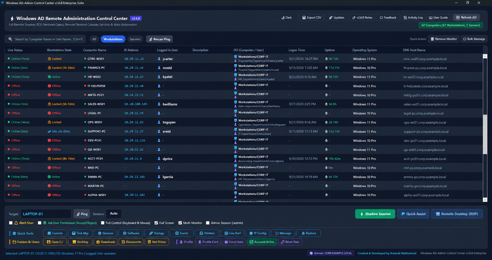
</p>

---

### 2. ☀️ Main Executive Control Center (Light Theme)
> **High-Contrast Daytime Administrative Workspace**  
> A crisp, high-visibility light theme interface offering identical management density and sub-second filtering responsiveness. Features real-time organizational unit hierarchies, rapid workstation categorization, and integrated action triggers.

<p align="center">
  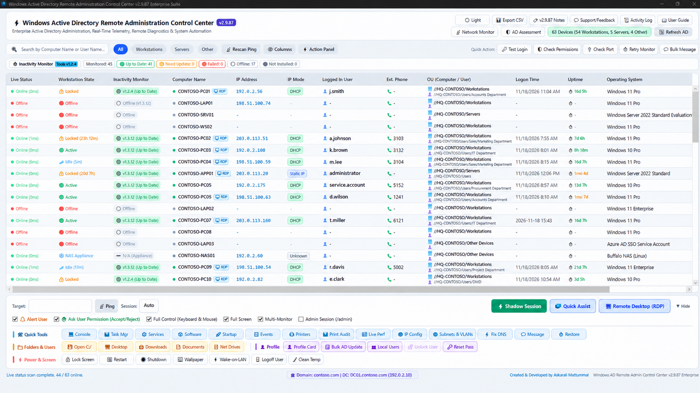
</p>

---

### 3. 🌓 Dual-Theme Adaptive Workspace (Dark & Light Comparison)
> **Zero-Restart Instant Theme Ergonomics**  
> Seamlessly toggle between dark and light color modes with a single click. Designed with tailored color contrast ratios for dark room Network Operations Centers (NOCs) and brightly lit office environments alike.

<p align="center">
  
</p>

---

### 4. 👤 Enterprise 360° Active Directory User Profile Inspector & Editor
> **Complete Directory Object Telemetry & Direct In-Place Attribute Modification**  
> Inspect 40+ Active Directory user attributes across categorized tabs (Identity, Contact, Organization, Security Groups, and Full Text Summary). Perform instant account unlocking, password resets, and in-place LDAP attribute updates without launching external management snap-ins.

<p align="center">
  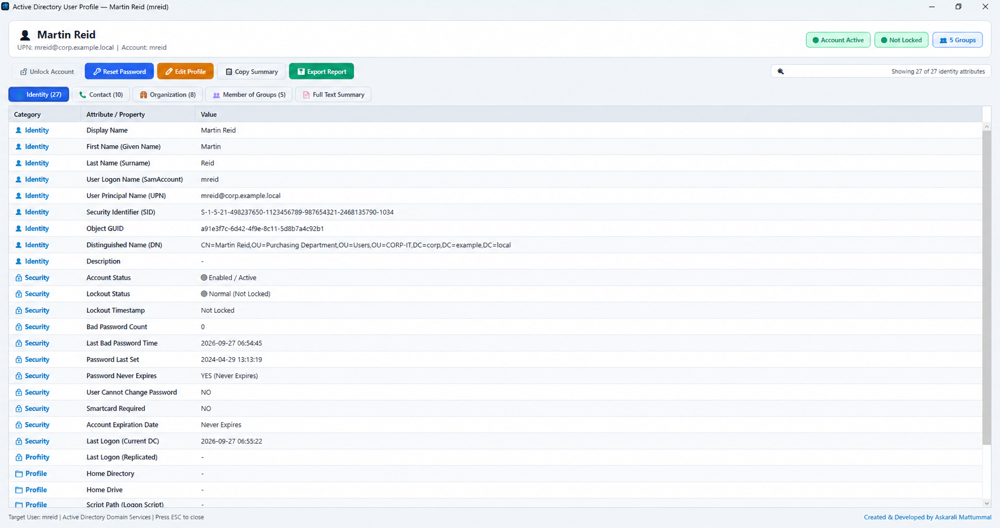
</p>

---

### 5. 📈 Live Workstation Performance & Resource Telemetry
> **High-Frequency Sub-Second Hardware Telemetry & Dual-Named Network / Teaming Diagnostics**  
> Monitor real-time CPU utilization, physical and available RAM, bi-directional network adapter throughput, and active disk I/O. Features a 60-second rolling trend line graph, live hardware specifications, dual-named network adapter tables showing both custom Windows adapter names and standardized `#N` system interfaces with Windows NIC Teaming profile & member role visibility, running processes, and Windows services tabs.

<p align="center">
  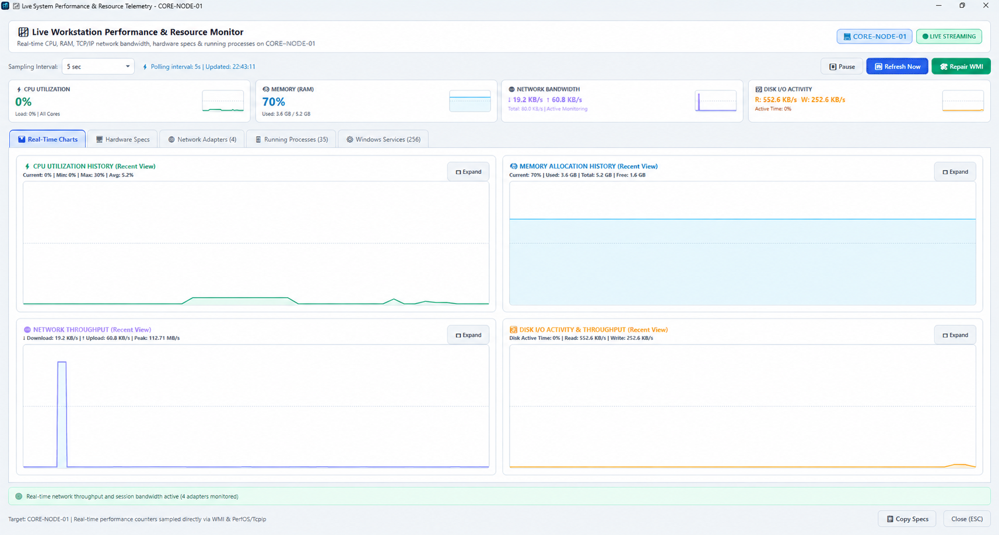
</p>

<p align="center">
  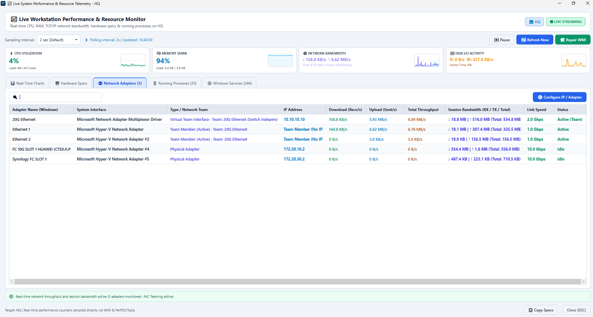
</p>

---

### 6. 💻 Interactive Remote Command Terminal (CMD & PowerShell)
> **Agentless Direct Remote Shell Execution Engine**  
> Run command-line instructions directly against target workstations without installing agents. Equipped with one-click enterprise diagnostic presets (`whoami`, `gpupdate /force`, `ipconfig /all`, `netstat -ano`, `Get-Process`, `Restart Spooler`) and instant export capabilities.

<p align="center">
  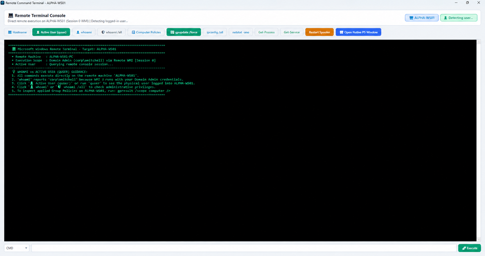
</p>

---

### 7. 📊 Remote Task Manager & Process Controller
> **Granular Process Telemetry & Hung Application Termination**  
> Inspect all running processes across target workstations with live Process IDs (PID), memory consumption footprint, and real-time search filtering. Easily start new tasks, restart processes, or safely terminate unresponsive applications remotely.

<p align="center">
  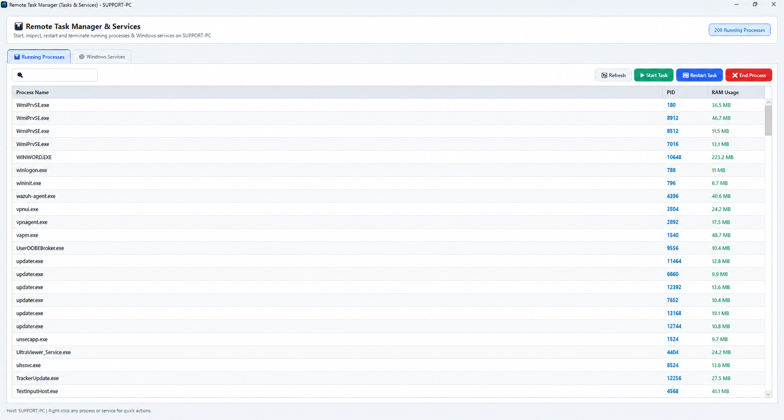
</p>

---

### 8. ⚙️ Remote Windows Services Controller
> **Complete Service Lifecycle & Startup Configuration Management**  
> Enumerate all registered Windows services with live running states, service names, and startup configurations (Automatic, Manual, Disabled). Remotely start, stop, restart services, launch custom service names, and instantly recover hung Print Spoolers.

<p align="center">
  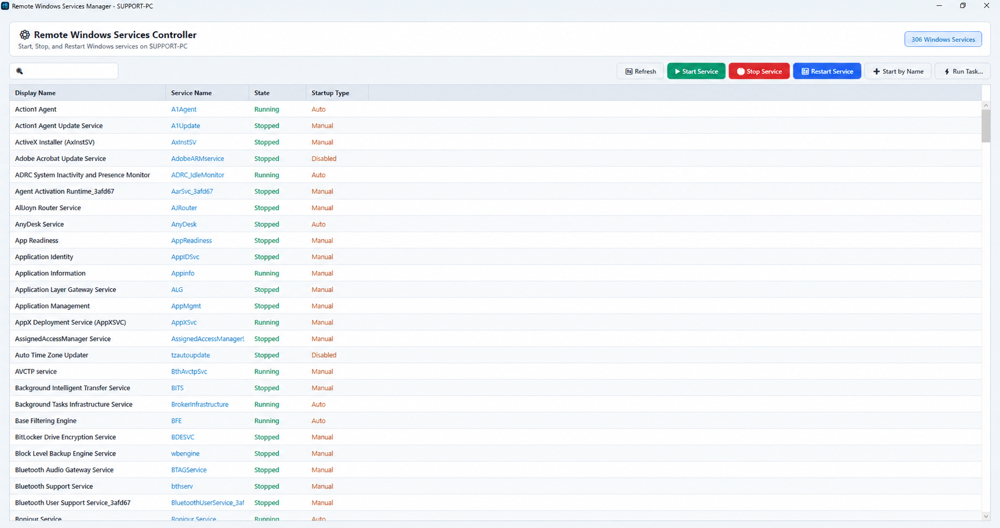
</p>

---

### 9. 📦 Installed Software Inventory & Remote Silent Uninstaller
> **Dual-Architecture Registry & Profile Application Auditing**  
> Audit all installed applications across 64-bit and 32-bit system registries as well as per-user application profiles (Teams, Zoom, OneDrive). Features instant search, application version details, install dates, installer types (MSI/EXE), and one-click silent uninstallation.

<p align="center">
  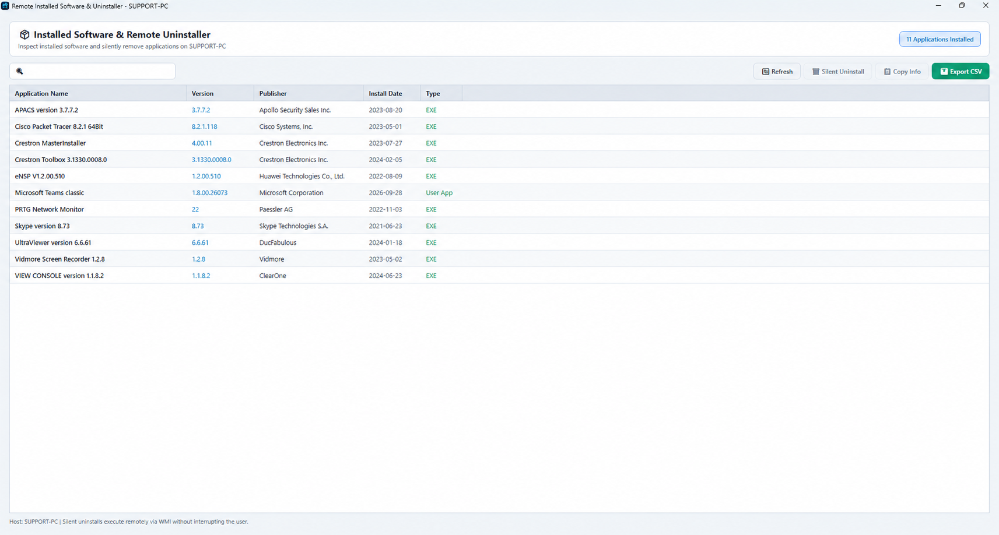
</p>

---

### 10. 🚀 Remote Startup Applications & Autoruns Manager
> **Machine & User Profile Startup Optimization**  
> Audit all startup programs configured in system-wide and user-specific autorun registries and Startup folders. Toggle programs Enabled or Disabled safely without permanently deleting keys, copy command lines, or remove legacy autorun entries.

<p align="center">
  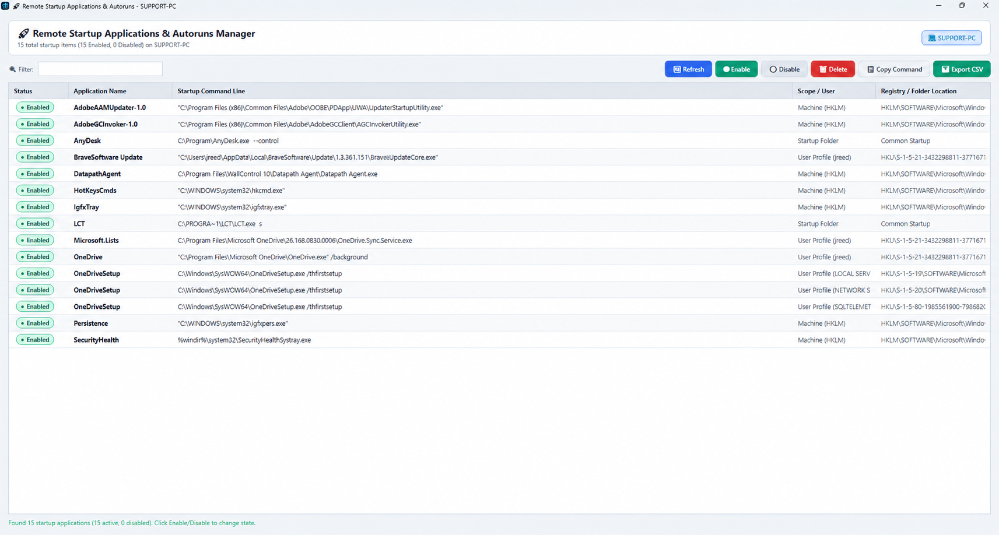
</p>

---

### 11. 👥 Local Computer Users & Security Manager
> **Agentless Local SAM Account Administration & Provisioning**  
> Remotely manage local workstation accounts even when no domain session is active. Create new local administrators or standard users, reset passwords, activate or deactivate accounts, and safely delete accounts with multi-tier administrative password safeguards.

<p align="center">
  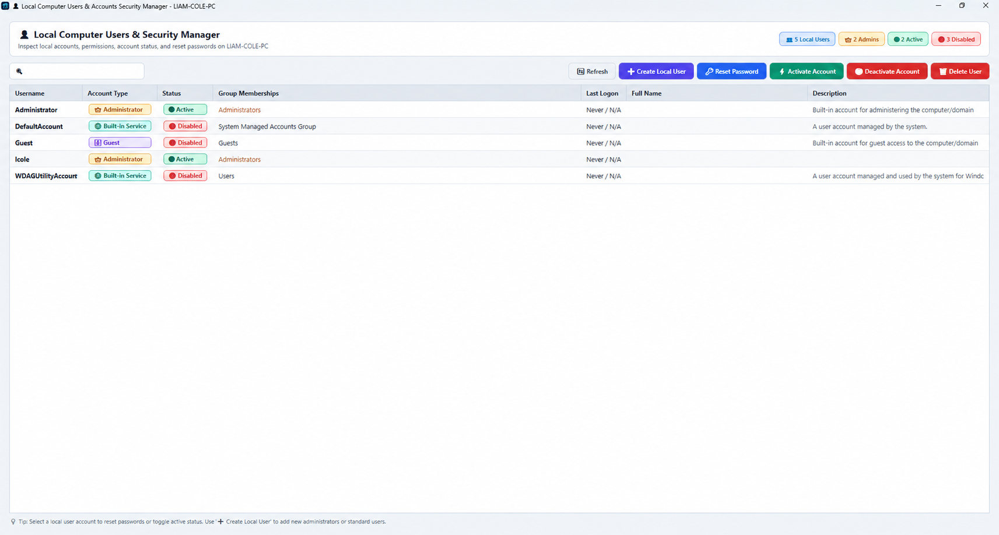
</p>

---

### 12. 🗄️ Remote Mapped Network Drives Manager (`Ctrl + D`)
> **Cross-Profile Network Storage Auditing & Drive Provisioning**  
> Inspect mounted network drives and UNC paths across all loaded user profiles. Add new network drive mappings with automated free letter assignment (Z-D), edit existing mappings, toggle persistent logon reconnection, and disconnect shares with immediate feedback.

<p align="center">
  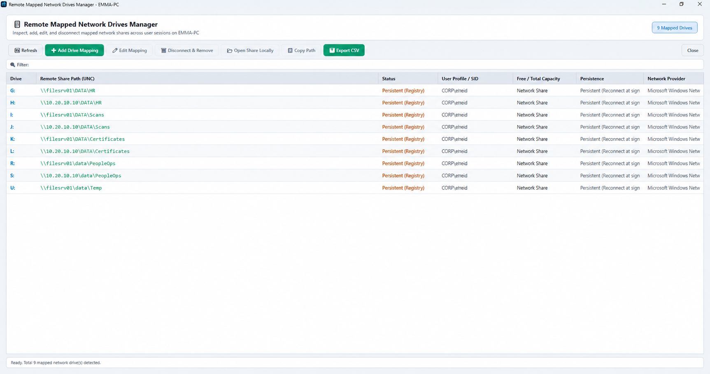
</p>

---

### 13. 🌐 Remote Network Adapter & IP Configuration Hub
> **Role-Aware Multi-NIC Discovery, Offline Persistent IP Switching & Autonomous Network Repair**  
> Discover and inspect every endpoint interface—including physical, Virtual Team (Multiplexor), Team Member, Hyper-V virtual switch (`vEthernet`) and uplink, cable-unplugged (APIPA or pre-staged static), disabled, and IPv4-unbound adapters—with safety sorting and role advisory banners featuring 1-click inline actions (`Enable Adapter`, `Enable TCP/IPv4 Binding`, `Switch to Team Interface`). Remotely reconfigure DHCP ⇄ Static IP (even on unplugged cables or virtual switches), manage multiple IPs/gateways/DNS priorities and interface metrics, and run one-click autonomous network repair routines.

<p align="center">
  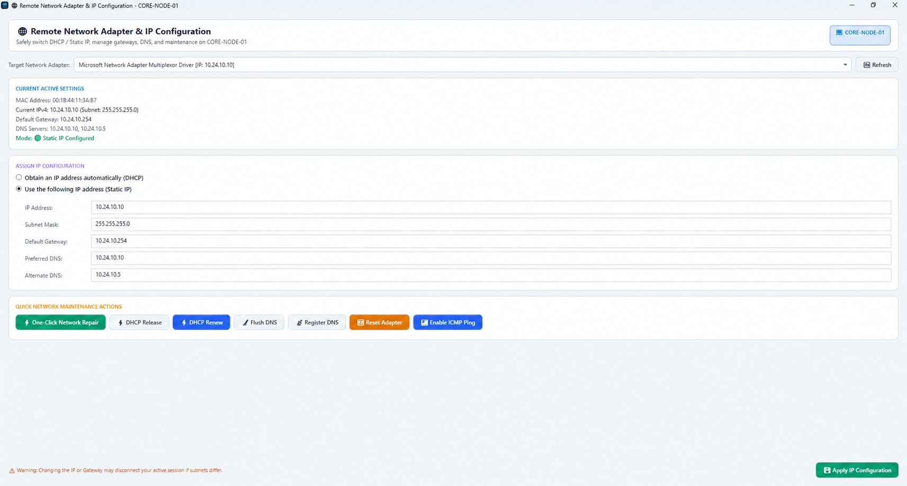
</p>

---

### 14. 🔍 DNS Name Resolution & Reverse Lookup (nslookup)
> **Active Directory Integrated DNS Diagnostics & PTR Validation**  
> Perform forward (A/AAAA) and reverse (PTR) host resolution against domain DNS servers. Verify responding DNS servers, inspect response latencies, flush local DNS caches, and toggle between structured records and raw terminal output.

<p align="center">
  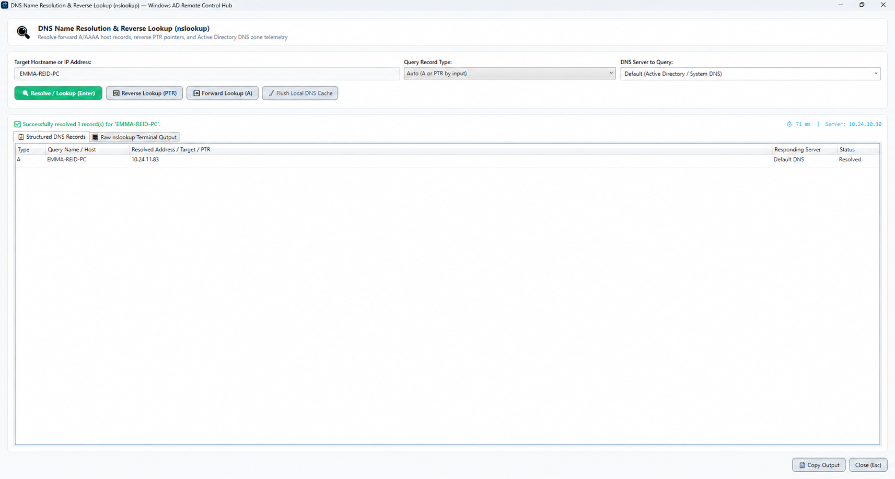
</p>

---

### 15. 🔒 Remote Workstation Lock & Unlock Controller
> **Real-Time Lock Screen Detection & Credential Session Unlock**  
> Accurately detects whether a remote computer is actively locked by an operator. Remotely engage the Windows lock screen, reconnect disconnected physical console sessions, safely log off abandoned sessions, or unlock sessions remotely using authenticated credentials.

<p align="center">
  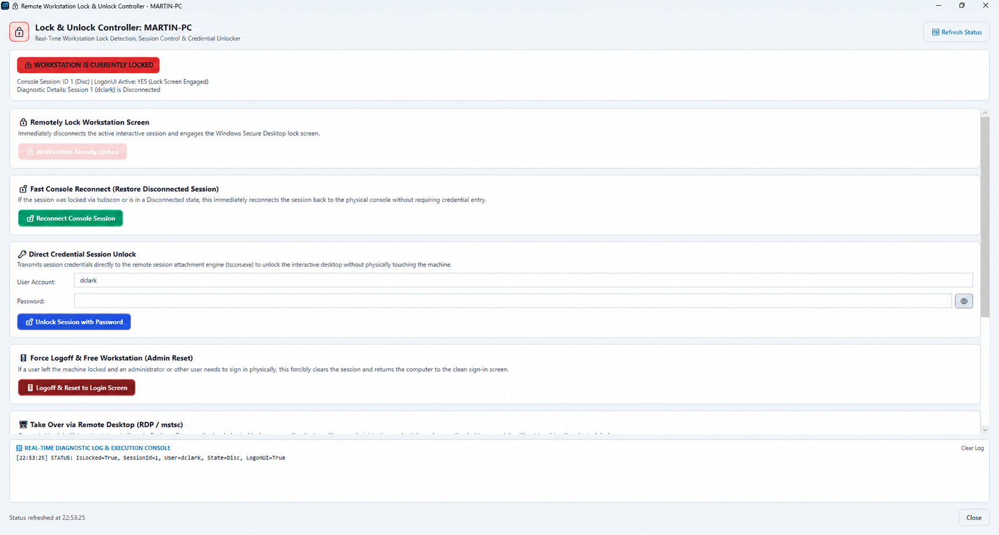
</p>

---

### 16. 🔑 Windows LAPS & Local Administrator Password Management
> **Native Active Directory LAPS Decryption & Expiration Scheduling**  
> Directly decrypt and view Microsoft LAPS managed passwords in plain-text with authorized administrative permissions. Copy credentials in standard formats, view remaining validity countdowns, set custom expiration dates, or force immediate password rotation.

<p align="center">
  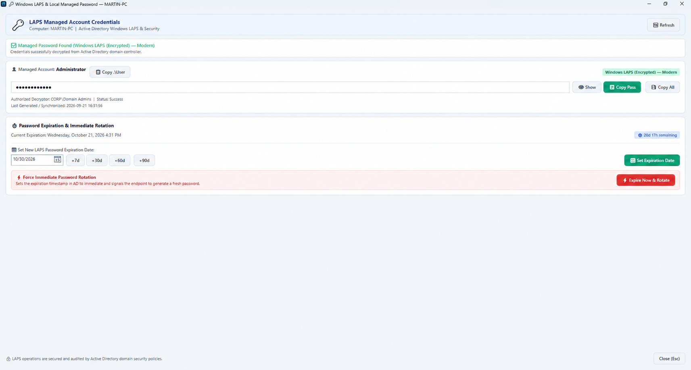
</p>

---

### 17. 🖥️ Desktop Info HUD (Sysinternals BgInfo Wallpaper Engine)
> **Customizable System Telemetry Stamped Directly onto Desktop Backgrounds**  
> Stamp critical system diagnostics (hostname, IP address, OS build, uptime, CPU, RAM, disk space) cleanly onto remote desktop wallpapers in high-contrast two-column drop shadow format. Supports wallpaper overlays, floating desktop companion widgets, or dual modes.

<p align="center">
  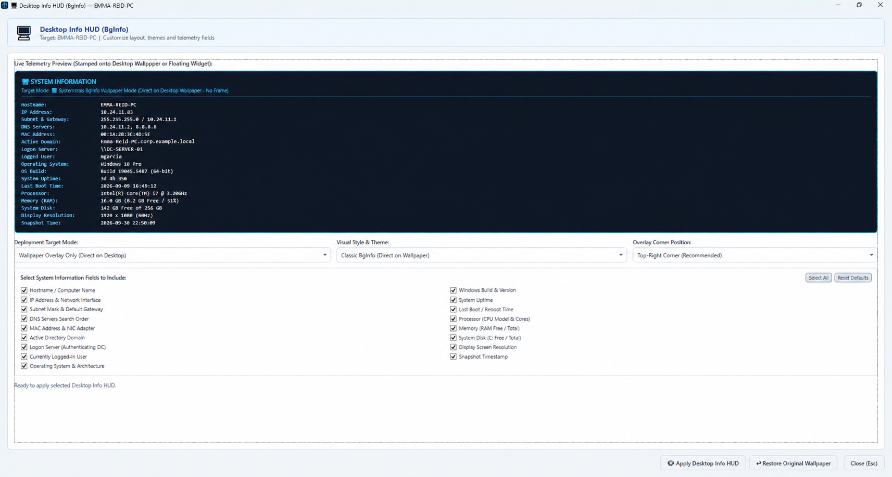
</p>

---

### 18. 👑 Windows God Mode & Enterprise Power Tweaks Hub
> **Master Control Panel Deployment & Enterprise OS Optimization Tweaks**  
> Deploy the Windows God Mode folder containing 200+ administrative applets to User or Public Desktops and context menus. Apply one-click power tweaks including "Take Ownership", Classic Windows 11 context menus, "Ultimate Performance" power scheme, and CompactOS storage compression.

<p align="center">
  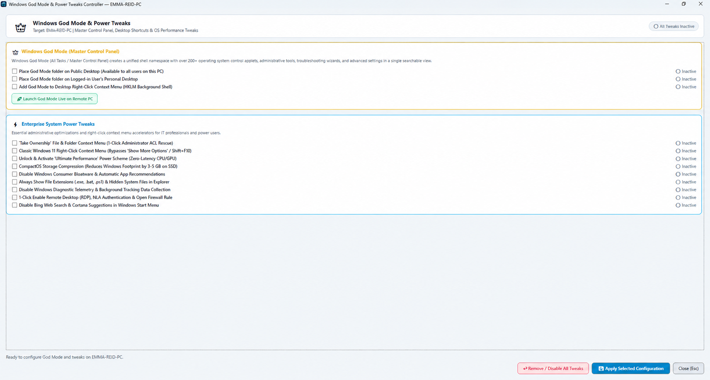
</p>

---

### 19. ⏱️ Remote System Restore Point Manager
> **On-Demand Checkpoint Creation & Remote System Rollback**  
> Remotely inspect System Restore protection status on client drives, enable or disable protection, create custom named checkpoints before updates, view historical restore points, and initiate remote rollbacks with automated reboot confirmation.

<p align="center">
  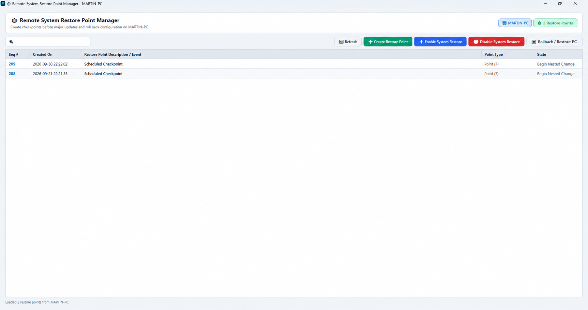
</p>

---

### 20. 💬 Remote User Messaging & Notification Hub
> **On-Screen Modal Dialogs & Action Center Toast Notifications**  
> Dispatch customized notification banners directly to remote user screens. Choose between intrusive modal popups requiring manual acknowledgement or modern Windows Action Center toast banners, complete with alert level badges, custom sender titles, and quick action templates.

<p align="center">
  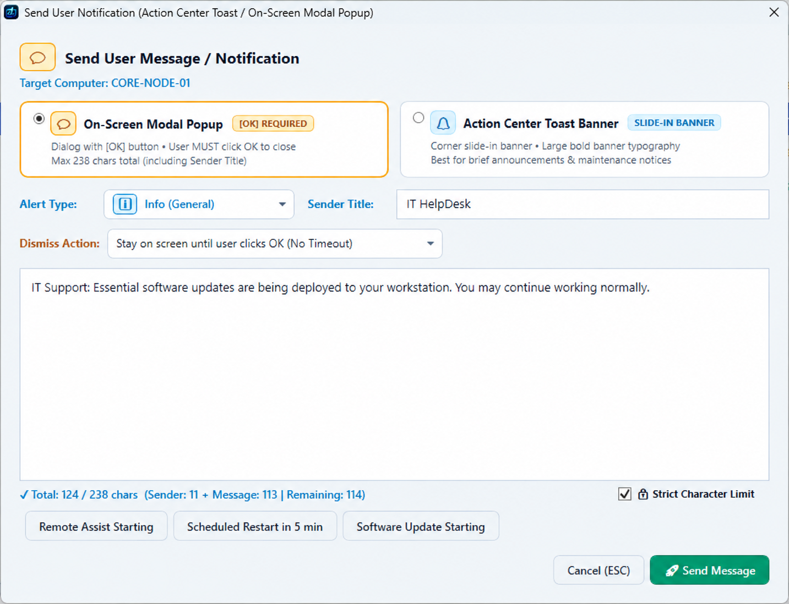
</p>

---

### 21. 🖨️ Remote Printers & Print Queue Manager
> **Fleet Printer Infrastructure, Ink/Toner Telemetry & Queue Management**  
> Manage local and shared domain network printers. Inspect multi-color ink and toner level indicators with intuitive color badges (Black, Cyan, Magenta, Yellow), view active spooler queues, purge stuck print jobs, and send remote test print pages.

<p align="center">
  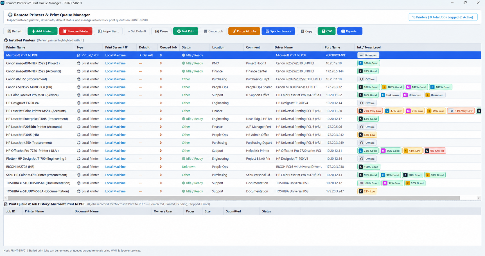
</p>

---

### 22. 📊 Print Fleet Audit Analytics — User Printing Summary
> **Executive User Paper Consumption Intelligence & Quota Auditing**  
> Comprehensive print intelligence ranking users by total print volume, individual job counts, average pages per job, maximum job size, data bandwidth, and departmental fleet utilization percentage.

<p align="center">
  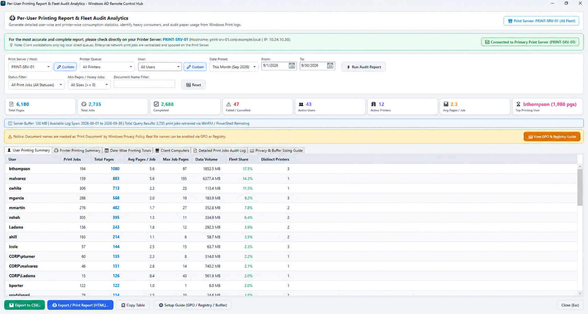
</p>

---

### 23. 🖨️ Print Fleet Audit Analytics — Printer Utilization Summary
> **Print Queue Workload Distribution & Fleet Capacity Planning**  
> Audit workload across all enterprise printers. Track total print jobs, page volumes, distinct users per device, data volume throughput, and overall fleet capacity share to identify over-utilized or idle printing hardware.

<p align="center">
  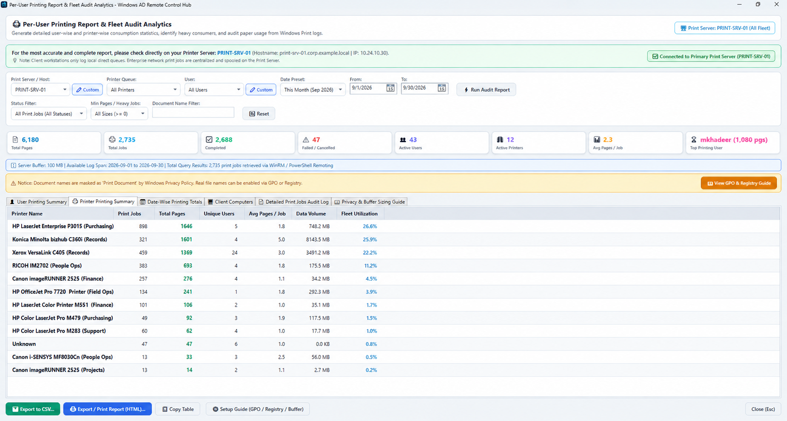
</p>

---

### 24. 📅 Print Fleet Audit Analytics — Date-Wise Printing Totals
> **Chronological Printing Trends & Daily Volume Analysis**  
> Track daily printing trends across selected calendar periods. Displays daily job counts, page totals, active daily users, active printers, and average pages per job to detect unusual peak usage days or unauthorized mass printing.

<p align="center">
  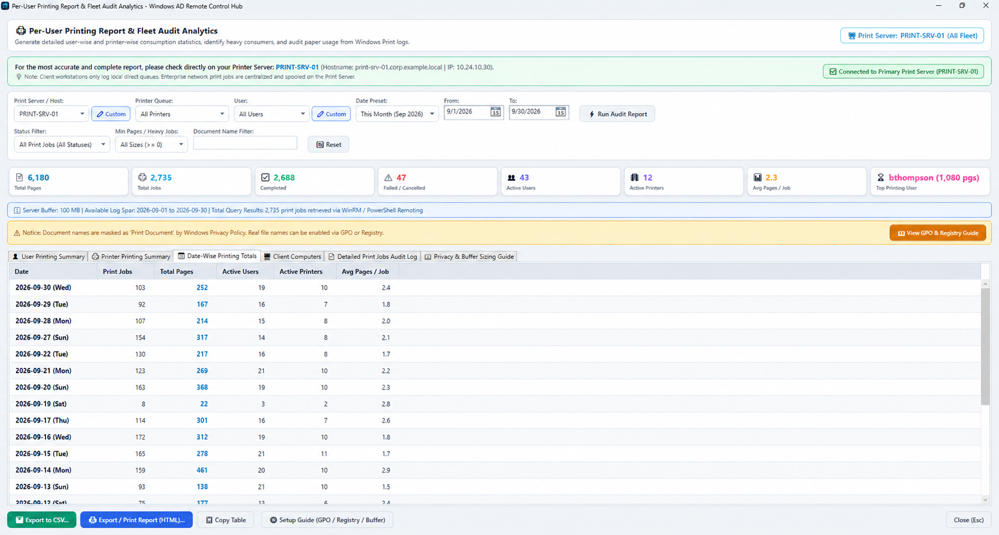
</p>

---

### 25. 💻 Print Fleet Audit Analytics — Client Workstations Breakdown
> **Endpoint Origin Auditing & Workstation Paper Tracking**  
> Trace every print job back to the originating client PC and primary authenticated user account. Identify which physical workstations generate the heaviest printer traffic across corporate departments.

<p align="center">
  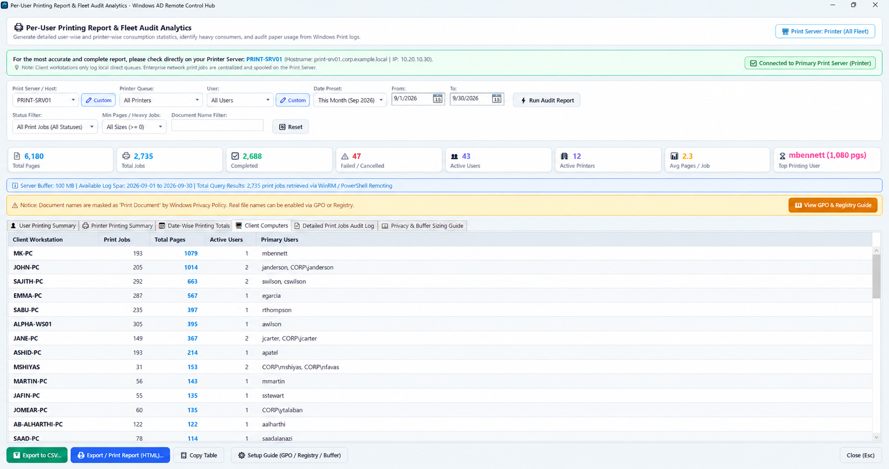
</p>

---

### 26. 📜 Print Fleet Audit Analytics — Detailed Print Jobs Audit Log
> **Transaction-Level Print Audit Ledger & Compliance Logging**  
> Complete audit log recording every print transaction with Job ID, exact date and time, user account, printer name, document/file name, page count, document file size in KB/MB, client workstation, network port IP, and final status (Completed / Printed / Cancelled). Supports 1-click HTML and CSV report export.

<p align="center">
  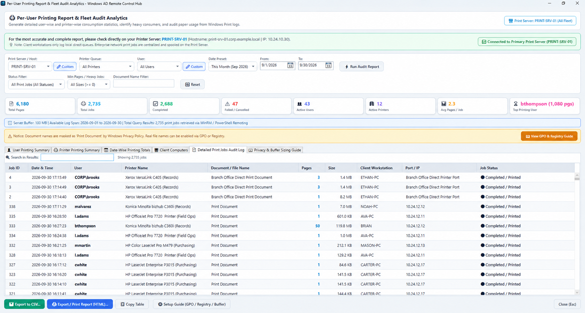
</p>

---

### 27. 🌐 24/7 Network Device Monitoring & WhatsApp Alerting Center
> **Multi-Layer Infrastructure Health, Auto-Detected Server Roles & Real-Time WhatsApp Incident Broadcasts**  
> Comprehensive single-pane-of-glass dashboard for 24/7 agentless monitoring of mission-critical enterprise infrastructure—including Active Directory Domain Controllers, application and print servers, core switches, routers, firewalls, NAS storage arrays, VoIP appliances, and workstations. Features live KPI summary cards (Total Monitored, Online, Offline, Degraded, Active Incidents, and WhatsApp Delivery status), multi-layer per-device health columns, and an interactive **Edit Device Configuration** workspace with live layer verification.
>
> **Key Operational Benefits:**
> - **True Multi-Layer Visibility**: Combines **ICMP Ping**, **TCP/UDP Port Monitoring**, and **Windows Service & Application Protocol Checks** (RDP, SMB, HTTP/HTTPS, AD DS, DNS, DHCP, Certificate Services) in one view—continuing port and service checks even when ICMP Ping is blocked by firewalls.
> - **1-Click Role Discovery & Live Diagnostics**: Automatically identifies server roles with **Scan & Auto-Detect Roles on Host**, displays real-time per-port latency badges and service status indicators in a **Live Layer Preview**, and launches the **Server Health & Binding Audit** directly from the device profile.
> - **False-Alarm Prevention & Instant Mobile Alerts**: Smart **Degraded Warning** policies distinguish single port/service issues from full device outages while delivering immediate WhatsApp outage and recovery notifications directly to on-call administrators.

<p align="center">
  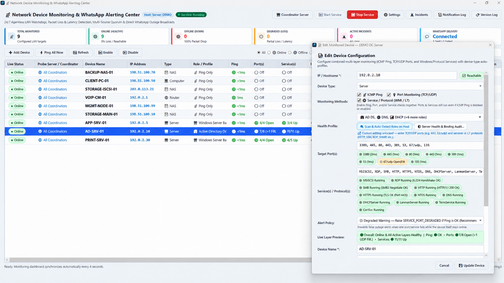
</p>

---

### 28. 📡 Coordinator Server Discovery & Multi-Server Synchronization
> **High-Availability Coordinator Cluster, One-Click Remote Deployment & Automatic Configuration Sync**  
> Multi-server distributed monitoring console that lets IT teams discover, deploy, update, and synchronize autonomous 24/7 monitoring coordinators across multiple domain servers and administrative workstations. Displays live service health, coordinator version compliance, active target assignment, and synchronized monitored device counts across every node in the cluster.
>
> **Key Operational Benefits:**
> - **Silent Multi-Server Deployment**: Deploy and register the auto-start 24/7 background monitoring service onto one or multiple domain hosts in a single click via **Deploy to Server...**, complete with instant search and a **Domain Servers Only** filter.
> - **Uninterrupted 24/7 Failover & Multi-Source Quorum**: Run synchronized coordinators across multiple servers and VLANs so monitoring continues uninterrupted during server reboots, maintenance windows, or hardware failures.
> - **Centralized Cluster Lifecycle Control**: Instantly switch the active node (**Set as Active**), enroll servers in automatic configuration replication (**Add to Auto-Sync**), push seamless upgrades (**Update Coordinator**), or cleanly remove retired nodes from one unified console.

<p align="center">
  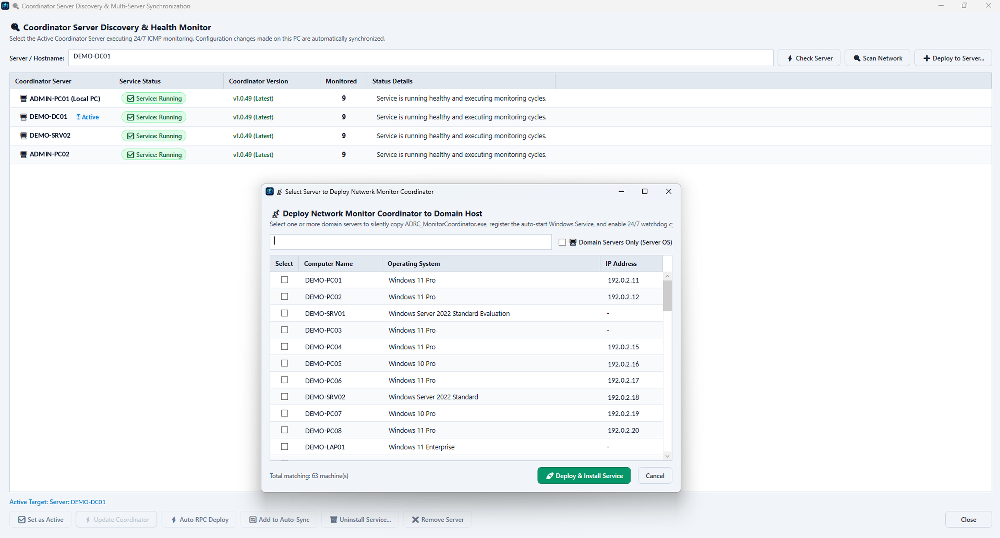
</p>

---

### 29. 💾 Remote Disk Usage Analyzer & Storage Optimization Suite
> **Interactive 3D Cushion Squarified Treemap, Dedicated File Analysis Tabs & Safe Cleanup Suite**  
> High-speed enterprise storage diagnostics featuring hybrid dual-path scanning (high-speed sequential NTFS volume indexing and parallel directory crawling). Features interactive 3D cushion squarified treemaps, independent horizontal and vertical scrolling in the "Items Inside" area, dedicated file analysis tabs (Largest Files with multi-tier size and category filtering, Recent Files chronological timeline, Duplicate Files with cryptographic SHA-256 hash verification and potential space savings calculation, and Space Cleanup with an informative safety card, non-modal dry-run staging preview, and 7-day reversible quarantine rollback).

<p align="center">
  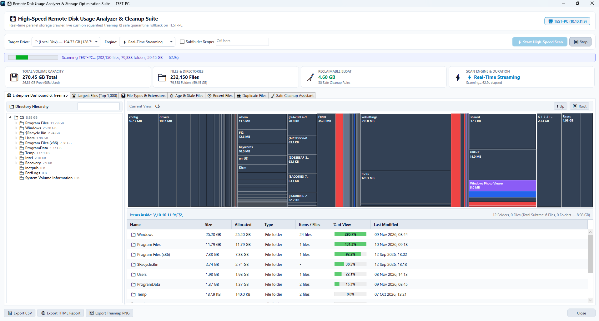
</p>

---

### 30. 🛡️ Deep Windows Server Health & Active Directory Diagnostics Audit
> **Multi-Layer Server Health Scoring, Subsystem Scorecards & Safe 1-Click Remediation**  
> Non-destructive, agentless server diagnostics evaluating 8 core subsystems (Active Directory Domain Services, DNS Infrastructure, DHCP Multi-NIC Isolation, Windows Services, Network Sockets, Attack Surface Hardening, Storage Capacity, and System Event Logs). Features an overall health score (0–100), visual scorecards, safe 1-click administrative remediation with pre-change backup snapshots and reversible rollback, and executive HTML report generation.

<p align="center">
  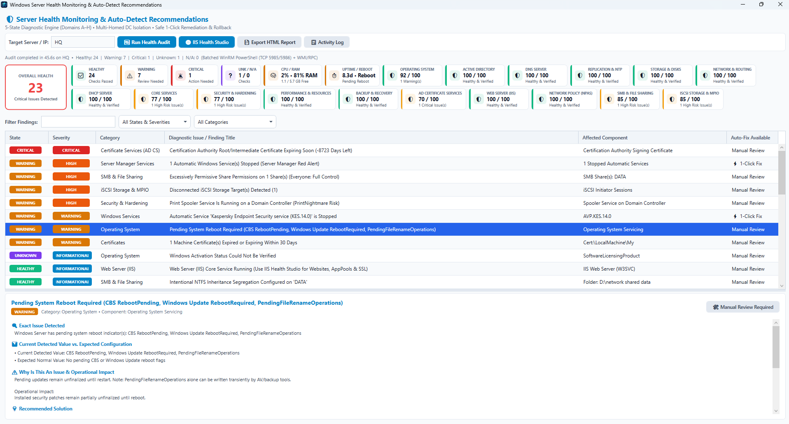
</p>

---

### 31. 🗺️ Server Topology & Infrastructure Discovery Map
> **Interactive Multi-Tier Active Directory, Primary/Secondary DNS & Hyper-V Relationship Visualizer**  
> Automatically discovers and maps your Active Directory Forest, Sites, Domain Controllers (with FSMO and Global Catalog badges), Member Servers, Primary and Secondary DNS infrastructure (including independent per-server DNS forwarder discovery, forwarder source attribution, and zone-transfer synchronization arcs), and physical Hyper-V Host-to-VM relationships on an interactive zoomable canvas.
>
> **Key Operational Benefits:**
> - **Instant Infrastructure Visibility**: View resolved IPv4 addresses, detected server roles (AD DS, DNS, DHCP, IIS, Print Server, Hyper-V), and guest-to-host VM mappings at a glance without manually building network diagrams.
> - **Independent Primary & Secondary DNS Clarity**: Verifies each DNS server's actual forwarder configuration independently, distinguishing Primary vs. Secondary forwarder paths with color-coded non-overlapping links and clear upstream attribution.
> - **Interactive Exploration & Export**: Zoom with the mouse wheel around the pointer (25% to 300%), filter by infrastructure layer (All Layers, AD Sites & DCs, DNS & Server Roles, Hyper-V Hosts & VMs), drag and reposition nodes via mouse or touch with automatic anti-overlap protection and one-click **Auto-Arrange**, inspect detailed server properties and relationships in the side panel, and export self-contained **SVG/HTML** diagrams for documentation and change reviews.

<p align="center">
  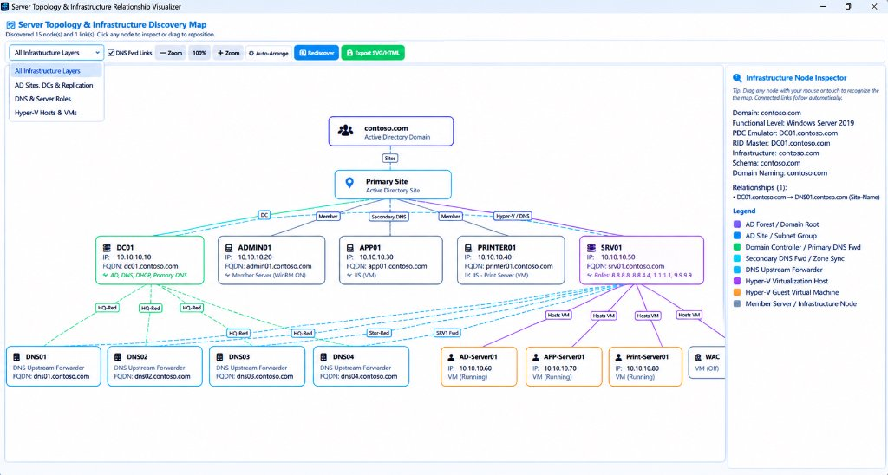
</p>

---

### 32. 📊 IT Hardware & Workstation Inventory Report — Complete Domain Asset Registry & 65-Column Studio (`Ctrl + Shift + I`)
> **Never Lose Offline Asset Visibility Again — Complete Online + Offline Domain Inventory with 4-Sheet Excel, Interactive HTML & PDF Export**  
> Eliminate incomplete "online-only" asset spreadsheets forever. WADRACC's **IT Hardware & Workstation Inventory Report** builds a persistent, 100% agentless domain asset registry that remembers every workstation's last verified hardware, operating system, user, and network specifications—even when laptops are powered off, traveling, or on annual leave. Powered by permanent Active Directory identity tracking, renamed computers stay unified without duplicate rows, while optional **Automatic Daily Idle-Aware Updates** silently keep records fresh once per day only when employees are idle, locked, or logged off.
>
> **Why IT Teams & Management Love It:**
> - **6 Live Fleet KPIs & Freshness Intelligence**: Instantly track **Total Registered**, **Online Now**, **Offline / Powered Off**, **Outdated (Stale)**, **Missing Inventory**, and **Filtered / Export Scope** with configurable stale thresholds and independent *Last Seen* vs. *Last Inventory* timestamps.
> - **12 Precision Filters & 65 Selectable Columns**: Slice your fleet by Search, Connection Status, Freshness, OU, Device Type, Manufacturer, Model, Assigned User, Connected Monitor Count, Stale Threshold, and **Collected From / To** dates—or switch views in one click with **6 Quick Presets** (*Management Overview*, *Hardware Audit*, *OS & Licensing*, *Network & IP*, *TPM & BitLocker*, *Minimal*).
> - **Dual-Purpose Executive Exports**: Click **🌐 Interactive HTML Report** (with built-in Light/Dark Mode and Print/PDF) to deliver the **complete domain fleet** for interactive self-service filtering in any browser, or export strictly your **filtered scope** to a native **4-Sheet Excel Workbook (`.xlsx`)** (*Inventory Summary*, *Complete Device Inventory*, *Hardware Details*, *Network Details*) or **UTF-8 CSV**.

<p align="center">
  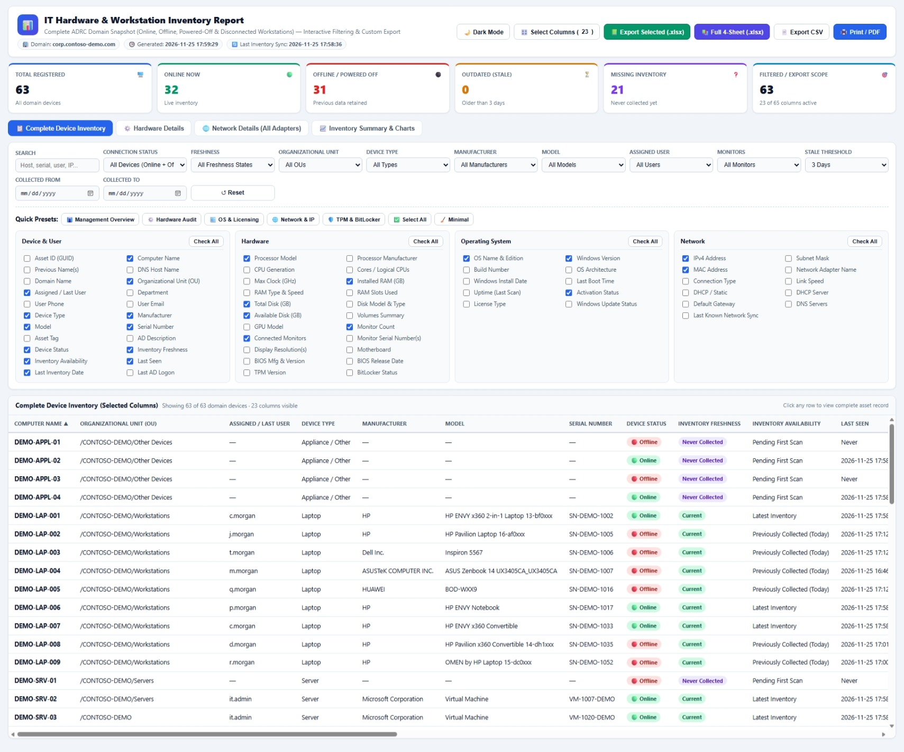
</p>

---

### 33. 📈 IT Hardware & Workstation Inventory — Executive Fleet Summary & Visual Breakdown Charts
> **Boardroom-Ready Hardware Lifecycle, OS Migration & Monitor Fleet Analytics at a Glance**  
> Switch to the **Inventory Summary & Charts** tab to transform raw domain telemetry into clear visual fleet intelligence across **7 interactive distribution breakdowns**—**Connection Status**, **Inventory Freshness**, **Device Type**, **Manufacturer**, **Operating System**, **Monitor Configuration**, and **Organizational Unit**.
>
> **Instant Operational Decisions:**
> - **Windows 10 → 11 Migration Planning**: Immediately spot exact counts and percentages of Windows 10, Windows 11, and Server editions alongside TPM 2.0 and BitLocker readiness.
> - **Vendor & Hardware Refresh Budgeting**: Compare Dell, HP, Lenovo, ASUS, and virtual fleets side by side and identify single-monitor vs. dual-monitor workstations for procurement planning.

<p align="center">
  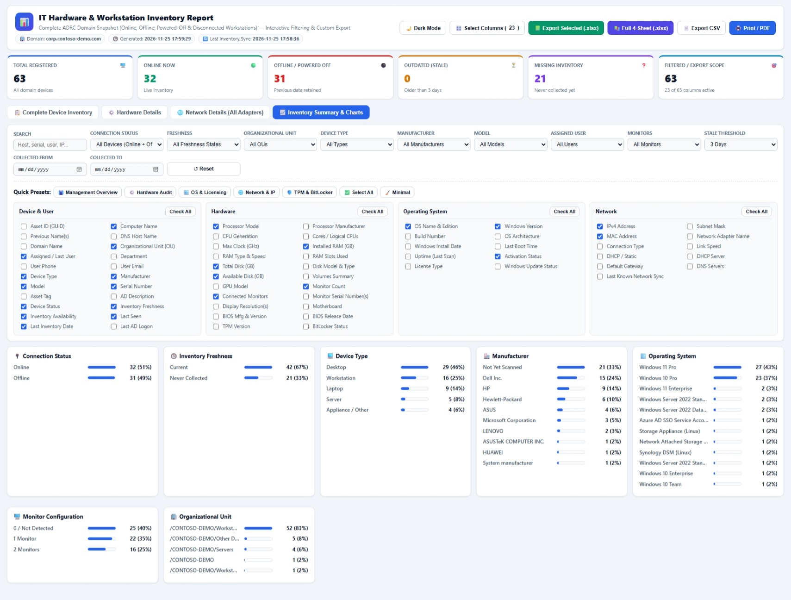
</p>

---

### 34. 🌐 IT Hardware & Workstation Inventory — Per-Adapter Network & IP Intelligence
> **Multi-NIC Fleet Auditing Across Every Physical, USB Dock, Wi-Fi & Virtual Adapter**  
> Modern workstations frequently carry wired docks, Wi-Fi radios, VPN tunnels, and Hyper-V/VirtualBox switches. The **Network Details (All Adapters)** tab expands every computer into an adapter-by-adapter ledger—surfacing **Asset ID**, **Connection Type**, **Link Speed**, **MAC Address**, **IPv4 Address**, **Subnet Mask**, **DHCP / Static Mode**, **Default Gateway**, and **DNS Servers** across your entire fleet in one searchable view.
>
> **Key Operational Benefits:**
> - **Instant 100 Mbps Bottleneck & Static IP Detection**: Quickly spot endpoints negotiated at 100 Mbps instead of 1 Gbps, audit hardcoded static IPs, and verify DNS/gateway consistency across branch OUs.

<p align="center">
  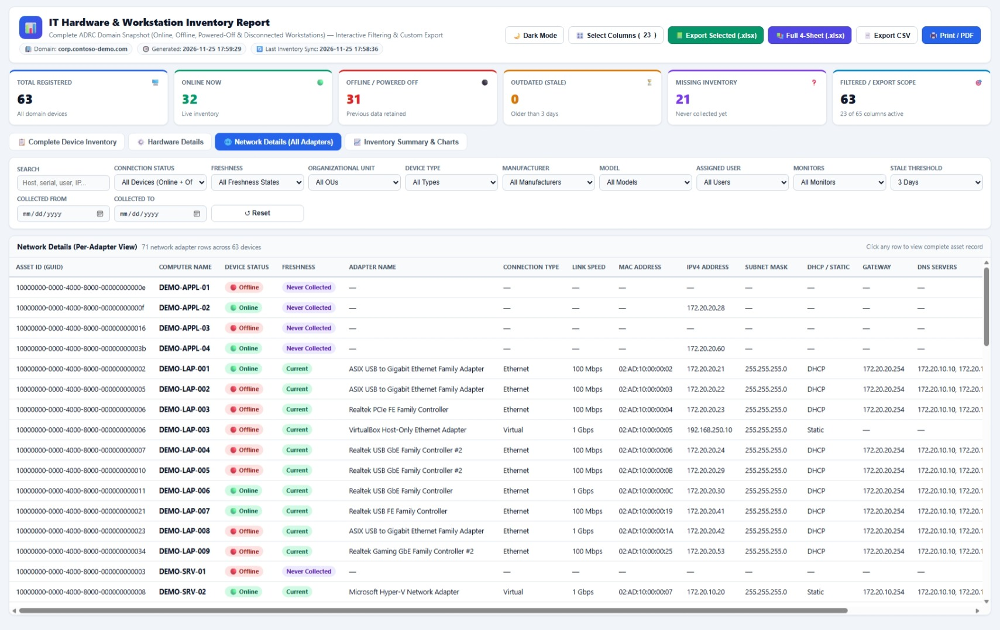
</p>

---

### 35. 🔍 IT Hardware & Workstation Inventory — 360° Complete Asset Record & Multi-Monitor Inspector
> **Click Any Row for a Complete 4-Pillar Hardware, OS, Network & Display Deep Dive**  
> Selecting any workstation opens its **Complete Asset Record** card—organizing all 65+ verified specifications into four clean pillars (**Device & User**, **Hardware**, **Operating System**, and **Network**) plus a dedicated **Connected Monitors & Displays** panel at the bottom.
>
> **Deep Asset Visibility Without Interrupting the User:**
> - **Multi-Monitor Hardware & Serial Tracking**: Automatically detects every attached monitor's port (`HDMI`, `DisplayPort`, `eDP`), manufacturer, model name, diagonal size, native resolution, and hardware serial number for accurate desk and warranty audits.
> - **Security, Licensing & Multi-Source User Contact**: Inspects TPM version, BitLocker encryption state, Windows activation and tampering indicators, RAM slot utilization, per-volume free/total disk space, BIOS release dates, and automatically resolves missing corporate user emails across Active Directory, Exchange/Microsoft 365, and Outlook profiles.

<p align="center">
  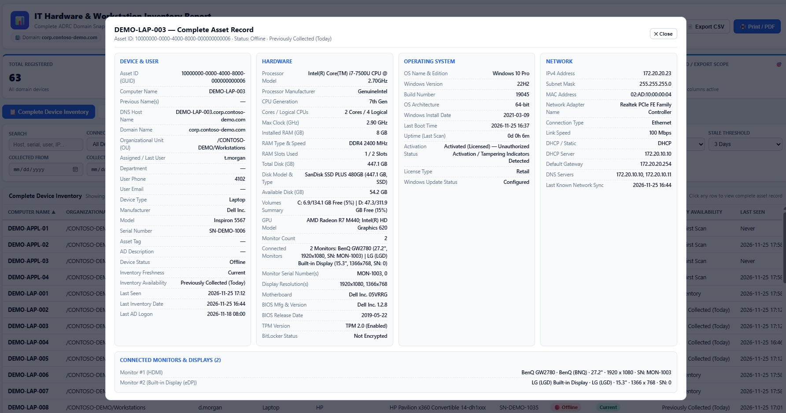
</p>

---

## 🛡️ Active Directory Assessment Studio Suite (11 Security, Health, Topology & GPO Audits)

> Comprehensive, agentless domain health, replication topology, protocol hardening, and security governance audits natively integrated into the WADRACC administrative workspace.

Active Directory environments grow increasingly complex over time, accumulating orphaned objects, obsolete protocols, misconfigured Group Policies, lingering DNS records, and dormant accounts that expand organizational attack surfaces. 

Originally developed as an advanced set of administrative audit scripts by Mohamed Zeghlache and integrated directly into the WADRACC native client, the **Active Directory Assessment Studio Suite** delivers an enterprise-grade auditing powerhouse. It automates domain-wide health inspections, evaluates security baselines, and compiles self-contained interactive offline HTML reports — all executed natively with zero agents, zero third-party software installations, and zero cloud data leaks.

<p align="center">
  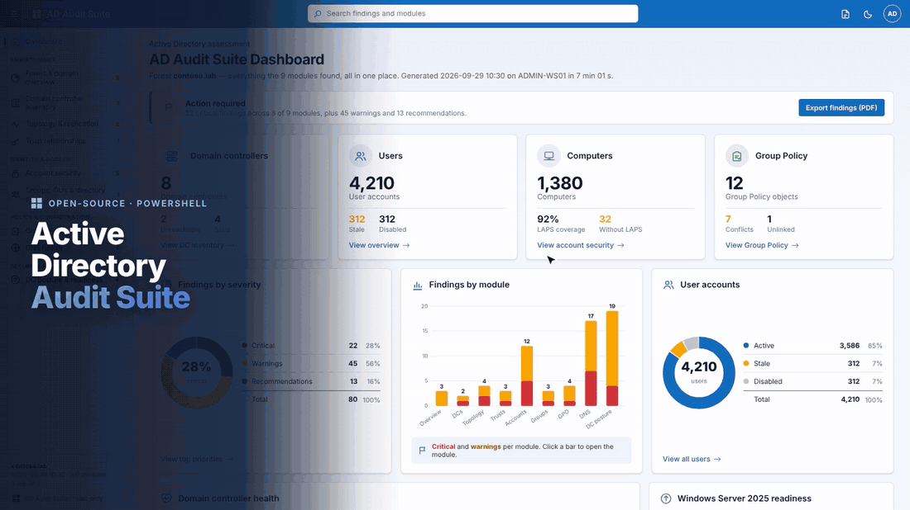
</p>

### 🎯 Key Purpose & Operational Benefits
* **Continuous Security Posture Hardening**: Automatically audits domain controller hardening, evaluating LDAP signing and channel binding, SMB signing, SMBv1 presence, NTLM restriction levels, Kerberos encryption types (RC4 vs AES), and Windows Server 2025 upgrade readiness.
* **Credential Hygiene & Account Vulnerability Discovery**: Identifies dormant accounts, non-expiring passwords, accounts with unconstrained Kerberos delegation, stale machine passwords, fine-grained password policies (PSOs), LAPS coverage, and krbtgt password age.
* **Replication & Topology Health Verification**: Uncovers replication latency, consecutive synchronization failures, orphaned domain controller metadata, and broken naming contexts across all domains in the forest.
* **Automated Group Policy (GPO) Conflict Analysis**: Parses raw Registry.pol and GptTmpl.inf files, resolves policies to friendly names via ADMX templates, and pinpoints conflicting settings across GPOs.
* **100% Self-Contained Offline HTML Reports**: Every audit generates a beautifully formatted, standalone HTML report with responsive dark and light themes, search filters, client-side CSV data exports, and 1-click **Export findings (PDF)** for executive presentations and compliance audits.

---

### 🏛️ Complete Assessment Modules Directory

| Module | Operational Scope | Coverage & Key Capabilities |
| :--- | :--- | :--- |
| **🚀 Complete AD Audit Suite** | All-In-One Master Engine | Orchestrates all individual modules sequentially in isolated background processes with timeout handling, combining findings into a single executive dashboard with cross-module search, severity breakdown, and 1-click executive PDF export. |
| **🌐 Forest & Domain Overview** | Forest-Wide Architecture | Forest functional levels, schema version, FSMO masters, tombstone lifetime, directory object counts, account posture (enabled, disabled, stale, locked, password-never-expires), and computer OS distribution with client-side CSV downloads. |
| **🗺️ Topology & Replication** | Forest-Wide Replication | Interactive pannable/zoomable map of Forest → Domain → Site → DC hierarchy across all domains, directional Replication Health Matrix across all naming contexts, and stale/orphaned metadata detection. |
| **👥 Groups, OUs & IDFix** | Domain Structure & Cloud Sync | Recursive group nesting graph with circular nesting detection, empty/large groups, OU hierarchy with tiering recommendations, and full IDFix scan identifying attributes that break Entra ID / Microsoft 365 cloud synchronization. |
| **🤝 Domain Trust Relationships** | Forest & Domain Trusts | Enumerates forest, external, realm, and child trusts, checks SID filtering (quarantine), selective authentication, TGT delegation, transitivity flags, and live connectivity probes. |
| **🖥️ DC Hardware & OS Inventory** | Domain Controllers | Per-DC deep hardware and system specs: CPU, memory utilization, logical volumes with storage usage bars, network adapters, BIOS, NTDS database size, GC, RODC, IPv4, time zone, and uptime. |
| **🛡️ DC Security Posture** | Domain Controllers | Forest-wide DC hardening: LDAP signing/channel binding, SMB signing, SMBv1, NTLM blocking, Kerberos AES, security event logs (lockouts 4740, spray, failed logons 4625), NTP time sync hierarchy, and Server 2025 readiness. |
| **🌐 AD DNS Health & Zones** | DNS Infrastructure | AD-integrated DNS zone configuration (dynamic updates, aging/scavenging, DNSSEC, zone transfers), live DC forward/reverse resolution tests, forwarders, and lingering DC _msdcs record detection. |
| **🔑 Account Security & Hygiene** | Domain Accounts | Default password & lockout policies vs baseline, fine-grained password policies (PSOs), gMSA/sMSA inventory, LAPS coverage, and risky accounts (unconstrained delegation, SID history, stale passwords, lack of AES keys). |
| **📜 GPO Policy Analyzer** | Group Policy Infrastructure | Automated Policy Analyzer: exports GPOs to WADRACC managed storage, parses Registry.pol and GptTmpl.inf, maps policies via ADMX, flags cross-GPO setting conflicts, and evaluates WMI filters. |
| **🗄️ Server Inventory & Lifecycle** | Forest Member Servers | Discovers every member server in the forest: OS lifecycle support milestones, installed roles/features, SQL Server instances, failover clusters, hardware specs, physical/virtual platform, patch currency, and uptime. |
| **🔌 Test Server Access** | Management Diagnostic | Rapid diagnostic port tester verifying reachability of essential remote management protocols (Ping, 135, 445, 3389, 5985, 5986), delivering a clear one-sentence verdict on firewall or permission blockers. |

---

### 📸 Visual Feature Showcase — Complete 11-Module Demonstration Gallery

#### 1. 🚀 Complete Active Directory Audit Suite (All-In-One Master Report)
The flagship all-in-one assessment engine orchestrates all individual modules sequentially in isolated background processes. Synthesizes findings into a unified executive dashboard featuring cross-module search, severity breakdown, and 1-click executive PDF export:
<p align="center">
  
</p>

#### 2. 🌐 Forest & Domain Overview Dashboard
Interactive overview displaying forest functional levels, FSMO master holders, object inventory charts, account posture donuts, and OS distribution graphs. Stat cards feature instant client-side CSV downloads:
<p align="center">
  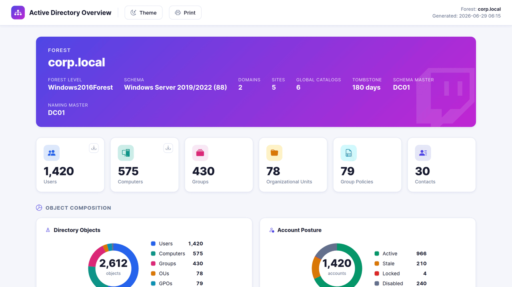
</p>

#### 3. 🗺️ Forest Topology & Replication Health Matrix
Interactive, pannable, and zoomable visualization of forest, domain, site, and DC hierarchies. Includes a directional source-to-destination replication matrix monitoring all directory naming contexts and detecting lingering metadata:
<p align="center">
  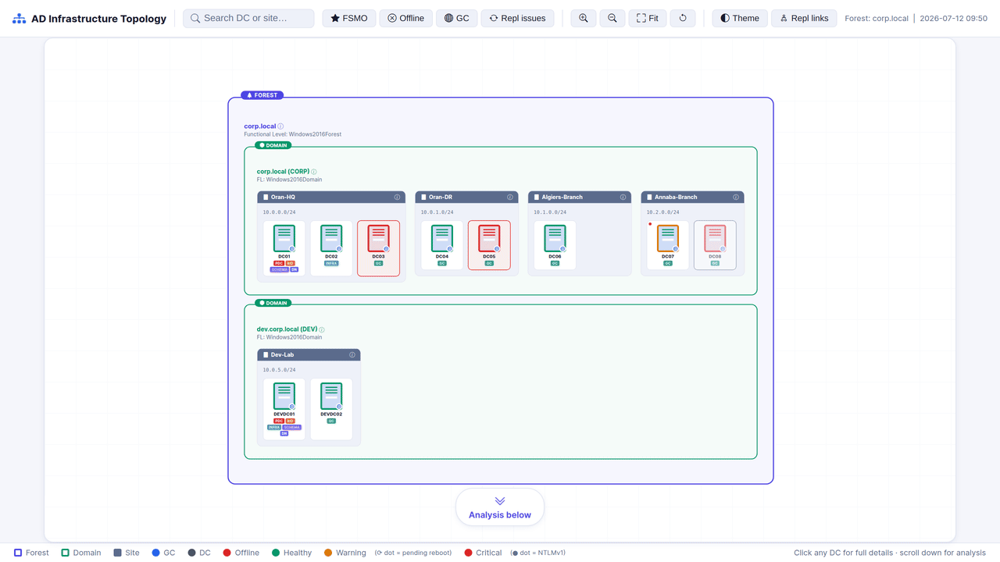
</p>

#### 4. 👥 Group Nesting, OU Architecture & IDFix Cloud Sync Audit
Visualizes deep nested group relationships with interactive circular loop detection. Identifies empty or excessively large groups, validates OU structure against administrative tiering models, and executes an automated IDFix scan to uncover cloud sync blockers before Microsoft 365 onboarding:
<p align="center">
  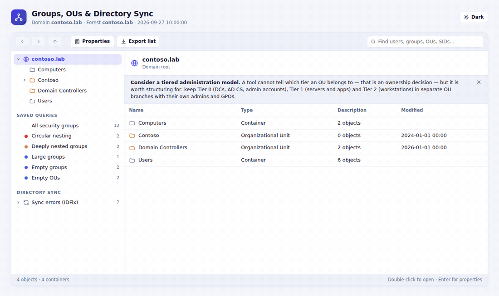
</p>

#### 5. 🤝 Domain Trust Relationships & Security Posture
Audits all inbound and outbound trust relationships across forest, external, realm, and child domains. Validates crucial security boundaries including SID filtering (quarantine), selective authentication, TGT delegation, and transitivity flags with live socket connectivity tests:
<p align="center">
  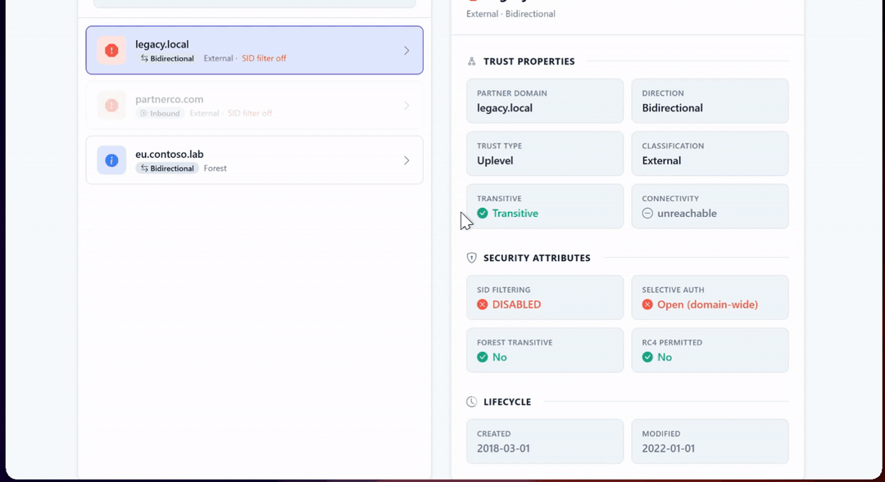
</p>

#### 6. 🖥️ Domain Controller Hardware, Volumes & Specs Inventory
Per-DC hardware and system inventory providing CPU metrics, memory utilization, disk volumes with color-coded capacity indicators, network adapters, NTDS database size, Global Catalog status, IPv4 assignments, time zones, and uptime statistics:
<p align="center">
  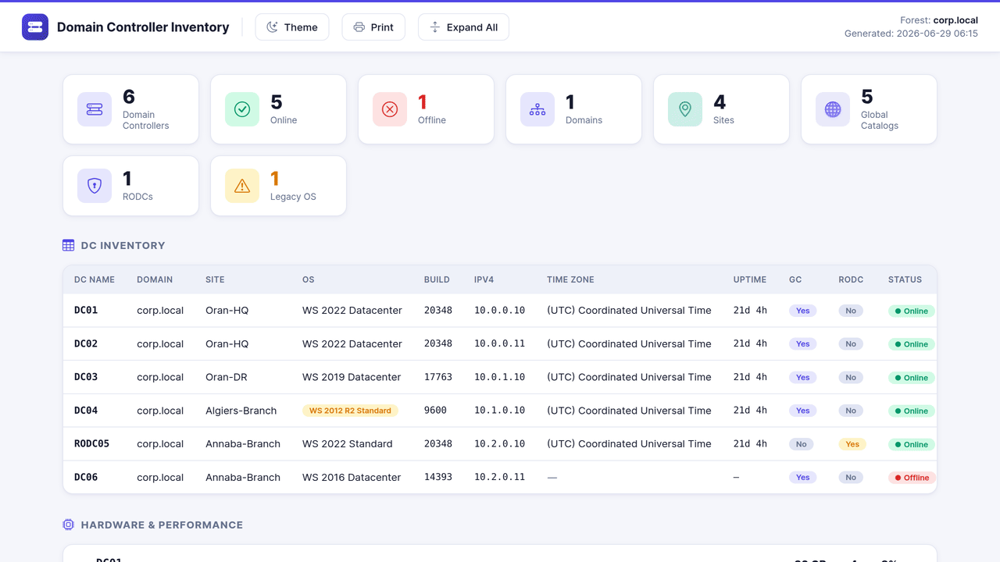
</p>

#### 7. 🛡️ Domain Controller Security Posture & Protocol Hardening
In-depth security audit verifying domain controller protocol hardening (LDAP signing, SMB signing, Kerberos encryption, NTLMv1 elimination), security event log telemetry (lockouts, password spray attempts), and Windows Server 2025 readiness:
<p align="center">
  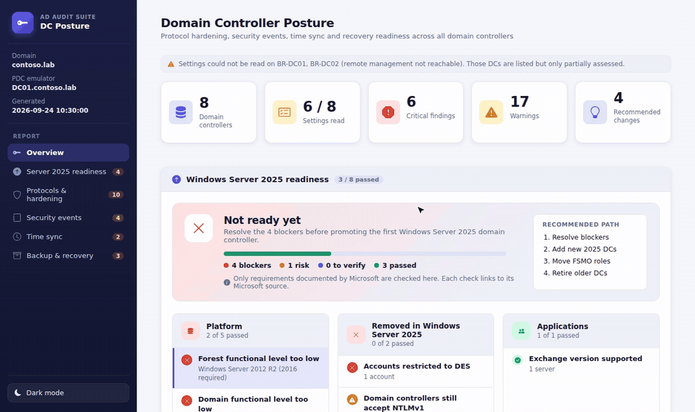
</p>

#### 8. 🌐 Active Directory DNS Health & Zone Analysis
Deep diagnostic of domain DNS infrastructure: verifies AD-integrated zones, dynamic update policies, aging and scavenging configurations, DNSSEC validation, forwarders, and detects lingering or orphaned domain controller SRV and `_msdcs` records:
<p align="center">
  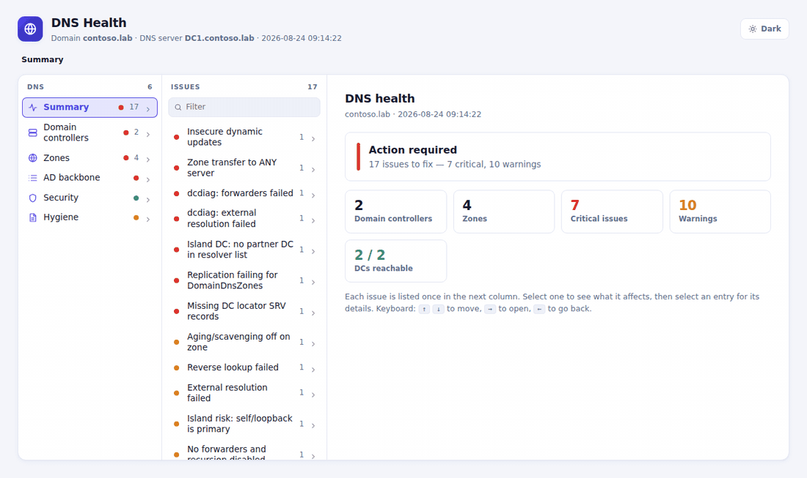
</p>

#### 9. 🔑 Account Security, Password Policies & Credential Hygiene
Evaluates default domain password policies against modern security baselines. Identifies fine-grained password policies (PSOs), gMSA and sMSA accounts, LAPS deployment coverage, stale passwords, accounts with unconstrained delegation, and krbtgt password age:
<p align="center">
  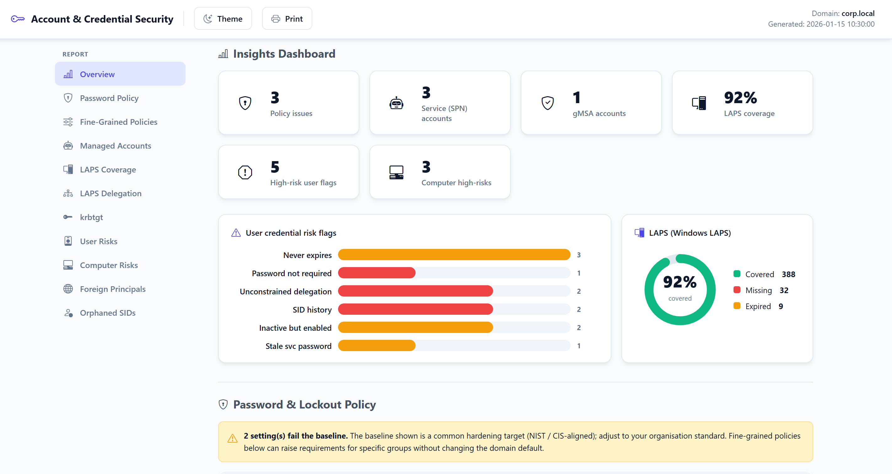
</p>

#### 10. 📜 Group Policy (GPO) Policy Analyzer & Conflict Detection
Automated Group Policy analysis engine that exports domain GPOs, parses Registry.pol and GptTmpl.inf definitions, maps policies to friendly names via ADMX templates, flags setting conflicts across overlapping GPOs, and inspects WMI filters:
<p align="center">
  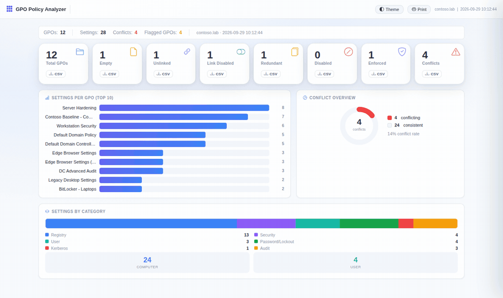
</p>

#### 11. 🗄️ Forest-Wide Member Server Inventory & Lifecycle Tracking
Discovers every member server across all domains in the forest. Analyzes operating system lifecycle milestones (End of Life / Extended Support), installed roles and features, SQL Server instances, failover clusters, hardware specifications, patch levels, and operational uptime:
<p align="center">
  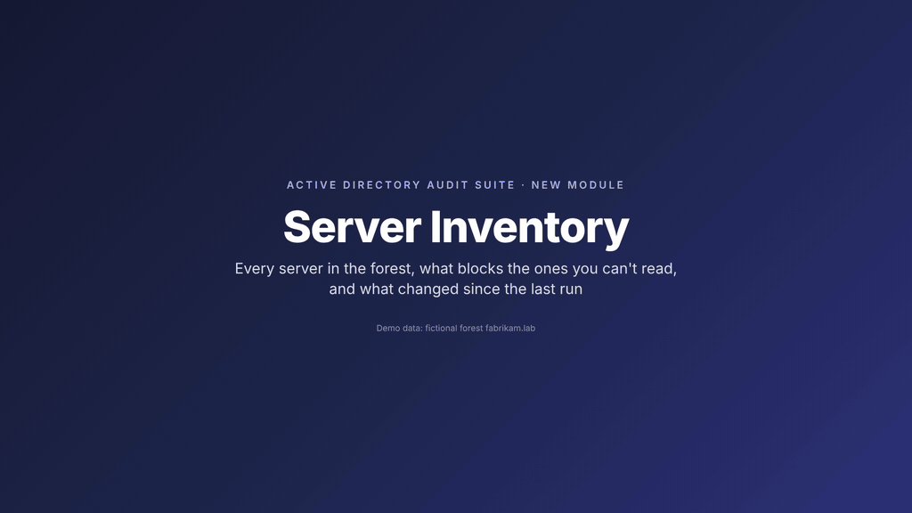
</p>

---

### ⚡ Native WADRACC Integration Architecture
* **Non-Blocking Background Asynchronous Execution**: All assessments execute in separate background PowerShell processes. The main WADRACC console, live hardware monitors, and remote screen sessions remain 100% responsive.
* **Live Streaming Console Terminal**: An integrated terminal window streams live PowerShell execution output with real-time color-coded syntax, percentage completion bars, and item counters (e.g. *Processing GPO 14 of 68*).
* **Dedicated Report Organization**: Generated reports are automatically structured and saved into organized subfolders under Windows AD RACC Reports/AD Assessment/.
* **Integrated Upstream GitHub Sync**: Built-in repository update manager continuously monitors upstream updates on GitHub, stages new scripts, and provides 1-click automated rollback snapshots.

---

## 🛠️ Complete Feature Matrix

| Category | Features & Capabilities |
| :--- | :--- |
| **📊 IT Hardware & Workstation Inventory** | • **Offline-Retaining Domain Asset Registry (`Ctrl + Shift + I`)**: Tracks **65+ hardware, OS, user, licensing, and network fields** across all domain devices—retaining last verified specs for powered-off, traveling, and disconnected machines with permanent Active Directory identity tracking so renamed PCs never duplicate<br>• **Automatic Daily Idle-Aware Collection**: Optional once-per-day silent inventory refresh running strictly when workstations are idle, locked, or logged off—zero employee interruption<br>• **4 Interactive Report Tabs & 6 Quick Presets**: Switch seamlessly between *Complete Device Inventory*, *Hardware Details*, *Network Details (All Adapters)*, and *Inventory Summary & Charts* (7 visual fleet breakdowns), with 6 column presets (*Management Overview*, *Hardware Audit*, *OS & Licensing*, *Network & IP*, *TPM & BitLocker*, *Minimal*)<br>• **Multi-Monitor & Multi-Source Email Intelligence**: Captures individual monitor ports, models, screen sizes, resolutions, and serial numbers, and resolves user emails across AD, Microsoft 365 proxy addresses, and Outlook profiles<br>• **360° Complete Asset Record & Flexible Exports**: Click any row for a 4-pillar hardware/OS/network/display card, or export to **Complete Interactive HTML / Print-PDF** (Light & Dark Mode) and **Filter-Scoped 4-Sheet Excel (`.xlsx`) / CSV** |
| **💾 Remote Disk Usage Analyzer & Storage Optimization** | • **High-Speed Hybrid Storage Engine (`Ctrl + Shift + D`)**: Dual-path scanning combining high-speed sequential NTFS volume indexing with multi-threaded parallel directory crawling supporting deep extended-length paths (`\\?\`)<br>• **Interactive 3D Cushion Squarified Treemap**: Real-time visual disk exploration with cushion illumination, smooth hierarchy drill-downs, zoomable folder navigation, and breadcrumbs<br>• **Independent Horizontal Scrolling & Full Column Visibility**: Independent horizontal and vertical scrollbars in the "Items Inside" area ensuring complete visibility of Name, Size, Allocated, Type, Items, % of View, Modified Date down to the second, and Full Remote Path without clipping on any display size<br>• **Dedicated File Analysis Tabs**: Includes Largest Files (size threshold filtering, category filtering, search, and live summary), Recent Files (chronological timeline, one-click time periods, and relative age), Duplicate Files (master-detail layout, calculated wasted space, copy roles, and on-demand cryptographic SHA-256 content verification), and Space Cleanup (safety card, category filtering, non-modal dry-run preview, and 7-day rollback)<br>• **Safe Cleanup Suite (14 Predefined Safe Locations)**: Automated discovery and purge of reclaimable storage across 14 enterprise temp, cache, and update locations with dry-run staging, locked file handling, and 7-day reversible quarantine rollback<br>• **Standalone Companion Scanner Engine (`ADRC_DiskScanner.exe`)**: High-speed, zero-dependency disk analyzer companion tool for ultra-fast local or remote scanning |
| **🪟 Independent Window Architecture & Stability** | • **Non-Blocking Independent Multi-Window Management**: All secondary windows (Remote Disk Usage Analyzer, Network Monitoring Center, Live Performance Monitor, Remote Terminal, Event Viewer, User Profile Card) operate independently with dedicated taskbar presence<br>• **Independent Window Lifecycle**: Minimizing or closing any secondary window never affects or closes other open windows or the main dashboard<br>• **Concurrent Multi-Window Operations**: Allows multiple windows to remain active simultaneously without UI thread blocking or freezing |
| **🔍 Documentation Search & Visual Locator** | • **Intelligent In-App Documentation Search**: High-precision search engine featuring typo auto-correction, domain synonym intent mapping, and weighted relevance ranking<br>• **Animated Visual Heading Locator**: Smooth scroll-into-view and two-pass animated visual highlighting ensuring destination documentation sections are immediately located |
| **🛡️ Server & Multi-DC Health Command Center** | • **Active Directory Multi-DC Health & Replication Command Center**: Modeless 7-tab command center consolidating multi-DC health (`Writable` / `RODC` / `GC`, FSMO roles, promotion date, services, LDAP/LDAPS, NTP drift, CPU/RAM/Disk), partner replication matrix & latency with translated error diagnostics and confirmation-gated **Replicate Now** / KCC recalculation, DNS zone/scope/SOA/SRV/lingering record validation, SYSVOL/DFSR & GPO consistency checks, guided online FSMO role transfer, live parsed diagnostics, persistent replication history, and 7-sheet **Excel (`.xlsx`), Light/Dark Interactive HTML, and CSV** exports<br>• **Auto Detect Errors & Recommendations (Comprehensive Windows Server Health Audit)**: Non-destructive, agentless multi-layer diagnostic engine evaluating 8 core subsystems (Active Directory Domain Services, DNS Infrastructure & Multi-Homed Network Leakage, DHCP Multi-NIC Binding Isolation, Core Windows System Services, Network Interfaces & Sockets, Security & Attack Surface Hardening, Storage Capacity, and System Event Logs) with overall health score (0–100) and subsystem scorecards<br>• **Multi-Homed Domain Controller Network Binding & Interface Isolation**: Audits and resolves multi-adapter domain controller issues (such as DHCP listening across secondary storage/backup subnets or secondary adapters registering non-routable IPs in DNS), eliminating client authentication delays<br>• **Safe 1-Click Administrative Remediation with Reversible Rollback**: Interactive 4-part inspector (Evidence, Explanation, Operational Impact, Prescribed Recommendation) with automatic pre-change backup snapshots saved safely on disk and 1-click instant undo/rollback<br>• **Standalone HTML Report Generation**: 1-click export of an executive-ready HTML audit report with visual health score gauge, scorecards, findings table, and timestamped remediation history |
| **🌐 Network Monitoring & WhatsApp Alerts** | • **24/7 Combined Multi-Layer Network Device Monitoring Console**: Combines **ICMP Ping**, **TCP/UDP Ports** (including `53/udp`, `67/udp`, `161/udp`, `5060/udp`), and **Windows Services & Agentless Protocols** (HTTP/HTTPS, SSH, RDP, SMB, RTSP, SNMP, SIP, DNS, MySQL, MSSQL, SMTP) with side-by-side Open and Filtered UDP port visibility and clear `Closed (No Listener)` diagnostics<br>• **Auto-Configured 12-Device-Type Profiles**: Automatically applies recommended monitoring layers, ports, and services for Server, Computer, Router, Switch, Firewall, Camera, Printer, Access Point, NAS, IP Phone, Scanner, and Other<br>• **Per-Layer Health Columns, Two-Way Profile Sync & Live Preview**: Dedicated Ping, Port(s), Service(s), and Overall Health indicators, automatic live rechecking on IP changes, incremental probing for unchanged items, and unified two-way synchronization (`Select All` / `Clear All`, manual matching, custom entry preservation, and duplicate prevention) between the Health Profile checklist and Target Port/Service fields<br>• **Centralized Service Management & Fleet Control**: Service lifecycle controls are centralized under **Settings → General** with unified **▶ Start**, **🔄 Restart**, and **⏹ Stop** actions managing the entire server monitoring service across registered servers from a single button, with streamlined first-time machine installation<br>• **False-Incident Prevention Policy**: Per-device choice between Degraded Warning, Status-Only Dashboard, or Critical Alert when a single port or service fails while the host stays online<br>• **Distributed Multi-Server Probing Cluster**: Multi-coordinator discovery, dynamic probe distribution, and automatic failover clustering<br>• **Focused Issue-Only WhatsApp Outage & Recovery Alerts**: Real-time notifications featuring device name, IP, downtime duration, timestamp, and strictly the affected failing or recovering port(s) and service(s) without healthy-service clutter |
| **🚀 Remote Assistance** | • **Dedicated Quick Assist Button**<br>• Positioned after Shadow Session and before RDP in primary bottom action bar<br>• Authentic Microsoft Fluent Quick Assist icon embedded locally (100% offline-ready)<br>• Instant 1-click launch of `quickassist.exe` / `ms-quick-assist:` without needing `Ctrl+Win+Q` |
| **⏱️ Live Uptime & Durations** | • **Dedicated Live Uptime Column**: Displays real-time endpoint uptime (`⏱️ 3d 12h`, `⏱️ 18d 6h`, `⏱️ 1mo 5d`) with 1-click numerical sorting by total duration, health color thresholds (green for normal, amber for >30d overdue reboot), and exact last boot tooltip (`Last Boot: yyyy-MM-dd HH:mm`)<br>• **Smart Duration Decomposition**: Automatically scales idle and lock durations into clean, compact lowercase units (`m`, `h m` / `h`, `d h` / `d`, `mo d` / `mo`) eliminating confusing raw minute counts (e.g. `Idle (916m)` -> `Idle (15h 16m)`, `Locked (1020m)` -> `Locked (17h)`) |
| **⏱️ Idle & Presence** | • **Inactivity / Idle Monitor Agent in Top Quick Action Toolbar**<br>• Real-time workstation state detection (`v1.2.0`): `🟢 Active`, `💤 Idle (Screensaver)`, `💤 Locked (Screensaver)`, `💤 Idle (...)`, `🔒 Locked (...)`, `🚪 Logged Off`, `🔴 Offline` with active/disconnected RDP tracking and human-readable duration formatting (`m`, `h m`, `d h`, `mo d`)<br>• Instant post-update version verification & lock-free atomic status persistence: immediately flushes fresh startup state, clears stale telemetry, verifies installed executable version metadata directly, prevents stale background probes from reverting updated rows, and synchronously refreshes grid badges, fleet summary pills, Quick Action buttons, filtered views, and local startup snapshots before showing confirmation—never requiring manual **Refresh AD** clicks<br>• Continuous 24/7 lifecycle monitoring: Starts at Windows boot before user login, monitors Windows login screen, active/RDP sessions, screen saver engagement, user switching, logout, and shutdown<br>• Privacy-friendly: Monitors user idle time without keystroke logging or screen recording<br>• High-speed 8-thread parallel deployment, 1-click bulk uninstaller (`Remove Monitor`), and selective **Update** workflow (`🔄 Update Monitor`) skipping redundant setup checks and already updated hosts<br>• **Tools Executable Update Detection**: Automatic in-app notification banner and release notes viewer for companion utilities (`ADRC_IdleAgent.exe`, `ADRC_MonitorCoordinator.exe`)<br>• **Enterprise Tamper Protection**: Hidden from Programs & Features / Installed Apps, strict file permissions lockdown, eliminated from Task Manager Startup Apps, and native process tamper protection preventing standard user process termination in Task Manager<br>• Structured diagnostic logging (`[SUCCESS]`, `[SKIPPED]`, `[NO ACCESS]`, `[OFFLINE]`, `[FAILED]`, `[ERROR]`) |
| **🔄 Auto Refresh** | • **Intelligent Background Refresh & Search Auto-Probing Engine**<br>• Multi-method reachability verification (ICMP Ping + management ports) with mismatched stale IP rejection and monotonic sequence guards so delayed probes never overwrite fresh status results<br>• Automatically re-checks visible incomplete/offline computers when searching, filtering, or installing a monitor—eliminating repeated manual **Refresh All** clicks<br>• Refreshes Online/Offline, Ping latency, Logged-in User, Active/Idle/RDP status, and Idle Agent presence silently without clearing the grid or interrupting user typing |
| **🎯 Smart Context Menu** | • **Dynamic Context Menu Architecture (Single vs Multi-Device)**<br>• Automatically detects multi-selection to show only bulk-compatible operations<br>• Protects against accidental single-host tool execution in bulk<br>• Full rich menu on single selection with clean "Not Configured / Not Supported" feedback on hardware or policy limitations (Battery, BitLocker, LAPS) |
| **🖥️ Remote Display** | • Remote Shadowing (Attended & Auto-Attended `/noConsentPrompt`)<br>• Full Control (Keyboard & Mouse) or View-Only<br>• Fullscreen & Multi-Monitor spanning<br>• Standard RDP & Server Console Admin (`/admin`) sessions |
| **🔔 User Alerts** | • Action Center Toast Notifications near the taskbar clock<br>• Audio chime notification<br>• Automated fallback to `msg.exe` |
| **📢 Broadcast Studio** | • **In-App Broadcast Studio & Notification Delivery Tracker**<br>• Centralized real-time broadcast dispatcher with domain and workstation targeting<br>• **Full Delivery Lifecycle Tracking**: `Sent / Pending` ➔ `Received` ➔ `Read` ➔ `Acknowledged`<br>• **Mandatory Acknowledgement Mode**: Requires users to click `✓ Acknowledge` before closing critical notices<br>• **Fleet Reach Analytics & Receipts Ledger**: Real-time delivery progress bars and detailed per-workstation compliance receipts (Computer, User, Domain, Delivery Timestamp, Status)<br>• **Contextual Lifecycle Action Control**: Deactivation dynamically limited to active broadcasts; automatically marks `✓ Completed` upon fleet reception |
| **👑 God Mode & Tweaks**| • **Windows God Mode (Master Control Panel) Remote Controller (Single & Bulk)**<br>• Deploy/remove God Mode folder shortcut on User & Public Desktop<br>• Native desktop background right-click context menu integration<br>• 1-Click live interactive launch of God Mode Master Control Panel on remote user's screen<br>• **"Take Ownership"** context menu injector to reclaim permissions on locked folders<br>• **Classic Windows 11 Context Menu** restorer (bypasses "Show more options")<br>• **"Ultimate Performance"** power plan activator for maximum hardware throughput<br>• **CompactOS** storage compression (free 3-5 GB on SSD)<br>• **Disable Consumer Bloatware** & promotional tiles<br>• **Always Show File Extensions & Hidden Files** in Explorer<br>• **Disable Windows Diagnostic Telemetry** for enterprise privacy and compliance<br>• **1-Click Enable Remote Desktop (RDP)**, NLA & Firewall<br>• **Disable Bing Web Search** in Start Menu<br>• **Win32 Long Path Support** (removes 260 MAX_PATH limit in FileSystem & GPO) |
| **🖼️ Wallpaper Changer**| • **Remote Desktop Wallpaper Changer & Manager (Single & Bulk)**<br>• Remotely apply custom corporate wallpaper (JPG, PNG, BMP) to single or multi-selected computers<br>• Fit styles: Fill (Default), Fit, Stretch, Tile, Center, Span<br>• Embedded in-app image preview before applying<br>• Automatic backup of original wallpaper prior to replacement<br>• 1-Click restore original wallpaper on single or bulk target computers<br>• Seamless updates across active console and RDP user sessions |
| **🖥️ Desktop Info HUD** | • **Sysinternals BgInfo Wallpaper Engine (`🖥️ HUD (BgInfo)`)**<br>• Direct-to-wallpaper stamping matching classic Sysinternals BgInfo<br>• Two-column telemetry with drop shadows for 100% legibility on any wallpaper<br>• 3 deployment modes: Wallpaper Overlay, Floating HUD Widget, or Both<br>• Dynamic profile path discovery<br>• Theme-accurate live preview and 1-click wallpaper restoration |
| **🌐 Browser & App Run** | • **Remote Browser URL & Program Launcher**<br>• Launch URLs in Default Browser, Microsoft Edge, or Google Chrome<br>• Non-interactive execution directly inside user session |
| **🚀 Startup Apps** | • **Remote Startup Applications & Autoruns Manager (`🚀 Startup`)**<br>• Machine and per-user profile startup enumeration<br>• Dynamic **Enable / Disable** toggling without registry deletion<br>• Preserves user configurations<br>• 1-Click delete orphaned autorun entries and CSV export |
| **👥 Local Users** | • **Local Computer Users & Security Manager (`👥 Local Users`)**<br>• Works without active logon session (direct local accounts connection)<br>• Account type badging: 👑 Administrator, 👤 Standard User, 🚼 Guest<br>• Remote user creation, password reset, and enable/disable toggle<br>• **Secure User Deletion**: Multi-factor administrative password verification and confirmation keywords<br>• **System Account Shield**: Protects essential system and active login accounts from accidental removal |
| **⏱️ System Restore** | • **Remote System Restore Point Manager (`⏱️ System Restore`)**<br>• Remotely check System Restore protection status on system drives<br>• Enable or disable protection remotely<br>• Create on-demand named checkpoints prior to software or configuration updates<br>• View chronological restore point history with sequence numbers and timestamps<br>• Remote system rollback to selected restore points with automatic reboot confirmation |
| **📈 Live Monitor** | • **Sub-Second Live Performance Monitor (`📈 Live Perf`)**<br>• High-frequency CPU, RAM, Network (RX/TX), Disk active I/O with 60-second sparkline graphs & deep full-window charts<br>• **Windows Licensing & Activation Details**: Inspects activation status, license type/source (OEM, Retail/Digital License, Volume MAK, Organizational KMS, Active Directory-Based Activation, Subscription), expiration/renewal timelines, masked installed and BIOS/UEFI firmware OEM product keys with Reveal/Copy controls, key mismatch detection, and expandable KMS & authenticity indicator diagnostics<br>• **Dual-Name & `#N` Network Adapter Telemetry**: Shows both custom Windows-configured adapter names alongside standardized `#N` system interface names, rich tooltips, context copy actions, and accurate link speeds<br>• **Windows Network Teaming Support**: Detects LBFO & Switch Embedded Teaming (SET) Virtual Team Interfaces, teaming profiles, modes, VLANs, and Active/Standby member adapters without double-counting host throughput<br>• Motherboard DIMM module slot inspector (DDR4/DDR5, MHz, part numbers) & physical storage drive inventory |
| **🌐 Network & IP Hub** | • **Advanced Remote Network & IP Configuration Console (`🌐 IP Config`)**<br>• Unified 5-tab control center: Basic IP, Multi-Homing IP Addresses, Default Gateways, DNS Servers, and Interface Metrics<br>• Multiple IPv4 address assignment with bidirectional subnet mask / prefix conversion<br>• Multiple default gateways with route cost metric prioritization<br>• Multi-server DNS search order management with Move Up / Move Down ordering<br>• IPv4 and IPv6 Interface Metric configuration (Automatic and custom)<br>• Pre-apply side-by-side verification and session disconnection safety advisory<br>• One-click network repair, flush DNS, register DNS, and safe adapter reset<br>• **Silent Per-User PC Internet Bandwidth Limiter**: Independent upload and download speed throttling (0.5 to 100 Mbps) with 100% background silent enforcement, live system configuration & adapter speed auditing, one-click Reset to Unrestricted, dedicated speed-test tool exemptions & 5-minute temporary test bypass, preserved physical link speed (continues showing 1.0 Gbps), and automatic corporate LAN/VLAN bypass |
| **📡 Ping Telemetry & HUD** | • **Interactive In-App Ping Telemetry HUD & Layer 2 Inspector**<br>• **Continuous Real-Time Ping Loop**: Active 1-second telemetry stream with dynamic button state toggling (`📡 Ping` ⇄ `⏹ Stop Ping`)<br>• **Smart Target Re-pointing**: Automatically transfers active real-time monitoring when selecting another computer in the data grid<br>• **Clean HUD Dismissal**: Closing the HUD automatically terminates pinging, cancels active route traces, and cleanly hides live status badges<br>• Inline pulsing radar animation and status pill with quick-action badges (`🔄 Re-Ping`, `🧭 Trace`)<br>• Sliding diagnostic HUD strip with 4 views: Quick Metrics (real-time latency, TTL, resolved IP/DNS, ports, session), Hop-by-Hop Traceroute with scrollable viewport containment and mouse-wheel scrolling, Layer 2 Diagnostics (MAC address, IEEE hardware vendor, link speed, and ports 135/445/3389/5985), and Live Pulse sparkline graph with jitter and packet loss monitoring |
| **🔒 Lock & Unlock** | • **Workstation Lock & Unlock Controller (`🔒 Lock Screen`)**<br>• Real-time lock screen state detection and session telemetry<br>• Remote workstation lock, console session reconnect, and direct session unlock<br>• Embedded live diagnostic execution console |
| **🗄️ Network Drives** | • **Remote Mapped Network Drives Manager (`Ctrl + D`)**<br>• Dual-engine inspection across registry and active mounted network disks<br>• Real-time storage capacity gauge (Free / Total GB)<br>• 1-Click **Add Drive Mapping** with automatic free letter selection (Z-D) & UNC test<br>• **Edit Mapping** and modify persistence (Reconnect at sign-in)<br>• **Disconnect & Remove** mapping from registry and active session<br>• 1-Click Explorer launcher into remote UNC share |
| **💻 Remote Terminal** | • Interactive command console (CMD & PowerShell)<br>• 1-click presets: `whoami`, `gpupdate /force`, `ipconfig /all`, `sfc /scannow`, `ping`<br>• Deterministic completion waiting and lock-resilient shared output reading (`gpupdate /force`), plus output logging and clipboard export |
| **💻 Diagnostics** | • Visual sensor dashboard with CPU, RAM, and Disk storage gauges<br>• Motherboard, BIOS, Serial Number / Dell Service Tag inspection<br>• System boot timestamp and continuous uptime health tracker |
| **📊 Processes & Services**| • Remote Task Manager: view processes, memory usage, terminate hung apps<br>• Windows Services Controller: query status, Start, Stop, Restart services<br>• 1-Click Remote Print Spooler restart |
| **📋 Event Log Viewer** | • High-speed reverse-chronological streaming of remote event logs<br>• **Authoritative Deep Entity Search**: Query across all event records within selected date ranges for User, Source Host, IP Address, File Path/Name, and Message Text up to your display limit<br>• **Precision Custom Date & Time Range Picker**: Targeted forensic auditing with From/To Date and Time inputs and instant boundary termination<br>• **Strict Company-Internal Privacy**: File share and user file activity auditing remains 100% local on the administrator workstation<br>• **Categorized Quick Presets Dropdown**: 35+ enterprise forensic and diagnostic presets (Group Policy & GPUpdate diagnostics, Windows LAPS, user account creation/deletion/lockout/modification, group memberships, file share access/deletion/edits, logon failures, threats, system reliability)<br>• **Instant Type-to-Find Preset Search**: Type any keyword with continuous keyboard input to filter presets live<br>• **Forensic Entity Filtering & Sortable Columns**: Dedicated filter toolbar with exact-match search, live auto-suggestions, and target counters<br>• **Native Remote Server-Side Filtering Engine**: Filters directly on the remote host for lightning-fast query results<br>• **Full Multi-Channel Support**: System, Application, Security, Group Policy (Operational), Windows LAPS, Setup, RDP Session Manager, Print Spooler, Task Scheduler, Windows Defender, DNS Client, Directory Service, DNS Server<br>• **Vivid Severity Badges**: Audit Success (Emerald), Audit Failure (Rose), Critical, Error, Warning, Information, Verbose<br>• **Expanded Query Limits**: 50 up to 10,000 events<br>• 1-Click rapid action pills (including `📜 GPUpdate`), multi-token search, and full CSV export |
| **🛡️ Active Directory Assessment Suite** | • **11 Deep Domain Audits (`Ctrl + Shift + A`)**: Complete Forest & Domain Overview, Forest Topology & Replication, Group & OU Structure (with IDFix hygiene), Domain Trust Relationships & Posture, Domain Controller Inventory, DC Security Posture & Hardening, DNS Health & Zone Analysis, Account Security & Credential Hygiene, GPO Policy Analyzer & Conflicts, Forest-Wide Server Inventory & Lifecycle, and Management Port Connectivity<br>• **Multi-Threaded Background Execution**: Runs audits non-blockingly with real-time stage progress, item counters, elapsed timer, and live colored PowerShell console streaming<br>• **Executive WADRACC Enterprise HTML Reports**: Customizes output with WADRACC master branding, executive summary, 1-click Print/PDF save, and saves reports to `Windows AD RACC Reports/AD Assessment/`<br>• **GPO Backup Optimization**: Automatically routes GPO backups to dedicated application-managed writable storage, eliminating permissions warnings<br>• **Upstream GitHub Update Manager**: Tracks `Mohamed-Zeghlache/AD-Assessment-PowerShell-Script`, detects new/modified scripts, and provides safe staging with automated rollback backups |
| **🖨️ Printer Management & Fleet Audit**| • Inspect local printers and domain print server shared printers<br>• Accurate active user default printer detection (`⭐ Default`) via remote registry<br>• Real-time Test Print (`🖨️ Test Print`) execution<br>• Live **Pending Jobs** column cross-referenced with active queue<br>• Real-time queue inspection: Document, Owner, Pages, Size, Submission Time<br>• 1-Click `Cancel Job`, `Purge All Jobs`, and `Restart Spooler`<br>• **Per-User Printing Reports & Fleet Job Statistics**: Audit print server logs across custom date ranges (Today, This Month, This Year, All History) with automated Print Server guidance banner and 1-click redirection, real-time dynamic dropdown filtering across users and printer queues, User Summary, Printer Utilization, Date-Wise Trends, Workstation breakdowns, Bulk Page filters, Document Masking privacy setup, and printable Executive HTML/CSV reports |
| **📁 File Explorer** | • 1-Click Explorer access into `\\<host>\C$`<br>• Direct navigation to remote user's `Desktop`, `Downloads`, and `Documents` |
| **👤 AD Account Actions**| • **Enterprise 360° AD User Profile Inspector & In-App Editor**: 40+ directory attributes, organizational hierarchy, contact information, and security group memberships<br>• **✏️ Edit AD User Profile Attributes**: In-place editing of First/Last/Display Name, Title, Department, Company, Office, Phone, Mobile, Email, and Address with direct LDAP commit<br>• **🏷️ Rename Remote Computer**: Rename remote computer over encrypted administrative channels with automated restart option and pre-flight privileges diagnostics<br>• **📝 Edit / Set Computer Description**: Live Active Directory computer description updater synchronized to the computer grid<br>• Real-time lockout detection: button turns red (`⚠️ Account Locked`)<br>• 1-click AD account unlocking<br>• Remote password reset with optional forced password change at next logon |
| **🧹 Deep Temp Cleaner** | • Purges 4 administrative paths: `C:\Windows\Temp`, User `AppData\Local\Temp`, `Recent` files across all profiles, and `Prefetch`<br>• Reports exact file count and MB disk space freed |
| **⚡ Power Management** | • Wake-on-LAN (WOL) magic packets<br>• Lock remote screen without logging off<br>• Graceful remote user session logoff<br>• Remote Sleep / Standby (ACPI S3 / Modern Standby) and Hibernate (ACPI S4)<br>• Remote reboot and shutdown with countdown grace period |
| **📜 Audit Logging** | • Reverse-chronological activity log (newest records always on top)<br>• Isolated single-machine audit filtering<br>• Outcome logging: `SUCCESS`, `FAILED`, `CANCELLED` with error messages<br>• Dedicated administrative isolation preventing background cloud telemetry from polluting local endpoint action records |
| **🏷️ Release Notes** | • Centralized 4-Tab Release Notes & Version History Viewer (`🏷️ Release Notes`)<br>• Inspect changelogs for the Main Application, Idle Agent, Network Monitor Coordinator, and Disk Usage Analyzer<br>• Direct GitHub synchronization with local offline fallback & integrated **🚀 Check for Updates** verification |

---

## 🖥️ Complete UI Element, Toolbar, Column & Control Reference

### 1. 🔍 Header Navigation & Global Controls
* **Quick Filter / Search Box (`Ctrl+S` / `Ctrl+F`) & Category Filter Bar (`All` | `Workstations` | `Servers` | `Other`)**: Real-time filter box that narrows the inventory list instantly as you type across Computer Names, IP Addresses, Logged-in Users, Descriptions, Operating Systems, and OUs (press `ESC` to clear). Alongside the search field, dedicated filter buttons isolate **All** devices, **Workstations**, **Servers**, or **Other** infrastructure hardware (NAS storage appliances, network printers, access points, switches, routers, firewalls, IP cameras, scanners, IP phones, and service accounts).
* **`🔄 Refresh AD / Scan` (`F5` / `Ctrl+R`) & `Shift + F5 – Reset Application Cache`**: Press `F5` / `Ctrl+R` to re-synchronize computer inventory from Active Directory without wiping your local snapshot, or press `Shift + F5` / `Ctrl + Shift + R` whenever device information appears outdated, monitoring data stops updating, inconsistent or stale cached entries appear, or normal views fail to refresh. Cache resets warn cleanly and rebuild completely in the background with a live progress bar (`0%–100%` stage indicator directly below the Inactivity Monitor bar, Cancel/Retry controls, and automatic hide upon completion) so unaffected features remain responsive.
* **`📊 IT Inventory` (`Ctrl+Shift+I`)**: Launches the **Centralized IT Hardware & Workstation Inventory Report (Offline + Online)**—providing 65+ hardware, OS, licensing, multi-monitor, user, and multi-adapter network fields across every domain device with offline persistence, automatic daily idle-aware collection, 6 live KPI tiles, 12 filters, visual summary charts, and exports to Interactive HTML/PDF, 4-sheet Excel (`.xlsx`), and CSV.
* **`🛡️ AD Assessment` (`Ctrl+Shift+A`)**: Active Directory Assessment Studio Hub. Launches 11 comprehensive health, security, GPO, and topology audits with background execution, live colored console monitoring, automatic ADRC Enterprise HTML reports, and integrated GitHub sync manager.
* **`🏷️ Release Notes`**: Opens the 4-tab Release Notes & Version History viewer (Main Application, Idle Agent, Network Monitor Coordinator, Disk Usage Analyzer) with online GitHub refresh and a built-in **🚀 Check for Updates** verification button.
* **`📖 User Guide`**: Opens the two-tab searchable operator reference manual (**🖥️ Main Application** and **📡 Network Monitor**), complete with direct GitHub loading, copy-to-clipboard, and Notepad export.
* **`📜 Activity Log`**: Reverse-chronological audit trail of all administrative actions. Records timestamp, operator, target host, action, and detailed outcome status (`SUCCESS`, `FAILED`, `CANCELLED`), strictly isolated from background fleet telemetry and connection retries.
* **`🌓 Auto` (`Theme Selector`)**: Dynamically switches between **Auto** (follows Windows system setting), **🌙 Dark**, and **☀️ Light** modes with zero visual glitching.
* **`💬 Support/Feedback`**: In-app Support & Feedback Center with five one-click community cards (**WhatsApp Updates Channel**, **WhatsApp Community**, **Telegram Community**, **GitHub Discussions**, and **GitHub Issues**), 1–5 star satisfaction rating feedback, and technical support submission with optional one-click Activity Log error extraction.

### 2. ⚡ Top Quick Action Toolbar & Multi-Select Operations
Located directly above the computer inventory grid, the **Quick Action** toolbar provides rapid 1-click access to primary diagnostic, broadcast, and monitoring actions:
* **`🔑 Test Login`**: Opens the Active Directory User Credentials Validation Tester to verify domain username/password pairs and unlock locked accounts in one click.
* **`🛡️ Check Permissions`**: Evaluates combined SMB Share and NTFS effective permissions across User, User+Computer, Computer-only, and active logon session contexts.
* **`🔌 Check Port`**: Instant TCP socket reachability diagnostic and multi-threaded port scanner (`Test-NetConnection` equivalent) testing remote listening ports (135, 445, 3389, 5985, 80, 443) with round-trip latency metrics and real-time open port discovery.
* **`📡 Ping`**: Advanced Multi-Target Network Ping & Diagnostic Studio displaying all monitors at once without tabs. Monitor widgets fill the whole window automatically and re-arrange as monitors are added, removed or cleared; any widget can be pinned in place or resized from its corner. Features 1 ms interval pacing, ICMP Echo, TCP port, UDP reachability, DNS lookup and HTTP/HTTPS response-time testing, a single **Stop After** field (packets, time, or both), live latency graphs or Command Prompt style output, RFC 3550 jitter, a **Clear** button for finished monitors, a live all-monitor summary, and CSV / TXT export. Opens with an empty target box and follows the light or dark theme.
* **`⏱️ Idle Agent` (`Inactivity Monitor` / `Install Monitor` / `Retry Monitor` / `Remove Monitor`)**:
  - **1-Click Mass Service Deployment**: Installs the monitoring agent as a system-level Windows Service (`ADRC_IdleMonitor`) with automatic boot-time startup (`start= auto`).
  - **Continuous 24/7 Presence Monitoring**: Starts with Windows during system boot before any user logs in; tracks presence across login screens, active user sessions, screen saver engagement (`💤 Idle (Screensaver)`), lock/unlock, user switching, and system shutdown.
  - **Intelligent Skip & Targeted Retry**: Automatically skips healthy endpoints and re-targets only failed, offline, or inaccessible machines on subsequent clicks.
  - **Dynamic Toggle to Uninstaller**: When 100% of endpoints are monitored, button dynamically transitions to `Remove Monitor` for 1-click bulk cleanup with multi-stage service, task, process, and file teardown.
* **`💬 Bulk Message`**: Fleet-wide notification broadcaster automatically targeting all online workstations with no manual computer selection required, live delivery tracking, and automatic offline workstation skipping.
* *(Multi-selection right-click bulk actions also include **⚡ Power & WOL**, **🖼️ Wallpaper**, **👑 God Mode**, **🖥️ HUD (BgInfo)**, **🧹 Deep Clean**, **🔄 GPUpdate**, **📦 Deployer**, **📁 Push File**, **📡 Rogue Scanner**, and **🏛️ Multi-Server Administration**.)*

### 3. 📊 Computer Inventory Grid Columns
* **`Live Status`**: Real-time reachability (`🟢 Online (Xms)`, `🔴 Offline`, `🟡 Checking...`, `🔵 WinRM Only`).
* **`Workstation State`**: Real-time presence telemetry (`🟢 Active`, `💤 Idle (Screensaver)`, `💤 Locked (Screensaver)`, `💤 Idle (1h 30m)`, `🔒 Locked (17h)`, `🚪 Logged Off`, `🔴 Offline`) with human-readable duration scaling.
* **`Computer Name`**: NetBIOS / DNS hostname with multi-mode cycling sort (Alphabetical A-Z, Reverse Z-A, Monitor Color Indication, and Remote Desktop Status).
* **`IPv4 Address`**: Active network adapter IP address.
* **`Logged-in User`**: Currently authenticated domain user (`DOMAIN\User`).
* **`Logon Time`**: Interactive session logon timestamp.
* **`Uptime`**: Real-time system uptime (`⏱️ 3d 12h`, `⏱️ 18d 6h`, `⏱️ 1mo 5d`) with 1-click numerical duration sorting, color health thresholds, and last boot tooltip.
* **`Operating System`**: OS edition and build (Windows 10, 11, Server 2019/2022).
* **`Description`**: Active Directory computer description attribute.
* **`OU (Computer / User)`**: Standardized root-relative parent-to-child directory hierarchy (`/ParentOU/ChildOU/LeafOU`), enabling natural top-down structural filtering without redundant domain prefixes.

### 4. ⚡ Bottom Connection Bar (Quick Control)
Positioned directly beneath the DataGrid for rapid keyboard-first dispatching:
* **Session Configuration Checkboxes**:
  - **`🔔 Alert User`**: Sends an on-screen notification to the remote user before shadowing (default: enabled).
  - **`✋ Ask User Permission`**: Prompts the remote user with an Accept/Reject dialog before connecting (default: enabled).
  - **`Full Control`**: Interacts with remote keyboard and mouse (default: enabled).
  - **`Full Screen`**: Launches connection in full screen mode.
  - **`Multi-Monitor`**: Spans across multi-monitor display setups (`/multimon`).
  - **`Admin Console`**: Connects directly to the physical server console session (`/admin`), bypassing RDS CAL limitations.
* **Primary Connection Buttons**:
  - **`⚡ Connect Shadow Session` (`Enter`)**: Hooks directly into RDS screen shadowing (`mstsc.exe /shadow:<id> /control`) for zero-lag mirroring without kicking the user off.
  - **`🚀 Quick Assist`**: Dedicated 1-click launcher for Microsoft Quick Assist featuring the official Microsoft Fluent Quick Assist icon embedded locally for 100% offline reliability.
  - **`🖥️ Connect RDP Session` (`Ctrl+Enter`)**: Launches standard Remote Desktop Protocol connection (`mstsc.exe /v:<Host>`) with automated pre-flight port 3389 reachability verification. Includes a split-button dropdown menu (`▼`) providing instant access to the **Remote Desktop Configuration & Diagnostic Center**, port 3389 reachability probing, Network Level Authentication (NLA) inspection, and one-click remote firewall rule activation.

### 5. 🛠️ Administrative Category Toolbars (Collapsible Bottom Action Deck)
* **Row 1 (`🛠️ Quick Tools`)**:
  - **`💬 Message` (`Ctrl+M`)**: Targeted remote user messaging dialog for selected workstation(s) with exact character limits, Title/Subtitle/XL modes, Large Text toggle, and alert type badges (requires explicit computer selection).
  - **`💻 Console` (`Ctrl+T`)**: Remote command terminal (CMD/PowerShell) with 1-click presets (`whoami`, `gpupdate`, `sfc`, `ipconfig`, `ping`).
  - **`📊 Task Mgr`**: Remote process controller displaying PID, Memory, and CPU time with instant search and `🛑 End Process`.
  - **`⚙️ Services`**: Windows services manager with Start, Stop, Restart, Start Mode toggling, and 1-click Print Spooler restart.
  - **`🚀 Startup`**: Remote startup applications manager. Toggle programs Enabled/Disabled without deleting registry keys.
  - **`📋 Events`**: Windows Event Log viewer with reverse-chronological streaming, categorized 35+ preset dropdown with vivid badges, live type-to-find search, Authoritative Deep Entity Search across full date ranges (User, Client / Source PC, IP, and File operations with Exact Match toggle), precision Custom Date & Time Range picker, strict company-internal file share auditing privacy, sortable columns, 14 event channels, vivid severity badges, 1-click `📜 GPUpdate` pill, and limits up to 10,000 events.
  - **`🖨️ Printers`**: Local and network printer manager (excludes virtual printers to isolate physical hardware) with persistent MAC address, serial number, and online/offline connectivity history, ink/toner supply telemetry, queue control, and `📈 Reports...`.
  - **`📊 Print Audit`**: Centralized Per-User Printing Report & Fleet Consumption Analytics Studio with automated print server detection, user/printer/date-wise breakdowns, document logging setup, and executive HTML/CSV export.
  - **`📈 Live Perf` (`Ctrl+I`)**: High-resilience live performance & hardware monitor tracking real-time CPU, RAM, Network throughput (Windows custom + `#N` system adapter names, NIC Teaming profiles), Disk I/O sparklines, Windows Licensing & Activation Details (status, type/source, masked installed & BIOS/UEFI OEM keys with Reveal/Copy, KMS diagnostics), multi-monitor hardware details, DIMM slots, BIOS serials, and logical storage gauges.
  - **`🌐 IP Config`**: Remote network hub. Switch DHCP ⇄ Static IP, Multi-Homing IPv4 addresses, Default Gateways, DNS search ordering, Interface Metrics, pre-apply safety verification, and One-Click Network Repair & Reset.
  - **`🌐 Subnets & VLANs`**: Enterprise Subnets & Multi-VLAN Scope Manager (Optional). View auto-discovered subnets from Active Directory Sites & Services and configure optional custom network CIDRs for background identity sweeps.
  - **`⚡ Fix DNS`**: Fleet IP & Active Directory DNS Discrepancy Analyzer. Detects stale DNS records across static IP and DHCP endpoints, with one-click authoritative DNS server reconciliation and direct verification on domain controllers.
* **Row 2 (`📁 Folders & 👤 Profile`)**:
  - **`💾 Open C$/`**, **`🖥️ Desktop`**, **`📥 Downloads`**, **`📄 Documents`**: Instant File Explorer navigation to remote administrative and user folders (`C$` root & active user directories).
  - **`🗄️ Net Drives` (`Ctrl+D`)**: Remote mapped network drives manager (dual-engine inspection, add mapping with free letter auto-selection, edit, disconnect, test UNC, local open).
  - **`👤 Profile Card` (`Ctrl+Shift+U`)**: Enterprise 360° AD User Profile Inspector (40+ directory attributes, organizational hierarchy, contact info, security metrics, and interactive Group Membership Manager with Add/Remove group actions).
  - **`📋 Bulk AD Update`**: High-speed batch updater for Active Directory user attributes from CSV/Excel/TXT files with mandatory read-only dry-run validation.
  - **`👥 Local Users`**: Local computer SAM accounts manager (provision users, reset passwords, enable/disable accounts, and secure user deletion with safeguards).
  - **`🔓 Unlock User` (`Ctrl+U`)**: Dynamic Active Directory account unlocker. Button turns red (`⚠️ Account Locked`) when account is locked.
  - **`🔑 Reset Pass` (`Ctrl+Shift+P`)**: Remote password reset dialog with option to force password change at next logon.
* **Row 3 (`⚡ Power & Screen`)**:
  - **`🔒 Lock Screen`**: Locks the interactive user display session on selected workstation(s).
  - **`🔄 Restart`**: Remotely reboots selected workstation(s) with grace period countdown and justification logging.
  - **`🛑 Shutdown`**: Remotely powers down selected workstation(s) with grace period countdown.
  - **`💤 Sleep`**: Remotely puts selected workstation(s) into sleep / standby mode (ACPI S3 or Modern Standby).
  - **`❄️ Hibernate`**: Remotely puts selected workstation(s) into hibernation mode (ACPI S4).
  - **`🖼️ Wallpaper`**: Deploys corporate desktop wallpaper across selected computer(s).
  - **`⚡ Wake-on-LAN`**: Broadcasts Wake-on-LAN magic packets to wake sleeping remote machines.
  - **`🚪 Logoff User`**: Signs out the active interactive user session.
  - **`🧹 Clean Temp`**: Purges temporary files, cache, and prefetch storage on remote computers.

### 6. 🎯 Dynamic Smart Context Menu & Fast Action Search (Single vs Bulk Selection)
* **Integrated Fast Action Search Bar**: Right-clicking automatically focuses the embedded search bar. Typing any keyword (such as `ping`, `event`, `temp`, `reboot`, `rdp`, `uac`, `service`, `wallpaper`, `restore`, `disk`, `5-stage`) instantly filters all 60+ tools in real time, displaying a flat results list with category badges. Press `Enter` to launch the top tool immediately, `Down Arrow` to navigate, or `Escape` to clear.
* **Target Computer Header Banner**: Prominently certifies targeted hostname, IP address, and online status at the top of the menu.
* **Single-Computer Selection Menu**: Direct top-level access to Screen Shadowing, RDP Sessions Monitor, Fix UAC, RDP Login, Enable RDP, and Remote Console, alongside role-aware submenus:
  - `⚙️ Administration & Management ▸`: Task Manager, Services, Installed Software Uninstaller, Startup Apps, Printers & Queues, Print Fleet Statistics, Local Users & Accounts Manager, Remote System Restore Manager, Event Log Capacity Monitor, Computer Management MMC, Task Scheduler MMC, Server Task Manager Disk Counters, Rename Computer, Edit AD Description.
  - `🏛️ Active Directory Server Management / Windows Server Management ▸`: Shown exclusively for Domain Controllers and Windows Servers — includes the 7-tab Multi-DC Health & Replication Command Center, Server Health Monitoring (5-State / 8-Domain Engine), Multi-Server Drift Comparison, Server Topology Map, plus 11 focused submenus (`AD Replication & Diagnostics`, `DNS Health & Resolution`, `SYSVOL, DFSR & GPO Consistency`, `FSMO Roles & Global Catalog`, `DHCP Server Infrastructure`, `Time Sync & Critical Services`, `IIS Web Server Management`, `Hyper-V Virtualization Management`, `Remote Server Administration`, `Server Security & Compliance`, and `Print Server & Spooler Management`).
  - `🖥️ Workstation Management & Diagnostics ▸`: Shown for client workstations — Workstation Audit, Fleet Debloater & Privacy Studio, Insecure Service ACL Auditor, DFIR Live Forensic Triage, Rogue Remote Access Scanner, Orphaned Temp Cleanup, 1-Click Network Repair, Remote GPUpdate, Clear Print Queue, Print Document Logging, Local Users Manager.
  - `📊 Diagnostics & Health ▸`: Centralized IT Hardware & Workstation Inventory Report (`Ctrl+Shift+I`), Live Performance & Hardware Monitor (`Ctrl+I`), DFIR Forensic Triage, Remote Event Logs, GPUpdate Event Logs, Event Log Capacity Monitor, GPResult HTML Report, Battery Health, Inactivity Agent Diagnostics, Repair WMI, Computer Activity Log.
  - `🌐 Network & Connectivity ▸`: Advanced Multi-Target Ping Studio, Ping Host, Per-Process Network Bandwidth & QoS Monitor, Check Port, Find Open Ports, **5-Stage RPC, WMI & Remote Management Deep Diagnostic**, Remote Network & IP Config, DNS Lookup (`nslookup`), DNS Zone Transfer (AXFR) Audit, Reconcile Stale DNS, Fleet DNS Discrepancy Analyzer, Subnets & VLANs, Flush DNS, One-Click Network Repair, Network Profile Manager, Silent Internet Bandwidth Limiter, Enable ICMP Ping, Time Sync (NTP), Open Browser URL, Wake-on-LAN.
  - `👤 Active Directory & User Session ▸`: View AD Profile Card, AD Credential Leak & Breach Intelligence (XposedOrNot), DNS Zone Transfer (AXFR) Leak Audit, Edit AD Attributes, Bulk Update AD Attributes, Unlock AD Account, Reset User Password, Test User Credentials, Check Effective Permissions, Check Password Expiration Date, Send Toast Notification, Live & Historical RDP Sessions Monitor, Logoff Active Session.
  - `📁 Files & Shared Folders ▸`: Open C$ Admin Share, Desktop Folder, Downloads Folder, Documents Folder, Remote Mapped Network Drives Manager (`Ctrl+D`), Push File/Script to C$\Temp, Win32 Long Path Support, Check Effective Permissions, Remote Disk Usage Analyzer & Storage Optimization Suite (`Ctrl+Shift+D`).
  - `🛠️ Customization, Automation & Deploy ▸`: Silent Software Deployer, Workstation Fleet Debloater & Privacy Studio, Force Remote GPUpdate, GPUpdate Event Logs, Windows God Mode & Power Tweaks, Desktop Info HUD (BgInfo), Change Desktop Wallpaper, Remote Screen Saver Config, Inactivity Agent (Update / Deploy / Uninstall / Status), Deploy Network Monitor Coordinator, Automatic RPC Service & Firewall Deployment, Companion Release Notes, Supporting Tools & External Modules Manager.
  - `⚡ Security & Power Control ▸`: GPO Baseline Studio, Attack Surface Reduction (ASR) Rules Studio (19 Canonical Rules), Turn Off Monitor, Block/Unblock Input, BitLocker Recovery Keys, Windows LAPS Management, Rogue Remote Access & Shadow IT Scanner, Insecure Service Permissions Auditor, DFIR Forensic Triage, Deep Temp Clean, Remote Lock & Unlock Controller, Instant Lock, Restart, Shutdown, Sleep, Hibernate, Schedule Power Action.
  - `🛡️ Active Directory Assessment ▸`: Shown exclusively on Domain Controllers and Windows Servers — 11 domain audits, Complete All-In-One Audit Suite, Studio Hub (`Ctrl+Shift+A`), and Reports Directory.
* **Multi-Computer Bulk Selection Menu**: Right-clicking multiple selected computers automatically adapts the menu and search bar to bulk-compatible operations across Customization, Maintenance, Network & Messaging, Security & Power (including Sleep, Hibernate & Rogue Scanner Bulk), Multi-Server Administration, and Active Directory Assessment.

### 7. 🌐 Network Device Monitoring Console & Coordinator Cluster Controls
Accessed via the Network Monitoring module (`Ctrl+Shift+M`) or top administrative menu:
* **Combined 3-Layer Real-Time Device Health Grid**:
  - **`Live Status`**: Immediate overall visual status badge (`🟢 Online`, `🟡 High Latency / Degraded`, `⚠️ Degraded / Zombie`, `🟠 Pending Failure`, `🔴 Critical / Offline`) positioned as the first column for at-a-glance visibility.
  - **`Device Name` & `IP Address`**: Configured hardware identity and IPv4/FQDN destination across 12 supported hardware categories (`Server`, `Computer`, `Router`, `Switch`, `Firewall`, `Camera`, `Printer`, `Access Point`, `NAS`, `IP Phone`, `Scanner`, `Other`) with automatic preset configuration per device type.
  - **`Ping`, `Port(s)`, `Service(s)` & `Overall Health`**: Independent per-layer status columns displaying ICMP Ping reachability/latency, TCP/UDP port health (including explicit side-by-side **Open** and silent **Open|Filtered** UDP counts plus clear `Closed (No Listener)` diagnostics for `53/udp`, `67/udp`, `161/udp`, `5060/udp`), Windows Service or agentless protocol status (`HTTP`, `HTTPS`, `SSH`, `RDP`, `SMB`, `RTSP`, `SNMP`, `SIP`, `DNS`, `MySQL`, `MSSQL`, `SMTP`), and combined device health—running independently even when ICMP Ping is blocked or disabled, while WhatsApp alerts report only failing or recovering ports/services without healthy-service clutter.
  - **`False-Incident Alert Policy`**: Per-device alert behavior (*Degraded Warning (Recommended)*, *Status Only — No Outage Alerts*, or *Critical Zombie Alert*) prevents single-service faults on reachable devices from triggering noisy offline outage alerts.
  - **`Live IP-Change Rechecking, Incremental Probing & Two-Way Profile Sync`**: Changing a target IP inside Add/Edit Device immediately clears stale badges, renders `⏳ Checking...` indicators, and re-tests Ping, Port(s), and Service(s) against the latest IP without removing or re-adding items; adding or removing individual ports or services on an unchanged IP incrementally checks only newly added items while preserving verified results; and the **Health Profile** checklist (`☑ Select All` / `✕ Clear All`) stays synchronized in both directions with **Target Port(s)** and **Service(s) / Protocol(s)** with automatic manual profile matching, custom entry preservation, and duplicate prevention.
  - **`Interval` & `Last Check`**: Configurable polling frequency per device (e.g., 5s, 10s, 30s, 60s) and exact timestamp of the latest probe sweep.
* **Bulk Operation Toolbar**:
  - **`Enable`**: Activates live probing for selected network devices.
  - **`Disable`**: Temporarily halts polling for selected devices during planned maintenance or device reboots.
  - **`Add Device` / `Edit Device` / `Delete Device`**: Fast asset provisioning with IP format validation, category assignment, and threshold tuning.
  - **`Refresh`**: Instant manual re-probing across all configured endpoints.
* **Coordinator Servers Hub**:
  - **Coordinator Health Matrix**: Lists all active coordinator nodes, their hostnames, IP addresses, service version, assigned probe counts, and heartbeat latencies.
  - **Distributed Quorum & Incident Control**: Configurable per-device multi-coordinator consensus. Operators independently set Incident Generation and Notification Thresholds (`All Coordinators Down` vs `Any Coordinator Down`), suppressing false alarms during local branch connection blips until all active coordinators confirm the outage.
  - **Cluster Discovery & Synchronization**: Auto-discovers coordinator servers across the domain and synchronizes target device lists.
  - **High-Availability Failover**: Visual indicators showing primary coordinator role and standby failover readiness.
* **WhatsApp Alerting & Security Center**:
  - **Encrypted Credential Protection**: WhatsApp API Key is securely protected using enterprise AES-256 encryption.
  - **Protected UI Masking**: Displayed exclusively as `●●●●●●●● (Protected & Saved)`; raw API keys cannot be revealed or copied from the user interface.
  - **Recipient Directory**: Easily configure individual engineer numbers or notification group IDs.
  - **Test Delivery**: Instant one-click notification test verifying end-to-end connectivity between the coordinator service and your WhatsApp gateway.

---

## 📁 Repository & Release Structure

```text
Windows_AD_Remote_Administration_Control_Center/
├── Windows AD Remote Admin Control Center v3.0.0.exe   # Standalone portable Windows executable (~6.5 MB)
├── Run_AD_Remote_Control.bat           # 1-Click launcher script (auto-launches versioned exe)
├── README.md                          # Complete project documentation & quick start
├── VERSION.txt                        # Release version metadata (3.0.0)
├── CHECKSUMS.txt                      # Official SHA-256 integrity checksums
├── Documentation/                     # Complete administrative documentation suite
│   ├── USAGE_GUIDE.md                 # In-depth operator reference manual & GPO guide
│   ├── USAGE_GUIDE.txt                # Plain text version for in-app fallback viewer
│   ├── NETWORK_MONITOR_GUIDE.md       # Dedicated Network Monitor guide (second tab of the in-app User Guide)
│   ├── NETWORK_MONITOR_GUIDE.txt      # Plain text copy of the Network Monitor guide
│   ├── CHANGELOG.md                   # Detailed version release notes & history
│   ├── CHANGELOG.txt                  # Plain text copy of release notes
│   ├── Release_Notes/                 # Per-module release notes (Main App v3.0.0, Idle Agent v1.2.0, Coordinator v1.0.0, Disk Scanner v1.0.0)
│   └── LICENSE                        # Freeware License & EULA (All Rights Reserved)
├── Tools/                             # Auxiliary administrative tools
│   ├── ADRC_IdleAgent.exe             # Endpoint inactivity and presence monitoring agent (v1.2.0)
│   ├── ADRC_MonitorCoordinator.exe    # 24/7 background network monitoring coordinator service (v1.0.0)
│   └── ADRC_DiskScanner.exe           # High-speed standalone disk usage scanner companion (v1.0.0)
├── PS Scripts/                        # Domain & endpoint configuration scripts
│   ├── Configure_Endpoint_GPO.ps1     # Automated endpoint GPO & firewall configuration script
│   ├── Deploy_Domain_Shadow_GPO.ps1   # Domain Controller shadow policy deployment script
│   └── Sign_And_Trust_App.ps1         # Internal AD domain GPO certificate signing & root trust script
└── Images/                            # Screenshots and visual assets
    ├── Screenshots/                   # Full-resolution feature screenshot suite (36 screens)
    └── AD_Assessment/                 # Active Directory security & audit suite demonstration visuals (11 assets)
```

---

## 🚀 How to Run

### Option 1: Standalone Portable Executable
Download the latest `Windows AD Remote Admin Control Center v3.0.0.exe` from [GitHub Releases](https://github.com/SuperUser-exe/Windows-Active-Directory-Remote-Administration-Control-Center/releases).  
Right-click `Windows AD Remote Admin Control Center v3.0.0.exe` and select **Run as Administrator** (using an authorized Domain Administrator account):
```cmd
"Windows AD Remote Admin Control Center v3.0.0.exe"
```

### Option 2: 1-Click Convenience Launcher
Alternatively, run the included launcher script:
```cmd
Run_AD_Remote_Control.bat
```

---

## ⚙️ Group Policy & Administrator Setup Requirements

### 1. Administrator Account Permissions & Authorization Policy

> [!IMPORTANT]
> **Strict Active Directory Administrative Authorization Enforcement**:  
> To safeguard domain environments and prevent unauthorized workstation management, the application verifies the security identity of the launching user at startup. The application will **ONLY** launch if the user belongs to at least one of the following **five explicitly authorized Active Directory security groups**:
>
> | Authorized AD Group | Well-Known Security Identifier (SID) | Operational Scope |
> | :--- | :--- | :--- |
> | **Domain Admins** | Domain SID ending in `-512` (`S-1-5-21-...-512`) | Full administrative authority across all domain-joined endpoints, domain controllers, and Active Directory objects. |
> | **Enterprise Admins** | Forest-root domain SID ending in `-519` (`S-1-5-21-...-519`) | Forest-wide administrative authority across all domains and domain controllers in the Active Directory forest. |
> | **Schema Admins** | Forest-root domain SID ending in `-518` (`S-1-5-21-...-518`) | Forest-wide authority to manage Active Directory schema definitions and directory partitions. |
> | **Account Operators** | Builtin domain SID `S-1-5-32-548` | Authority to create, modify, and manage Active Directory user accounts, groups, and workstations. |
> | **Server Operators** | Builtin domain SID `S-1-5-32-549` | Authority to manage domain servers, shares, services, and system configuration. |
>
> 🛡️ **Active Directory Domain-Joined Device Enforcement**: This application is built specifically for enterprise IT administrators operating within an Active Directory environment. The application strictly requires a domain-joined computer to run; standalone or workgroup devices are completely restricted from executing the suite.
>
> 🔒 **Strict Least-Privilege Access Control**:
> - Application access is restricted **exclusively** to members of the five approved groups listed above.
> - Access is **denied** for local workstation administrators (`BUILTIN\Administrators` / `Local Administrators`), custom administrative groups, generic helpdesk groups, and non-domain accounts.
> - If an unauthorized user attempts to launch the application, or if domain controller connectivity cannot verify group membership, access is immediately blocked and a security denial dialog is displayed.

- **Domain Admins**: Fully privileged across all domain endpoints, Active Directory user objects, and admin shares out of the box.
- **Account & Server Operators**: Fully authorized to operate user account management, password resets, service controllers, server maintenance suites, and diagnostic tooling within their delegated Active Directory authority.

### 2. Enable Remote Desktop Shadowing (GPO Setup)
To enable shadowing without disconnecting active users:
1. Open `gpmc.msc` on your Domain Controller and edit your Computer Policy (or use `PS Scripts/Deploy_Domain_Shadow_GPO.ps1`).
2. Navigate to:  
   `Computer Configuration -> Policies -> Administrative Templates -> Windows Components -> Remote Desktop Services -> Remote Desktop Session Host -> Connections`
3. Configure:
   - **Set rules for remote control of Remote Desktop Services user sessions**:
     - Set to **Enabled**.
     - Choose **Full Control without user's permission** (recommended for instant unattended screen mirror) or **Full Control with user's permission** (prompts user to allow/deny).
   - **Allow users to connect remotely by using Remote Desktop Services**:
     - Set to **Enabled**.
4. **Eliminate UAC Elevation Black Screen** (Optional but Recommended):
   - Navigate to: `Computer Configuration -> Policies -> Windows Settings -> Security Settings -> Local Policies -> Security Options`
   - Set **User Account Control: Switch to the secure desktop when prompting for elevation** to **Disabled**. This allows remote administrators to view and enter credentials into UAC prompts without display blanking.
5. Run `gpupdate /force` on client workstations.

### 3. Windows Defender Firewall Rules & Management Ports
Ensure the following ports and predefined rule groups are enabled via GPO:
- **TCP 3389**: Remote Desktop & Remote Shadowing
- **TCP 445 & 139**: SMB File Sharing (C$ access, remote folder navigation, deep temp clean)
- **TCP 135 & Dynamic RPC**: WMI Management (Hardware Specs, Task Manager, Services, Remote Console, Drive Mapping)
- **TCP 5985**: WinRM HTTP (for Action Center Toast notifications)
- **ICMPv4**: Ping echo request for live online/offline latency detection
- **Remote Registry Service**: Startup type set to **Automatic** for instant cross-profile software and drive mapping scans.

### 4. Automated Configuration Scripts (PS Scripts/)
The application includes two automated configuration scripts to streamline onboarding:
- **`PS Scripts/Deploy_Domain_Shadow_GPO.ps1`**: Run once on a Domain Controller or RSAT workstation to automatically create, configure, and link the complete Desktop Shadow Domain GPO in Active Directory via PowerShell.
- **`PS Scripts/Configure_Endpoint_GPO.ps1`**: Run locally on target workstations (or assign as a GPO Computer Startup Script) to configure Remote Desktop, Shadow policy (`Shadow = 2`), UAC elevation (`PromptOnSecureDesktop = 0`), firewall rules, and services in one click with built-in reversal (`-Revert`).

---

## 🔄 In-App Release Notes & Update Checks

When a new release is published on [GitHub Releases](https://github.com/SuperUser-exe/Windows-Active-Directory-Remote-Administration-Control-Center/releases):
1. Click **`🏷️ Release Notes`** in the application header to browse version notes across four tabs (**Main Application**, **Idle Agent**, **Network Monitor Coordinator**, and **Disk Usage Analyzer**).
2. Click **`🔄 Reload Tab`** to pull the latest release notes directly from GitHub, or click **`🚀 Check for Updates`** / **`🌐 GitHub Repo`** at the bottom right to verify whether a newer public release is available.

---

## ⌨️ Universal Shortcuts

The application provides universal keyboard shortcuts for high-frequency operations:

| Category | Shortcut | Action Description | Operational Scope |
| :--- | :--- | :--- | :--- |
| **Search & Discovery** | **`Ctrl + S` / `Ctrl + F`** | Focus Quick Search box and select all text | Main Inventory Window |
| **Search & Discovery** | **`F5` / `Ctrl + R`** | Refresh computer inventory from Active Directory (preserves cache) | Main Inventory Window |
| **Search & Discovery** | **`Shift + F5` / `Ctrl + Shift + R`** | **Reset Application Cache** — Clear local snapshot and rebuild fresh directory data in background | Main Inventory Window |
| **Remote Sessions** | **`Enter`** | Connect Remote Shadow Session (screen mirror) to selected computer | Main Inventory DataGrid |
| **Remote Sessions** | **`Ctrl + Enter`** | Connect Remote Desktop (Standard RDP Login) | Main Inventory Window |
| **Remote Sessions** | **`🚀 Quick Assist`** *(Toolbar / Windows `Ctrl + Win + Q`)* | Launch Microsoft Quick Assist (toolbar button in app; native Windows hotkey) | Main Inventory Window |
| **Diagnostics & Tools** | **`Ctrl + P`** | Ping selected computer with live ICMP latency response | Main Inventory Window |
| **Diagnostics & Tools** | **`Ctrl + T`** | Open interactive in-app Remote Console (CMD / PowerShell) | Main Inventory Window |
| **Diagnostics & Tools** | **`Ctrl + I`** | Open Workstation Hardware Diagnostics & Live Resource Performance Monitor | Main Inventory Window |
| **Diagnostics & Tools** | **`Ctrl + Shift + I`** | Open Centralized IT Hardware & Workstation Inventory Report (Offline + Online, Excel/HTML/CSV/PDF) | Main Inventory Window |
| **Diagnostics & Tools** | **`Ctrl + D`** | Open Remote Mapped Network Drives Manager (Add / Edit / Remove) | Main Inventory Window |
| **Storage & Analysis** | **`Ctrl + Shift + D`** | Open Remote Disk Usage Analyzer & Storage Optimization Suite | Main Inventory Window |
| **User & Security** | **`Ctrl + M`** | Open Send User Notification Message dialog | Main Inventory Window |
| **User & Security** | **`Ctrl + U`** | Unlock logged-in user account in Active Directory | Main Inventory Window |
| **User & Security** | **`Ctrl + Shift + P`** | Reset domain user password modal dialog | Main Inventory Window |
| **User & Security** | **`Ctrl + Shift + U`** | Open 360° Active Directory User Profile Inspector Card | Main Inventory Window |
| **Monitoring & Alerting** | **`Ctrl + Shift + M`** | Open 24/7 Network Device Monitoring & WhatsApp Alerting Center | Main Inventory Window |
| **Audits & Governance** | **`Ctrl + Shift + A`** | Open Active Directory Assessment Studio Hub | Main Inventory Window |
| **Workspace & Layout** | **`Ctrl + B`** | Toggle Show/Hide Bottom Action & Connection Control Deck | Main Inventory Window |
| **Window Navigation** | **`ESC`** | Deselect active computer row, clear search text (when focused), or dismiss active modal dialog | Universal across all windows |

---

## 🌟 Author, Community & Ways to Connect

### 👨‍💻 About the Author
**Windows Active Directory Remote Administration Control Center (WADRACC)** is created and actively developed by **Askarali Mattummal**, an Enterprise Systems and Infrastructure Engineer. Built from hands-on experience managing enterprise Active Directory domains, WADRACC was created to give IT administrators, systems engineers, and helpdesk specialists a fast, reliable, and completely agentless command center for modern Windows environments.

---

### 🌐 Official Connect & Profile Links

| Platform | Channel / Profile | Purpose & Community Engagement |
| :--- | :--- | :--- |
| 💼 **LinkedIn** | [linkedin.com/in/askaralimattummal](https://www.linkedin.com/in/askaralimattummal/) | Connect for enterprise infrastructure insights, professional updates, and networking. |
| 🐙 **GitHub Profile** | [@SuperUser-exe](https://github.com/SuperUser-exe) | Explore open-source projects, system administration scripts, and upcoming tooling. |
| 📦 **GitHub Repository** | [WADRACC on GitHub](https://github.com/SuperUser-exe/Windows-Active-Directory-Remote-Administration-Control-Center) | Star the repository, watch releases, track commits, and access source code. |
| 📲 **WhatsApp Updates Channel** | [WhatsApp Updates Channel](https://whatsapp.com/channel/0029VbDZfvhCMY0H1PxerW2c) | Follow for application updates, announcements, new features, and important notifications. |
| 👥 **WhatsApp Community** | [Join Our WhatsApp Community](https://chat.whatsapp.com/FFnsz5kSWND2FTZt8WNpZX) | Connect with other ADRC users, share experiences, discuss features, and participate in community conversations. |
| 💬 **Telegram Community** | [Join Our Telegram Community](https://t.me/WADRACC) | Connect with the ADRC community through Telegram for peer support, tips, and live chat. |
| 💡 **GitHub Discussions** | [GitHub Discussions & Feature Requests](https://github.com/SuperUser-exe/Windows-Active-Directory-Remote-Administration-Control-Center/discussions/new/choose) | Share suggestions, discuss improvements, ask questions, and participate in technical discussions. |
| 🐛 **GitHub Issue Tracker** | [Report a Bug or Technical Issue](https://github.com/SuperUser-exe/Windows-Active-Directory-Remote-Administration-Control-Center/issues) | Report application bugs, technical problems, unexpected behavior, and other issues directly through GitHub. |

---

### 🤝 Ways to Support, Contribute & Report Feedback

* ⭐ **Star the Repository**: If this application saves you or your IT department valuable time, please take a moment to **[star the repository on GitHub](https://github.com/SuperUser-exe/Windows-Active-Directory-Remote-Administration-Control-Center)**. Your star helps other systems administrators discover this free tool.
* 💬 **In-App Support & Feedback Center**: WADRACC includes an integrated **Support & Feedback Center** accessible directly from the top header of the application. It features quick-access cards for the WhatsApp Updates Channel, WhatsApp Community Group, Telegram Community, GitHub Discussions, and GitHub Issue Tracker, plus built-in rating feedback and technical support submission with on-demand **Paste Recent Activity Log Errors**.
* 🐛 **Submit Bug Reports & Suggestions**: Encountered an issue or have a feature idea? Open an issue on our **[GitHub Issues tracker](https://github.com/SuperUser-exe/Windows-Active-Directory-Remote-Administration-Control-Center/issues)** with your Windows Server environment details, build version, and diagnostic logs.
* 📢 **Spread the Word**: Recommend WADRACC to colleagues and IT communities across Reddit (`r/sysadmin`, `r/PowerShell`), LinkedIn, and your team's internal technical forums.

---
## 📄 License, Legal & Ethical Use Notice

Developed with ❤️ by **[Askarali Mattummal](https://www.linkedin.com/in/askaralimattummal/)** | [GitHub](https://github.com/SuperUser-exe) | [Telegram Community](https://t.me/WADRACC).  
Licensed under the [Freeware License & End-User License Agreement (EULA)](Documentation/LICENSE) — Free for personal and enterprise IT use (source code remains private; All Rights Reserved).

> [!CAUTION]
> **Authorized IT Administrative Use Only**: This software is designed, developed, and published strictly for authorized IT systems administrators and certified support personnel to maintain, monitor, and troubleshoot authorized enterprise domain infrastructure. Any unauthorized deployment, surveillance, privacy violation, or malicious use is strictly prohibited. The author assumes no responsibility or liability for damages or legal consequences arising from misuse. Please consult the [LICENSE](Documentation/LICENSE) for complete terms of use and liability disclaimers.
